# Six-Hour Urban PM2.5 Forecasting Across Ireland and Europe

## Project Overview

This project develops an end-to-end AI/ML system for forecasting **3-hour mean PM2.5 concentration 6 hours ahead** at urban air-quality monitoring stations.

The project treats the problem primarily as a **time-series and structured-data ML problem**. Historical PM2.5 observations are collected from official environmental monitoring sources, stored in cloud object storage, transformed into a common canonical dataset, analysed and converted to model features, and then used to train and evaluate several models.

The main research question is:

> **Can machine learning accurately forecast PM2.5 concentrations 6 hours ahead across different Irish and European cities using historical air-quality measurements?**

Two secondary questions are:

1. Can a model trained across several cities generalise to a city not seen during training?
2. Does including geographically and environmentally diverse cities improve or affect generalisation?

The second question is a hypothesis to be tested rather than an assumption that greater diversity will necessarily improve performance.

The initial modelling progression is:

**Persistence baseline → Linear Regression → XGBoost → PyTorch GRU/LSTM (Optional)**

This allows simple, interpretable, nonlinear tabular, and explicit sequence-based approaches to be compared.

**Unit of analysis.** One row is one station at one 3-hour block, described by that block and the blocks before it, and its label is the mean of the block two blocks later.

**Lead time.** The forecast is issued when the current block B ends. The target block then starts 3 hours after issuance and ends 6 hours after it, so "six hours ahead" counts from the start of B to the start of the target block (two blocks). This is the one definition used by the code (`TARGET_HORIZON_BLOCKS = 2`), by the persistence baseline and by every planned model, and it is the same as in Milestone 1.

**Intended setting.** An urban air-quality network that issues public forecasts and health alerts. The project is a course experiment and is not used for any real warning.

**Task unchanged since Milestone 1.** The target, the horizon, the stations and the split years are the same as in Milestone 1; what changed are the cleaning and encoding decisions that Milestone 1 left open (see "What changed since Milestone 1, and why" below).

## Quick start and status

Milestone 1 (storage, versioning, preprocessing, splits) and Milestone 2 (data understanding, EDA, pipeline implementation) are implemented in `src/`. The Milestone 2 report is `docs/M2.md`. From an empty clone, once Python is installed, a virtual environment is created and activated (`python -m venv .venv`, then `source .venv/Scripts/activate` in bash on Windows, `.\.venv\Scripts\Activate.ps1` in PowerShell, or `source .venv/bin/activate` on macOS and Linux) and the packages are installed (`pip install -r requirements.txt`; the Setup Guide at the end has PowerShell and bash commands for every step), the whole project runs as:

```
python src/download_ukair.py
python src/download_eea.py
python src/download_epa.py
python src/download_source_metadata.py
python src/upload_raw_data.py
python src/canonicalize_raw_data.py
python src/validate_data_quality.py
python src/aggregate_to_3hour.py
python src/feature_extraction.py
python src/create_splits.py
python src/fit_scalers.py
python src/store_preprocessed_data.py
```

Then the evidence and EDA scripts, which read `processed_data/` and write `reports/`:

```
python src/check_negative_values.py
python src/check_high_values.py
python src/check_time_labels.py
python src/check_block_rule.py
python src/check_training_coverage.py
python src/baseline_persistence.py
python src/eda_missingness.py
python src/eda_distributions.py
python src/eda_seasonal_diurnal.py
python src/eda_autocorrelation.py
python src/eda_station_differences.py
python src/eda_dev_drift.py
```

`upload_raw_data.py` and `store_preprocessed_data.py` need `GCP_PROJECT_ID`, `GCS_BUCKET_NAME` and Google Cloud credentials; every other step runs on your own machine. `raw_data/` and `processed_data/` are generated by these scripts and are not committed (they are in `.gitignore`); `reports/` is generated too, and its small tables and figures are committed so the results can be read on GitHub. The evidence and EDA scripts (`check_*.py`, `eda_*.py`, `baseline_persistence.py`) read `processed_data/` and write tables and figures to `reports/`; see "Milestone 2: Evidence and EDA Scripts" below and Step 9 of the Setup Guide.

---

# Milestone 1 Rubric

| **Criterion** | **Points** | **Project specification** |
|---|---:|---|
| **1. Raw data storage** | **1.0** | Raw source data will be stored unchanged in **Google Cloud Storage (GCS)** under source-specific `raw/` paths. GCS is appropriate because the raw datasets are historical files that need durable, scalable object storage and repeated batch access rather than transactional updates. |
| **2. Processed data storage & file formats** | **1.0** | Processed canonical measurements and model features will be stored in **Parquet** in GCS. Parquet is appropriate for columnar analytical access to structured time-series data. Raw files remain in their original source formats. |
| **3. Database / object storage decision** | **0.5** | GCS will be the authoritative object/data-lake layer. **BigQuery** would provide an analytical/query layer for SQL exploration and data-quality analysis. BigQuery may be abandoned for simplicity and to reduce setup time, as pandas should be sufficient for ~324k rows on Parquet files. A transactional SQL database is not required because the project has no transactional workload. |
| **4. Data versioning** | **0.5** | Raw files are identified by source, path/filename, SHA-256 checksum, size, last-modified and upload timestamps, pipeline version and git commit. Dataset versions are linked to the raw-data version, preprocessing configuration and code version to provide data lineage. |
| **5. Data access** | **1.0** | Python ingestion scripts will access official EEA, EPA Ireland and UK-AIR sources, download raw files and upload them to GCS. Training/preprocessing code will read versioned Parquet data from GCS, with either BigQuery or pandas used for analytical queries. Google Cloud authentication will use service-account/application-default credentials rather than embedded credentials. |
| **6. Data split / validation strategy** | **2.0** | A chronological train/dev/test strategy will be used: **2018–2023 training (2022-2023 for Irish stations), 2024 development, 2025 final test**. 2026 is reserved for a future-data/model-update demonstration. Derry, London and Paris are geographical holdouts and are excluded from model development. Time-aware CV may be used within 2018–2023. Future information, test data and target-period observations will not influence training or feature construction. |
| **7. Feature description** | **1.0** | Features include historical PM2.5 lags and rolling statistics, temporal variables, and geographical information. Each feature is constructed only from information available before the forecast target. |
| **8. Data types and formats** | **0.5** | The dataset contains numerical continuous data (PM2.5, coordinates), categorical data (city, country), integer temporal variables, timestamps, station identifiers and valid hour counts. Raw sources include CSV and Parquet; processed data will use Parquet; manifests use JSONL. |
| **9. Reproducibility of data collection** | **1.0** | Collection is implemented in version-controlled Python ingestion scripts. Collection parameters (source, station, pollutant, date range) are documented in this README and metadata/station_reference.csv. Each raw file's path, checksum, size, timestamps, pipeline version and git commit are recorded in a manifest. |
| **10. Reproducibility of preprocessing** | **1.5** | Raw data will be parsed, standardised, mapped to canonical stations, checked for duplicates and quality issues, aggregated into 3-hour measurements, converted into 6-hour-ahead targets, and transformed into historical lag/rolling/temporal features. The exact configuration, completeness rules and dataset version will be recorded so the processed dataset can be regenerated from the raw data. |

**Total: 10.0 points**

---

# 1. Raw Data Storage — 1.0 point

## Storage system

All original source files will be retained in **Google Cloud Storage (GCS)**.

The proposed structure is:

```text
gs://<project-bucket>/
│
├── raw/
│   ├── eea/
│   |   ├── athens/
│   |   │   ├── athensAristotelous/
│   |   │   └── athensParaskevi/
│   |   ├── copenhagen/
│   |   ├── madrid/
│   |   │   ├── madridCuatroCaminos/
│   |   │   └── madridEscuelasAguirre/
│   |   └── paris
│   |       ├── parisGennevilliers/
│   |       └── parisSaintDenis/
|   |
│   ├── epa/
│   │   ├── cork/
│   │   ├── dublin/
│   │   │   ├── dublinKilmainham/
│   │   │   └── dublinRathmines/
│   │   ├── galway/
│   │   ├── limerick/
│   │   └── waterford/
|   |
│   └── uk_air/
│       ├── belfast/
│       ├── derry/
│       └── london/
│           ├── londonBloomsbury/
│           └── londonKensington/
│
│
├── processed/
│   ├── canonical/
│   │   └── canonical_hourly.parquet
│   │
│   ├── three_hour/
│   │   └── three_hour_aggregated.parquet
│   │
│   ├── features/
│   │   └── pm25_features.parquet
│   │
│   ├── scalers/
│   │   └── scalers.json
│   │
│   └── splits/
│       ├── train/
│       ├── dev/
|       ├── test/
|       ├── held_out/
│       └── future_update/
│
├── manifests/
│   ├── raw_files.jsonl
│   └── dataset_versions.jsonl
│
├── metadata/
│   ├── station_reference.csv
│   └── source_metadata/
│
└── models/
    ├── linear_regression/
    │   └── v1/
    │       ├── model.joblib
    │       ├── config.yaml
    │       ├── metrics.json
    │       └── metadata.json
    │
    ├── xgboost/
    │   └── v1/
    │       ├── model.json
    │       ├── config.yaml
    │       ├── metrics.json
    │       └── metadata.json
    │
    └── pytorch_gru/ (optional)
        └── v1/
            ├── model.pt
            ├── config.yaml
            ├── preprocessing.json
            ├── metrics.json
            └── metadata.json
```

The raw files will be preserved **unchanged**. Processing will create separate derived datasets rather than overwriting the source data.

This follows the data-lake principle from the lectures: retaining the raw data means that if a preprocessing decision is later found to be incorrect, the dataset can be regenerated without recollecting everything.

GCS is appropriate because the raw data is primarily accessed through **batch processing**, is not transactional, and needs durable, scalable object storage.

The raw data sources are:

- **European Environment Agency (EEA)** Air Quality Download Service
- **Environmental Protection Agency Ireland (EPA) / AirQuality.ie** current/provisional air-quality measurements
- **UK-AIR** automatic monitoring data

### Raw data upload code (`upload_raw_data.py`)
 
`src/upload_raw_data.py` is the script that moves the downloaded raw files into storage. It mirrors the local `raw_data/` folder into `gs://<project-bucket>/raw/` without changing the files.
 
- It creates the bucket first if it does not exist (location `EU`, uniform bucket-level access, object versioning on). If the bucket already exists with versioning off, versioning is switched on.
- For every local file it computes a SHA-256 checksum *before* uploading and compares it with the raw manifest (`manifests/raw_files.jsonl`). A file already in the bucket with the same checksum is skipped, a new file is uploaded, and a file whose content has changed is uploaded again as an update (the earlier copy is kept by bucket versioning).
- Every uploaded file adds one line to the manifest (fields in Section 4).
- At the end it compares the number of local files with the number of objects under `raw/` and warns if they differ.

```python
# src/upload_raw_data.py
def upload_local_tree(client, bucket_name: str, local_root: Path) -> None:
    """Upload every new or changed file under local_root and append their records to the manifest."""
    bucket = client.bucket(bucket_name)
    # known_checksums: {gs:// path: checksum} from earlier runs; manifest: all earlier records
    known_checksums, manifest = load_existing_manifest(bucket)
    existing_objects = {b.name for b in client.list_blobs(bucket_name, prefix="raw/")}   # what is in the bucket now
    new_records, uploaded, updated, skipped = [], 0, 0, 0
    commit = git_commit()   # the same code version is recorded for every file of this run
 
    for local_path in sorted(local_root.rglob("*")):   # every file under raw_data/, in a fixed order
        if local_path.is_dir() or local_path.name in SKIP_NAMES:
            continue
        relative = local_path.relative_to(local_root).as_posix()   # path below raw_data/, with forward slashes
        gcs_path = f"raw/{relative}"
        gcs_url = f"gs://{bucket_name}/{gcs_path}"
        checksum = sha256_of_file(local_path)   # computed BEFORE uploading, from the exact file being sent
 
        previous = known_checksums.get(gcs_url)   # checksum recorded when this file was last uploaded (None = new)
        if previous == checksum and gcs_path in existing_objects:
            skipped += 1   # unchanged AND still in the bucket: nothing to do
            continue
        if previous is not None and previous != checksum:   # same path, different content: a revised file
            print(f"Checksum changed for {relative} - uploading the updated version.")
            updated += 1
        else:
            uploaded += 1
 
        record = upload_file(bucket, local_path, gcs_path, checksum, commit)
        record["source"] = relative.split("/")[0]   # first folder = the data source: epa, uk_air or eea
        new_records.append(record)
 
    print(f"\n{uploaded} new, {updated} updated, {skipped} unchanged (skipped).")
    if new_records:
        manifest.extend(new_records)   # the manifest is rewritten whole: all earlier lines plus this run's
        bucket.blob(MANIFEST_BLOB).upload_from_string("\n".join(json.dumps(r) for r in manifest) + "\n")
        print(f"Manifest updated: {len(manifest)} total entries.")
```

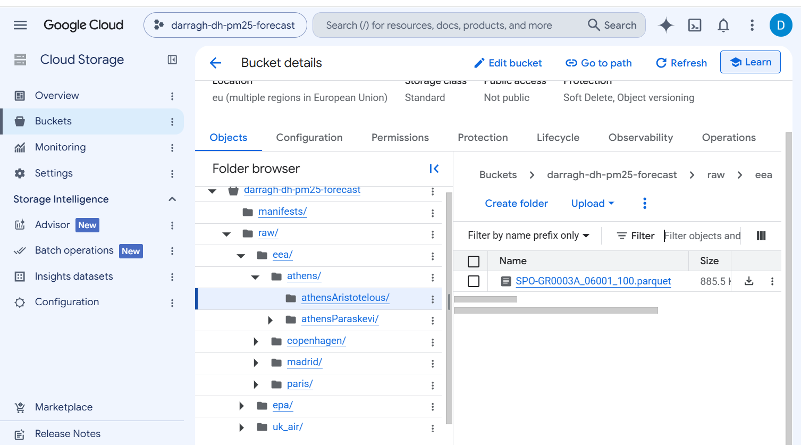
*After running `python src/upload_raw_data.py`: the bucket has been created in the EU multi-region with object versioning, and the raw files are mirrored under `raw/` (shown: `raw/eea/athens/athensAristotelous/`). Only `raw/` and `manifests/` exist at this point.*

---

# 2. Processed Data Storage and File Formats — 1.0 point

Processed data will be stored separately from the raw data in GCS.

The main processed format will be **Apache Parquet**.

Planned structure:

```text
processed/
├── canonical/
│   └── canonical_hourly.parquet
|
├── three_hour/
│   └── three_hour_aggregated.parquet
│
├── features/
│   └── pm25_features.parquet
│
├── scalers/
│   └── scalers.json
│
└── splits/
    ├── train/
    ├── dev/
    ├── test/
    ├── held_out/
    └── future_update/  
```

### Why Parquet?

The project produces structured time-series data with many numerical columns and repeated analytical operations.

Parquet is appropriate because it provides:

- columnar storage;
- efficient analytical reads;
- compression;
- efficient selection of only the columns required for a particular operation;
- compatibility with Pandas, PyArrow, BigQuery and cloud-based analytical workflows.

This is a deliberate choice based on **access pattern**, rather than simply using CSV because it is familiar.

CSV will still be retained where it is the original EPA source format; UK-AIR files stay in their original R data (`.RData`) format.

The distinction between **data type and storage format** is important:

- PM2.5 is numerical time-series data.
- A timestamp represents temporal data.
- These data types can be represented using CSV, Parquet, database tables or other formats.

Therefore, the choice of Parquet is a storage/I/O decision rather than a claim that PM2.5 is itself a "Parquet data type."

### Storing the processed data (`store_preprocessed_data.py`)
 
`src/store_preprocessed_data.py` writes every processed stage to GCS as Parquet, following the structure above: the canonical hourly table, the 3-hour table, the full feature table (every row, with its `split` label) and one file per split (train, dev, test, held_out, future_update). Rows labelled `excluded` stay in the full feature file only. It also uploads `metadata/station_reference.csv`, stops with a clear message if an earlier pipeline stage has not been run, and appends one line to `manifests/dataset_versions.jsonl` (Section 4).
 
```python
# src/store_preprocessed_data.py
SPLIT_TO_FOLDER = {
    "train": "processed/splits/train/train.parquet",
    "dev": "processed/splits/dev/dev.parquet",
    "test": "processed/splits/test/test.parquet",
    "held_out_test": "processed/splits/held_out/held_out_test.parquet",
    "future_update": "processed/splits/future_update/future_update.parquet",
}
 
# excerpt from main()
outputs = []   # one record per uploaded file; becomes the "outputs" list in the manifest
 
# 1. canonical hourly table   2. 3-hour table   (uploaded as they are; only the row count is read)
outputs.append(upload_file(bucket, CANONICAL_PATH, "processed/canonical/canonical_hourly.parquet",
                           rows=len(pd.read_parquet(CANONICAL_PATH, columns=["station_id"]))))
outputs.append(upload_file(bucket, THREE_HOUR_PATH, "processed/three_hour/three_hour_aggregated.parquet",
                           rows=len(pd.read_parquet(THREE_HOUR_PATH, columns=["station_id"]))))
# 3. the full feature table (every row, including excluded ones)
outputs.append(upload_dataframe(bucket, features, "processed/features/pm25_features.parquet"))
# 4. one file per split
for split_name, gcs_path in SPLIT_TO_FOLDER.items():
    subset = features[features["split"] == split_name]
    if subset.empty:
        print(f"No rows for split '{split_name}' - skipping upload.")
        continue
    outputs.append(upload_dataframe(bucket, subset, gcs_path))
# 5. the scaler artefact (fitted on the train split only), stored next to the data it was fitted on
outputs.append(upload_file(bucket, SCALER_PATH, "processed/scalers/scalers.json"))
# 6. the station table that produced this dataset
outputs.append(upload_file(bucket, REFERENCE_PATH, "metadata/station_reference.csv"))
```

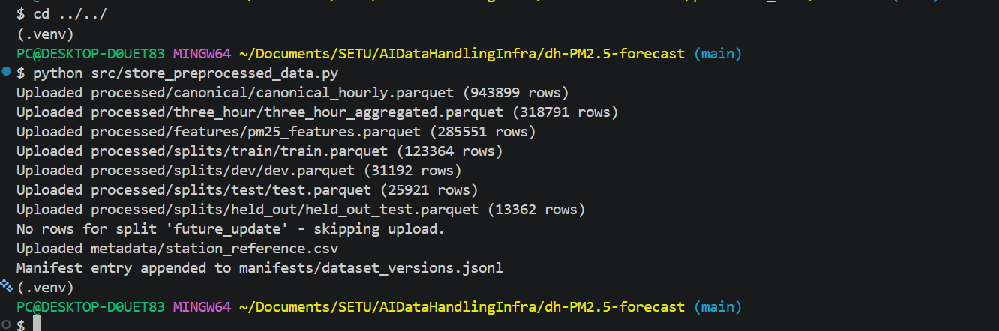
*After running `python src/store_preprocessed_data.py`: each processed stage is uploaded with its row count, `future_update` is skipped because there is no 2026 data yet, and a record is appended to `manifests/dataset_versions.jsonl`.*

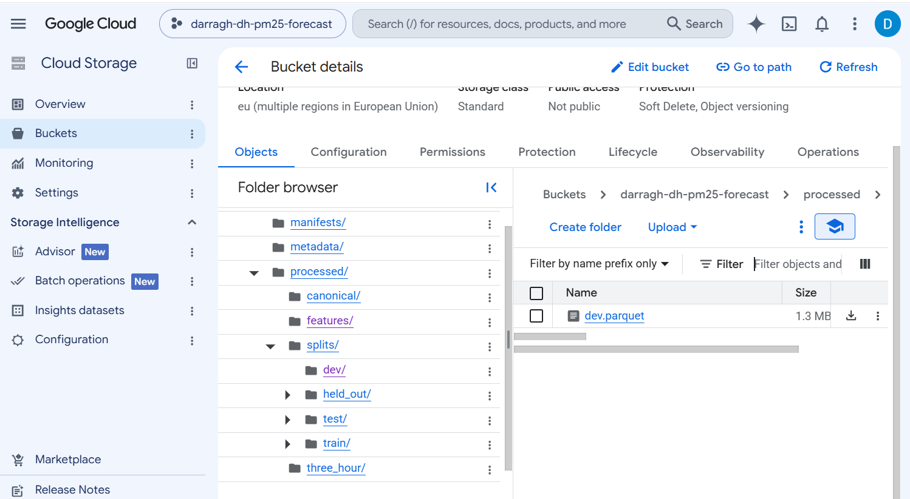
*The bucket after the store step: `processed/` (canonical, features, scalers, splits, three_hour), `manifests/` and `metadata/` now exist (shown: `processed/splits/dev/dev.parquet`).*

---

# 3. Database / Object Storage Decision — 0.5 point

The project will use **multiple complementary storage technologies**, rather than attempting to put everything into one database.

### GCS — authoritative object storage

GCS will store:

- immutable raw data;
- processed Parquet datasets;
- model artifacts;
- manifests and metadata.

This acts as the project's object-storage/data-lake layer.

### BigQuery — analytical layer

BigQuery is considered optional. The main reason for including it would be to demonstrate understanding. 
BigQuery is not required for scalability at the current dataset size. Its potential value is providing a managed SQL analytical layer and demonstrating integration between object storage and a cloud analytical warehouse.

However, the ~319,000 rows in the Parquet files could be analysed more simply with pandas in seconds. The trade-off for implementing BigQuery would be increased setup time, including dataset creation, load jobs, and IAM permissions.

BigQuery may be used where SQL-based exploration and analysis are useful.

A possible dataset is:

```text
pm25_dataset
├── canonical_hourly
├── station_reference
└── three_hour_aggregated
```

BigQuery is useful for:

- aggregation;
- coverage analysis;
- station comparisons;
- data-quality queries;
- exploratory analysis.

The project will **not** treat BigQuery as a replacement for the raw data lake.

BigQuery is not required at this dataset scale, local Parquet queries are sufficient. However, a final decision on whether or not to implement BigQuery will be made later in the project process, based on workload and educational value rather than dataset size alone.

### Why not sharding?

The current dataset is approximately 970,000 hourly observations and is expected to remain manageable as Parquet data for the project's batch-processing workload. Therefore, extensive manual sharding is not initially necessary.

If the dataset or processing workload grows substantially, Parquet partitioning by year, station or another appropriate key can be introduced without changing the raw-data architecture.

### Why not Cloud SQL/PostgreSQL?

The project does not require:

- transactional updates;
- application-level relational transactions;
- complex operational CRUD workloads.

Its main workloads are:

- historical batch ingestion;
- analytical queries;
- feature generation;
- model training.

Therefore, a transactional relational database would add complexity without addressing the project's main access pattern.

### Why not a feature store?

A dedicated feature store is not initially justified because the project is small enough for feature definitions and transformations to be managed in version-controlled pipeline code.

However, the project will explicitly address **training-serving consistency** in M4 by reusing the same feature-generation definitions during training and inference.

---

# 4. Data Versioning — 0.5 point

Environmental datasets can change because sources may publish revised or corrected historical measurements.

Therefore, dataset versioning will be explicit.

Each raw-file manifest entry will contain information such as:

| Field | Origin |
| :--- | :--- |
| **local_path** | The file's path on your machine |
| **gcs_path** | `raw/` plus the path under `raw_data/` |
| **checksum_sha256** | Hash of the file contents, computed before upload |
| **size_bytes** | File size |
| **file_modified_utc** | The file's last-modified time |
| **upload_timestamp_utc** | Time of upload |
| **source** | First folder: `epa`, `uk_air`, or `eea` |
| **pipeline_version** | `config.py` |
| **git_commit** | `config.py` |

These fields are written automatically by `upload_file()` in `upload_raw_data.py`, one JSON line per uploaded file (nothing is typed in by hand). `pipeline_version` and `git_commit` come from `config.py`, which reads the current commit hash and adds `-dirty` if tracked files have uncommitted changes.

The bucket has object versioning on, so a file uploaded again keeps its previous copy; a lifecycle rule then deletes non-current versions after 7 days, so the manifests and checksums, not the old copies, are the lasting record of what was used.

```python
# src/upload_raw_data.py
def upload_file(bucket, local_path: Path, gcs_path: str, checksum: str, commit: str = "unknown") -> dict:
    """Upload one file and return its manifest record (the dict that becomes one JSON line)."""
    bucket.blob(gcs_path).upload_from_filename(str(local_path))
    print(f"Uploaded {local_path} -> gs://{bucket.name}/{gcs_path}")
    return {
        "local_path": str(local_path),
        "gcs_path": f"gs://{bucket.name}/{gcs_path}",
        "checksum_sha256": checksum,
        "size_bytes": local_path.stat().st_size,
        "file_modified_utc": datetime.fromtimestamp(local_path.stat().st_mtime, timezone.utc).isoformat(),
        "upload_timestamp_utc": datetime.now(timezone.utc).isoformat(),
        "pipeline_version": PIPELINE_VERSION,
        "git_commit": commit,
    }
```
 
```python
# src/config.py
def git_commit() -> str:
    """Hash of the code that is running, for the manifests. Gets a "-dirty" suffix
    if tracked files have uncommitted changes, and "unknown" outside a git repo."""
    try:
        # "git rev-parse HEAD" prints the hash of the current commit
        sha = subprocess.run(["git", "rev-parse", "HEAD"], cwd=REPO_ROOT, capture_output=True, text=True, timeout=10)
        if sha.returncode != 0 or not sha.stdout.strip():
            return "unknown"   # not a git repository
        # "status --porcelain" lists modified tracked files; untracked files are ignored,
        # so only uncommitted edits to committed files make the run "dirty"
        changed = subprocess.run(["git", "status", "--porcelain", "--untracked-files=no"], cwd=REPO_ROOT,
                                 capture_output=True, text=True, timeout=10).stdout.strip()
        return sha.stdout.strip() + ("-dirty" if changed else "")
    except Exception:   # git missing or timed out: never let this stop a pipeline run
        return "unknown"
```

Each run of the storage step (store_preprocessed_data.py) appends one line to
manifests/dataset_versions.jsonl, linking the processed dataset to the exact raw data and code that produced it:


| Field | Origin |
| :--- | :--- |
| dataset_run_id | UTC timestamp of the run |
| pipeline_version | config.py |
| preprocessing_version, feature_version | store_preprocessed_data.py |
| git_commit | config.py ("-dirty" if uncommitted changes) |
| raw_data_version | SHA-256 of manifests/raw_files.jsonl |
| station_reference_sha256 | SHA-256 of metadata/station_reference.csv |
| row_counts | Rows per split |
| config | Rolling window, target horizon, minimum valid hours, completeness threshold |
| outputs | Per file written: gcs_path, sha256, size_bytes, rows |
| created_timestamp_utc | Time of the run |

This record is built at the end of `main()` in `store_preprocessed_data.py`. `raw_data_version` is a fingerprint of the raw manifest, so two dataset runs with the same value used exactly the same raw files.

```python
# src/store_preprocessed_data.py
def raw_data_version(bucket):
    """SHA-256 of the raw-file manifest = a fingerprint of exactly which raw files were uploaded."""
    blob = bucket.blob(RAW_MANIFEST)
    if not blob.exists():
        print(f"WARNING: {RAW_MANIFEST} not found - run upload_raw_data.py first; raw_data_version will be null.")
        return None
    return hashlib.sha256(blob.download_as_text().encode("utf-8")).hexdigest()
 
# excerpt from main()
append_manifest_entry(bucket, {
    "dataset_run_id": now.strftime("%Y%m%dT%H%M%SZ"),
    "pipeline_version": PIPELINE_VERSION,
    "preprocessing_version": PREPROCESSING_VERSION,
    "feature_version": FEATURE_VERSION,
    "git_commit": git_commit(),
    "raw_data_version": raw_data_version(bucket),
    "station_reference_sha256": sha256_of_file(REFERENCE_PATH),
    "row_counts": {k: int(v) for k, v in features["split"].value_counts().items()},
    "config": {
        "rolling_window_blocks": ROLLING_WINDOW_BLOCKS,
        "target_horizon_blocks": TARGET_HORIZON_BLOCKS,
        "aggregation_min_valid_hours": MIN_VALID_HOURS,
        "study_start_utc": STUDY_START_UTC.isoformat(),
        "high_value_threshold": HIGH_VALUE_THRESHOLD,
        "completeness_threshold": COMPLETENESS_THRESHOLD,
    },
    "outputs": outputs,
    "created_timestamp_utc": now.isoformat(),
})
```

This provides a lineage relationship such as:

```text
Raw dataset version
        ↓
Preprocessing version
        ↓
Feature dataset version
        ↓
Training run
        ↓
Model version
```

The objective is to be able to answer:

> **Which exact data, preprocessing code and feature definitions produced this model?**

Raw files will not silently be overwritten when a source publishes revised data. Bucket versioning is enabled and each file's checksum is recorded.

---

# 5. Data Access — 1.0 point

The data pipeline will use Python to access the official sources.

### EEA

The EEA Air Quality Download Service will provide European monitoring time-series data and station metadata.

### EPA Ireland

EPA hourly monitoring data will provide Irish monitoring measurements.

### UK-AIR

UK-AIR automatic monitoring files (yearly `.RData` files) will provide measurements for the UK stations.

The ingestion code will use Python tools including:

- `requests`
- `pandas`
- `NumPy`
- `PyArrow`
- Google Cloud Storage client libraries
- BigQuery client libraries (optional)

The ML pipeline will use:

- `scikit-learn`
- `xgboost`
- `torch` (optional)

GCS access will use Google Cloud authentication through service-account/application-default credentials. Credentials will not be embedded in source code.

In the code, the project ID and bucket name are read from environment variables and the storage client uses Application Default Credentials (for example after `gcloud auth application-default login`), so no credential is stored in the repository. If the variables are not set, the scripts stop with a message (`check_gcp_settings()` in `config.py`) instead of using placeholder values.
 
```python
# src/upload_raw_data.py (store_preprocessed_data.py uses the same pattern)
PROJECT_ID = os.environ.get("GCP_PROJECT_ID", "your-gcp-project-id")
BUCKET_NAME = os.environ.get("GCS_BUCKET_NAME", "your-unique-bucket-name")
 
def get_client() -> storage.Client:
    """Storage client for the configured project. Credentials come from Application Default
    Credentials (see the module docstring), never from the code."""
    return storage.Client(project=PROJECT_ID)
```

The project will primarily use **batch processing** for data collection and training-data generation.

This is appropriate because historical data is accumulated and processed in relatively large batches.

The future M4 system can additionally demonstrate new data arriving and triggering a batch update/retraining workflow. Full continuous streaming is not required for the initial training pipeline because the forecasting task does not require online learning at every individual measurement.


## Download scripts

The raw data and the station metadata are fetched by four scripts, run from the repository root:

```
python src/download_ukair.py
python src/download_eea.py
python src/download_epa.py
python src/download_source_metadata.py
```

| Script | Source | Format of the saved files | What it fetches | robots.txt |
|---|---|---|---|---|
| `src/download_ukair.py` | UK-AIR (Defra) | `.RData` (R data file) | the 32 yearly files (4 stations x 2018-2025) from `https://uk-air.defra.gov.uk/openair/R_data/<site>_<year>.RData` (the folder has no index page; for example `BEL2_2024.RData`) | `/datastore/` (the website's CSV files) is disallowed, `/openair/R_data/` is not |
| `src/download_eea.py` | EEA | Parquet | the verified hourly PM2.5 file of each of the 7 stations, through the EEA download API | allows everything |
| `src/download_epa.py` | EPA Ireland (airquality.ie) | CSV | one CSV per 183-day window and station, read from the readings page | no robots.txt |
| `src/download_source_metadata.py` | EEA Air Quality Viewer | CSV | one metadata table per country (6 files) into `metadata/source_metadata/` | no robots.txt |

The three raw-data scripts only write to `raw_data/<source>/<raw_folder>/` (the `raw_folder` column of `metadata/station_reference.csv`; the metadata script writes to `metadata/source_metadata/`), and all four skip files that already exist, retry on errors, write each file through a `.tmp` file so a crash cannot leave a half-written file, pause between requests so the public servers are not hammered, and print a summary (with a non-zero exit code if something failed). The EPA download is the slowest (about 10 minutes in testing); the other two take a few minutes. The upload to GCS stays in `upload_raw_data.py`, which adds the checksum and manifest record. The scripts do not edit what they saved, and the raw files are saved as received; the one exception is EPA, whose script converts the chart data in the page into a CSV because the site offers no CSV file to fetch.

Where the files go:

```text
raw_data/
├── eea/
│   ├── athens/
│   │   ├── athensAristotelous/
│   │   └── athensParaskevi/
│   ├── copenhagen/
│   ├── madrid/
│   │   ├── madridCuatroCaminos/
│   │   └── madridEscuelasAguirre/
│   └── paris/
│       ├── parisGennevilliers/
│       └── parisSaintDenis/
├── epa/
│   ├── cork/
│   ├── dublin/
│   │   ├── dublinKilmainham/
│   │   └── dublinRathmines/
│   ├── galway/
│   ├── limerick/
│   └── waterford/
└── uk_air/
    ├── belfast/
    ├── derry/
    └── london/
        ├── londonBloomsbury/
        └── londonKensington/
```

Each source stores its files differently, so the pipeline identifies the station differently: EPA and UK-AIR files by the folder they sit in (UK-AIR files also by the site name inside them), EEA files by the station code inside the file.

### UK-AIR: why `.RData` files

UK-AIR's `robots.txt` (https://uk-air.defra.gov.uk/robots.txt) contains `Disallow: /datastore/`, and the CSV files offered on the UK-AIR website are stored there. A script that fetched them would ignore that rule, so `download_ukair.py` does not. UK-AIR also publishes the same hourly data as `.RData` files for the R package `openair`, under `/openair/R_data/`, a path `robots.txt` does not disallow. The files are published under the Open Government Licence v3.0.

An `.RData` file is how the statistics language R saves data tables. It is a compressed binary file instead of text, so it cannot be read in a text editor, and Python needs the `rdata` package to open it (it is in `requirements.txt`). Compared with the CSV file of the same station and year on the UK-AIR website:

| | CSV (UK-AIR website) | `.RData` (used by the project) |
|---|---|---|
| Storage | plain text | compressed binary (gzip) R objects |
| Site information | a few lines above the table | `site` and `code` columns in the table |
| Time stamp | text: `dd-mm-yyyy` and `HH:MM`, hour ending, the day's last hour written `24:00` | a number (seconds since 1 January 1970, UTC) that already marks the start of the hour |
| Per-value status (R = ratified, P = provisional) | in columns next to every pollutant | not included |
| Content | one table with all pollutants | several tables (hourly, 15-minute, daily means and others); the hourly one has a single `PM2.5` column |

The pipeline reads only the `.RData` files (`parse_ukair_rdata_file` in `canonicalize_raw_data.py`): the date needs no hour shift and no `24:00` repair, and the site name in each file is checked against the station of the folder.

**Comparison with the CSV files.** While the scripts were being built, the 32 station-years had also been downloaded by hand as CSV files. The two forms were compared with the whole pipeline (scripts 2-6) run once on each. The same station-hours are present and missing, and the pipeline counts are identical. Of the 895,452 PM2.5 values, 711 (0.08%) differ, always by exactly 0.001 ug/m3 and always with the CSV value higher; they occur only at three UK stations (London Bloomsbury 179, Belfast Centre 344, London N. Kensington 188).

**Where the 0.001 comes from (most likely cause, not verified).** Both formats give PM2.5 to three decimals. At an exact tie, such as a true value of 5.8255, the CSV rounds up (5.826) and the R file ends at 5.825, which fits how R stores numbers as binary fractions (5.8255 cannot be stored exactly and is held just below the tie). The unrounded source values are not available, so this could not be confirmed. The effect is 0.001 ug/m3 on 0.08% of values.

```python
# src/download_ukair.py
URL_TEMPLATE = "https://uk-air.defra.gov.uk/openair/R_data/{site}_{year}.RData"

# excerpt from main()
dest = LOCAL_RAW_DIR / st.raw_folder / f"{st.source_download_id}_{year}.RData"
# A year that already exists is skipped.
# RISK: an existing file is never refreshed (see the module docstring).
if dest.exists():
    counts["skipped"] += 1
    continue
```

### EEA

`download_eea.py` calls the EEA download API's `ParquetFile/urls` endpoint (the one behind the EEA web app) with `requests`: one request for the verified PM2.5 files of DK, ES, FR and GR, then it keeps only the files whose name contains one of the project's seven station codes and downloads those. The API ignores date filters, so each file is the station's complete series (Copenhagen's `_100` file, and the Madrid and Paris files, start in 2013). The study period is 2018-2025: `canonicalize_raw_data.py` drops every row before 2018-01-01 UTC (236,261 rows) and prints the count per station. A file is saved only if every row is hourly, so Copenhagen's daily `_103` file and Athens Agia Paraskevi's `_100` file are not saved. Only verified data (dataset E1a) is downloaded.

Tested against files downloaded earlier by hand from the EEA web app: the script found 875 verified PM2.5 files for the four countries and saved the same 8 files, under the same names, and the values and validity flags of every hour that both contain are identical (0 differences in 8 files).

```python
# src/download_eea.py
def is_hourly(content: bytes) -> bool:
    """True if the Parquet file holds only hourly values (its AggType column says "hour" on every row).

    canonicalize_raw_data.py skips daily files and stops on a file that mixes hourly and other rows, so
    files that are not purely hourly are not saved.
    """
    df = pd.read_parquet(io.BytesIO(content), columns=["AggType"])
    return set(df["AggType"].astype(str).str.lower().unique()) == {"hour"}

# excerpt from main(): keep only the files whose name carries one of the project's station codes
mine = [u for u in urls if st.source_download_id in u.split("/")[-1]]
```

### EPA Ireland

The readings page https://airquality.ie/readings is an ordinary page request, for example `https://airquality.ie/readings?station=EPA-21&dateFrom=01+Jan+2022&dateTo=02+Jul+2022`. The server writes the readings straight into the HTML, inside the chart definition (one block per pollutant, with lines such as `[ Date.UTC(2022,0,4,20,0,0), 27 ]`, where JavaScript months start at 0). There is no separate data request, which is why nothing from airquality.ie shows under the browser's Fetch/XHR filter; the chart menu's "Download CSV" builds a CSV in the browser from the same data. `download_epa.py` reads the same series and writes a CSV (a `Date and Time` column and one column per pollutant). The site accepts about six months per request, so the script uses windows of 183 days (for example 1 January to 2 July 2022, then 3 July 2022 to 1 January 2023) and names the files by station and dates (`cork010122-020722.csv`: ddmmyy start, ddmmyy end).

Tested for all six stations (47 windows, 46 saved), and compared with CSV files downloaded earlier by hand from the same page. Read back with the pipeline's parser, the PM2.5 values equal the hand-downloaded files for Cork, Rathmines, Kilmainham, Limerick and Waterford (same hours, no different value). Galway differs by one hour only because the hand-downloaded windows were cut at different dates near the end. Kilmainham's last window (July-December 2025) has no readings: the site answers "No data found for this station and date range", which the script reports and does not save. The script does not write the empty `HH:01:00` padding rows that the browser's CSV contains, and writes missing values as empty cells. The site says its data are not validated.

```python
# src/download_epa.py
WINDOW_DAYS = 183          # days per request (end = start + 182 days)

def windows(start: date, end: date):
    """Yield (window_start, window_end) pairs of WINDOW_DAYS days, from `start` to `end`.

    Windows follow each other with no gap and no overlap; the last one stops at `end`.
    """
    current = start
    while current <= end:
        window_end = min(current + timedelta(days=WINDOW_DAYS - 1), end)
        yield current, window_end
        current = window_end + timedelta(days=1)
```

**Before and after running the scripts.** The screenshots show the folders in the terminal (`ls`) before and after the four download scripts are run.
 

*Before: `ls` inside `raw_data/` prints nothing. The download scripts create the `epa/`, `uk_air/` and `eea/` folders and each station's sub-folder themselves.*
 

*Before: `metadata/source_metadata/` is empty too.*
 

*Running: the four commands from the start of this step are entered as one block, so they run one after another. `download_ukair.py` goes first and prints one `Saved` line per file (shown: `raw_data/uk_air/belfast/BEL2_2018.RData` to `BEL2_2021.RData`).*
 

*After: `raw_data/epa/cork/` holds the eight Cork CSV files created by `download_epa.py`, one per 183-day window. Each name is the station folder plus the window's start and end dates (for example `cork010122-020722.csv` covers 1 January to 2 July 2022).*
 

*After: `metadata/source_metadata/` holds the six EEA metadata tables written by `download_source_metadata.py`: `denmark.csv`, `france.csv`, `greece.csv`, `ireland.csv`, `spain.csv` and `uk.csv`.*

### Station metadata

`download_source_metadata.py` sends the request that the EEA Air Quality Viewer's "Download CSV" button sends (https://discomap.eea.europa.eu/App/AQViewer/index.html?fqn=Airquality_Dissem.b2g.measurements). The page posts the chosen Country filter to `.../AQViewer/download?fqn=Airquality_Dissem.b2g.measurements&f=csv` and the server answers with a zip file holding `DataExtract.csv`. The script does this for Denmark, Spain, France, the United Kingdom, Greece and Ireland (the countries of `station_reference.csv`) and saves each table, unchanged, as `metadata/source_metadata/<country>.csv` (`uk.csv` for the United Kingdom). These tables are where the station IDs, coordinates and station types in `station_reference.csv` come from; no pipeline script reads them. Like the raw data, they are not committed to git (`metadata/source_metadata/` is in `.gitignore`); the script downloads them.

Tested against the files saved from the viewer by hand: `denmark.csv` and `greece.csv` are byte-for-byte identical. The other four are larger or updated: with only the Country filter the viewer returns every row (for example Spain is about 18 MB, because it includes every pollutant; the hand-saved file had been narrowed to PM2.5), and `uk.csv` has the same 11,742 rows with different text in 994 rows of two columns (Measurement Equipment and Sampling Method). For all 17 stations the PM2.5 latitude and longitude in the new tables equal those in `station_reference.csv`.

### Source notes

**Timestamps.** EEA hourly files are converted to UTC+1 for every country, while EEA daily files are not. EPA files are hour-ending (inferred from the data, not documented), so the pipeline shifts them back one hour. UK-AIR's `.RData` files already label the start of the hour in UTC, so nothing is shifted.

**EEA station codes and metadata.** The Parquet files contain no station names, only a sampling-point code. For Denmark, France and Greece it contains the EU id (SPO-DK0034A_06001_104 is Copenhagen, DK0034A). The Spanish files use Spain's national code instead (SP_28079038_9_47 is Cuatro Caminos, ES1525A). Section 9 lists both codes.  For any new cities or stations added you will need to figure out the station id yourself. The full mapping is in metadata/station_reference.csv (columns station_id and source_download_id).

You can find the full EEA metadata and filter by country here https://discomap.eea.europa.eu/App/AQViewer/index.html?fqn=Airquality_Dissem.b2g.measurements to find its unique id under EoI code and Nat code. This metadata also displays latitude/longitude and other relevant info and can be downloaded into CSV files. 
Even for station data downloaded from UKAir and EPA Ireland, it is recommended to download the EEA metadata CSV for the relevant country to get a consistent EU station id for each station, as well as other important metadata. This is due to its metadata generally being more complete and clear than EPA Ireland/AirQuality.ie in particular.

Alternatively this metadata can be found by checking each station in the city on this interactive map - https://www.eea.europa.eu/en/analysis/maps-and-charts/index . Click on the dot and then Show details. Beside the station name will be its unique EEA id. You can find longitude/latitude by clicking view station location which will bring you to its exact location on Google Maps.

**EPA Ireland.** Note: Irish stations have only two years of training data (2022–2023), providing substantially less temporal depth for time-aware cross-validation than the non-Irish stations. This is a known limitation caused by the lack of earlier hourly PM2.5 data for the selected Irish stations. The effect of this limitation on model performance will be evaluated empirically. 

You can find the easting/northing for each station at the bottom of the station page, e.g. https://airquality.ie/station/EPA-59 . This will need to be converted to latitude/longitude. Recommended to simply use the EEA metadata instead.

**What was tested.** Each script was run against the live source and compared with files downloaded earlier by hand (above). Run from an empty `raw_data/` folder (the download scripts create the folders), the pipeline reproduces the numbers in this document. The scripts have not been run for 2026 data (reserved for Milestone 4).

---

## Timestamp conventions used by the pipeline:

| Source | Label | Time zone | Action |
| :--- | :--- | :--- | :--- |
| EEA hourly | interval start | UTC+1 (EEA converts) | −1 h |
| UK-AIR (`.RData`) | interval start | UTC | none |
| EPA | hour ending | UTC (both inferred) | −1 h |

---

# 6. Data Split / Validation Strategy — 2.0 points

This is one of the most important design decisions because the project uses **time-series data**.

A random train/test split is inappropriate because it could allow future observations to influence model development.

## Primary chronological split

```text
2018 ─────────────── 2023 | 2024 | 2025 | 2026
          TRAIN             DEV    TEST   UPDATE
```
Note: Train split is 2022-2023 for Irish stations.

### Training: 2018–2023 (2022-2023 for Irish stations)

Used for fitting model parameters.

Time-aware cross-validation may be performed inside this period for model/hyperparameter development.

### Development: 2024

Used for:

- comparing models;
- tuning hyperparameters;
- selecting features;
- early stopping;
- model-development decisions.

### Final test: 2025

The 2025 test set remains untouched until final evaluation.

It must not be used to decide:

- which model to use;
- which XGBoost hyperparameters to use;
- which feature set to use;
- how many neural-network layers to use.

### 2026 future-data demonstration

2026 is deliberately reserved for M4.

It represents newly arriving data and allows the project to demonstrate:

```text
New data
   ↓
Updated dataset
   ↓
Retraining
   ↓
Model v2
   ↓
Comparison with Model v1
```

This follows the lecture principle that a project should not immediately consume every available observation and then claim to simulate future data.

The approximate split will be:
- Non-Irish stations: 75% Training for years 2018-2023, 12.5% Development/Validation for year 2024, and 12.5% Test for year 2025. 
- Irish stations: 50% Training for years 2022-2023, 25% Development/Validation for year 2024, and 25% Test for year 2025.

---

## Geographic holdout

Three cities are held out:

- Derry
- London
- Paris

These cities are excluded from training and model selection. The 2025 observations from these stations will be used to evaluate generalisation to unseen cities.

This creates a second evaluation dimension:

```text
Temporal generalisation:
known cities → later years

Spatial generalisation:
known cities → completely unseen cities
```

The held-out cities must remain unseen across **all source systems**. The held-out cities must remain excluded from model development regardless of source.

---

## Cross-validation

Ordinary random k-fold cross-validation across the entire dataset will not be used.

If cross-validation is required, it will be **time-aware and restricted to the training period**.

The 2024 development set and 2025 final test set remain outside this process.

---

## Leakage prevention

The pipeline for learned preprocessing explicitly follows:

**Split → fit learned preprocessing on training data → transform other datasets**

rather than:

**Full dataset → preprocessing → split**

This applies to operations such as:

- numerical scaling;
- categorical encoding;
- learned feature transformations;
- hyperparameter selection.

For time-series features:

- lag features use only historical observations;
- rolling features use only historical observations;
- target observations cannot enter feature calculations;
- future measurements cannot be used to construct past features.

**Deterministic vs Learned preprocessing:**

Deterministic preprocessing, such as timestamp parsing, unit standardisation, station-ID mapping, duplicate detection, and fixed 3-hour aggregation rules, can be applied before the split because it does not learn parameters from the full dataset.

Learned preprocessing, such as feature scaling, imputation parameters, normalisation, or dimensionality reduction, must be fitted using the training data only and then applied unchanged to the development and test data.

### Split implementation (`create_splits.py`)
 
`src/create_splits.py` reads the feature table and gives every row a `split` label: `train`, `dev`, `test`, `held_out_test`, `future_update` or `excluded`.
 
- **Time:** the calendar year of a row decides its period (2024 = dev, 2025 = test, 2026 = future_update). Training starts in each station's first available year, taken from `availability_start` in `metadata/station_reference.csv` (never before 2018), which is how the Irish stations start in 2022 without a special rule.
- **Boundaries:** a row is only labelled if its input block and its target block (six hours later) fall in the same period. A row whose input is in late December 2023 but whose target is in January 2024 is `excluded`, so no training label comes from the development year. New Year inside the training period is not a boundary.
- **Place:** stations in `HELD_OUT_STATIONS` never enter train, dev or test. Their 2025 rows become `held_out_test` and all their other rows are `excluded`.
- **Safety checks:** the script stops if a held-out code is not in `station_reference.csv` (a typo), if a held-out station is missing from the feature table or has no 2025 rows, or if any held-out row ends up in train, dev or test.

```python
# src/create_splits.py
HELD_OUT_STATIONS = {
    "GB1060A",  # Derry Rosemount
    "GB0566A",  # London Bloomsbury
    "GB0620A",  # London N. Kensington
    "FR04002",  # Paris Gennevilliers
    "FR04058",  # Paris Saint-Denis
}
 
def period_of(year: pd.Series, train_start_year: pd.Series) -> pd.Series:
    """Which period a calendar year belongs to, for a given station."""
    # np.select takes the FIRST condition that is true: 2026+ is "future", then 2025 "test", then 2024 "dev";
    # any earlier year from the station's own start year onwards is "train"; older years are "before_study"
    return pd.Series(np.select(
        [year >= FUTURE_UPDATE_START_YEAR, year == TEST_YEAR, year == DEV_YEAR, year >= train_start_year],
        ["future", "test", "dev", "train"], default="before_study"), index=year.index)
 
def assign_splits(df: pd.DataFrame, train_start_year: pd.Series) -> pd.Series:
    """Return the split label of every row (the rules are in the module docstring)."""
    in_period = period_of(df["block_start_utc"].dt.year, train_start_year)           # period of the input block
    target_period = period_of(df["target_block_start_utc"].dt.year, train_start_year)  # period of the block predicted
    same_period = in_period == target_period  # False only for rows straddling a split boundary
    is_held_out = df["station_id"].isin(HELD_OUT_STATIONS)
 
    # np.select takes the FIRST condition that is true, so the ORDER below matters.
    conditions = [
        same_period & (in_period == "future"),                  # 2026 rows: kept for the update demo
        same_period & is_held_out & (in_period == "test"),      # an unseen city's 2025 rows: the unseen-city test
        is_held_out,                                            # every other row of an unseen city: unused
        same_period & (in_period == "test"),
        same_period & (in_period == "dev"),
        same_period & (in_period == "train"),
    ]
    choices = ["future_update", "held_out_test", "excluded", "test", "dev", "train"]
    # a row matching nothing (before the study, or input and target in different periods) is "excluded"
    return pd.Series(np.select(conditions, choices, default="excluded"), index=df.index)
```

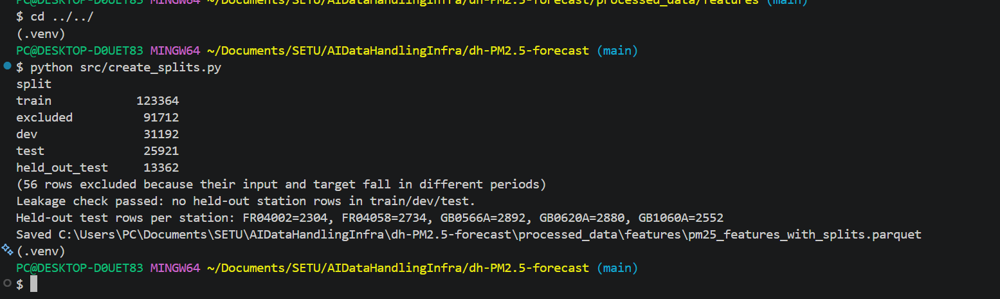
*After running `python src/create_splits.py`: rows per split (train 123,364; dev 31,192; test 25,944; held_out_test 13,362; excluded 91,712), the leakage check, and the held-out test rows per station.*

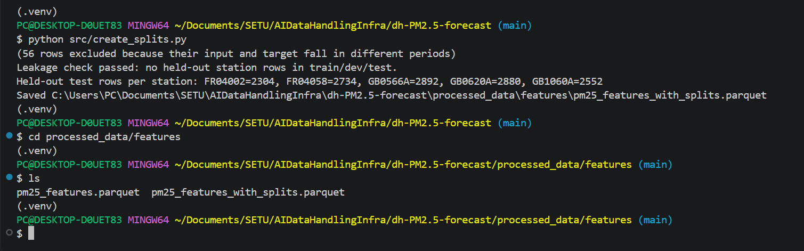
*`create_splits.py` saves `pm25_features_with_splits.parquet` next to `pm25_features.parquet`: the same rows plus a `split` column.*

---

# 7. Feature Description — 1.0 point

The initial candidate feature set is:

| **Variable** | **Definition** | **Type / Notes** |
|---|---|---|
| `pm25_current` | Mean PM2.5 of the input block, the 3-hour block that has just completed when the forecast is made | Continuous, µg/m³
| `pm25_lag_1` | Mean PM2.5 of the block immediately before the input block | Continuous, µg/m³
| `pm25_lag_2` | Mean PM2.5 two blocks before the input block | Continuous, µg/m³
| `pm25_lag_3` | Mean PM2.5 three blocks before the input block | Continuous, µg/m³
| `pm25_rolling_mean` | Recent historical mean PM2.5 | Continuous; historical observations only |
| `pm25_rolling_std` | Recent historical PM2.5 variability | Continuous; historical observations only |
| `time_block` | 3-hour period within the day, derived from station-local time (time zone in station_reference.csv) | Categorical/integer, 0–7 |
| `day_of_week` | Day of week | Categorical/integer |
| `month` | Calendar month | Categorical/integer |
| `season` | Meteorological season | Categorical |
| `city` | City containing the station | Categorical/metadata |
| `country` | Country containing the station | Categorical |
| `latitude` | Monitoring-station latitude | Continuous |
| `longitude` | Monitoring-station longitude | Continuous |
| `target_pm25` | Mean PM2.5 6 hours ahead | Continuous target |

The features are deliberately based primarily on **historical PM2.5 and time/station information**.

Weather variables are excluded from the initial system to keep the first version focused on the predictive information contained in the monitoring data itself.

PM10, NO2 and O3 are also excluded from the initial model.

### Important consideration: station/city identity

A station ID may be useful for predicting known stations but could allow a model to memorise location-specific behaviour.

Because unseen-city generalisation is a core research question, station and city identifiers will be treated carefully.

Milestone 2 decided this from the evidence: station identity explains 15% of the variance of a 3-hour mean (city 12%, country 11%), so place is not the main driver. The baseline model leaves `station_id`, `city`, `country`, latitude and longitude out; latitude, longitude and country are a named ablation validated by leaving whole cities out.

Latitude and longitude are potentially more appropriate for a model intended to generalise to unseen locations.

### How `time_block` works, and what models use instead

Blocks are fixed 3-hour windows on the UTC clock, starting at 00, 03, ... 21 UTC. `local_timestamp` is the block's start time converted to the station's time zone, and `time_block` is the local hour of that start divided by 3, rounded down. It names the 3-hour bin of the local clock in which the block *starts*, not the window the block covers. For the UTC block 00:00-03:00:

| Station | Winter | Summer |
|---|---|---|
| Madrid (UTC+1 / +2) | starts 01:00, label 0 (covers 01:00-04:00) | starts 02:00, label 0 |
| Dublin (UTC+0 / +1) | starts 00:00, label 0 | starts 01:00, label 0 |
| Athens (UTC+2 / +3) | starts 02:00, label 0 | starts 03:00, **label 1** |

The label is stable all year except at Athens, where a one-hour shift moves the block start across a bin edge, so every Athens block changes label between winter and summer (24.7% of training and development rows; `check_time_labels.py`). The description "0 = 00:00-02:59" is exactly true only when a station's UTC offset is a multiple of 3 hours.

For models, Milestone 2 uses the sine and cosine of the local hour (at the block midpoint) and of the month, built from `local_timestamp`, and drops `season` (it repeats the month). A sine and cosine pair places the time of day on a 24-hour clock face, so 23:00 and 01:00 are close and midnight is not a jump. A one-hot encoding of the label would inherit the Athens flip, and moving the edges of the three-hour bins only moves the problem to other stations (reasoning; only the Athens case is measured). The cost is readability, which is why the 0-7 label stays in the data for tables and plots. The choice is a judgement and is tested in Milestone 3 against a one-hot encoding of the UTC block and against no time features.

### Feature extraction code (`feature_extraction.py`)
 
`src/feature_extraction.py` builds the feature table from the 3-hour data. Feature extraction is an optional step for the milestone, but it is included because the features and the 6-hour-ahead target are what the splits label (`create_splits.py` needs the `target_block_start_utc` column created here).
 
1. Each station is first placed on a complete 3-hour UTC grid (`ensure_full_grid()`), so a missing block is a visible gap rather than silently joining two distant blocks.
2. The time features are derived from each station's local time (`add_temporal_features()`).
3. The current block, three lags, rolling mean and standard deviation, and the target are added (`add_lag_rolling_and_target()`). The rolling window is 8 blocks (24 hours, including the input block) and the target is 2 blocks (6 hours) ahead.
Rows without a full history or a valid target are dropped; nothing is imputed.
 
```python
# src/feature_extraction.py
ROLLING_WINDOW_BLOCKS = 8   # 8 x 3h = 24h of history, including the current block
TARGET_HORIZON_BLOCKS = 2   # 2 x 3h = 6h ahead
 
def add_temporal_features(df: pd.DataFrame) -> pd.DataFrame:
    """time_block / day_of_week / month / season from each station's LOCAL time."""
    parts = []
    for tz_name, group in df.groupby("timezone"):   # one timezone at a time (each station has its own local time)
        g = group.copy()
        # drop tz info after converting: mixing several tz-aware zones in one
        # column would collapse it to dtype 'object' and break .dt below
        g["local_timestamp"] = g["block_start_utc"].dt.tz_convert(tz_name).dt.tz_localize(None)
        parts.append(g)
    df = pd.concat(parts).sort_index()   # join the per-timezone pieces back together
 
    df["time_block"] = df["local_timestamp"].dt.hour // 3   # 0 = 00:00-02:59 local ... 7 = 21:00-23:59
    df["day_of_week"] = df["local_timestamp"].dt.dayofweek  # 0 = Monday ... 6 = Sunday
    df["month"] = df["local_timestamp"].dt.month            # 1-12
    # meteorological seasons: Dec-Feb winter, Mar-May spring, Jun-Aug summer, Sep-Nov autumn
    season_map = {12: "winter", 1: "winter", 2: "winter", 3: "spring", 4: "spring", 5: "spring",
                  6: "summer", 7: "summer", 8: "summer", 9: "autumn", 10: "autumn", 11: "autumn"}
    df["season"] = df["month"].map(season_map)
    return df
 
def add_lag_rolling_and_target(df: pd.DataFrame) -> pd.DataFrame:
    """Add, per station: the current block, 3 lags, a 24-hour rolling mean and std, and the target.
 
    Relies on the gap-free grid from ensure_full_grid(), so a shift of N rows is exactly N blocks.
    """
    df = df.sort_values(["station_id", "block_start_utc"])   # time order within each station
    df["pm25_current"] = df["pm25_3h_mean"]   # the block that has just finished: known when the forecast is made
    # each station's own series, so a lag never reaches from one station into another
    grouped = df.groupby("station_id")["pm25_3h_mean"]
 
    for k in (1, 2, 3):
        df[f"pm25_lag_{k}"] = grouped.shift(k)   # the value k blocks (3k hours) earlier
    # mean / std of the last 8 blocks including this one; min_periods=8 gives NaN unless all 8 blocks have a value
    df["pm25_rolling_mean"] = grouped.transform(
        lambda s: s.rolling(ROLLING_WINDOW_BLOCKS, min_periods=ROLLING_WINDOW_BLOCKS).mean())
    df["pm25_rolling_std"] = grouped.transform(
        lambda s: s.rolling(ROLLING_WINDOW_BLOCKS, min_periods=ROLLING_WINDOW_BLOCKS).std())
 
    # the grid is gap-free, so shifting by N rows is exactly N blocks
    df["target_pm25"] = grouped.shift(-TARGET_HORIZON_BLOCKS)   # the value 2 blocks (6 h) LATER: what the model predicts
    df["target_block_start_utc"] = df["block_start_utc"] + pd.Timedelta(hours=3 * TARGET_HORIZON_BLOCKS)
    return df
```

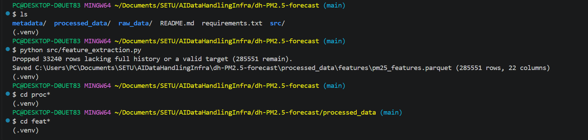
*After running `python src/feature_extraction.py`: 33,234 rows without a full history or a valid target are dropped, leaving 285,574 feature rows.*

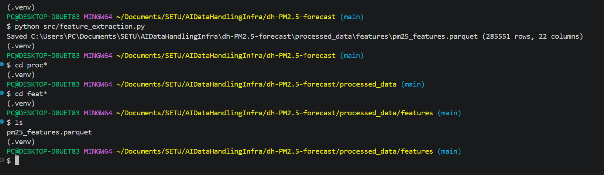
*`processed_data/features/pm25_features.parquet` (285,574 rows, 22 columns) is created.*

---

# 8. Data Types and Formats — 0.5 point

The project contains several types of structured/time-series data.

| **Data** | **Type** | **Example representation** |
|---|---|---|
| PM2.5 | Continuous numerical | `float32`/`float64` |
| Latitude/longitude | Continuous numerical | `float32`/`float64` |
| Time block | Discrete/categorical | integer 0–7 |
| Day of week | Categorical/discrete | integer/category |
| Month | Categorical/discrete | integer/category |
| Season | Categorical | string/category |
| City/country | Categorical | string/category |
| Station ID | Identifier | string |
| Timestamp | Time-series/time data | timezone-aware datetime |
| Valid Hours | Discrete numerical | integer 0-3 |
| Raw EPA data | Structured tabular | CSV |
| Raw UK-AIR data | Structured tabular | RData (R data file) |
| Raw EEA data | Structured time-series | Parquet |
| Processed data | Structured time-series | Parquet |
| Collection manifest | Semi-structured metadata | JSONL |
| Model configuration | Semi-structured metadata | JSON/YAML |

This distinction is important: **data type and storage format are not the same thing**.

For example, PM2.5 is numerical time-series data, while Parquet is a storage format used to represent that data efficiently.

---

# 9. Reproducibility of Data Collection — 1.0 point

Data collection is automated through version-controlled Python download scripts: one per source for the raw data, and one for the station metadata (Section 5, "Download scripts").

The collection configuration will specify:

- source;
- URL/API endpoint;
- country;
- city;
- station;
- pollutant;
- start date;
- end date;
- source-specific parameters.

The current collection scope is:

### EPA Ireland

Provisional/unvalidated Irish PM2.5 data for:
- Kilmainham, Dublin (missing data between 30 Jan 2025 and 3 Jan 2026)
- Rathmines, Dublin
- University College Cork
- Briarhill, Co. Galway (located slightly outside Galway city with data available from December 2022 onwards)
- People's Park, Limerick
- Paddy Browne's Road, Waterford

**2022–2025**

Validated data would have been preferred, however there was only validated daily data for 5 of the 6 stations (2018-2021) and no hourly data. Unvalidated provisional data was chosen as it is readily available from approximately January 2022 onwards for all selected stations except Briarhill, Co. Galway which begins in December 2022. This choice was simply due to a lack of available verified data. EPA remains the main authority on Air Pollution levels in Ireland. These measurements are treated as provisional/unvalidated and will be subject to additional data-quality checks during M2. 

If it is determined later that the 2022-2023 Training data for Irish stations is not sufficient to accurately train our model, the daily data may be used, though this is unlikely. A more plausible potential use of the daily data could be for validation by comparing daily means of the EPA hourly readings with the validated daily values.

### UK-AIR

PM2.5 data for:

- Belfast Centre
- Derry
- London Bloomsbury
- London N. Kensington

**2018–2025**

### EEA

PM2.5 data for:

- Agia Paraskevi, Athens - EEA id: GR0039A
- Aristotelous, Athens - EEA id: GR0003A
- Copenhagen - EEA id: DK0034A (no hourly data for 2025)
- Cuatro Caminos, Madrid - EEA id: ES1525A (Parquet code: 28079038)
- Escuelas Aguirre, Madrid - EEA id: ES0118A (Parquet code: 28079008)
- Gennevilliers, Paris - EEA id: FR04002
- Saint-Denis, Paris - EEA id: FR04058

**2018–2025**

The EEA download API ignores date filters, so the downloaded files hold each station's complete series (from 2013 for most stations, to the end of 2025). 2018–2025 is the study period: `canonicalize_raw_data.py` drops the 236,261 rows before 2018-01-01 UTC, so nothing later in the pipeline sees them.

Exact station candidates were initially chosen by manual analysis of their suitability based on a combination of location, prioritising large cities, and sufficient available historical data. This decision was initially made prior to ingestion. After analysing the files, it was determined that Milan's 2 stations, London Westminster, and Athens Lykovrisi were lacking the required data to make them viable candidates. Thus, they were replaced by 2 Madrid stations, London N. Kensington, and Athens Aristotelous. All other original candidates were retained.

Every collection run (each run of upload_raw_data.py) records:

- local_path;
- gcs_path;
- checksum_sha256;
- size_bytes;
- file_modified_utc;
- upload_timestamp_utc;
- source;
- pipeline_version;
- git_commit;

This means another student can rerun the collection code using the documented configuration and identify exactly which source files were used.

Collection is fully scripted: the files saved by the download scripts (Section 5) are placed under `raw_data/<source>/<raw_folder>/` (the `raw_folder` column of `metadata/station_reference.csv`) and uploaded by `upload_raw_data.py` (Section 1), which writes the manifest record above. `metadata/station_reference.csv` also holds the station selection listed above in machine-readable form and is read by every pipeline script (Section 10, Station mapping).

The download scripts save each file as received, never edit an existing file and skip files that already exist. The one exception to "as received" is EPA: its script converts the chart data in the page into a CSV, because the site offers no CSV file to fetch.

A requirements.txt file will also be included to streamline and simplify any necessary installations. Note that torch and google-cloud-bigquery will be included in requirements.txt, even though the decision has not yet been made on whether these will be implemented. They are currently commented out for this reason as are some M4 requirements.

---

# 10. Reproducibility of Preprocessing — 1.5 points

The preprocessing pipeline will be implemented as version-controlled code and will transform the immutable raw data into the canonical and model-ready datasets.

The sequence is:

```text
Official raw files (downloaded by the download scripts and stored unchanged in GCS)
        ↓
Parse source-specific formats
        ↓
Standardise column names / units / timestamps
        ↓
Match files to stations
        ↓
Detect duplicates/conflicting records
        ↓
Apply source quality rules
        ↓
Drop rows before 2018 and apply the above-500 rule
        ↓
Calculate station/year coverage (reports only)
        ↓
Aggregate hourly → 3-hour measurements
        ↓
Construct 6-hour-ahead target
        ↓
Create historical lag features
        ↓
Create historical rolling features
        ↓
Create temporal features
        ↓
Add station/geographical features
        ↓
Create chronological/geographical splits
        ↓
Fit scalers on the train split only
        ↓
Write versioned Parquet datasets
```

### Code overview and run order
 
Step 1 (downloading) is done by the download scripts (Section 5). After them, the scripts in `src/` run in this order:
 
| Order | Script | What it does | Why it is included |
|---|---|---|---|
| 1 | `upload_raw_data.py` | Uploads the raw files to GCS and records the raw manifest | **Required: moves the raw data into storage** (Section 1) |
| 2 | `canonicalize_raw_data.py` | Parses the EPA, UK-AIR and EEA files into one hourly table keyed by `station_id` with UTC timestamps, drops rows before 2018 and applies the above-500 rule | The splits and stored datasets are built from its output, and it holds the timestamp and quality rules (this section) |
| 3 | `validate_data_quality.py` | Writes completeness, duplicate and value-sanity reports | Data-quality checks, kept and documented as part of the work done (Missing observations) |
| 4 | `aggregate_to_3hour.py` | Hourly to 3-hour mean blocks | The target and features are defined on these blocks (Aggregation) |
| 5 | `feature_extraction.py` | Lag, rolling and temporal features and the 6-hour-ahead target | The splits label its output (Section 7) |
| 6 | `create_splits.py` | Labels each row train / dev / test / held-out / future | **Required: train/dev/test split** (Section 6) |
| 6b | `fit_scalers.py` | Fits the scalers on the train split only and saves them | The artefact that models apply unchanged to dev, test and held-out rows (Feature preprocessing) |
| 7 | `store_preprocessed_data.py` | Writes all processed stages (and the scaler artefact) to GCS and the dataset manifest | **Required: stores the preprocessed data** (Section 2) |
 
The scripts marked **Required** are the ones the milestone asks for. The others are included because the required scripts depend on their output (the split can only label features, and features can only be built from cleaned 3-hour data) and because data validation is part of the work that was done; leaving them out would make the project impossible to reproduce.
 
Supporting files: `config.py` (folder paths, pipeline version, git commit; used by every script), `stations.py` (loads and validates `metadata/station_reference.csv`), `analysis_helpers.py` (shared code of the evidence and EDA scripts, see the Setup Guide) and `requirements.txt`.
 
To run the pipeline from the repository root (steps 1 and 7 need `GCP_PROJECT_ID` and `GCS_BUCKET_NAME` set as environment variables and Google Cloud application-default credentials):
 
```
python src/download_ukair.py
python src/download_eea.py
python src/download_epa.py
python src/download_source_metadata.py
python src/upload_raw_data.py
python src/canonicalize_raw_data.py
python src/validate_data_quality.py
python src/aggregate_to_3hour.py
python src/feature_extraction.py
python src/create_splits.py
python src/fit_scalers.py
python src/store_preprocessed_data.py
```

## Station mapping

Every station is keyed on its EU code (station_id) in metadata/station_reference.csv.

Station mapping will contain:

```text
station_id (EU id)
station_name
city
country
timezone
latitude
longitude
source
source_download_id
raw_folder
uk_air_internal_id
source_name_check
availability_start
coordinates_source
```

Station identity is handled by two small files: `metadata/station_reference.csv` (the table above) and `src/stations.py`, which loads it and stops with a complete list of problems if it is malformed (duplicate IDs, blank fields, unknown time zones, overlapping folders and so on). EPA and UK-AIR files do not contain the EU code, so `canonicalize_raw_data.py` matches each file to its station through the `raw_folder` column; EEA files are identified by the station code inside the file (`source_download_id`).
 
```python
# excerpt from load_station_reference() in src/stations.py
folders = raw.assign(raw_folder=raw["raw_folder"].str.replace("\\", "/", regex=False).str.strip("/ "))
for source, grp in folders.groupby("source"):
    pairs = list(zip(grp["station_id"], grp["raw_folder"]))
    for a_id, a in pairs:
        for b_id, b in pairs:
            if a_id != b_id and (a == b or b.startswith(a + "/")):
                problems.append(f"{source}: raw_folder {a!r} ({a_id}) overlaps {b!r} ({b_id}) - "
                                f"each station needs its own non-nested folder")
```
 
```python
# src/canonicalize_raw_data.py
def station_for_folder(file_path: Path, source_dir: Path, folders: "pd.Series"):
    """Which station's raw_folder contains this file? (None if none does.)
    `folders` maps station_id -> raw_folder (relative to source_dir, '/' separated)."""
    rel = file_path.relative_to(source_dir).parent.as_posix()   # the file's folder, relative to raw_data/<source>/
    rel = "" if rel == "." else rel                             # a file directly in the source folder has no sub-folder
    # a file belongs to a station if its folder IS that station's raw_folder or sits inside it
    hits = [sid for sid, folder in folders.items() if rel == folder or rel.startswith(folder + "/")]
    return hits[0] if len(hits) == 1 else None   # exactly one match, otherwise the caller reports the file
```

---

## Time standardisation

Source timestamps will be converted into a consistent time representation before temporal aggregation.

Time-zone handling will be explicitly recorded because the project uses measurements from multiple countries.
Source timestamps will be preserved exactly as provided in the raw data. EEA hourly data is preserved in UTC+1. During canonicalisation, the timestamp convention and timezone/offset associated with each source will be recorded. A consistent timezone representation will then be used for temporal alignment and aggregation, with daylight-saving transitions handled explicitly.

In `canonicalize_raw_data.py` every source is converted to the same convention: hourly timestamps in UTC, labelled by the start of the hour. EPA files are labelled by the end of the hour and EEA hourly files are labelled in UTC+1, so one hour is subtracted in each case. UK-AIR's `.RData` files already label the start of the hour in UTC (the date is a number of seconds since 1970), so nothing is subtracted.

```python
# src/canonicalize_raw_data.py
# Timestamp conventions. A row stamped 09:00 under "hour ending" covers
# 08:00-09:00; we shift to interval-START so all sources match.
# UK-AIR (.RData): the date is already UTC and labels the START of the hour, so there is nothing to shift.
EPA_TIMESTAMPS_ARE_HOUR_ENDING = True    # INFERRED, not documented: files start each day at 01:00.
#   Could be confirmed by comparing with validated EEA data for the same station.
# EEA: Start/End bound each hour (already interval-start) but the service
# labels them UTC+1 for every country, so we subtract 1h to reach true UTC.
EEA_LABEL_UTC_OFFSET_HOURS = 1

# excerpt from parse_ukair_rdata_file()
# the date is seconds since 1970 in UTC; a different type means the file format has changed
if not pd.api.types.is_numeric_dtype(df["date"]):
    raise ValueError(f"{path}: the 'date' column is {df['date'].dtype}, expected seconds since 1970.")
out = pd.DataFrame({"timestamp_utc": pd.to_datetime(df["date"], unit="s", utc=True),
                    "pm25": pd.to_numeric(df["PM2.5"], errors="coerce"),
                    "sampling_point": path.name})
```

---

## Missing observations

Monitoring stations may have:

- missing hours;
- outages;
- incomplete days;
- station changes;
- provisional observations;
- revised observations.

Some obvious patterns have already been identified by an initial analysis of the data. This is why the initial proposals of 2 Milan stations, London Westminster, and Athens Lykovrisi were rejected and replaced with 2 Madrid stations, London N. Kensington, and Athens Aristotelous. These observations will be analysed and scrutinised more thoroughly during M2.

An initial target of approximately 75% valid PM2.5 coverage per year will be used as a data-quality criterion. This is a predefined quality target rather than a result of the model evaluation.

A block is valid with at least 2 of 3 hourly values. A feature row needs the input block, all 3 lags, all 8 rolling blocks and the target to be valid with nothing imputed. The 75% figure is a diagnostic. Failing station-years are flagged, not removed.

**Why the data are missing.** The evidence supports one statement: the missing hours are not scattered at random (so "missing completely at random" does not describe them); they come in long outages of a whole station, so whether a value is missing depends on the station and the period, both of which are observed, which is the pattern called "missing at random given station and time". A plausible but untested explanation is a monitor failing or being serviced independently of the air quality. What the data cannot show is whether missingness also depends on the concentration itself ("missing not at random", for example a monitor failing during a pollution episode), because the missing values were never observed. The consequence is that scores computed on complete rows describe the times when stations were running.

These rules are implemented in two places. `canonicalize_raw_data.py` applies the source quality rules: EEA rows are valid only if their `Validity` flag is 1, 2 or 3 (invalid rows carry placeholder values such as -9999 and become missing), empty EPA placeholder rows stamped off the hour are dropped, and if two files give different values for the same station-hour the run stops instead of choosing one. `validate_data_quality.py` is an extra quality-check step: it measures the share of valid hours per station and year against the hours expected from `availability_start` and writes its reports to `processed_data/quality_reports/`. It is a diagnostic only; nothing is removed.

Milestone 2 added three rules to `canonicalize_raw_data.py`, each decided from the evidence in `reports/` (see "Milestone 2: Evidence and EDA Scripts") using only the training and development years of the non-held-out stations:

- **Study period.** Rows before 2018-01-01 UTC are dropped (the EEA API returns each station's full series, back to 2013). 236,261 of 1,180,226 canonical rows go.
- **Negative readings are kept.** Of 3,696 negative hours in the decision pool, 98.8% belong to Cork UCC (15.7% of its hours); 0.84% of them lie below -5 ug/m3, so they cluster near zero and look like instrument noise (a plausible explanation, not confirmed). Setting them to missing would remove 60% of Cork's training rows, and clipping to 0 would lift Cork's mean by 0.24 ug/m3, so the stored data stay unchanged. A model that needs non-negative inputs (log1p) clips inside its own step.
- **Values above 500 ug/m3 are checked by a written rule.** An isolated value that no other station confirms is set to missing; a value that is sustained and confirmed is kept. All 7 values found (4 at Copenhagen in 2023, 3 at Cork in 2025) were isolated and unconfirmed, so all 7 are missing in the stored data, and each decision is saved in `processed_data/quality_reports/high_value_audit.csv`. Corroboration is evidence, not proof: Copenhagen's four are flagged valid and verified by the EEA and no second Danish station exists to confirm them, so they are the inconclusive case. The rule is a judgement, written down before the evidence was looked at.

```python
# src/canonicalize_raw_data.py
# Study period: rows before this are dropped (the EEA API returns full series that start as early as 2013).
STUDY_START_UTC = pd.Timestamp("2018-01-01", tz="UTC")

# High-value rule (a judgement, fixed before the individual values were examined). A value above HIGH_VALUE_THRESHOLD is
# kept only if it is both SUSTAINED (at least SUSTAINED_MIN_HOURS other hours of the same station within
# +/-NEIGHBOUR_WINDOW_HOURS are above SUSTAINED_LEVEL) and CORROBORATED (another station of the same city or country is
# above max(SUSTAINED_LEVEL, CORROBORATION_FACTOR x its own median) within the same window). Otherwise it is set to missing.
# Corroboration is evidence, not proof. The medians use data before MEDIAN_UNTIL_UTC only, so test-year (2025) data
# never sets a threshold.
HIGH_VALUE_THRESHOLD = 500        # ug/m3
SUSTAINED_LEVEL = 100             # ug/m3
SUSTAINED_MIN_HOURS = 2
NEIGHBOUR_WINDOW_HOURS = 3
CORROBORATION_FACTOR = 3
MEDIAN_UNTIL_UTC = pd.Timestamp("2025-01-01", tz="UTC")

# excerpt from trim_to_study_period()
kept = canonical[canonical.timestamp_utc >= STUDY_START_UTC].reset_index(drop=True)

# excerpt from handle_high_values(): the decision for each value above the threshold
own = near[(near.station_id == r.station_id) & (near.timestamp_utc != r.timestamp_utc)]
sustained = int((own.pm25 > SUSTAINED_LEVEL).sum()) >= SUSTAINED_MIN_HOURS
others = near[(near.station_id != r.station_id) & ((near.city == r.city) | (near.country == r.country))]
threshold = (others.station_id.map(medians) * CORROBORATION_FACTOR).clip(lower=SUSTAINED_LEVEL)
corroborated = bool((others.pm25 > threshold).any())
keep = sustained and corroborated
if not keep:
    canonical.loc[idx, "pm25"] = float("nan")
```


```python
# src/canonicalize_raw_data.py
# EEA Validity codes we accept. 1 = valid. 2 = valid but below the detection
# limit (the measured value is given). 3 = valid, below the detection limit,
# value replaced by half the limit. Everything else (-1, -99, ...) is invalid
# and carries a sentinel value (0, -999, -9999) that must never be used.
EEA_VALID_CODES = (1, 2, 3)
 
# excerpt from parse_eea_file()
value = pd.to_numeric(df[col["value"]], errors="coerce")
if "validity" in col:
    validity = pd.to_numeric(df[col["validity"]], errors="coerce")  # handles "1" vs 1
    invalid = ~validity.isin(EEA_VALID_CODES)
    below_limit = validity.isin((2, 3))
    if invalid.any():
        print(f"  {path.name}: {int(invalid.sum())} invalid rows (Validity not in {EEA_VALID_CODES}) set to NaN.")
    if below_limit.any():
        print(f"  {path.name}: kept {int(below_limit.sum())} readings flagged valid-but-below-detection-limit.")
    value = value.where(~invalid)
```

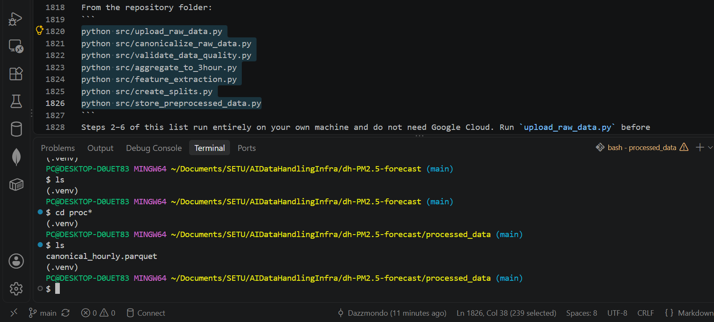
*After running `python src/canonicalize_raw_data.py`: `processed_data/canonical_hourly.parquet` is created.*

```python
# src/validate_data_quality.py
COMPLETENESS_THRESHOLD = 0.75   # a station-year with a smaller share of valid hours is flagged (not removed)
 
def check_completeness(df: pd.DataFrame, stations: pd.DataFrame) -> pd.DataFrame:
    """Share of hourly values that are valid, for every station and year it should have data.
 
    How many hours to EXPECT comes from availability_start in station_reference.csv, never
    from the data itself. Years below COMPLETENESS_THRESHOLD are flagged, not removed.
    """
    df = df.drop_duplicates(["station_id", "timestamp_utc"], keep="first")   # a repeated hour must not count twice
    rows = []
    for _, st in stations.iterrows():
        avail_start = max(STUDY_START, pd.Timestamp(st["availability_start"], tz="UTC"))   # first hour we expect data
        s_df = df[df["station_id"] == st["station_id"]]   # this station's rows only
        for year in range(avail_start.year, STUDY_END.year + 1):
            # the part of this year inside the expected period (shorter for the first and last year)
            win_start = max(avail_start, pd.Timestamp(f"{year}-01-01 00:00", tz="UTC"))
            win_end = min(STUDY_END, pd.Timestamp(f"{year}-12-31 23:00", tz="UTC"))
            expected = int((win_end - win_start).total_seconds() // 3600) + 1   # hourly values that window should hold
            in_win = s_df[(s_df["timestamp_utc"] >= win_start) & (s_df["timestamp_utc"] <= win_end)]
            valid = int(in_win["pm25"].notna().sum())   # hours that actually have a PM2.5 value
            rows.append({"station_id": st["station_id"], "station_name": st["station_name"], "year": year,
                         "expected_from": win_start.date(), "valid_hours": valid, "expected_hours": expected,
                         "completeness_pct": round(100 * valid / expected, 1),
                         "passes_threshold": valid / expected >= COMPLETENESS_THRESHOLD})
    report = pd.DataFrame(rows)   # one row per station-year
    failing = report[~report["passes_threshold"]]
    if failing.empty:
        print(f"All expected station-years reach {COMPLETENESS_THRESHOLD:.0%} completeness.")
    else:
        print(f"{len(failing)} expected station-year(s) below {COMPLETENESS_THRESHOLD:.0%} "
              f"(0% usually means not downloaded yet):")
        print(failing[["station_id", "station_name", "year", "valid_hours", "expected_hours", "completeness_pct"]]
              .to_string(index=False))
    print("Note: this is a diagnostic - the station set is fixed and nothing is removed automatically.")
    return report
```

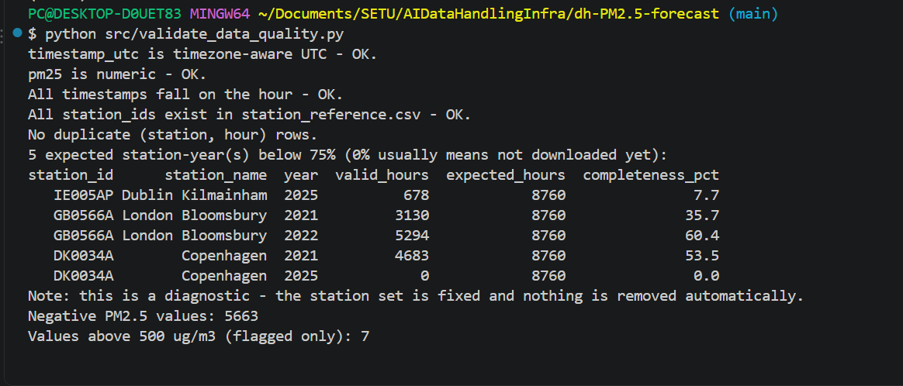
*After running `python src/validate_data_quality.py`: the schema checks pass and the five station-years below the 75% completeness threshold are listed (flagged, not removed).*

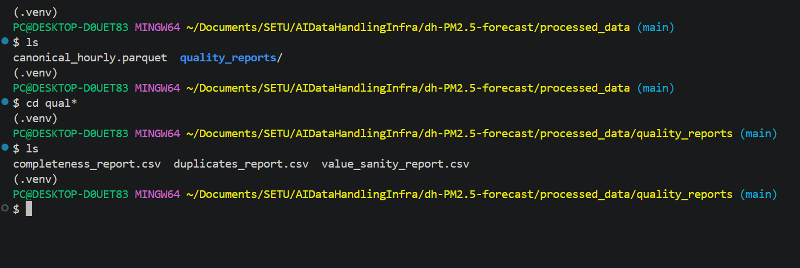
*`validate_data_quality.py` also writes three reports to `processed_data/quality_reports/`: `completeness_report.csv`, `duplicates_report.csv` and `value_sanity_report.csv`.*

---

## Aggregation

Hourly measurements will be converted into **3-hour mean PM2.5 concentrations**.

The aggregation rule defines:

- the three-hour boundaries;
- the minimum number of valid hourly observations required;
- how missing hours are handled;
- how invalid/quality-flagged measurements are treated.

The project will not silently fill missing target observations.

Implemented in `aggregate_to_3hour.py`: blocks are fixed 3-hour windows on the UTC clock, and a block's mean is kept only if at least 2 of its 3 hours are valid. The number of valid hours is stored in `valid_hours`. This script is included because the target and all features are defined on these blocks.

```python
# src/aggregate_to_3hour.py
MIN_VALID_HOURS = 2  # out of 3, per block
 
def aggregate_station(group: pd.DataFrame) -> pd.DataFrame:
    """Turn ONE station's hourly series into 3-hour mean blocks.
 
    Blocks are fixed UTC windows (00:00-03:00, 03:00-06:00, ...). A block's mean
    is kept only if at least MIN_VALID_HOURS of its 3 hours have a value.
    """
    group = group.set_index("timestamp_utc").sort_index()   # time-indexed, so resample() can cut it into windows
    if group.index.has_duplicates:   # the same hour twice means canonicalize_raw_data.py left a duplicate
        raise SystemExit("Duplicate hours found in the canonical file - re-run canonicalize_raw_data.py, "
                         "which is responsible for resolving them.")
    resampled = group["pm25"].resample("3h")   # fixed 3-hour windows, each labelled by its START time
    # mean() ignores missing hours; count() is how many hours in the window have a value (0-3)
    block_mean, valid_hours = resampled.mean(), resampled.count()
    out = pd.DataFrame({"block_start_utc": block_mean.index,
                        "pm25_3h_mean": block_mean.values,
                        "valid_hours": valid_hours.values})
    # too few valid hours: the block gets no mean (missing values are never filled in)
    out.loc[out["valid_hours"] < MIN_VALID_HOURS, "pm25_3h_mean"] = float("nan")
    return out
```

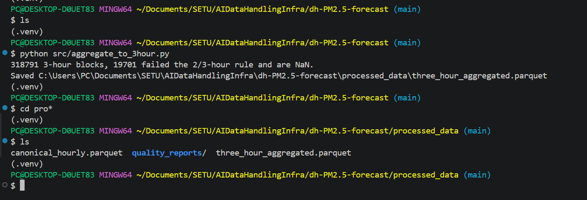
*After running `python src/aggregate_to_3hour.py`: 318,808 three-hour blocks are produced and `processed_data/three_hour_aggregated.parquet` is created.*

---

## Target construction

The raw data is first aggregated into **3-hour PM2.5 averages**.

For each completed 3-hour input block, the model predicts the PM2.5 average for the 3-hour block **six hours later**.

For example:

```text
Input block             Target block
09:00–11:59     →       15:00–17:59
```

A target is only created when the required hourly measurements are available according to the predefined completeness rule.

The target variable is therefore:

**`target_pm25` = 3-hour mean PM2.5 concentration in the target block.**

Aggregation blocks are fixed 3-hour windows on the UTC clock, so a target two blocks ahead is always exactly six hours later, even on daylight-saving change days. Times in the examples are therefore UTC. The time_block feature is derived from station-local time: the local hour at the start of the block divided by 3, rounded down, so 0 means local 00:00–02:59 and 7 means 21:00–23:59. A block lines up exactly with its time_block only where local time is a whole multiple of 3 hours from UTC (Ireland and the UK in winter, Athens in summer). Elsewhere, such as Paris in winter, the UTC block 09:00–11:59 is 10:00–12:59 local and takes the label of the bin containing its start.

The time_block feature is 0-7 arranged thus:

| `time_block` | Time period |
|---:|---|
| 0 | 00:00–02:59 |
| 1 | 03:00–05:59 |
| 2 | 06:00–08:59 |
| 3 | 09:00–11:59 |
| 4 | 12:00–14:59 |
| 5 | 15:00–17:59 |
| 6 | 18:00–20:59 |
| 7 | 21:00–23:59 |

The target and the time features are created in `feature_extraction.py` (`add_lag_rolling_and_target()` and `add_temporal_features()`, shown in Section 7).

---

## Lag features

The model also uses previous 3-hour PM2.5 averages as input features.

For example, for the 09:00–11:59 input block:

```text
Previous blocks                              Input        Target

00:00–02:59   03:00–05:59   06:00–08:59   09:00–11:59   15:00–17:59
     ↓             ↓             ↓             ↓            ↓
   lag_3         lag_2         lag_1      pm25_current     target
```

The lag features therefore describe recent historical PM2.5 concentrations available before the target period.
The forecast is issued after the input block has completed, so its mean (pm25_current) is a known input; lag_1 is the block before it.

No measurements from the target block or any later period are used to create the lag features.

Implemented in `add_lag_rolling_and_target()` in `feature_extraction.py` (code in Section 7): lag k is the block shifted back by k rows, which is exactly k blocks because the grid has no gaps.

---

## Rolling features

Rolling features summarise recent historical PM2.5 measurements.

The initial features will include:

* a recent rolling mean;
* a recent rolling standard deviation.

Only observations available before the target period are used.

The rolling-window length will be treated as a configuration parameter and selected using the training/development data. The final 2025 test data will not be used to choose the window length.

Implemented in `add_lag_rolling_and_target()` in `feature_extraction.py` (code in Section 7). The default window is 8 blocks (24 hours, including the input block).

---

## Feature preprocessing

Where models require transformations such as:

- standardisation;
- categorical encoding;
- numerical imputation;

the transformation parameters will be fitted using training data only.

The same fitted transformation will then be applied to development and test data.

This prevents the preprocessing stage itself from leaking information from the evaluation datasets.

This is implemented in `fit_scalers.py`, which fits on the **train split only** (123,364 rows of the 12 non-held-out stations; it stops if a held-out station is among them) and writes `processed_data/scalers/scalers.json`. `store_preprocessed_data.py` uploads it to `processed/scalers/` next to the dataset, and the dataset record lists its hash. The processed Parquet files stay unscaled. Two variants are fitted so that Milestone 3 can compare them: plain standardisation, and log1p (negatives clipped to 0 first) followed by standardisation. The concentration columns, the spread column (`pm25_rolling_std`) and the target have separate means and standard deviations. XGBoost needs no scaling. `apply_scaler()` applies the saved numbers to development, test and held-out rows without refitting, and `fit_scalers.py` prints a check that train scales to mean 0 and standard deviation 1 while dev does not.

The cyclical time features (sin and cos of the local hour at the block midpoint, and of the month) are built from `local_timestamp`, so they follow the local clock including daylight saving, and nothing is fitted for them. The `time_block` column is a label only: it is the local clock hour at the block start divided by 3, not a fixed local window, and it changes between winter and summer for Athens (UTC+2/+3). The `season` column repeats the month and is not used.

```python
# src/fit_scalers.py
def fit_columns(train: pd.DataFrame, columns: list, variant: str) -> dict:
    """Mean and standard deviation (population, ddof=0, as scikit-learn's StandardScaler) of each column, from the train rows."""
    fitted = {}
    for column in columns:
        values = prepare(train[column], variant)
        fitted[column] = {"mean": float(values.mean()), "std": float(values.std(ddof=0))}
    return fitted

def cyclical_features(df: pd.DataFrame) -> pd.DataFrame:
    """sin/cos of the local hour at the block midpoint and of the month, from local_timestamp. Nothing is fitted."""
    midpoint = df["local_timestamp"] + pd.Timedelta(hours=BLOCK_HOURS / 2)
    hour = midpoint.dt.hour + midpoint.dt.minute / 60
    month = df["local_timestamp"].dt.month
    return pd.DataFrame({"hour_sin": np.sin(2 * np.pi * hour / 24), "hour_cos": np.cos(2 * np.pi * hour / 24),
                         "month_sin": np.sin(2 * np.pi * (month - 1) / 12), "month_cos": np.cos(2 * np.pi * (month - 1) / 12)},
                        index=df.index)
```

---

## Model-ready representations

The same underlying processed data will support multiple models.

### Linear Regression

Uses the engineered tabular feature representation.

### XGBoost

Uses the engineered tabular feature representation and allows nonlinear feature interactions.

### PyTorch GRU/LSTM

This is an optional addition if time allows after XGBoost is working and evaluated.

Uses historical sequences of observations, with the exact sequence length selected during M2/M3.

The model-specific representation is therefore produced **after** the common canonical data pipeline rather than requiring separate, manually maintained datasets.

---

# Milestone 2: Evidence and EDA Scripts

Milestone 2 asked for data understanding and a defensible pipeline. Every cleaning rule and modelling choice below comes from a script in `src/` that reads `processed_data/` and prints a table, writes it to `reports/<topic>/` and, for the EDA scripts, saves a figure to `reports/figures/`. The scripts change nothing in `processed_data/`. All of them use the same **decision pool**: the 12 non-held-out stations, 2018-2024 (training and development years). The 2025 test split and the held-out stations are only counted, never used to choose a threshold, a rule or a feature. Choosing a rule is different from applying it: the above-500 rule is applied to every row, including three values in the 2025 test year, but its thresholds were set from the decision pool and the corroboration medians use only data before 2025, and no model result on the test split was used for any choice. Each EDA script ends with a printed FINDING, DECISION and LIMITATION. `reports/` holds the generated tables and figures (small files, committed); regenerate them by running the scripts (about a minute each).

| Script | Question | Output in `reports/` |
|---|---|---|
| `check_negative_values.py` | How many negatives, where, how large, what do the source flags say, and what would keep / set to missing / clip do? | `negative_values/` |
| `check_high_values.py` | What is the evidence for each value above 500 ug/m3? | `high_values/` |
| `check_time_labels.py` | What does `time_block` mean, and is it stable across daylight saving? | `time_labels/` |
| `check_block_rule.py` | What does the 2-of-3 valid-hours rule drop, and what if it were 1 or 3? | `block_rule/` |
| `check_training_coverage.py` | Which cities and countries do the training stations cover? | `training_coverage/` |
| `baseline_persistence.py` | How good is "the next value is the current value" on the development year? | `baseline/` |
| `eda_missingness.py` | Which station-years are poorly covered, and what do the gaps look like? | `figures/01_missingness_heatmap.png` |
| `eda_distributions.py` | How skewed is the target? | `figures/02_target_distribution.png` |
| `eda_seasonal_diurnal.py` | Do levels follow the calendar and the local clock? | `figures/03_seasonal_pattern.png`, `04_diurnal_pattern.png` |
| `eda_autocorrelation.py` | How much of the value 6 hours ahead is in the current block? | `figures/05_autocorrelation.png` |
| `eda_station_differences.py` | How much does "which station" explain? | `figures/06_station_differences.png` |
| `eda_dev_drift.py` | Is the development year (2024) like the training years? | `figures/07_dev_year_drift.png` |

`analysis_helpers.py` holds the shared code: the decision pool, the plotting style (the first three colours of a validated categorical palette), and a rebuild of the feature table from hourly data using the pipeline's own functions. Before a what-if run uses it, `verify_against_pipeline()` checks that the rebuild reproduces the pipeline's feature table exactly (285,574 rows, same split counts).

| Topic | Finding (evidence) | Decision |
|---|---|---|
| Missing data | 5 of 112 station-years (all 17 stations, 2018-2025) are below 75% valid; 88% of the missing hours are in outages of 24 hours or more and 6% in gaps of 3 hours or less; the pattern is station outages, not scattered gaps | No imputation; keep the 75% figure as a flag |
| 2-of-3 rule | It drops 1,405 blocks from 2018 on (0.06% to 1.02% of each station's blocks with data) and keeps 3,232 two-hour blocks; a rule of 1 / 2 / 3 valid hours gives development-year persistence MAE 3.843 / 3.869 / 3.912 | Keep 2 of 3 |
| Negative readings | See "Missing observations" | Keep; clip inside a model's own step |
| Values above 500 | See "Missing observations" | Written rule; all 7 set to missing |
| Target distribution | Skewness 4.7 on its own scale, -0.2 after log1p | Store unchanged; compare log1p for linear and neural models in Milestone 3 |
| Seasonal and daily cycles | 10 of 12 stations swing by at least 25% of their level over the year | Use sin/cos of month and local hour |
| Time labels | `time_block` is the 3-hour bin of the local clock in which a block starts; at Athens the same UTC block gets a different label in summer (24.7% of training and development rows) | Models use sin/cos of the local time; `time_block` stays a label |
| Autocorrelation | Correlation with the block 6 hours ahead: median 0.52 (about 27% of the variance); at 24 hours 0.41, higher than at 9 hours at 5 of 12 stations | Keep the current block, 3 lags and the 24-hour rolling statistics; test "same block yesterday" as a feature |
| Station differences | Station identity explains 15% of the variance of a 3-hour mean (city 12%, country 11%, source 5%) | Keep station, city, latitude/longitude and country out of the baseline; test them as a named ablation validated by leaving whole cities out |
| Training coverage | 12 training stations = 9 cities in 5 countries (Ireland 6 stations in 5 cities; Great Britain only Belfast; France not at all) | Leave-one-city-out validation has at most 9 folds |
| Development year | 11 of 12 station medians within 25% of their training median; Cork UCC +70% (negatives fell from about 20% to 7.6% of its hours in 2024, a possible instrument change, not confirmed); 2024 persistence MAE 3.87 against 3.91 to 4.49 in the training years | Use 2024 as planned; report per-station scores and every pooled score with and without Cork UCC, with Cork's own score, row count and negative-hour share on a separate line |
| Baseline | Persistence on the development year: MAE 3.869 ug/m3, RMSE 7.99, mean target 9.07, 31,192 rows; by station from 2.87 (Belfast) to 6.65 (Athens Aristotelous) | The score every model must beat |

**Limitations**, ranked by how much each could change a Milestone 3 conclusion, with what addresses it:
1. **One development year.** 2024 is the only year used for choices, and it is "not clearly similar" to the training years (Cork UCC is +70%). *Addressed by:* per-station scores beside the pooled one, scores with and without Cork UCC, and time-aware cross-validation inside the training years as a second view.
2. **Thin evidence for unseen cities.** Copenhagen has no valid hours in 2025 and Kilmainham 678; France is not in training and Great Britain only through Belfast. *Addressed by:* per-city scores with row counts, and claims about unseen cities only from the held-out evaluation.
3. **Unequal data quality and history.** Irish data are unvalidated and have two training years, UK-AIR's status is unknown, so country differences are partly quality differences. *Addressed by:* reporting by source.
4. **An inferred timestamp.** The EPA convention (hour ending, UTC) is inferred, not documented. *Addressed by:* scoring the Irish stations separately and testing a one-hour shift.
5. **Judgement thresholds.** The limits of 25%, two thirds, 500 and 100 ug/m3 and three times the median are judgements, labelled as such. They were fixed before the individual values and their context were examined (Milestone 1 had counted the values above 500, but had not looked at them one by one). *Addressed by:* the sensitivity checks already run (2-of-3 rule, negatives, values above 500).
6. **Unconfirmed explanations.** The reasons for Cork's negatives and for the 2024 change are plausible, not confirmed; the same holds for the cause of the outages. *Addressed by:* stating them as such and not building a rule on them.

---

## What changed since Milestone 1, and why

Milestone 1 already had the automated downloads from the three sources, the bucket with object versioning and the two manifests, Parquet for processed data, and the split design. Those are unchanged. Milestone 1 listed several decisions as open ("Known limitations and open decisions"); this table records how each was settled, and what else changed, with the reason.

| Topic | Milestone 1 | Milestone 2 | Reason (evidence) |
|---|---|---|---|
| Rows before 2018 | Kept in the canonical table and labelled `excluded` by the split step; "Whether to trim them earlier is open" | Dropped in `canonicalize_raw_data.py` | The EEA API returns whole series, so 236,261 rows (20%) lay outside the study period and were never used. Dropping them keeps every later table inside the study period. The cost is small: the first 7 blocks of 2018 at the 5 EEA training stations lose their pre-2018 history, so 35 training rows (0.03%) are gone (5 stations x 7 blocks) |
| Negative readings (5,666) | Kept and reported; policy open | Kept unchanged in storage; clipped at 0 only inside a model's own step | They cluster near zero and 98.8% of the pool's negatives belong to one station. Setting them to missing would remove 60% of Cork UCC's training rows and censor one side of the distribution; the policies differ by only 0.6% in baseline MAE |
| Values above 500 ug/m3 (7) | Counted and reported | Set to missing by a written rule, with an audit file | All 7 are isolated and uncorroborated, and one hour moves a 3-hour mean by up to 410 ug/m3 |
| The 2-of-3 valid-hours rule and the 8-block window | Fixed, flagged as to be settled | The 2-of-3 rule is kept after testing 1, 2 and 3 valid hours; the window length stays open for Milestone 3 | Baseline MAE 3.843 / 3.869 / 3.912 for 1 / 2 / 3: a small, stated difference, and the 2-of-3 rule drops 1,405 blocks while keeping 3,232 two-hour blocks |
| Station identity as features | `city`, `country`, latitude and longitude are in the feature table | Left out of the baseline model; latitude, longitude and country are a named ablation with leave-one-city-out cross-validation | Station identity explains 15% of the variance (city 12%, country 11%), so place is not the main driver; research questions 2 and 3 are about place, so it is tested, not assumed |
| Time-of-day and season features | `time_block` (0 to 7) and `season` | Sine and cosine of the local hour and of the month, built from `local_timestamp`; `season` dropped; `time_block` kept as a label only | `time_block` is not a fixed local window and shifts across daylight saving at Athens (24.7% of rows); `season` repeats the month (`check_time_labels.py`) |
| Scaling | Planned: steps that learn from data fitted on training data only | `fit_scalers.py` writes a versioned artefact (standard and log1p-standard variants) from the train split only, stored in the bucket next to the data | Models that need scaling must not learn from dev, test or held-out rows; the target is right-skewed. The processed Parquet stays unscaled |
| Evidence | Counts only | Twelve `check_*`, `baseline_persistence` and `eda_*` scripts, with their tables and figures in `reports/` | Each decision above must be reproducible from a script, not typed from memory |
| Versions | `PIPELINE_VERSION` and `PREPROCESSING_VERSION` v1 | v2; the dataset record stores the study start and the 500 threshold | Behaviour changed, and a record must say with which settings it was made |

**What the changes did to the counts.**

| | Milestone 1 | Milestone 2 |
|---|---|---|
| Canonical hourly rows | 1,180,226 | 943,965 |
| 3-hour blocks (missing) | 400,611 (24,666) | 318,808 (19,696) |
| Feature rows | 358,142 | 285,574 |
| Train / dev / test / held-out test | 123,399 / 31,192 / 25,944 / 13,362 | 123,364 / 31,192 / 25,944 / 13,362 |
| Excluded | 164,245 | 91,712 |

The development, test and held-out sets are identical; only the training set (35 rows) and the excluded rows changed, which is what dropping the pre-2018 rows should do.

**Decisions confirmed unchanged, and why.** The 3-hour windows on the UTC clock, the 6-hour target and the split years and held-out cities stay because nothing in the evidence argued against them. Google Cloud Storage stays the only store: the whole 3-hour table has about 319,000 rows and is analysed with pandas in seconds, so BigQuery would add set-up without adding capability. `validate_data_quality.py` still only reports and was not extended with the analysis checks, because validation (does the data meet the contract?) and analysis (what should we decide?) are different jobs, and a validator that also analyses grows into a second analysis script.

## Next steps and evaluation approach (Milestone 3)

The steps are ordered by priority: **core** steps answer the research questions, the others are done if the core is complete.

| Step | Priority | What | How it is checked |
|---|---|---|---|
| 1. Models | Core: Linear Regression and XGBoost; optional: GRU/LSTM | Linear Regression and XGBoost, then a GRU or LSTM if time allows, all scored on the same 31,192 development rows as persistence | MAE and RMSE overall and per station, with row counts; the model must beat 3.869 MAE |
| 2. Feature sets | Core | Baseline = current, lags, rolling statistics, cyclical month and local hour; add "same block yesterday"; compare log1p against the raw scale using the saved scalers; compare the cyclical time features with a one-hot encoding of the UTC block and with no time features | Development year only |
| 3. Place ablation | Core (research question 3) | Add latitude, longitude, country | Leave-one-city-out cross-validation on the training years (at most 9 folds), time-aware inside each fold |
| 4. Held-out cities | Core (research question 2) | One final evaluation on Derry, London and Paris, and on the 2025 test split, after every choice is frozen | Each used once; per-city scores; France is not in training and Great Britain only through Belfast |
| 5. Storage integration | Should | Store model artefacts and metrics in the bucket (`models/`), read the training data from the bucket, log each model with the dataset run ID and scaler hash | Dataset record, scaler record and model record share IDs |
| 6. Open questions | As needed | Rolling-window length; GRU sequence length; whether Cork needs separate treatment; the EPA timestamp convention | Each decided on training and development data |
| 7. Later | Milestone 4 | Deployment and retraining on 2026 data | The pipeline already reserves `future_update` |

**Evaluation approach.** Every model is compared with the persistence baseline (MAE 3.869 ug/m3, RMSE 7.99, 31,192 development rows) on exactly the same rows. MAE is the main metric because it is in the units of the target and is not dominated by a few episodes (the baseline's MAE is 43% of the mean target); RMSE is the second metric because it penalises missed pollution episodes more. Both are reported overall and per station with the row count, and pooled scores are given with and without Cork UCC. The training years fit the models; the development year (2024) is used for every choice; cross-validation inside the training years is time-aware (and grouped by city for the place ablation); the 2025 test split and the held-out cities are used once, after the choices are frozen. A model counts as an improvement if it beats persistence on the development year overall, and the report states at how many stations it does so.

**Risks.** Overfitting to the single development year (mitigation: per-station scores and city-grouped validation); data-quality differences driving country effects (mitigation: report by source); the timestamp assumption for Ireland (mitigation: report Irish scores separately and test a one-hour shift).

## Storage evidence from the project bucket

The bucket is `darragh-dh-pm25-forecast` (location EU). The raw files were first uploaded in Milestone 1; the Milestone 2 run uploaded the processed stages. The full outputs, including the raw-file and dataset manifest records, are in section 5.4 of `docs/M2.md`; the key ones are below.

```
gs://darragh-dh-pm25-forecast/manifests/
gs://darragh-dh-pm25-forecast/metadata/
gs://darragh-dh-pm25-forecast/processed/
gs://darragh-dh-pm25-forecast/raw/
```

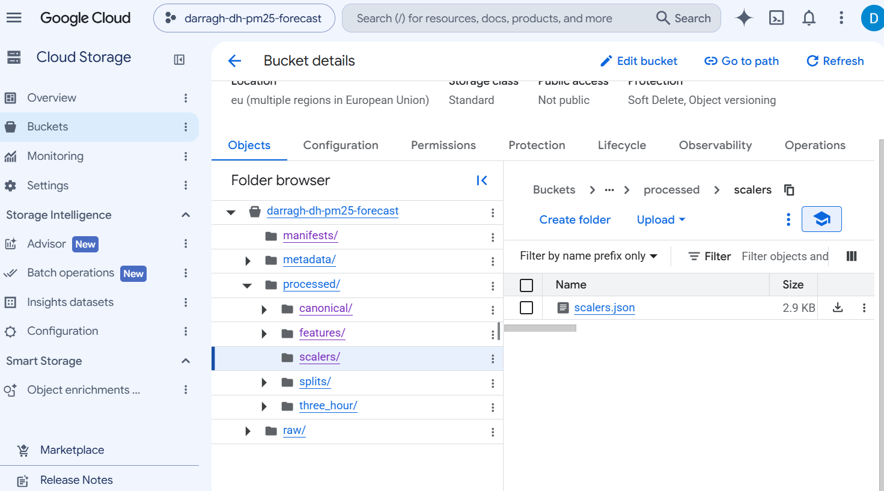

Running `upload_raw_data.py` again compares each local file's SHA-256 with the raw manifest and uploads nothing that has not changed:

```
Bucket 'gs://darragh-dh-pm25-forecast' already exists.

0 new, 0 updated, 86 unchanged (skipped).

--- Verification ---
Local files: 86
Objects in GCS: 86
Counts match.
```

The bucket settings applied when `upload_raw_data.py` creates the bucket:

```
lifecycle_config:
  rule:
  - action:
      type: Delete
    condition:
      age: 7
      isLive: false
location: EU
uniform_bucket_level_access: true
versioning_enabled: true
```

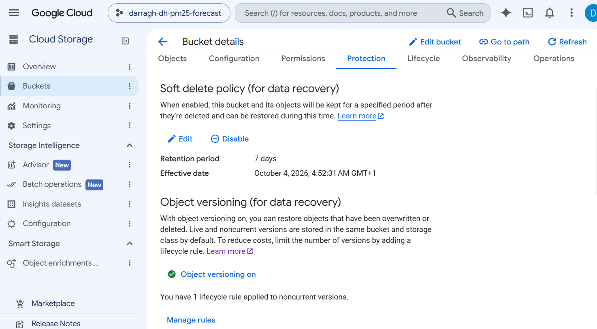

A processed file can be read straight from the bucket with `pandas` and `gcsfs`, using the same Application Default Credentials as the scripts:

```
python -c "import pandas as pd; df = pd.read_parquet('gs://darragh-dh-pm25-forecast/processed/splits/dev/dev.parquet'); print(df.shape)"
(31192, 23)
```

The latest `manifests/dataset_versions.jsonl` record (run `20261019T213934Z`) lists every output with its SHA-256 and row count and the `raw_data_version` of the raw manifest it used. Its `git_commit` ends in `-dirty`, the marker for a run made with uncommitted edits to tracked files; the raw-file record carries a plain commit hash, because the working tree was clean when that file was uploaded. The SHA-256 of every output file, and the repeatability check below, are what tie the stored files to the code.

## Example output and repeatability

**A step that stops, writing nothing.** A copy of a Belfast file was placed in the London folder of a scratch copy of the repository, and `canonicalize_raw_data.py` was run:

```
STOPPED - these files could not be used:
  -...\raw_data\uk_air\london\BEL2_2018.RData: not inside any raw_folder listed for uk_air stations in station_reference.csv (['belfast', 'derry', 'london/londonBloomsbury', 'london/londonKensington'])
```

The exit code was 1 and no `processed_data/` folder was created. With the file removed the same script ran to the end.

**A second step that stops.** `store_preprocessed_data.py` run without the two Google Cloud settings:

```
GCP_PROJECT_ID and GCS_BUCKET_NAME are not set. Set them as environment variables (PowerShell: $env:GCP_PROJECT_ID="..."; $env:GCS_BUCKET_NAME="...") and run again.
```

The exit code was 1 and nothing was uploaded.

**Repeatable outputs.** The local steps (`canonicalize_raw_data.py` to `fit_scalers.py`) were run twice from an empty `processed_data/`, and the SHA-256 of every output file was identical between the two runs: the canonical table, the 3-hour table, the feature table with splits, and the four quality reports. `scalers.json` differs only in its `created_utc` field. The hashes of the canonical table (`8b9a0831...`), the 3-hour table (`f3d9209d...`) and the feature table (`b2cd1f6e...`) equal those in the stored dataset record, so the stored files are what the code produces. The downloads depend on live sources (EPA Ireland's data are provisional and may be revised) and are not repeated this way; what fixes the input of a run is the raw manifest, whose checksums (and their hash, `raw_data_version`) identify exactly which raw files were used.

---

# Data Sources, Stations and Dataset Size

**Sources.**

| Source | Owner and access | Format kept | Stations | Years | Validation status |
|---|---|---|---|---|---|
| EEA Air Quality Download Service | Owner: European Environment Agency (AQ e-Reporting, dataset page https://www.eea.europa.eu/data-and-maps/data/aqereporting-8, Prod-ID DAT-3-en; no DOI is assigned). Access: https://eeadmz1-downloads-webapp.azurewebsites.net/ and the API behind it, documented at https://eeadmz1-downloads-api-appservice.azurewebsites.net/swagger/index.html | Parquet (one file per station) | 7: Athens x2, Copenhagen, Madrid x2, Paris x2 | 2013-2025 held; study uses 2018-2025 | Verified data only (dataset E1a, Verification flag 1) |
| EPA Ireland (airquality.ie) | Owner: Environmental Protection Agency, Ireland (the site is operated by Sonitus Systems). Access: the readings page, https://airquality.ie/readings | CSV (6-month windows) | 6: Cork, Dublin x2, Galway, Limerick, Waterford | 2022-2025 (Galway from 22 Dec 2022) | **Not validated** (the site's own disclaimer) |
| UK-AIR | Owner: Defra (https://uk-air.defra.gov.uk/). Access: the `.RData` files published for the R package openair, one file per station-year at `https://uk-air.defra.gov.uk/openair/R_data/<site>_<year>.RData`, for example https://uk-air.defra.gov.uk/openair/R_data/BEL2_2024.RData (the folder itself has no index page) | `.RData` (one file per station-year) | 4: Belfast, Derry, London x2 | 2018-2025 | The files carry no per-value ratification status |

Station identity, coordinates, time zone and each station's first expected date live in one table, `metadata/station_reference.csv` (17 rows), whose IDs and coordinates come from the EEA's station metadata (six country tables downloaded by `download_source_metadata.py`).

**Station context.** An hourly PM2.5 value is the mass concentration of particles smaller than 2.5 micrometres, in ug/m3, averaged over the hour at the station's air inlet. The EEA metadata tables (downloaded by `download_source_metadata.py`; they also list the EPA and UK-AIR stations) record each station's type, area and PM2.5 measurement method:

| Station | Source | Station type | Area | Measurement method |
|---|---|---|---|---|
| Cork UCC (`IE004BP`) | epa | background | suburban | BETA |
| Dublin Rathmines (`IE0028A`) | epa | background | urban | TEOM-FDMS |
| Dublin Kilmainham (`IE005AP`) | epa | traffic | urban | light-scat |
| Galway Briarhill (`IE009GY`) | epa | traffic | suburban | light-scat |
| Limerick Peoples Park (`IE007CP`) | epa | background | urban | light-scat |
| Waterford Paddy Brownes Road (`IE005CP`) | epa | background | suburban | light-scat |
| Belfast Centre (`GB0567A`) | uk_air | background | urban | OPC-CMC, TEOM-FDMS |
| Derry Rosemount (`GB1060A`) | uk_air | background | urban | BETA, TEOM-FDMS |
| London Bloomsbury (`GB0566A`) | uk_air | background | urban | BETA, TEOM-FDMS |
| London N. Kensington (`GB0620A`) | uk_air | background | urban | TEOM-FDMS; active sampling |
| Athens Agia Paraskevi (`GR0039A`) | eea | background | suburban | BETA |
| Athens Aristotelous (`GR0003A`) | eea | traffic | urban | BETA |
| Copenhagen (`DK0034A`) | eea | traffic | urban | BETA, TEOM; active sampling |
| Madrid Cuatro Caminos (`ES1525A`) | eea | traffic | urban | TEOM |
| Madrid Escuelas Aguirre (`ES0118A`) | eea | traffic | urban | TEOM |
| Paris Gennevilliers (`FR04002`) | eea | background | urban | OPC-CMC, TEOM, TEOM-FDMS, other |
| Paris Saint-Denis (`FR04058`) | eea | traffic | urban | BETA, TEOM, other |

Seven stations are traffic sites and ten are background sites; all are in urban or suburban areas. The method codes are as recorded in the metadata: BETA is beta attenuation, TEOM is a tapered element oscillating microbalance (TEOM-FDMS adds a correction for volatile particles), and light-scat is light scattering; the other codes are kept as recorded. A station with several methods has one metadata record per sampling point over the years, so the method in force in a given year cannot be read from this table. The methods differ between stations (four of the six Irish stations use light scattering; Cork UCC uses beta attenuation and Dublin Rathmines TEOM-FDMS), so part of the difference in levels and in negative readings between stations may be instrument-related; that is a plausible explanation, not a tested one.

**Size.** The course requires at least 10,000 learning samples. The 86 raw files become 943,965 canonical hourly rows (after dropping 236,261 rows before 2018), 318,808 three-hour blocks (19,696 missing), and 285,574 feature rows (33,234 dropped for lacking a full history or a valid target). The splits are train 123,364, dev 31,192, test 25,944, held-out test 13,362 and excluded 91,712. Of the excluded rows, 91,674 belong to the five held-out stations outside their 2025 test year (they are never used) and 38 are rows of training stations whose input and target blocks fall in different periods (18 across 2023 and 2024, 20 across 2024 and 2025). The data cover 12 training stations in 9 cities and 5 countries plus the 5 held-out stations, which is enough temporal and geographical diversity for forecasting and for generalisation to unseen cities, and small enough for CPU-based classical ML and a modest PyTorch sequence model.

---

# Legal and Data-Use Considerations

The project uses environmental monitoring data about places, not people. No names, email addresses or other personal identifiers are collected, and each station is identified by a public monitoring-network code and a public location.

**Licences and terms, as stated on each source's own pages (read on 19 October 2026):**

| Source | Licence or terms | Data-quality statement | Attribution used |
|---|---|---|---|
| UK-AIR (Defra) | UK-AIR content is made available under the Open Government Licence v3.0 (https://www.nationalarchives.gov.uk/doc/open-government-licence/version/3/), which says: "You are free to: copy, publish, distribute and transmit the Information; adapt the Information; exploit the Information commercially and non-commercially for example, by combining it with other Information, or by including it in your own product or application." It requires the user to "acknowledge the source of the Information in your product or application by including or linking to any attribution statement specified by the Information Provider(s) and, where possible, provide a link to this licence". | The `.RData` files carry no per-value ratification status; whether each year is ratified or provisional is not recorded in the files used | UK-AIR data, Defra (Contains public sector information licensed under the Open Government Licence v3.0) |
| airquality.ie (EPA Ireland) | Readings page, https://airquality.ie/readings, section "Disclaimer": "When using this data you must comply to the terms described in the Creative Commons Attribution licence." (links to https://creativecommons.org/licenses/by/4.0/). The deed says the user is free to: "Share — copy and redistribute the material in any medium or format for any purpose, even commercially." "Adapt — remix, transform, and build upon the material for any purpose, even commercially." Under the following terms: "Attribution — You must give appropriate credit, provide a link to the license, and indicate if changes were made. You may do so in any reasonable manner, but not in any way that suggests the licensor endorses you or your use." | The same page: the data "has not yet been validated" and "may be subject to revision"; sharp spikes may be a calibration or monitor fault | airquality.ie, EPA Ireland (CC BY 4.0) |
| EEA Air Quality Download Service | Legal notice, https://www.eea.europa.eu/en/legal-notice: "Unless otherwise indicated, the European Environment Agency (EEA) is the owner of copyrights and database rights in this website and its contents, and EEA materials are published under the CC-BY license." "The re-use of certain data may be subject to different conditions, and if so the item concerned is accompanied by a copyright mark or other mention of the specific conditions relating to it." | Each hourly value has a Validity flag (1 valid, 2 valid below the detection limit with the value given, 3 valid below the detection limit with the value replaced by half the limit, -1 and -99 not valid) and a Verification flag; only validity 1, 2 and 3 are used, and only verified (E1a) data is downloaded | European Environment Agency (CC BY) |

The EEA legal notice is written for the EEA website and its contents; neither the download service nor the EEA dataset page (https://www.eea.europa.eu/data-and-maps/data/aqereporting-8, Prod-ID DAT-3-en; no DOI is assigned) carries a notice of its own, so the legal notice is taken to apply to the data.

**Automated access.** UK-AIR's robots.txt disallows `/datastore/` (the website's CSV files), so the project downloads UK-AIR's `.RData` files under `/openair/R_data/`, which are not disallowed. The EEA download service's robots.txt allows everything, and airquality.ie has none. All download scripts use a descriptive User-Agent, timeouts, retries and pauses between requests. UK-AIR was not asked whether bulk automated use of the `.RData` files is welcome.

**What is stored where.** The downloaded files are kept in a private Google Cloud Storage bucket. `raw_data/` and `processed_data/` are not committed to the repository (they are in `.gitignore`); `reports/` is committed and holds only summary tables and figures, no hourly data. Earlier commits of the repository contained the raw files, so the sources are credited here. No credentials are stored in the code: the scripts read the project and bucket names from environment variables and use Application Default Credentials.

**Data limitations that affect how results may be used.** The Irish data are provisional and unvalidated; stations are mostly in large cities, so results describe urban monitoring sites and not whole countries; the stations differ in type (traffic and background) and in coverage (see "Milestone 2: Evidence and EDA Scripts"). The data are suitable for the course's forecasting experiment and are not an official air-quality assessment.

---

# Overall Architecture

The project follows the lecture's general AI data architecture:

```text
 EPA / EEA / UK-AIR
        ↓
  Raw data sources
        ↓
  GCS / Data Lake
        ↓
  Batch ingestion
        ↓
Canonical processing
        ↓
     Parquet
        ↓
┌──────────────────────┐
│ Analytical layer     │
│ pandas / Parquet     │
│ BigQuery (optional)  │
└──────────────────────┘
        ↓
 Feature / sequence construction
        ↓
┌────────────┬───────────┬──────────────────┐
│   Linear   │  XGBoost  │ PyTorch GRU/LSTM │
│ Regression │           │    (optional)    │
└────────────┴───────────┴──────────────────┘
        ↓
      Model
        ↓
 Docker / FastAPI
        ↓
    Cloud Run
```

The architecture deliberately uses different technologies for different workloads rather than treating one database or storage system as the solution to every problem.

**The implemented pipeline**, from the sources to the reports (arrows show the files one step hands to the next):

```
SOURCE     UK-AIR (Defra)            EEA Air Quality Download     EPA Ireland (airquality.ie)
           .RData files              Service API, Parquet         readings pages, CSV
               |                              |                           |
               v                              v                           v
INGEST     download_ukair.py          download_eea.py            download_epa.py
           (+ download_source_metadata.py: EEA station metadata)
                                      |
                                      v
           raw_data/   original files, never edited
                                      |
                                      v
STORE      upload_raw_data.py  ->  GCS raw/  +  manifests/raw_files.jsonl (SHA-256 per file)
                                      |
                                      v
VALIDATE   canonicalize_raw_data.py -> processed_data/canonical_hourly.parquet
              (parse, match files to stations, UTC, trim to 2018+, above-500 rule; stops on bad files)
           validate_data_quality.py -> quality_reports/  (reports only)
                                      |
                                      v
TRANSFORM  aggregate_to_3hour.py -> feature_extraction.py -> create_splits.py -> fit_scalers.py
              (3-hour blocks -> lags, rolling statistics, target -> split labels -> train-only scalers)
                                      |
                                      v
STORE      store_preprocessed_data.py -> GCS processed/  +  manifests/dataset_versions.jsonl
                                      |
                                      v
OUTPUT     check_*.py, eda_*.py, baseline_persistence.py -> reports/ (tables, figures)
           split datasets (train, dev, test, held-out) for Milestone 3
```

The raw files are stored (in `raw_data/` and in the bucket) before any validation, so the original is kept unchanged whatever the validation decides; every later stage reads the stored copy and writes a new file. Scripts hand data to each other only through files, so any step can be re-run alone. Only `upload_raw_data.py` and `store_preprocessed_data.py` talk to the cloud.

**Automated and manual.** Every step from the downloads to the figures is a script run by hand, one command per step; there is no scheduler or orchestration tool, because the data are historical and the pipeline is run on request. The only manual actions are signing in to Google Cloud (`gcloud auth application-default login`), setting the two environment variables, and taking the console screenshots used as storage evidence.

---

# Key Design Principles

### 1. Data before model

The project treats data collection, quality, storage, transformation and lineage as fundamental parts of the AI system rather than focusing only on model selection.

### 2. Storage follows workload

GCS is used for durable object storage and batch access, Parquet for efficient analytical data access, and BigQuery for SQL-based analysis (if implemented, otherwise pandas may be used for analysis).

### 3. Raw data is preserved

The raw source data is retained so that preprocessing can be changed and reproduced without recollecting the data.

### 4. Data type is separated from storage format

PM2.5 is numerical time-series data; Parquet is a representation/storage format.

### 5. Batch processing is appropriate for training

Historical environmental measurements can be collected and transformed in batches. Real-time/streaming processing is not necessary for the initial training-data pipeline.

### 6. Future data remains unseen

2025 is reserved as the final temporal test set, while 2026 is reserved for demonstrating new-data/model updates.

### 7. Leakage prevention is explicit

Source-independent canonicalisation and deterministic transformations are performed before splitting. Any transformation that learns parameters from the data is fitted using training data only.

The following preprocessing needs to occur before the split:
- parsing timestamps
- unit standardisation
- station mapping
- identifying duplicates
- source-quality filtering
- hourly → 3-hour aggregation

Historical lag and rolling features are then constructed using only observations available before each forecast time, with no future target information included.

### 8. Data lineage matters

The project aims to link:

**raw data → preprocessing → feature dataset → training run → model**

so that the origin of a deployed model can be reconstructed.

### 9. More complex models are not assumed to be better

Persistence, Linear Regression, XGBoost and PyTorch (optional) sequence modelling will be compared empirically.

### 10. Generalisation matters

The project does not evaluate only performance on cities seen during training.

Derry, London and Paris are held out to investigate geographical generalisation.

---

# Questions Raised in Milestone 1 and How Milestone 2 Answered Them

These questions were left open in Milestone 1. Each was answered from training and development data only, never from the 2025 test set.

| # | Question | Answer in Milestone 2 | Status |
|---|---|---|---|
| 1 | Is the rule of at least 2 of 3 valid hours appropriate? | Yes: it drops 1,405 blocks (0.06% to 1.02% of each station's blocks with data); 1 or 3 of 3 change the development-year persistence MAE by 0.03 to 0.04 | Decided |
| 2 | Which rolling-window lengths are most appropriate? | Not compared. The autocorrelation shows signal out to at least 24 hours and a daily cycle, so the 24-hour window stays and a "same block yesterday" feature is a candidate | Open for Milestone 3 |
| 3 | How much missing data can be tolerated? | 75% valid per station-year stays a flag. No imputation, because 88% of the missing hours are outages of 24 hours or more | Decided |
| 4 | How should negative readings be treated? | Kept unchanged in storage; clipped to 0 only inside a model's own step | Decided |
| 5 | How should stations with no 2025 data be handled in evaluation? | Copenhagen has no 2025 test rows and Kilmainham has 225; report the row count with every per-station score and do not impute | Decided |
| 6 | Should station ID or city be model features? | No, not in the baseline. Latitude, longitude and country are a named ablation validated by leaving whole cities out (9 folds at most) | Decided; ablation in Milestone 3 |
| 7 | What sequence length for the PyTorch model? | Not decided; the autocorrelation suggests at least 8 blocks (24 hours) | Open |
| 8 to 10 | XGBoost hyperparameters; XGBoost against Linear Regression; whether PyTorch adds value | Not started | Open for Milestone 3 |
| 11 | Time of day as `time_block` or a continuous local hour? | Continuous: sin/cos of the local hour from `local_timestamp`; `time_block` is a label only | Decided |

---

# AI Acknowledgement

**AI use.** Generative AI tools were used in this project. I am responsible for every claim, line of code and result in this submission.

**Tools and purpose.**
- **Claude** (Sonnet 5 and Sonnet 5.5) was used as a coding and writing assistant: to turn my design decisions into Python scripts, to run analyses I specified, and to draft the README and this report from my instructions.
- **ChatGPT** was used to discuss design choices, analyse code and review Claude's recommendations, and to assess drafts of this report against the marking rubric.

**Who decided what.**
- **The design and the creative decisions were mine.** The research questions, the target (a 3-hour mean six hours ahead), the choice of cities and monitoring stations, the three data sources, the choice of Google Cloud Storage and Parquet, the chronological and held-out-city split design, and the decision to treat generalisation to unseen cities as the central question came from me. The larger Milestone 2 decisions also came from me: what to investigate, what counts as acceptable evidence, which rules to keep simple, and which suggestions to reject.
- **I guided the AI with course material.** I gave the assistant sample code from the labs, and pointed it to the principles from the lectures that mattered most (for example: keep raw data unchanged, fit anything that learns from data on training data only, prevent leakage, report uncertainty and group sizes, justify every design choice and compare alternatives). I told it to follow the marking rubric and to explain each decision with evidence.
- **The AI worked out the "how".** Given a decision, Claude proposed the specific code and details: file parsing, the exact functions and thresholds to test, the structure of the scripts, the manifest fields, and first drafts of text. I then reviewed, questioned and changed these. I rejected or changed suggestions that I judged unnecessary or unsupported, for example extra confidence-interval machinery that I thought over-engineered the project, rewriting git history, and a claimed change between Milestone 1 and Milestone 2 that Milestone 1 already contained; and I kept features that I judged useful, such as the `-dirty` commit marker as a demonstration of provenance.
- **Working rules I set.** The AI was not allowed to commit or push, to edit the submitted Milestone 1 report, or to add files or tools I had not approved, and it had to propose changes and show evidence before implementing them.

**How the output was checked or changed.**
- I have checked every line of code in `src/`.
- All scripts were run end to end on real data; the reported row counts, split counts and results come from those runs.
- The feature table is rebuilt from the canonical table with the pipeline's own functions and compared with the pipeline's output (same rows, same split counts) before any analysis script uses it.
- Running the local pipeline twice from an empty `processed_data/` gave identical SHA-256 hashes for every output file, which also match the stored dataset record.
- The UK-AIR `.RData` values were compared with the website's CSV files for all 32 station-years, and the scripted EPA download was compared with the hand-downloaded files.
- Licence and terms text was compared with the live pages.
- Code style was checked with `pyflakes`.
- I reviewed proposed changes before they were applied and corrected or removed AI suggestions that were wrong or unsupported by the data.
- No confidential, personal or restricted data was uploaded to an AI service; the data are public monitoring data.

---

# Setup Guide:

## Running the pipeline on your own Google Cloud bucket

This guide takes you from a fresh computer to a finished run of the pipeline, with the data uploaded to your own Google Cloud Storage bucket. The raw data are not in the repository (`raw_data/` is in `.gitignore`); the download scripts (Section 5) fetch them in Step 4.

### All the steps at a glance

Every script in `src/` that you run, in the order you run it. The numbered Steps below explain how to set up and run each group: scripts 1 to 4 in Step 4, scripts 5 to 12 in Step 7, scripts 13 to 24 in Step 9.

| # | Script | What it does | Writes | Needs the cloud |
|---|---|---|---|---|
| 1 | `download_ukair.py` | Downloads UK-AIR's yearly `.RData` files (32) | `raw_data/uk_air/` | no |
| 2 | `download_eea.py` | Downloads the verified hourly PM2.5 Parquet file of each EEA station (8 files) | `raw_data/eea/` | no |
| 3 | `download_epa.py` | Downloads the EPA Ireland readings as CSV files (46) | `raw_data/epa/` | no |
| 4 | `download_source_metadata.py` | Downloads the EEA station metadata, one table per country (6 files) | `metadata/source_metadata/` | no |
| 5 | `upload_raw_data.py` | Creates the bucket if needed and mirrors `raw_data/` into it with checksums | `raw/` and `manifests/raw_files.jsonl` in the bucket | yes |
| 6 | `canonicalize_raw_data.py` | Parses all sources into one hourly UTC table, drops rows before 2018, applies the above-500 rule | `processed_data/canonical_hourly.parquet`, `quality_reports/high_value_audit.csv` | no |
| 7 | `validate_data_quality.py` | Reports on schema, duplicates, completeness and value ranges (changes nothing) | `processed_data/quality_reports/` | no |
| 8 | `aggregate_to_3hour.py` | Hourly values to 3-hour mean blocks (2 of 3 hours valid) | `processed_data/three_hour_aggregated.parquet` | no |
| 9 | `feature_extraction.py` | Lags, rolling statistics, time labels and the 6-hour-ahead target | `processed_data/features/pm25_features.parquet` | no |
| 10 | `create_splits.py` | Labels every row train, dev, test, held-out or excluded | `processed_data/features/pm25_features_with_splits.parquet` | no |
| 11 | `fit_scalers.py` | Fits the scalers on the train split only | `processed_data/scalers/scalers.json` | no |
| 12 | `store_preprocessed_data.py` | Uploads every processed stage and the scaler file, and records the dataset version | `processed/` and `manifests/dataset_versions.jsonl` in the bucket | yes |
| 13 | `check_negative_values.py` | Negative readings: where, how large, flags, effect of each way of handling them | `reports/negative_values/` | no |
| 14 | `check_high_values.py` | Evidence behind each value above 500 ug/m3 | `reports/high_values/` | no |
| 15 | `check_time_labels.py` | What `time_block` means and whether it changes with daylight saving | `reports/time_labels/` | no |
| 16 | `check_block_rule.py` | What the 2-of-3 rule drops, and what a rule of 1 or 3 would do | `reports/block_rule/` | no |
| 17 | `check_training_coverage.py` | Cities and countries covered by the training stations | `reports/training_coverage/` | no |
| 18 | `baseline_persistence.py` | Persistence baseline on the development year | `reports/baseline/` | no |
| 19 | `eda_missingness.py` | Figure 1: missing data by station and year, and the gaps | `reports/figures/`, `reports/eda/missingness/` | no |
| 20 | `eda_distributions.py` | Figure 2: the target's distribution | `reports/figures/`, `reports/eda/distributions/` | no |
| 21 | `eda_seasonal_diurnal.py` | Figures 3 and 4: seasonal and daily cycles | `reports/figures/`, `reports/eda/seasonal_diurnal/` | no |
| 22 | `eda_autocorrelation.py` | Figure 5: autocorrelation at the forecast horizon | `reports/figures/`, `reports/eda/autocorrelation/` | no |
| 23 | `eda_station_differences.py` | Figure 6: differences between stations | `reports/figures/`, `reports/eda/station_differences/` | no |
| 24 | `eda_dev_drift.py` | Figure 7: is the development year like the training years? | `reports/figures/`, `reports/eda/dev_drift/` | no |

Three more files in `src/` are never run on their own: other scripts import them. Together with the 24 scripts above, they are every file in `src/`, and each one is used.

| File | What it provides | Used by |
|---|---|---|
| `config.py` | The folder paths (`raw_data/`, `processed_data/`, `reports/`, `metadata/`), the pipeline version, the git commit written into the manifests, and the check that the Google Cloud settings are set | Every script, directly or through `analysis_helpers.py` |
| `stations.py` | Loads `metadata/station_reference.csv` (the one station table) and stops with a full list of problems if it is malformed | The four download scripts, `canonicalize_raw_data.py`, `validate_data_quality.py`, `create_splits.py`, `analysis_helpers.py` and the analysis scripts that need station details |
| `analysis_helpers.py` | The shared code of scripts 13 to 24: the decision pool (the 12 non-held-out stations, 2018 to 2024), a rebuild of the feature table with the pipeline's own functions plus a check that it matches the pipeline's table, the report folders, and the figure style and colours | Scripts 13 to 24 (all twelve check, baseline and EDA scripts) |

The input data file `metadata/station_reference.csv` (17 stations) is in the repository; `requirements.txt` lists the packages. Run the scripts in the order of the table: each one reads what the earlier ones wrote.

**Which terminal am I using?** The few commands that differ between terminals are given twice, once for **PowerShell** and once for **bash** (Git Bash on Windows, the macOS Terminal, Linux, or WSL). Use the block that matches your terminal:
- PowerShell: the prompt starts with `PS C:\...>`.
- bash: the prompt ends with `$` (Git Bash also shows `MINGW64`). VS Code's terminal can be either; its tab shows which.

If a command fails with "command not found", you are probably typing the other kind of command. The `git`, `python`, `pip` and `gcloud` commands are the same in both.

### Step 0 — Get the code

**0.1 Install Python and Git (once).**
- Python 3.10 or newer, from python.org. On Windows, tick "Add python.exe to PATH" in the installer.
- Git, from git-scm.com.
- Check both in a new terminal window: `python --version` and `git --version` (Mac/Linux: `python3 --version`).

**0.2 Get the code.**
```
git clone <repository URL>
cd dh-PM2.5-forecast
```
The folder is named after the repository. It contains the scripts (`src/`), `metadata/station_reference.csv` and `requirements.txt`. It does not contain the raw data: `raw_data/` is in `.gitignore`, and the download scripts fetch the data in Step 4, once Python is set up.

**0.3 The raw data.** Nothing to do yet. The data are downloaded in Step 4, after the Python environment exists. You do not need to create the `raw_data/` folders: the download scripts create them (the structure is shown in Section 5, "Download scripts").

### Step 1 — Create a Google Cloud project

- In console.cloud.google.com, create or choose a project and copy its **Project ID**. It looks like `my-project-123456` and is not the display name.
- The project needs billing linked (the free trial works) and you need to be its owner. That covers creating the bucket and turning on versioning.

### Step 2 — Install the Google Cloud CLI and sign in

Install it from cloud.google.com/sdk/docs/install, then open a new terminal window and run these four commands, in this order:
```
gcloud auth login
gcloud config set project YOUR_PROJECT_ID
gcloud auth application-default login
gcloud services enable storage.googleapis.com
```
The third command creates the credentials the Python scripts use. They are kept outside the repository. Setting the project first lets it attach the right project to them.

### Step 3 — Decide the bucket name (you do not create it yourself)

You do **not** create the bucket in the Cloud Console. `upload_raw_data.py` creates it automatically the first time it runs, in the EU region with object versioning switched on. If the bucket already exists, the script uses it.

Your only job in this step is to decide the name. It must be unique across all of Google Cloud and use only lowercase letters, numbers and hyphens (3 to 63 characters), for example `my-pm25-forecast-bucket`. You give the name to the script in Step 5. It may be the same text as your project ID: project IDs and bucket names are separate things.

### Step 4 — Create the Python environment

From the repository folder (where Step 0 left you):
PowerShell:
```
python -m venv .venv
.\.venv\Scripts\Activate.ps1
pip install -r requirements.txt
```
If PowerShell blocks the activate script, run `Set-ExecutionPolicy -Scope Process -ExecutionPolicy Bypass` and try again.

bash:
```
python -m venv .venv
source .venv/Scripts/activate
pip install -r requirements.txt
```
On macOS, Linux and WSL the activate script is `source .venv/bin/activate` and the Python command is `python3`. When the environment is active, the prompt starts with `(.venv)`.

**Download the raw data.** With the environment active, run the download scripts from the repository folder (Section 5). They create the `raw_data/` folders themselves and skip files that already exist, so they can be re-run after an interruption (the EPA download is the slowest, about 10 minutes):

```
python src/download_ukair.py
python src/download_eea.py
python src/download_epa.py
python src/download_source_metadata.py
```

From the repository folder, check the result:

PowerShell:
```
Get-ChildItem raw_data -Recurse -File | Group-Object DirectoryName | Select-Object Count, Name | Format-Table -AutoSize
(Get-ChildItem raw_data -Recurse -File).Count
```

bash (the first line prints the total, the loop prints the file count of each folder):
```
find raw_data -type f | wc -l
for d in $(find raw_data -type d | sort); do n=$(find "$d" -maxdepth 1 -type f | wc -l); [ "$n" -gt 0 ] && echo "$n  $d"; done
```
You should see 17 folders:
- Each UK-AIR folder holds 8 files (`.RData`).
- The EPA folders hold 8 files each, except Kilmainham and Galway with 7 (Kilmainham has no data after 29 January 2025, and Galway starts in December 2022).
- Each EEA folder holds 1 file (`.parquet`), except Copenhagen with 2.
- The total is 86 files (46 EPA + 32 UK-AIR + 8 EEA).

The upload in Step 7 prints the same total. Keep the files exactly as the scripts saved them: do not rename, edit or merge them, and do not add other files or folders to `raw_data/`.


### Step 5 — Tell the scripts your project ID and bucket name

The scripts need your project ID (Step 1) and your bucket name (Step 3). They read them from two **environment variables**: named settings that a terminal window holds and hands to every program you start from that window.

- There is no file to create. A `.env` file is not used, and neither script reads one.
- Type the two lines into the **same terminal window** you will run the scripts from in Step 7, pressing Enter after each. Nothing is printed when it works.
- They last until you close that window (in VS Code, each terminal tab is separate). Type them again in any new window.

Replace the values with your own.

PowerShell:
```
$env:GCP_PROJECT_ID = "your-project-id"
$env:GCS_BUCKET_NAME = "your-bucket-name"
```

bash:
```
export GCP_PROJECT_ID="your-project-id"
export GCS_BUCKET_NAME="your-bucket-name"
```
In bash there must be **no spaces around `=`** and no `$env:`. `$env:` is PowerShell-only: in bash it fails with `env:GCP_PROJECT_ID: command not found`.

Check that they are set, in the same window. It should print your value (nothing printed means the variable is not set in this window):
- PowerShell: `echo $env:GCP_PROJECT_ID`
- bash: `echo $GCP_PROJECT_ID`

### Step 6 — Final check before running

- Run `git status` and commit anything pending, otherwise the manifest records the commit as `-dirty` (harmless but untidy).
- Make sure `raw_data/` still holds the file count from Step 4.

### Step 7 — Run the pipeline

From the repository folder:
```
python src/upload_raw_data.py
python src/canonicalize_raw_data.py
python src/validate_data_quality.py
python src/aggregate_to_3hour.py
python src/feature_extraction.py
python src/create_splits.py
python src/fit_scalers.py
python src/store_preprocessed_data.py
```
Everything except `upload_raw_data.py` and `store_preprocessed_data.py` runs entirely on your own machine and does not need Google Cloud. Step 9 then runs the evidence and EDA scripts. Run `upload_raw_data.py` before `store_preprocessed_data.py`.

**What a correct run prints**, for the project's own dataset (the file counts and row counts differ if your files differ):
- **upload:**
  - `Created bucket: gs://…`
  - `86 new, 0 updated, 0 unchanged (skipped).`
  - `Manifest updated: 86 total entries.`
  - `Counts match.`
- **canonicalize:**
  - `Coverage: 17 / 17 stations`
  - `Study period: dropped 236261 rows before 2018-01-01 (1180226 -> 943965 rows)` and a table of the 7 values above 500, all `set to NaN`
  - `Saved 943965 canonical hourly rows`
- **validate:**
  - Four lines ending "OK".
  - `5 expected station-year(s) below 75%`: Kilmainham 2025, Bloomsbury 2021 and 2022, Copenhagen 2021 and 2025. They are flagged, not removed.
  - 5,663 negative values (kept).
  - 0 values above 500 (the 7 found were set to missing; see `high_value_audit.csv`).
- **aggregate:** `318808 3-hour blocks, 19696 failed the 2/3-hour rule`
- **features:** `285574 remain`, 22 columns
- **splits:**
  - train 123,364, dev 31,192, test 25,944, held_out_test 13,362 and excluded 91,712 (91,674 are rows of the five held-out stations outside their 2025 test year, and 38 are rows of training stations whose input and target fall in different periods).
  - `Leakage check passed`
  - Held-out rows per station: FR04002=2,304, FR04058=2,734, GB0566A=2,892, GB0620A=2,880, GB1060A=2,552.
- **fit_scalers:** `Fitted on 123,364 train rows of 12 stations (2018-01-01 to 2023-12-31)` and three `Check:` lines.
- **store:** it uploads the canonical, 3-hour and feature tables, four split files, the scaler artefact and the station table, then `Manifest entry appended`. `No rows for split 'future_update' - skipping upload.` is normal, because there is no 2026 data yet.

### Step 8 — Check it worked

```
gcloud storage ls -r gs://YOUR_BUCKET/
gcloud storage cat gs://YOUR_BUCKET/manifests/dataset_versions.jsonl
```
- **Folders:** you should see `raw/`, `processed/` (canonical, three_hour, features, scalers, splits), `manifests/` and `metadata/station_reference.csv`.
  - There is no `future_update/` or `models/` folder yet. Cloud Storage does not keep empty folders, so planned folders appear only once files go in.
  - The scripts do not upload `metadata/source_metadata/`. To add it, run `gcloud storage cp --recursive metadata/source_metadata gs://YOUR_BUCKET/metadata/`.
- **Versioning:** in the Cloud Console, open Cloud Storage, then Buckets, then your bucket, then Protection. "Object versioning" should say Enabled, and a lifecycle rule should delete non-current versions after 7 days.
- **Skip logic:** run `python src/upload_raw_data.py` a second time. It should print `0 new, 0 updated, 86 unchanged (skipped)` and add no manifest lines.
- **Re-running the store step:** this is safe. It appends one more manifest line, and the replaced copies of the files are kept by versioning until the lifecycle rule deletes them after 7 days (the manifests keep the record).

### Step 9 — Run the evidence and EDA scripts

These twelve scripts are the Milestone 2 analysis. They read `processed_data/` (and, for two of them, the EEA files in `raw_data/eea/`), do not need Google Cloud, and change nothing in `processed_data/`. Run them after the local steps of Step 7 have finished (up to and including `fit_scalers.py`). They print their tables to the terminal and write the same tables as CSV files and the figures as PNG files to `reports/`:

```
python src/check_negative_values.py
python src/check_high_values.py
python src/check_time_labels.py
python src/check_block_rule.py
python src/check_training_coverage.py
python src/baseline_persistence.py
python src/eda_missingness.py
python src/eda_distributions.py
python src/eda_seasonal_diurnal.py
python src/eda_autocorrelation.py
python src/eda_station_differences.py
python src/eda_dev_drift.py
```

The commands are the same in PowerShell and bash. All twelve together take about 1.5 minutes (the slowest, `eda_missingness.py`, about 15 seconds).

**What a correct run prints**, for the project's own dataset:
- **check_negative_values:** `Check: the rebuilt feature table matches the pipeline's (285,574 rows, same split counts) - OK.` (`check_high_values.py` and `check_block_rule.py`, which also rebuild the features, print the same line first; if it is missing or the script stops, see the table below), and `Rule check: 0.84% of the pool's negative hours are below -5 ug/m3 (limit 1%)`, followed by the policy comparison. Output in `reports/negative_values/`.
- **check_high_values:** the 7 values above 500, each ending `rule: sustained=False, corroborated=False -> set to NaN`, then development-year persistence MAE 3.8688 with the values missing and with them put back. Output in `reports/high_values/`.
- **check_time_labels:** Athens is the only time zone whose label changes between winter and summer, `24.7%` of the training and development rows. Output in `reports/time_labels/`.
- **check_block_rule:** `Totals: dropped by the rule 1,405, kept with a partial mean 3,232, empty 18,291`, then development-year persistence MAE for a rule of 1, 2 and 3 valid hours (3.843, 3.869, 3.912). Output in `reports/block_rule/`.
- **check_training_coverage:** `Training stations: 12; cities: 9; countries: 5`. Output in `reports/training_coverage/`.
- **baseline_persistence:** `rows 31,192; MAE 3.869 ug/m3; RMSE 7.993; mean target 9.07; MAE is 43% of the mean target`. Output in `reports/baseline/`.
- **The six `eda_*.py` scripts:** each saves a figure (`01_missingness_heatmap.png` to `07_dev_year_drift.png` in `reports/figures/`, with `eda_seasonal_diurnal.py` saving two) and ends with a `FINDING`, a `DECISION` and a `LIMITATION` line, for example `5 of 112 station-years are below 75% valid` from `eda_missingness.py`. Their tables are in `reports/eda/<topic>/`.

### If something fails

| Message | Fix |
|---|---|
| `GCP_PROJECT_ID and GCS_BUCKET_NAME are not set` | Set them again in this window (Step 5). They are forgotten when a terminal window closes. |
| `command not found` when you set them, for example `env:GCP_PROJECT_ID: command not found` | You typed PowerShell syntax in a bash terminal, or put spaces around `=`. In bash use `export GCP_PROJECT_ID="..."` with no spaces (Step 5). |
| `DefaultCredentialsError` | Run `gcloud auth application-default login`. |
| `403` or `409` on the first upload call | The bucket name is probably taken by someone else, or your account lacks Storage Admin on the project. Try another name and check the project ID. |
| Warning about a "quota project" | It is harmless. To silence it, run `gcloud auth application-default set-quota-project YOUR_PROJECT_ID`. |
| `STOPPED - these files could not be used` | The message lists each file and the reason, usually a file in a folder that is not in the structure, or a UK-AIR or EEA file in the wrong station's folder. |
| `STOPPED: no usable data for selected station(s)` | A folder is missing, empty, or named differently from the structure in Section 5, "Download scripts". |
| `STOPPED: … DIFFERENT PM2.5 values` | Two files disagree for the same station and hour, often an EPA file in the wrong station's folder or the same download twice with edits. |
| PowerShell will not run the activate script | Run `Set-ExecutionPolicy -Scope Process -ExecutionPolicy Bypass` first. |
| `... not found. Run ... first` from a check, eda or baseline script | The pipeline step named in the message has not been run. Run it, then run the script again. |
| `The rebuilt feature table does not match the pipeline's` | `processed_data/` is out of date or was made by different code. Re-run the local steps of Step 7 (canonicalize through `fit_scalers.py`), then the script again. |
| `ModuleNotFoundError: No module named 'matplotlib'` | The environment is not active, or the packages are not installed: repeat Step 4 (`pip install -r requirements.txt`). |

### Cost and clean-up

The bucket holds roughly 100 MB, which should cost pennies or less per month. Each extra store run adds old versions, which the lifecycle rule deletes after 7 days. When you have finished, you can delete the bucket in the Cloud Console or just leave it.