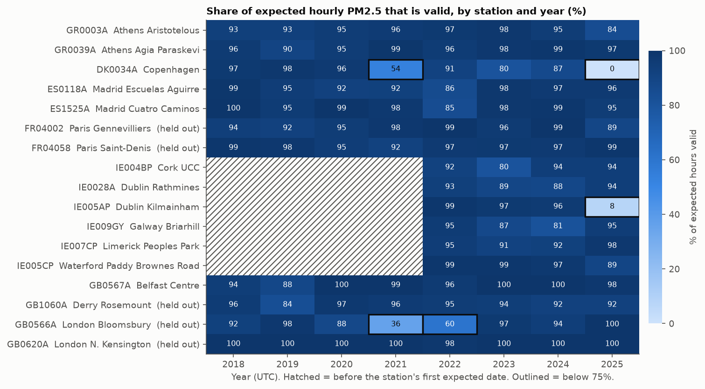
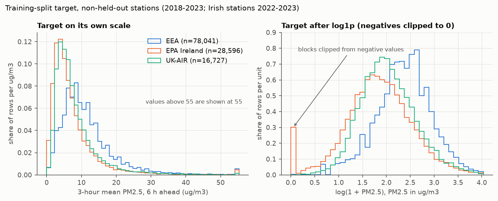
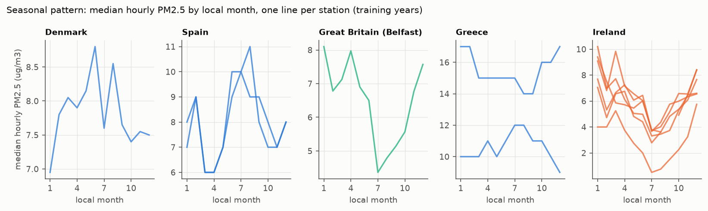
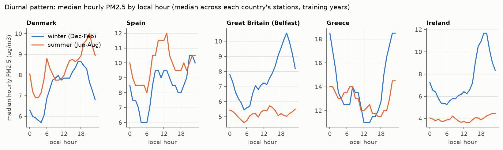
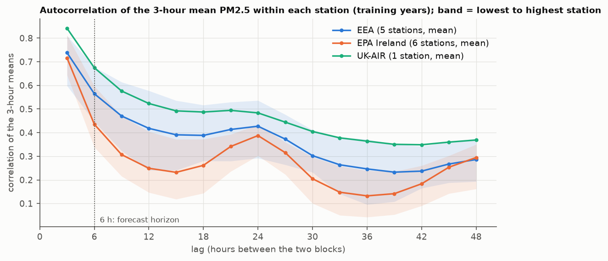
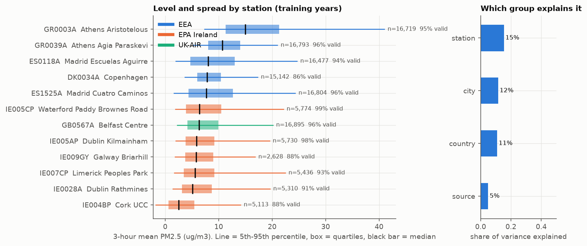
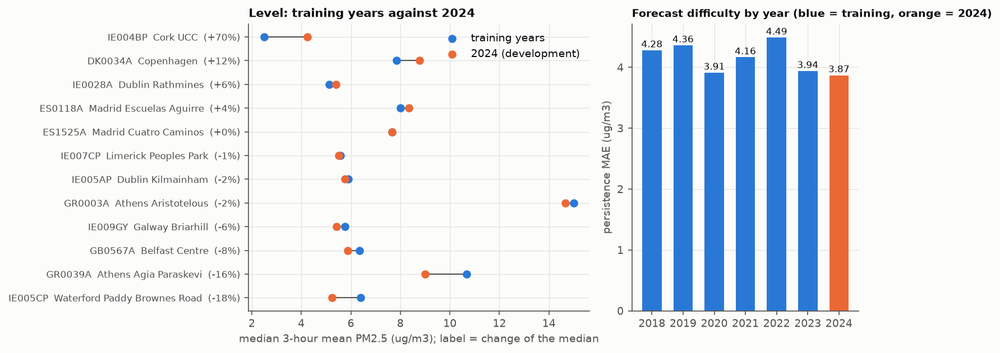

# Six-Hour Urban PM2.5 Forecasting Across Ireland and Europe: Milestone 2 Report

**Repository:** https://github.com/Dazzmondo/dh-PM2.5-forecast

## Contents

1. Project definition
2. Data source, provenance, governance and ethics
3. Data description
4. Exploratory data analysis
5. Design and architecture
6. Implementation
7. Results and limitations
8. Next steps
9. AI acknowledgement
10. How to reproduce

---

## 1. Project definition

**Problem.** Forecast the **3-hour mean PM2.5 concentration (ug/m3) six hours ahead** at urban air-quality monitoring stations in Ireland and Europe. PM2.5 (particles under 2.5 micrometres) is the pollutant most closely linked to health effects, and a six-hour warning is useful to people and services that can act in that time.

**Exact target.** For a station and a 3-hour block B that has just finished (blocks are fixed windows on the UTC clock: 00-03, 03-06, ...), the target is the mean PM2.5 of the block that starts 6 hours after B starts (two blocks later). A block's mean needs at least 2 of its 3 hourly values, and nothing is ever imputed. A row is usable only if the current block, three earlier blocks, the 24-hour rolling mean and standard deviation, and the target are all valid.

**Unit of analysis.** One row is one station at one 3-hour block, described by that block and the blocks before it, and its label is the mean of the block two blocks later.

**Task unchanged since Milestone 1.** The target, the horizon, the stations and the split years are the same as in Milestone 1; what changed are the cleaning and encoding decisions that Milestone 1 left open (section 5.3).

**Scope.** 17 stations in 9 training and 3 held-out cities: Cork, Dublin (2 stations), Galway, Limerick, Waterford, Belfast, Copenhagen, Madrid (2) and Athens (2) for training and development; **Derry, London (2) and Paris (2) are held out entirely** to test generalisation to cities the model has never seen. Training uses 2018-2023 (Irish stations 2022-2023), 2024 is the development year, 2025 is the final test, and 2026 is reserved for a later retraining demonstration.

**Research questions.** (1) Can machine learning forecast PM2.5 six hours ahead better than simply carrying the current value forward? (2) Can a model trained on several cities work in a city it has not seen? (3) Does geographic diversity in training help or hurt?

**Success criterion.** The forecast must beat the persistence baseline (the current block as the forecast): on the development year its MAE is **3.869 ug/m3** (RMSE 7.99) over 31,192 rows. Scores are always reported per station as well as pooled, with the row count beside each.

**Where this milestone fits.** Milestone 1 built the storage, versioning, preprocessing and split pipeline and was submitted separately. Milestone 2 (this report) adds the data understanding and the changes that understanding required. Milestone 3 will build and compare models; Milestone 4 will deploy and retrain on 2026 data.

**Short summary of Milestone 1.** Raw files from three official sources were stored unchanged in a private Google Cloud Storage bucket, each file with a SHA-256 checksum in a manifest; a Python pipeline turned them into one hourly table in UTC, 3-hour blocks, a feature table and chronological and geographic splits; and every stored dataset was recorded in a second manifest with the code version and settings. Milestone 1 left several decisions open (negative readings, the 2-of-3 rule, whether station identity is a feature, how to encode time of day). Section 4 answers them.

---

## 2. Data source, provenance, governance and ethics

### 2.1 Sources

| Source | Owner and access | Format kept | Stations | Years | Validation status |
|---|---|---|---|---|---|
| EEA Air Quality Download Service | Owner: European Environment Agency (AQ e-Reporting, dataset page https://www.eea.europa.eu/data-and-maps/data/aqereporting-8, Prod-ID DAT-3-en; no DOI is assigned). Access: https://eeadmz1-downloads-webapp.azurewebsites.net/ and the API behind it, documented at https://eeadmz1-downloads-api-appservice.azurewebsites.net/swagger/index.html | Parquet (one file per station) | 7: Athens x2, Copenhagen, Madrid x2, Paris x2 | 2013-2025 held; study uses 2018-2025 | Verified data only (dataset E1a, Verification flag 1) |
| EPA Ireland (airquality.ie) | Owner: Environmental Protection Agency, Ireland (the site is operated by Sonitus Systems). Access: the readings page, https://airquality.ie/readings | CSV (6-month windows) | 6: Cork, Dublin x2, Galway, Limerick, Waterford | 2022-2025 (Galway from 22 Dec 2022) | **Not validated** (the site's own disclaimer) |
| UK-AIR | Owner: Defra (https://uk-air.defra.gov.uk/). Access: the `.RData` files published for the R package openair, one file per station-year at `https://uk-air.defra.gov.uk/openair/R_data/<site>_<year>.RData`, for example https://uk-air.defra.gov.uk/openair/R_data/BEL2_2024.RData (the folder itself has no index page) | `.RData` (one file per station-year) | 4: Belfast, Derry, London x2 | 2018-2025 | The files carry no per-value ratification status |

Station identity, coordinates, time zone and each station's first expected date live in one table, `metadata/station_reference.csv` (17 rows), whose IDs and coordinates come from the EEA's station metadata (six country tables downloaded by `download_source_metadata.py`). Why these sources and stations: they are official, open and hourly, they cover large cities, and Milan, London Westminster and Athens Lykovrisi were rejected after inspection because their files lacked the required data.

**Data types.**

| Field | Type | Meaning |
|---|---|---|
| `station_id`, `source`, `city`, `country`, `timezone` | text (categorical) | identity and place; `timezone` is an IANA name such as Europe/Dublin |
| `latitude`, `longitude` | decimal number | station position in degrees |
| `timestamp_utc`, `block_start_utc` | datetime, UTC | start of the hour or of the 3-hour block |
| `pm25`, `pm25_3h_mean`, `pm25_current`, `pm25_lag_1..3`, `pm25_rolling_mean`, `pm25_rolling_std`, `target_pm25` | decimal number, ug/m3 | PM2.5 concentration; missing is NaN, never filled |
| `local_timestamp`, `time_block`, `day_of_week`, `month`, `season` | datetime and integer or text labels | local-time labels (`time_block` is a label, not a fixed local window) |
| `split` | text (categorical) | train, dev, test, held_out_test, future_update or excluded |

### 2.2 Provenance: how a value can be traced

1. **Acquisition.** Four scripts download the data (`download_ukair.py`, `download_eea.py`, `download_epa.py`, `download_source_metadata.py`); they skip files that already exist, retry on errors and pause between requests. The raw files are never edited.
2. **Raw storage and checksums.** `upload_raw_data.py` mirrors `raw_data/` into the bucket under `raw/` and writes one line per file to `manifests/raw_files.jsonl`: path, SHA-256, size, modification time, upload time, source, pipeline version and git commit.
3. **Processed storage.** `store_preprocessed_data.py` uploads each processed stage and appends one record to `manifests/dataset_versions.jsonl`: the dataset run ID, pipeline, preprocessing and feature versions, git commit, `raw_data_version` (the SHA-256 of the raw manifest), the station-table hash, row counts per split, the configuration (rolling window, horizon, block rule, study start, high-value threshold, completeness threshold) and the hash and size of every output file.
4. **Question it answers:** "which exact raw files and code produced this dataset?" The scaler artefact adds its own record: the hash of the feature table it was fitted on and the rows and stations it used.

The bucket listing, a raw-manifest line, a dataset-record line and the second-run skip message are shown in section 5.4.

### 2.3 Time and time-zone assumptions

| Source | Label in the file | Time zone | Handling | How certain |
|---|---|---|---|---|
| EEA hourly | start of the hour | UTC+1 for every country (the service converts) | subtract 1 hour | documented by the EEA |
| EPA Ireland | end of the hour | UTC | subtract 1 hour | **inferred** from the data (each day starts at 01:00); not documented |
| UK-AIR `.RData` | start of the hour (seconds since 1970) | UTC | none | compared with the website's CSV files (header "GMT hour ending") for all 32 station-years: the same hours; 711 of 895,452 PM2.5 values differ by exactly 0.001 (most likely a rounding difference, not verified) |

The EPA assumption is the weakest: if it is wrong, Irish stations are shifted by one hour relative to the others. It could be tested by comparing with validated EEA data for the same station, which Ireland does not have at hourly resolution.

### 2.4 Quality flags and what the pipeline does with them

- **EEA:** only Validity 1 (valid), 2 (valid, below the detection limit, measured value given) and 3 (valid, below the detection limit, value replaced by half the limit) are kept; -1 and -99 carry sentinel values such as -999 and -9999 and become missing (30,725 such rows in the raw files). Files whose AggType is not "hour" are skipped (Copenhagen's daily file and Athens Agia Paraskevi's `_100`).
- **EPA:** no per-value flag; the site warns that sharp spikes may be a calibration or monitor fault. Empty placeholder rows stamped off the hour are dropped.
- **UK-AIR:** no per-value flag in the files used.

### 2.5 Licences, robots.txt and attribution

| Source | Where the terms are, and what they say (quoted exactly; read 19 October 2026) | Attribution |
|---|---|---|
| UK-AIR | UK-AIR content is made available under the Open Government Licence v3.0, https://www.nationalarchives.gov.uk/doc/open-government-licence/version/3/, which says: "You are free to: copy, publish, distribute and transmit the Information; adapt the Information; exploit the Information commercially and non-commercially for example, by combining it with other Information, or by including it in your own product or application." It also requires the user to "acknowledge the source of the Information in your product or application by including or linking to any attribution statement specified by the Information Provider(s) and, where possible, provide a link to this licence". If the Information Provider does not provide a specific attribution statement, the licence requires: "Contains public sector information licensed under the Open Government Licence v3.0." | UK-AIR data, Defra (OGL v3.0): Contains public sector information licensed under the Open Government Licence v3.0 |
| airquality.ie | Readings page, https://airquality.ie/readings, section "Disclaimer": "Data downloaded from this website has been collected automatically from the monitoring sites and has not yet been validated. Therefore, following validation this data may be subject to revision." "When using this data you must comply to the terms described in the Creative Commons Attribution licence." The page links to https://creativecommons.org/licenses/by/4.0/. The deed says the user is free to: "Share — copy and redistribute the material in any medium or format for any purpose, even commercially." "Adapt — remix, transform, and build upon the material for any purpose, even commercially." Under the following terms: "Attribution — You must give appropriate credit, provide a link to the license, and indicate if changes were made. You may do so in any reasonable manner, but not in any way that suggests the licensor endorses you or your use." | airquality.ie, EPA Ireland (CC BY 4.0) |
| EEA | Legal notice, https://www.eea.europa.eu/en/legal-notice: "Unless otherwise indicated, the European Environment Agency (EEA) is the owner of copyrights and database rights in this website and its contents, and EEA materials are published under the CC-BY license." "Information, documents and material available on this website and for which the EEA holds the rights of use are public and may be re-used without prior permission, free of charge, for commercial or non-commercial purposes, provided that the EEA is always acknowledged as the original source of the material and that the original meaning or message of the content is not distorted." "The re-use of certain data may be subject to different conditions, and if so the item concerned is accompanied by a copyright mark or other mention of the specific conditions relating to it." | European Environment Agency (CC BY) |

The EEA legal notice is written for the EEA website and its contents. Neither the Air Quality Download Service nor the dataset page (https://www.eea.europa.eu/data-and-maps/data/aqereporting-8, Prod-ID DAT-3-en) carries a notice of its own, so the legal notice is taken to apply to the data, which the member states report to the EEA.

UK-AIR's robots.txt disallows `/datastore/`, where its website CSV files live, so the project uses the `.RData` files under `/openair/R_data/`, which are not disallowed. The EEA download service allows everything; airquality.ie has no robots.txt. UK-AIR was not asked whether bulk use of the `.RData` files is welcome. Downloaded files are kept in a private bucket and are not in the repository (`raw_data/` is git-ignored), although earlier commits did contain them.

### 2.6 Ethics, representativeness and coverage bias

- **No personal data.** Stations are public monitoring sites identified by public codes; no individuals are involved.
- **Intended use.** A course experiment. The output is not an official air-quality assessment and must not be used for health advice.
- **Representativeness.** All stations are in large cities; results describe urban monitoring sites, not countries or rural air. Athens, Madrid and Belfast carry most of the training rows (together about 61% of train and dev rows), and the Irish stations only 2022-2024.
- **Heterogeneous quality.** Irish data are unvalidated, EEA data are verified, UK-AIR's status is unknown, so differences between countries mix real differences with data-quality differences. Station types differ (for example Copenhagen is a traffic station).
- **Coverage bias in time.** The held-out evaluation depends on 2025 data that is missing for Copenhagen (0 valid hours) and almost missing for Kilmainham (678 valid hours; 225 test rows). France is not in training at all, and Great Britain is represented by one station.
- **Reporting rule that follows.** Every per-station score is reported with its row count; flagged station-years (section 4.1) are named next to any score that depends on them.

---

## 3. Data description

### 3.1 Raw and canonical data

86 raw files: 46 EPA CSV (6-month windows), 32 UK-AIR `.RData` (4 stations x 8 years), 8 EEA Parquet. After parsing, all sources become one **canonical hourly table**: `station_id, source, city, country, timezone, latitude, longitude, timestamp_utc, pm25` (ug/m3), UTC, labelled by the start of the hour. The EEA files hold each station's full series (back to 2013), and the study period starts on 1 January 2018, so the canonical step drops 236,261 earlier rows.

| Stage | Rows | Notes |
|---|---|---|
| Canonical hourly, before the 2018 trim | 1,180,226 | |
| Canonical hourly, after the trim | **943,965** | of which 895,509 hours have a value |
| 3-hour blocks | 318,808 | 19,696 missing (fewer than 2 valid hours, or no data) |
| Feature rows | 285,574 | 33,234 dropped (no full history or no valid target); 22 columns |
| train / dev / test / held-out test / excluded | 123,364 / 31,192 / 25,944 / 13,362 / 91,712 | 91,674 are rows of the five held-out stations outside their 2025 test year (they are never used); 38 are rows of training stations whose input and target blocks fall in different periods (18 across 2023/2024, 20 across 2024/2025) |

### 3.2 Features

`pm25_current` (the block that has just finished), `pm25_lag_1..3`, `pm25_rolling_mean` and `pm25_rolling_std` (8 blocks, 24 hours, including the current block), the local-time labels (`time_block`, `day_of_week`, `month`, `season`), `city`, `country`, `latitude`, `longitude`, and the target `target_pm25`. Nothing from the target block or later enters any feature.

### 3.3 Rows by station and split

| Station | City | Role | train | dev | test | held-out test |
|---|---|---|---|---|---|---|
| Cork UCC | Cork | train | 4,504 | 2,652 | 2,599 | |
| Dublin Rathmines | Dublin | train | 4,859 | 2,158 | 2,446 | |
| Dublin Kilmainham | Dublin | train | 5,635 | 2,725 | 225 | |
| Galway Briarhill | Galway | train | 2,565 | 2,333 | 2,724 | |
| Limerick Peoples Park | Limerick | train | 5,347 | 2,534 | 2,784 | |
| Waterford Paddy Brownes Road | Waterford | train | 5,686 | 2,686 | 2,574 | |
| Belfast Centre | Belfast | train | 16,727 | 2,917 | 2,793 | |
| Copenhagen | Copenhagen | train | 14,339 | 2,457 | 0 | |
| Madrid Cuatro Caminos | Madrid | train | 15,738 | 2,685 | 2,289 | |
| Madrid Escuelas Aguirre | Madrid | train | 15,278 | 2,564 | 2,439 | |
| Athens Aristotelous | Athens | train | 16,210 | 2,651 | 2,295 | |
| Athens Agia Paraskevi | Athens | train | 16,476 | 2,830 | 2,776 | |
| Derry Rosemount | Derry | held out | | | | 2,552 |
| London Bloomsbury | London | held out | | | | 2,892 |
| London N. Kensington | London | held out | | | | 2,880 |
| Paris Gennevilliers | Paris | held out | | | | 2,304 |
| Paris Saint-Denis | Paris | held out | | | | 2,734 |

### 3.4 Target distribution and levels

Over the 123,364 training rows the median target is 8.3 ug/m3, the 99th percentile 43.0 and the maximum 309. Station medians of the 3-hour mean range from 2.5 (Cork UCC) to 15.0 ug/m3 (Athens Aristotelous). Figures 2 and 6 (section 4) show the distribution and the station differences.

---

## 4. Exploratory data analysis

Every analysis uses the **decision pool**: the 12 non-held-out stations, 2018-2024. Counts may cover all years and stations, but no threshold, rule or choice uses the 2025 test split or the held-out stations. Each result is written as finding, decision, limitation. Rules marked "judgement" were written down before the numbers were seen. The scripts print these conclusions themselves, so each can be checked by running it.

### 4.1 Missing data (Figure 1, `eda_missingness.py`)



*Figure 1. Percent of expected hours with a valid value, by station and year, for all 17 stations, including the 5 held-out ones, over 2018-2025 (a count, not used to make any decision; n = 112 station-years that have expected hours; hatched = before the station's first expected date; outlined = below 75%).*

- **Finding.** 5 of 112 station-years are below 75%: Kilmainham 2025 (8%), London Bloomsbury 2021 (36%) and 2022 (60%), Copenhagen 2021 (54%) and 2025 (0%). Of 77,763 missing hours, 88% lie in outages of 24 hours or more and only 6% in gaps of 3 hours or less.
- **Missing-data mechanism.** The evidence supports one statement: the missing hours are not scattered at random (so "missing completely at random" does not describe them); they come in long outages of a whole station, so whether a value is missing depends on the station and the period, both of which are observed, which is the pattern called "missing at random given station and time". A plausible but untested explanation is a monitor failing or being serviced independently of the air quality. What the data cannot show is whether missingness also depends on the concentration itself ("missing not at random", for example a monitor failing during a pollution episode), because the missing values were never observed. The consequence is that scores computed on complete rows describe the times when stations were running.
- **Decision.** No imputation or interpolation (outages cannot be bridged and short gaps are rare); keep the 75% figure as a flag; name the flagged station-years next to any score that depends on them.
- **Limitation.** Hours are counted, not information: a station can be 80% complete and still miss every winter episode. Expected hours come from each station's first available date, itself a reference-table judgement.

### 4.2 The 3-hour block rule (`check_block_rule.py`)

- **Finding.** Of the blocks from 2018 on, the rule "at least 2 of 3 valid hours" sets 1,405 blocks to missing (0.06% to 1.02% of each station's blocks with data; Cork highest) and keeps 3,232 blocks on a two-hour mean. With 1 of 3, training rows grow by 2.3% and development-year persistence MAE is 3.843; with 3 of 3 they fall by 5.6% and the MAE is 3.912; the chosen rule gives 3.869.
- **Decision.** Keep 2 of 3.
- **Limitation.** The comparison uses a persistence forecast only; a model that uses more of the history could react differently.

### 4.3 Negative readings (`check_negative_values.py`)

- **Finding.** 5,663 hourly values are negative. In the decision pool 3,696 of 484,443 valid hours are negative (0.76%), and **98.8% of them belong to Cork UCC** (15.7% of its hours: 19.3% in 2022, 20.9% in 2023, 7.6% in 2024, with a seasonal peak in summer). Every other pool station is at or below 0.06%. The negatives cluster near zero: 76.5% lie between -2 and 0, and 0.84% lie below -5 (the pre-registered limit was 1%). The 23 negatives that carry a kept EEA flag are small (-1.95 to -0.05) and flagged valid or valid-below-detection-limit. Setting negatives to missing would remove 60% of Cork's training rows (4,504 to 1,797); clipping to 0 would lift Cork's mean by 0.24 ug/m3 (4.70 to 4.94) and leaves the median unchanged. Development-year persistence MAE differs by only 0.6% between all policies (3.857 to 3.881).
- **Plausible explanation, not confirmed.** Analysers report small negatives when the true value is near zero (instrument noise or a baseline offset); Cork's drop in 2024 may be an instrument change. UK-AIR documentation of a negative detection limit could not be verified from the sources read.
- **Decision (judgement).** Keep negatives unchanged in the stored data; clip at 0 only inside a model's own step when needed (616 pool block means are at or below -1, where log1p is undefined). Any two-tier threshold would be a judgement and is not used.
- **Limitation.** The rule rests on one station's behaviour; if Cork's instrument was changed, its training years and its development year differ in noise level.

### 4.4 Values above 500 ug/m3 (`check_high_values.py`)

| Station | Time (UTC) | Value | One hour moves its block mean by | Split |
|---|---|---|---|---|
| Copenhagen | 2023-05-26 09:00 | 1,239 | 410 | training years |
| Copenhagen | 2023-07-04 10:00 | 648 | 206 | training years |
| Copenhagen | 2023-07-04 17:00 | 607 | 156 | training years |
| Copenhagen | 2023-07-05 19:00 | 613 | 193 | training years |
| Cork UCC | 2025-03-21 19:00 | 940 | 318 | test year |
| Cork UCC | 2025-04-18 03:00 | 680 | 232 | test year |
| Cork UCC | 2025-04-18 07:00 | 588 | 302 | test year |

- **Rule (judgement).** A value above 500 is kept only if it is sustained (at least two other hours above 100 within 3 hours) **and** corroborated (another station of the same city or country above the larger of 100 and three times its own typical level within 3 hours); otherwise it is set to missing. Corroboration is evidence, not proof.
- **Finding.** All 7 values are isolated and unconfirmed, so the rule sets all 7 to missing. Copenhagen's four are flagged valid and verified by the EEA, but no second Danish station exists, so they are the inconclusive case: three fall within 33 hours with other raised hours around them, which suggests a local source but does not prove one. The three Cork values sit among repeated readings of exactly -15.0 and the other Irish stations show at most 47 ug/m3.
- **Decision.** Apply the rule; each decision is saved in `high_value_audit.csv`. Putting the values back changes nothing in the training row count (123,364) or the development-year persistence error (3.8688), because none lies in the development year.
- **Limitation.** The thresholds are judgements; three of the values are in the test year, so the rule changes the test data's definition (by data pattern, not performance).

### 4.5 Target distribution (Figure 2, `eda_distributions.py`)



*Figure 2. Training-split target (n = 123,364), by source, on its own scale (left) and after log1p (right; the spike at 0 is blocks clipped from negative values).*

- **Finding.** Strongly right-skewed: skewness 4.7 on its own scale, -0.2 after log1p; median 8.3, 99th percentile 43.0.
- **Decision.** Store the target unchanged. Tree models need no transform. For linear and neural models compare log1p (negatives clipped inside the model step) with the raw scale in Milestone 3, scoring both on the raw scale; report MAE and RMSE together because the tail separates them.
- **Limitation.** One distribution pools stations with very different levels; skewness is sensitive to a few extreme blocks.

### 4.6 Seasonal and daily cycles (Figures 3 and 4, `eda_seasonal_diurnal.py`)



*Figure 3. Median hourly PM2.5 by local month (training years; Irish curves rest on two years).*



*Figure 4. Median hourly PM2.5 by local hour, winter (Dec-Feb) and summer (Jun-Aug).*

- **Finding.** 10 of 12 stations swing by at least 25% of their level over the year (median 64%); the daily swing is large (median 71%) and has a different shape in winter, with an evening peak in northern and Irish stations, and in summer.
- **Decision.** Give models month and local hour as cyclical (sin and cos) features built from `local_timestamp`; drop `season`, which repeats the month.
- **Limitation.** Irish curves rest on two years; a swing measured against a small level (Cork, median 3) looks very large; medians hide the high episodes.
- **The `time_block` label** (`check_time_labels.py`) is the local clock hour at the block start divided by 3. It is not a fixed local window (for Madrid label 0 covers local 01:00-04:00 in winter), and for Athens (UTC+2/+3) the same UTC block gets a different label in summer, which affects 24.7% of training and development rows. It stays in the data as a label; models use the continuous local time instead.

### 4.7 Autocorrelation at the forecast horizon (Figure 5, `eda_autocorrelation.py`)



*Figure 5. Correlation of a block's mean with the block k later, within each station, training years only (the dotted line marks the 6-hour horizon).*

- **Finding.** The correlation between the current block and the block 6 hours ahead is 0.52 (median over stations, range 0.34 to 0.68), so the current block alone accounts for about 27% of the variance; at 24 hours it is 0.41, and at 5 of 12 stations the 24-hour correlation exceeds the 9-hour one, a daily cycle.
- **Decision.** Keep the current block, three lags and the 24-hour rolling statistics; test "same block yesterday" (lag 8) as a candidate feature in Milestone 3 and keep it only if it helps on the development year.
- **Limitation.** A linear correlation on a skewed variable is dominated by the high episodes and says nothing about error at low levels.

### 4.8 Station differences (Figure 6, `eda_station_differences.py`, `check_training_coverage.py`)



*Figure 6. Percentiles of the training-year 3-hour mean by station, with n and the share of valid blocks, and the share of variance explained by each grouping.*

- **Finding.** Medians range from 2.5 to 15.0 ug/m3. Station identity explains 15% of the variance of a 3-hour mean (city 12%, country 11%, source 5%). The 12 training stations are 9 cities in 5 countries; Great Britain is represented only by Belfast and France not at all.
- **Decision.** Keep `station_id`, `city`, latitude, longitude and country out of the baseline feature set. Test place information (latitude, longitude, country) as a named ablation validated by leaving whole cities out, not stations, because the held-out units are cities and stations of one city are highly correlated; with 9 training cities there are at most 9 folds.
- **Limitation.** This is evidence that place is not the main driver, not proof that adding it would hurt; station level also reflects real site differences a model could use in a new city.

### 4.9 Is the development year typical? (Figure 7, `eda_dev_drift.py`)



*Figure 7. Left: each station's median in the training years and in 2024. Right: persistence MAE by year (2024 in orange).*

- **Finding.** 11 of 12 stations have a 2024 median within 25% of their training median; Cork UCC is +70% (its negative share fell from about 20% to 7.6%). The 2024 persistence error is 3.87 against 3.91 to 4.49 in the training years, 0.04 below the lowest, so by the pre-registered reading (a judgement) 2024 is "not clearly similar", although the pooled differences are small and the one clear change is Cork.
- **Decision.** Use 2024 as the development year as planned; report per-station scores beside the pooled one; report every pooled score twice, with and without Cork UCC, and give Cork UCC's development score on its own line with its row count and its share of negative hours (about 20% in the training years, 7.6% in 2024). Cork is not removed from training; whether it helps or hurts is judged from the with/without difference.
- **Limitation.** One year cannot show a trend, and the 25% and two-thirds limits are judgements.

### 4.10 Persistence baseline (`baseline_persistence.py`)

On the development year the persistence forecast has MAE 3.869 ug/m3 and RMSE 7.99 over 31,192 rows; the mean target is 9.07, so the error is 43% of the mean. By station the MAE ranges from 2.87 (Belfast, 39% of its mean) to 6.65 (Athens Aristotelous, 38%), and the relative error from 30% (Athens Agia Paraskevi) to 60% (Cork UCC, Limerick). **Missing-data policy:** a row exists only if all inputs and the target are valid; persistence itself needs only the current block and the target, and the looser set has 32,651 rows (MAE 3.850), so the strict policy keeps 95.5% of them.

---

## 5. Design and architecture

### 5.1 Pipeline

The pipeline, from the sources to the reports (arrows show the files one step hands to the next):

```
SOURCE     UK-AIR (Defra)            EEA Air Quality Download     EPA Ireland (airquality.ie)
           .RData files              Service API, Parquet         readings pages, CSV
               |                              |                           |
               v                              v                           v
INGEST     download_ukair.py          download_eea.py            download_epa.py
           (+ download_source_metadata.py: EEA station metadata)
                                      |
                                      v
           raw_data/   original files, never edited
                                      |
                                      v
STORE      upload_raw_data.py  ->  GCS raw/  +  manifests/raw_files.jsonl (SHA-256 per file)
                                      |
                                      v
VALIDATE   canonicalize_raw_data.py -> processed_data/canonical_hourly.parquet
              (parse, match files to stations, UTC, trim to 2018+, above-500 rule; stops on bad files)
           validate_data_quality.py -> quality_reports/  (reports only)
                                      |
                                      v
TRANSFORM  aggregate_to_3hour.py -> feature_extraction.py -> create_splits.py -> fit_scalers.py
              (3-hour blocks -> lags, rolling statistics, target -> split labels -> train-only scalers)
                                      |
                                      v
STORE      store_preprocessed_data.py -> GCS processed/  +  manifests/dataset_versions.jsonl
                                      |
                                      v
OUTPUT     check_*.py, eda_*.py, baseline_persistence.py -> reports/ (tables, figures)
           split datasets (train, dev, test, held-out) for Milestone 3
```

Scripts hand data to each other only through files, so any step can be re-run alone. Only `upload_raw_data.py` and `store_preprocessed_data.py` talk to the cloud.

**Automated and manual.** Every step from the downloads to the figures is a script run by hand, one command per step, in the order of section 10; there is no scheduler or orchestration tool, because the data are historical and the pipeline is run on request. The only manual actions are signing in to Google Cloud (`gcloud auth application-default login`), setting the two environment variables, and taking the console screenshots used as storage evidence.

### 5.2 Storage design: how the bucket is configured, organised and accessed

- **Why object storage.** The data are historical files read in batches and never updated in place, so durable object storage (Google Cloud Storage, EU multi-region, uniform bucket-level access) fits; a database, BigQuery and a feature store were considered and not needed at this size (about 1 million hourly rows).
- **Layout.** `raw/` mirrors the local `raw_data/` folder (`raw/eea/athens/...`); `processed/canonical`, `processed/three_hour`, `processed/features`, `processed/scalers` and `processed/splits/{train,dev,test,held_out,future_update}`; `manifests/raw_files.jsonl` and `dataset_versions.jsonl`; `metadata/station_reference.csv`. The folder of every station is a column of the reference table, so no script holds a station list.
- **Versioning.** Object versioning is on, so a re-uploaded file keeps its older copy; a lifecycle rule deletes non-current versions after 7 days, trading history for cost (the manifests and hashes keep the lineage). Re-running the store step is safe: it appends a manifest line.
- **Access.** Application Default Credentials; the project and bucket names come from the environment variables `GCP_PROJECT_ID` and `GCS_BUCKET_NAME`. No key or name is in the code or the repository.
- **Integration.** The upload script creates the bucket if it is missing, uploads only new or changed files (checksum comparison) and verifies the object count; the store script refuses to run if an earlier stage's output is missing and links each dataset record to the raw manifest's hash.

### 5.3 What changed since Milestone 1, and why

| Change | Reason (evidence) |
|---|---|
| All four download scripts exist; the manual download guide is gone | Reproducibility: the project can be rebuilt from an empty clone; UK-AIR's robots.txt forbids the CSV route, so `.RData` files are used |
| `raw_data/` and `metadata/source_metadata/` are no longer committed | Data live in the bucket; the repository holds code and the station table |
| Rows before 2018 are dropped in `canonicalize_raw_data.py` | The EEA API returns whole series: 236,261 rows (20%) lay outside the study period |
| Above-500 rule with an audit file | 7 isolated spikes, up to 410 ug/m3 effect on a block mean (section 4.4) |
| Negatives kept | Cluster near zero, one station, removing them censors one side (4.3) |
| Scaler artefact fitted on the train split only, stored in the bucket | Models that need scaling must not learn from dev, test or held-out data (4.5, 4.8) |
| Evidence and EDA scripts, one per question | Decisions must be reproducible, not typed from memory |
| `PIPELINE_VERSION` and `PREPROCESSING_VERSION` are v2; dataset records store the study start and the 500 threshold | Behaviour changed, and the record must say with which settings |

### 5.4 Storage evidence

The outputs below come from running the final pipeline against the project bucket.

1. **Bucket layout.** `gcloud storage ls -r gs://<bucket>/` shows `raw/`, `processed/` (including `scalers/`), `manifests/` and `metadata/`. [Insert terminal output or Cloud Console screenshot.]
2. **Manifests.** One line of `manifests/raw_files.jsonl` and the latest line of `manifests/dataset_versions.jsonl`, with its config block and the scaler output. [Insert output.]
3. **Upload and skip logic.** The first upload summary (`86 new ... Counts match`) and the second run (`0 new, 0 updated, 86 unchanged`). [Insert output.]
4. **Versioning and lifecycle.** The bucket's Protection page, showing object versioning and the 7-day rule for non-current versions. [Insert screenshot.]
5. **Reading from storage.** A read of a processed file from the bucket (for example with `gcsfs`), to show the data are usable from storage. [Insert output.]

---

## 6. Implementation

### 6.1 Code organisation

| Group | Scripts | Role |
|---|---|---|
| Acquisition | `download_ukair.py`, `download_eea.py`, `download_epa.py`, `download_source_metadata.py` | Fetch raw files and station metadata |
| Storage | `upload_raw_data.py`, `store_preprocessed_data.py` | Mirror raw files and processed stages to the bucket with manifests |
| Cleaning and transformation | `canonicalize_raw_data.py`, `aggregate_to_3hour.py`, `feature_extraction.py`, `create_splits.py`, `fit_scalers.py` | One canonical table, 3-hour blocks, features and target, split labels, train-only scalers |
| Validation | `validate_data_quality.py` | Reports on schema, duplicates, completeness and value ranges |
| Evidence and EDA | `check_*.py`, `eda_*.py`, `baseline_persistence.py`, `analysis_helpers.py` | Tables and figures for the decisions |
| Support | `config.py`, `stations.py` | Paths, versions, the validated station table |

Every function has a docstring and every script says what it reads, writes and why. The code is linted (`python -m pyflakes src/*.py` is clean).

### 6.2 Validation: what is checked, what only reports, what stops the run

- **Stops the run (nothing is written):** a file that cannot be parsed or matched to a station; a file in a folder not listed for its source; a UK-AIR file whose site name does not match its folder; an EEA file that mixes hourly and other rows, holds several pollutants or is in the wrong station's folder; two files giving different values for the same station-hour; a selected station with no data; duplicate hours reaching the aggregation; a held-out station missing or with no 2025 rows; any held-out row in train, dev or test; held-out rows among the scaler's training rows; missing environment variables for the cloud steps; and a missing input for any later step.
- **Reports only (`validate_data_quality.py`, nothing removed):** schema warnings (UTC time zone, numeric PM2.5, timestamps on the hour, known station IDs); duplicates; completeness per station and year against the 75% target; counts of negative values and values above 500.
- **Handled by a written rule:** rows before 2018 (dropped), values above 500 (the rule in 4.4), EEA rows with an invalid flag (missing), 3-hour blocks with fewer than 2 valid hours (missing).
- **Never done:** imputation, interpolation, winsorising, or any choice made with the test split.

### 6.3 Leakage prevention

Features use only the current and earlier blocks; a row is labelled with a period only if its input block and target block fall in the same period; held-out stations never enter train, dev or test and this is checked in `create_splits.py`; scalers are fitted on the train split only and `fit_scalers.py` stops if a held-out station is among the rows; all thresholds come from the decision pool; the corroboration medians use data before 2025. **Not yet applied (Milestone 3):** cross-validation must be time-aware and grouped by city.

### 6.4 Verification

- The full local pipeline was run from an empty `raw_data/` (all four download scripts, then scripts 2 to 6) and reproduced the numbers in section 3.
- `analysis_helpers.verify_against_pipeline()` rebuilds the feature table from the canonical table with the pipeline's own functions and stops unless it matches (285,574 rows and the same split counts); every what-if script runs it first.
- The scaler check shows train scaled to mean 0.000 and standard deviation 1.000 and dev not forced to it (pm25_current mean -0.14), and a log1p target scaled and turned back reproduces the original values to 2e-13.
- **Not tested:** data for 2026 (reserved for Milestone 4).

### 6.5 Example output

Real output of the scripts, from the runs behind the numbers in this report.

**A step that stops, writing nothing.** A copy of a Belfast file was placed in the London folder of a scratch copy of the repository, and `canonicalize_raw_data.py` was run:

```
STOPPED - these files could not be used:
  - ...\raw_data\uk_air\london\BEL2_2018.RData: not inside any raw_folder listed for uk_air stations in station_reference.csv (['belfast', 'derry', 'london/londonBloomsbury', 'london/londonKensington'])
```

The exit code was 1 and no `processed_data/` folder was created. With the file removed the same script ran to the end:

```
--- Coverage: 17 / 17 stations ---
...
Saved 943965 canonical hourly rows -> processed_data\canonical_hourly.parquet
```

**A rule applied and audited.** `check_high_values.py` reports each value above 500 ug/m3 with its context (the first of the 7):

```
DK0034A Copenhagen (eea, Copenhagen, DK)  2023-05-26 09:00:00+00:00  value 1238.7
    split: training years; station median before 2025: 7.9
    same station, hours -6..+6: 11 12 11 11 10 9 1239 8 7 8 3 4 4
    no other station of the same city or country in the project
    its 3-hour block: mean 418.1 with the value, 7.8 without; one hour moves the block mean by 410.3
    rule: sustained=False, corroborated=False -> set to NaN
```

**A result.** `baseline_persistence.py`:

```
rows 31,192; MAE 3.869 ug/m3; RMSE 7.993; mean target 9.07; MAE is 43% of the mean target
```

### 6.6 Cleaning rules in code

The rules in 4.3 and 4.4 are constants and two functions in `canonicalize_raw_data.py` (`trim_to_study_period`, `handle_high_values`), documented in the README with verbatim excerpts. The dataset record stores the study start and the threshold, so a dataset says which rules produced it.

---

## 7. Results and limitations

**Results.** A reproducible pipeline turns 86 raw files from three official sources into 285,574 usable rows with chronological and geographic splits; the persistence baseline on the development year is 3.869 ug/m3 MAE; cleaning rules, feature decisions and the validation design are each backed by a script whose output is reproducible.

**Limitations**, ranked by how much each could change a Milestone 3 conclusion, with what addresses it:
1. **One development year.** 2024 is the only year used for choices, and it is "not clearly similar" to the training years (4.9; Cork UCC is +70%). *Addressed by:* per-station scores beside the pooled one, scores with and without Cork UCC, and time-aware cross-validation inside the training years as a second view (section 8).
2. **Thin evidence for unseen cities.** Copenhagen has no valid hours in 2025 and Kilmainham 678; France is not in training and Great Britain only through Belfast. *Addressed by:* per-city scores with row counts, and claims about unseen cities only from the held-out evaluation.
3. **Unequal data quality and history.** Irish data are unvalidated and have two training years, UK-AIR's status is unknown, so country differences are partly quality differences. *Addressed by:* reporting by source.
4. **An inferred timestamp.** The EPA convention (hour ending, UTC) is inferred, not documented. *Addressed by:* scoring the Irish stations separately and testing a one-hour shift.
5. **Judgement thresholds.** The limits of 25%, two thirds, 500 and 100 ug/m3 and three times the median are judgements, labelled as such and written before the evidence. *Addressed by:* the sensitivity checks already run (2-of-3 rule, negatives, values above 500).
6. **Unconfirmed explanations.** The reasons for Cork's negatives and for the 2024 change are plausible, not confirmed; the same holds for the cause of the outages (4.1). *Addressed by:* stating them as such and not building a rule on them.

---

## 8. Next steps

The steps are ordered by priority: **core** steps answer the research questions, the others are done if the core is complete.

| Step | Priority | What | How it is checked |
|---|---|---|---|
| 1. Models | Core: Linear Regression and XGBoost; optional: GRU/LSTM | Linear Regression and XGBoost, then a GRU or LSTM if time allows, all scored on the same 31,192 development rows as persistence | MAE and RMSE overall and per station, with row counts; the model must beat 3.869 MAE |
| 2. Feature sets | Core | Baseline = current, lags, rolling statistics, cyclical month and local hour; add "same block yesterday"; compare log1p against the raw scale using the saved scalers | Development year only |
| 3. Place ablation | Core (research question 3) | Add latitude, longitude, country | Leave-one-city-out cross-validation on the training years (at most 9 folds), time-aware inside each fold |
| 4. Held-out cities | Core (research question 2) | One final evaluation on Derry, London and Paris, and on the 2025 test split, after every choice is frozen | Each used once; per-city scores; France is not in training and Great Britain only through Belfast |
| 5. Storage integration | Should | Store model artefacts and metrics in the bucket (`models/`), read the training data from the bucket, log each model with the dataset run ID and scaler hash | Dataset record, scaler record and model record share IDs |
| 6. Open questions | As needed | Rolling-window length; GRU sequence length; whether Cork needs separate treatment; the EPA timestamp convention | Each decided on training and development data |
| 7. Later | Milestone 4 | Deployment and retraining on 2026 data | The pipeline already reserves `future_update` |

**Evaluation approach.** Every model is compared with the persistence baseline (MAE 3.869 ug/m3, RMSE 7.99, 31,192 development rows) on exactly the same rows. MAE is the main metric because it is in the units of the target and is not dominated by a few episodes (the baseline's MAE is 43% of the mean target); RMSE is the second metric because it penalises missed pollution episodes more. Both are reported overall and per station with the row count, and pooled scores are given with and without Cork UCC (4.9). The training years fit the models; the development year (2024) is used for every choice; cross-validation inside the training years is time-aware (and grouped by city for the place ablation); the 2025 test split and the held-out cities are used once, after the choices are frozen. A model counts as an improvement if it beats persistence on the development year overall, and the report states at how many stations it does so.

**Risks.** Overfitting to the single development year (mitigation: per-station scores and city-grouped validation); data-quality differences driving country effects (mitigation: report by source); the timestamp assumption for Ireland (mitigation: report Irish scores separately and test a one-hour shift).

---

## 9. AI acknowledgement

AI tools were used in this work. **Claude** (Sonnet 5 and Sonnet 5.5) was used to plan the work, write and review code, run analyses and draft documentation, including the scripts in `src/` and this report. **ChatGPT** was used only to discuss design choices, analyse code and review Claude's recommendations.

---

## 10. How to reproduce

Every script that is run, in the order it is run (each reads what the earlier ones wrote):

| # | Script | What it does | Writes | Needs the cloud |
|---|---|---|---|---|
| 1 | `download_ukair.py` | Downloads UK-AIR's yearly `.RData` files (32) | `raw_data/uk_air/` | no |
| 2 | `download_eea.py` | Downloads the verified hourly PM2.5 Parquet file of each EEA station (8 files) | `raw_data/eea/` | no |
| 3 | `download_epa.py` | Downloads the EPA Ireland readings as CSV files (46) | `raw_data/epa/` | no |
| 4 | `download_source_metadata.py` | Downloads the EEA station metadata, one table per country (6 files) | `metadata/source_metadata/` | no |
| 5 | `upload_raw_data.py` | Creates the bucket if needed and mirrors `raw_data/` into it with checksums | `raw/` and `manifests/raw_files.jsonl` in the bucket | yes |
| 6 | `canonicalize_raw_data.py` | Parses all sources into one hourly UTC table, drops rows before 2018, applies the above-500 rule | `processed_data/canonical_hourly.parquet`, `quality_reports/high_value_audit.csv` | no |
| 7 | `validate_data_quality.py` | Reports on schema, duplicates, completeness and value ranges (changes nothing) | `processed_data/quality_reports/` | no |
| 8 | `aggregate_to_3hour.py` | Hourly values to 3-hour mean blocks (2 of 3 hours valid) | `processed_data/three_hour_aggregated.parquet` | no |
| 9 | `feature_extraction.py` | Lags, rolling statistics, time labels and the 6-hour-ahead target | `processed_data/features/pm25_features.parquet` | no |
| 10 | `create_splits.py` | Labels every row train, dev, test, held-out or excluded | `processed_data/features/pm25_features_with_splits.parquet` | no |
| 11 | `fit_scalers.py` | Fits the scalers on the train split only | `processed_data/scalers/scalers.json` | no |
| 12 | `store_preprocessed_data.py` | Uploads every processed stage and the scaler file, and records the dataset version | `processed/` and `manifests/dataset_versions.jsonl` in the bucket | yes |
| 13 | `check_negative_values.py` | Negative readings: where, how large, flags, effect of each way of handling them | `reports/negative_values/` | no |
| 14 | `check_high_values.py` | Evidence behind each value above 500 ug/m3 | `reports/high_values/` | no |
| 15 | `check_time_labels.py` | What `time_block` means and whether it changes with daylight saving | `reports/time_labels/` | no |
| 16 | `check_block_rule.py` | What the 2-of-3 rule drops, and what a rule of 1 or 3 would do | `reports/block_rule/` | no |
| 17 | `check_training_coverage.py` | Cities and countries covered by the training stations | `reports/training_coverage/` | no |
| 18 | `baseline_persistence.py` | Persistence baseline on the development year | `reports/baseline/` | no |
| 19 | `eda_missingness.py` | Figure 1: missing data by station and year, and the gaps | `reports/figures/`, `reports/eda/missingness/` | no |
| 20 | `eda_distributions.py` | Figure 2: the target's distribution | `reports/figures/`, `reports/eda/distributions/` | no |
| 21 | `eda_seasonal_diurnal.py` | Figures 3 and 4: seasonal and daily cycles | `reports/figures/`, `reports/eda/seasonal_diurnal/` | no |
| 22 | `eda_autocorrelation.py` | Figure 5: autocorrelation at the forecast horizon | `reports/figures/`, `reports/eda/autocorrelation/` | no |
| 23 | `eda_station_differences.py` | Figure 6: differences between stations | `reports/figures/`, `reports/eda/station_differences/` | no |
| 24 | `eda_dev_drift.py` | Figure 7: is the development year like the training years? | `reports/figures/`, `reports/eda/dev_drift/` | no |

Three more files in `src/` are never run on their own: other scripts import them. Together with the 24 scripts above, they are every file in `src/`, and each one is used.

| File | What it provides | Used by |
|---|---|---|
| `config.py` | The folder paths (`raw_data/`, `processed_data/`, `reports/`, `metadata/`), the pipeline version, the git commit written into the manifests, and the check that the Google Cloud settings are set | Every script, directly or through `analysis_helpers.py` |
| `stations.py` | Loads `metadata/station_reference.csv` (the one station table) and stops with a full list of problems if it is malformed | The four download scripts, `canonicalize_raw_data.py`, `validate_data_quality.py`, `create_splits.py`, `analysis_helpers.py` and the analysis scripts that need station details |
| `analysis_helpers.py` | The shared code of scripts 13 to 24: the decision pool (the 12 non-held-out stations, 2018 to 2024), a rebuild of the feature table with the pipeline's own functions plus a check that it matches the pipeline's table, the report folders, and the figure style and colours | Scripts 13 to 24 (all twelve check, baseline and EDA scripts) |

The input data file `metadata/station_reference.csv` (17 stations) is in the repository; `requirements.txt` lists the packages. Run the scripts in the order of the table: each one reads what the earlier ones wrote.

The commands, from the repository root once Python is installed (the README's Setup Guide has the Google Cloud setup and PowerShell and bash details):

```
pip install -r requirements.txt
python src/download_ukair.py
python src/download_eea.py
python src/download_epa.py
python src/download_source_metadata.py
python src/upload_raw_data.py
python src/canonicalize_raw_data.py
python src/validate_data_quality.py
python src/aggregate_to_3hour.py
python src/feature_extraction.py
python src/create_splits.py
python src/fit_scalers.py
python src/store_preprocessed_data.py
```

`upload_raw_data.py` and `store_preprocessed_data.py` need `GCP_PROJECT_ID`, `GCS_BUCKET_NAME` and Google Cloud credentials; every other step runs on your own machine. The evidence and EDA scripts then read `processed_data/` and write `reports/`:

```
python src/check_negative_values.py
python src/check_high_values.py
python src/check_time_labels.py
python src/check_block_rule.py
python src/check_training_coverage.py
python src/baseline_persistence.py
python src/eda_missingness.py
python src/eda_distributions.py
python src/eda_seasonal_diurnal.py
python src/eda_autocorrelation.py
python src/eda_station_differences.py
python src/eda_dev_drift.py
```

The README has the full setup guide with PowerShell and bash commands, expected output of every script and troubleshooting. Expected results of the local pipeline: 943,965 canonical rows; 318,808 three-hour blocks; 285,574 feature rows; splits 123,364 / 31,192 / 25,944 / 13,362 / 91,712; 5 flagged station-years; 5,663 negatives; 0 values above 500 (7 set to missing).
