# Six-Hour Urban PM2.5 Forecasting Across Ireland and Europe: Milestone 3 Report

**Repository:** https://github.com/Dazzmondo/dh-PM2.5-forecast

## Contents

1. Summary and project recap
2. Model selection
3. Hyperparameter optimisation
4. MLOps and experiment tracking
5. Analysis and conclusions from the experiments
6. Compute architecture selection
7. Reproducibility
8. Model card
9. Error analysis and model weaknesses
10. Limitations, future work and AI acknowledgement

---

## Where each marking criterion is answered

| Criterion | Where | Key evidence |
|---|---|---|
| 1. Model selection | 2.1 to 2.5 | Three naive baselines, Ridge, XGBoost and a GRU compared on identical rows; the candidate table gives role, reason and cost, including the alternatives not run; the tuned XGBoost is selected (2024 MAE 3.147 against 3.869 for persistence) |
| 2. Hyperparameter optimisation | 3.3 to 3.8, `docs/HYPERPARAMETER_HISTORY.md` | Ranges and scales (3.4); random search against TPE over three seeds and three rounds (780 XGBoost configurations), a Ridge sweep, a GRU grid and a 40-trial search; three expanding selection folds with no test leakage (3.5); a seed noise floor |
| 3. MLOps and experiment tracking | 4 | MLflow with 954 runs in 17 experiments, lineage tags (commit, data hashes, library versions, machine), exported tables, screenshots, and a model manifest in the bucket |
| 4. Analysis and conclusions | 5, and the hypothesis table | Verdicts for H1 to H12, the trade-off tables (5.2) and the one-time final evaluation (5.3) |
| 5. Compute architecture | 6 | Thread scaling, CPU against GPU on the same machine, the profile, cost estimates and GPU availability; the decision is in 6.3 |
| 6. Reproducibility | 7 | Seeds, hashes, a table of configuration files, Docker, a three-machine re-run and the instructions |
| 7. Model card | 8, and `docs/MODEL_CARD.md` | Purpose, data, method, performance per station, limitations, version history |
| 8. Error analysis | 9 | Slices by concentration, month, hour and station, named worst cases, weaknesses W1 to W7, repeated on the final data (9.6) |

Companion documents: the model card (`docs/MODEL_CARD.md`), the profiling report (`docs/PROFILING_REPORT.md`), the hyperparameter record (`docs/HYPERPARAMETER_HISTORY.md`) and the cloud runbook (`docs/GCP_RUNBOOK.md`).

---

## 1. Summary and project recap

**Task.** Forecast the **3-hour mean PM2.5 (µg/m³) six hours ahead** at urban monitoring stations: for a station and a fixed 3-hour UTC block that has just finished, predict the mean of the block that starts 6 hours later (two blocks ahead). Unchanged since Milestone 1.

**Data.** 17 stations in Ireland and Europe; 12 development stations in 9 cities (Cork, Dublin ×2, Galway, Limerick, Waterford, Belfast, Copenhagen, Madrid ×2, Athens ×2) and 5 held-out stations in 3 cities (Derry, London ×2, Paris ×2). Splits (Milestone 1/2): training 2018–2023 (the Irish stations only 2022–2023), development 2024, final test 2025, 2026 reserved for the Milestone 4 retraining demonstration. Row counts: train 123,364; development 31,192; test 25,944; held-out test 13,362.

**Baseline to beat (Milestone 2).** Persistence (the current block as the forecast) on the 31,192 development rows: **MAE 3.869 µg/m³, RMSE 7.99** (mean target 9.07).

**Research questions.** RQ1: can a learned model beat carrying the current value forward? RQ2: can a model trained on several cities work in a city it has not seen? RQ3: does geographic diversity in training help or hurt?

**What this milestone adds.** A controlled model comparison (baselines, Ridge, XGBoost, GRU), a documented hyperparameter search (random search against TPE), experiment tracking in MLflow, a measured compute comparison, a reproducibility procedure, a model card and an error analysis. The 2025 test split and the held-out cities were used once, after every choice was frozen.

**Headline result.** The selected model is the tuned XGBoost regressor (absolute-error objective, PM2.5 history and time features only). On the 2024 development year (31,192 rows) its MAE is 3.147 µg/m³ and its RMSE 6.263, a skill score of 0.187 against persistence (MAE 3.869), and it is better than persistence at all 12 development stations. On the 2025 test split (25,944 rows at 11 stations, never used for any choice) its MAE is 3.038 µg/m³ (RMSE 5.462, skill 0.179, better than persistence at 11 of 11 stations), and on the three held-out cities it never saw (Derry, London and Paris; 13,362 rows at 5 stations) its MAE is 3.069 (RMSE 5.057, skill 0.118, better than persistence at 5 of 5 stations).

**Compute decision.** A CPU machine is enough for the selected model, and it is the better value. On the GPU VM the tuned XGBoost fits in 16.3 s on that machine's own CPU and in 7.1 s on its T4 (a like-for-like comparison), about $0.0022 and $0.0018 per fit at assumed list prices: a saving of about 9 s and $0.0004 per fit, with no difference in accuracy (on the 4-core CPU VM alone the fit takes 22 s at 8 threads). The GPU is clearly better only for the GRU (3.7 times faster, half the cost per fit), which is the comparison model and not the selected one. **Availability counted against the GPU:** obtaining a single T4 took about four hours of refused requests across four European regions, which is a risk to a schedule and, for a service, to its reliability, and the GPU also needs extra set-up (driver, container toolkit, a CUDA image); section 6.3 gives the evidence.

**Evidence rule used throughout.** A change is adopted only if its seen-station MAE improves by at least 1% in at least 2 of the 3 selection folds (and on average) and the 2024 development MAE is not worse; otherwise the simpler option is kept and reported as "no clear difference". The rule was fixed before any result was seen. The 1% threshold is a heuristic, not a significance test.

**What the rule decides, and what it does not.** The rule decides whether a feature, target form, loss or model-structure *variant* is adopted. It does not decide whether tuned hyperparameters are used: the result of a hyperparameter search is its best configuration by the selection-fold objective, which is refitted and scored once on 2024, and the size of its gain over the starting configuration is reported as a finding, whatever the size. The starting values in section 3.1 were always starting points for the searches, not candidate final settings. Why a model with a small tuning gain is still the primary one is answered in section 5.2.

**One model, without place inputs.** The model uses PM2.5 history and time features only. Latitude, longitude and country are not inputs: place features can let a model learn the identity of its training cities, which is a risk for cities it has not seen (not target leakage, because no target information is in those columns), and the place ablation (section 5.1) found no benefit from them. A second model that adds them was considered and not built, by decision of the project: the risk to the unseen-city result and the evidence of no benefit did not justify the extra search and code. **Inputs are PM2.5 history only (no weather)**, by decision of the project; weather is listed as future work.

---

## 2. Model selection

### 2.1 What the task and data imply
- **Tabular, per-station time series**, 123,364 training rows (small by deep-learning standards), 12 development stations.
- **Strong persistence.** The correlation between the current block and the target (6 hours ahead) has a median of 0.52 over stations (range 0.34 to 0.68), so the current block explains about 27% of the target variance. Any model must beat a hard baseline.
- **Daily cycle.** Across the 12 stations the median correlation of a block with the block 24 hours later is 0.41, and with the block 9 hours later 0.39; at 5 of the 12 stations the 24-hour correlation is the higher of the two, so a day-earlier value carries information, though not at every station.
- **Skewed target.** Skewness 4.7 on the raw scale and −0.2 after log1p; episodes dominate squared error. MAE is the primary metric and RMSE the secondary one.
- **Place is not the main driver.** Station identity explains 15% of the variance (city 12%, country 11%), so the baseline excludes place features and tests them as a named ablation (section 5, RQ3).
- **Modest compute.** About 123k rows with 10–20 input columns: any model must be justified against a CPU-only workload.

### 2.2 Candidates and decision
| Model | Role | Why it is (or is not) included | Expected cost |
|---|---|---|---|
| Persistence | Baseline | The M2 benchmark; costs nothing | none |
| Rolling mean (8 blocks) | Baseline | Tests whether smoothing alone beats persistence | none |
| Seasonal naive (the block at t−6: same clock time as the target, one day earlier) | Baseline | Tests whether the daily cycle alone beats persistence | none |
| Ridge regression | Core | Linear reference; shows how much is gained beyond linear structure; deterministic | seconds |
| XGBoost | Core | Gradient-boosted trees are the standard strong model for tabular data; handle non-linearity and interactions without scaling | seconds to minutes (measured: about 2.2–2.5 s per default fit on the CPU, see section 6) |
| GRU on the ordered 8-block window | Planned neural model | Tests whether the order of the 24-hour history helps beyond the rolling summary; named as a planned model in M1 and M2 | Implemented and tuned (section 3.7). Tuned GRU: 813–1,238 s for the four fits (three selection folds and 2024) and 316–492 s for the 2024 fit, on the laptop |
| MLP on the same flattened window | Optional | Separates "neural" from "sequence-aware": same inputs as the GRU, no recurrence | Not run: it was optional, and the tuned GRU did not beat XGBoost (section 3.7), so a further neural variant on the same inputs was not expected to change the conclusion (not tested) |
| Considered and not run: SVR | Rejected | Kernel methods scale poorly with 123k rows (training time grows faster than linearly in the number of rows) | high |
| Considered and not run: Transformer | Rejected | Far more parameters and data-hungry than an 8-step window of one variable justifies | high |
| Considered and not run: LSTM | Rejected | A recurrent alternative to the GRU with more parameters and no expected advantage at 8 steps | medium |
| Considered and not run: LightGBM, CatBoost, random forest | Not run | Tree ensembles in the same family as XGBoost, on the same ten inputs: similar accuracy is expected, which was not tested; XGBoost was kept as the standard, fast and GPU-capable choice | seconds to minutes |
| Considered and not run: classical time-series models (SARIMA, exponential smoothing) | Not run | One model per station, with strong daily and seasonal cycles but short, gappy histories (Irish stations start in 2022), and no way to forecast a city with no history, which is RQ2; not tested | medium |
| Global model against one model per station | Design choice | One global model uses all 123,364 training rows and can serve unseen cities (RQ2); per-station models were not compared, and the per-station errors of the global model are reported in section 9 | none |

### 2.3 Feature sets (kept separate so that each comparison changes one thing)
| Set | Contents | Used by |
|---|---|---|
| A (the M2 baseline) | current block, lags 1–3, 8-block rolling mean and standard deviation, sin/cos of local hour, sin/cos of month | Ridge, XGBoost |
| A+S | A plus the block at t−6 (same clock time as the target one day earlier) | Ridge, XGBoost |
| B (raw window) | the 8 raw block values t−7 … t plus the same time features | Ridge, XGBoost, GRU, MLP |
| Place | latitude/longitude and/or country added to A | place ablation only |
| A with a longer window | A with the rolling mean and standard deviation over 16 or 24 blocks instead of 8, or the 24-block statistics added | window-length check (E4d) only |

The seasonal feature is t−6, not t−8: the target is block t+2, one day is 8 blocks, so the same clock time as the target is t+2−8 = t−6.
Milestone 2 called the daily feature "lag 8"; that number is the spacing between two blocks in its autocorrelation figure (a block and the block 8 later), which is exactly the pair (t−6, target). The pair (t−8, target) is 10 blocks apart and has a median correlation of 0.24 against 0.41 at 8 blocks, lower at all 12 stations, so a t−8 feature was considered and rejected on that evidence and was not run.

**Window length (E4d), measured.** The 8-block (24-hour) window of set A was chosen in Milestone 1 to cover one daily cycle. Whether 16 blocks (two days) or 24 blocks (three days) carry more information was checked once, before the freeze, with `src/check_window_length.py` (`configs/window_length.yaml`, MLflow experiment `m3_windows`, table in `reports/m3/window_length/window_length.csv`). Only the rolling mean and standard deviation change; the current block, lags 1–3 and the time features are the same. They are rebuilt from the gap-free block table and the rebuilt 8-block values are checked against the stored ones. A longer window needs more valid blocks, so the 11,451 rows (7.4%; 2,638 of the 31,192 development rows) without a complete 24-block window are dropped for **every** variant: all variants use the same 143,105 rows, and the window is the only difference. The model is the starting XGBoost configuration with the absolute-error objective, as in E3–E6, and the pre-stated adoption rule applies (at least 1% better in at least 2 of the 3 selection folds, and 2024 not worse). MAE on seen stations:

| Window | F2021 | F2022 | F2023 | Mean of folds | 2024 | Mean of folds, change | 2024, change |
|---|---|---|---|---|---|---|---|
| 8 blocks (set A) | 3.4505 | 3.4526 | 3.1619 | 3.3550 | 3.1916 | reference | reference |
| 16 blocks | 3.5019 | 3.4676 | 3.1750 | 3.3815 | 3.2220 | +0.79% | +0.95% |
| 24 blocks | 3.5275 | 3.4806 | 3.1669 | 3.3917 | 3.2272 | +1.09% | +1.11% |
| 8 blocks plus the 24-block statistics | 3.4858 | 3.4570 | 3.1535 | 3.3654 | 3.1997 | +0.31% | +0.25% |

Persistence on the same rows: 4.1771, 4.2681, 3.9074 (folds) and 3.9071 (2024). **No variant was adopted: none is 1% better in any fold, and every one is worse on 2024.** The only gain anywhere is 0.27% in one fold (F2023) for the combined variant, below the threshold and offset by losses in the other two folds. The 8-block window is kept. A plausible explanation, not tested here, is that older blocks add noise and that a two- or three-day average dilutes the signal of the last day, while the 8-block window already spans the daily cycle. The check used the starting hyperparameters only and was not re-tuned, so an effect of less than about 1% after tuning is not excluded, and it was run for XGBoost only: a longer window for the GRU was not tried, because each GRU fit takes minutes and the XGBoost result gives no reason to expect a gain. The 8-block model scores 3.1916 on 2024 here against 3.152 on all rows, because dropping the rows that follow gaps changes the rows slightly; the variants are comparable with each other but not with the other tables.

### 2.4 Selection result

All models on the same 31,192 development rows (MLflow experiments `m3_baselines`, `m3_features`, `m3_candidates`, `m3_neural`; exported in `reports/m3/run_summary.csv`). The selection-fold columns are the MAE on seen-station rows of the three expanding folds; "stations beaten" counts the 12 development stations where the model's 2024 MAE is below persistence; fit time is the total of the four fits (three folds and 2024) on the laptop; the GRU row is the mean of three seeds.

| Model | F2021 | F2022 | F2023 | Mean of folds | 2024 MAE | 2024 RMSE | Skill | Stations beaten | Fit time (4 fits) | Inference, ms per 1,000 rows |
|---|---|---|---|---|---|---|---|---|---|---|
| Persistence | 4.147 | 4.307 | 3.939 | 4.131 | 3.869 | 7.99 | 0 | n/a | 0 | 0 |
| Rolling mean (8 blocks) | 3.954 | 4.088 | 3.833 | 3.958 | 3.853 | 7.28 | 0.004 | 5 | 0 | 0 |
| Ridge (α = 1) | 3.614 | 3.740 | 3.482 | 3.612 | 3.471 | 6.58 | 0.103 | 12 | 0.3 s | 0.36 |
| XGBoost, starting values, squared error | 3.594 | 3.595 | 3.349 | 3.512 | 3.295 | 6.29 | 0.148 | 12 | 10.9 s | 3.6 |
| XGBoost, starting values, absolute error | 3.436 | 3.466 | 3.182 | 3.361 | 3.152 | 6.26 | 0.185 | 12 | 16.0 s | 3.6 |
| **XGBoost, tuned (E7c)** | **3.397** | **3.459** | **3.162** | **3.339** | **3.147** | **6.26** | **0.187** | **12** | 339 s | 22.9 |
| GRU, tuned (E9b, mean of 3 seeds) | 3.410 | 3.499 | 3.205 | 3.371 | 3.187 | 6.40 | 0.176 | 12 | 992 s (813–1,238) | 6.3 |

The seasonal-naive baseline (the block one day earlier) is far worse (2024 MAE 4.706, skill −0.216) and is left out of the table. Section 3.2 gives the results of the earlier variants (target forms, time encodings, the seasonal lag, the raw window) and section 2.3 the window-length check.

**Selected model: the tuned XGBoost.** It has the lowest error on the selection folds (3.339) and on 2024 (3.147), and it beats persistence at all 12 stations. Against the alternatives: Ridge is 10% worse on 2024 (3.471) but fits in a fraction of a second, so it is the cheap reference rather than the choice; the tuned GRU is 1.0% worse on the selection folds and 1.3% worse on 2024 and takes about three to four times as long to fit (316–492 s against 114 s for the 2024 fit), so the tested GRU configuration did not outperform the selected XGBoost configuration. This does not establish that temporal order adds no information, because the GRU receives the raw window and XGBoost the engineered features (the H10 row of the hypothesis table). The choice is made on accuracy and cost together, and the cost of the tuned XGBoost is real: the tuned model needs about 3,700 rounds, so a fit takes 339 s for the four fits against 16 s for the starting values, the model file is 22 MB against 3.5 MB, and prediction takes 22.9 ms per 1,000 rows against 3.6 ms (and 6.3 ms for the GRU). Those costs are small in absolute terms for a workload of 31,192 rows, so they do not change the choice (section 5.2).

### 2.5 Metrics, loss and target forms: what is used and why

| Choice | Reason | What was compared or measured |
|---|---|---|
| **MAE on the raw µg/m³ scale is the primary metric** | It is in the units of the target, it is not dominated by a few episodes, and it is the quantity a loss on absolute error minimises. The persistence baseline's MAE is 43% of the mean target, so it is a meaningful scale | RMSE is reported next to it everywhere |
| **RMSE is the secondary metric** | It penalises missed pollution episodes more heavily, which MAE hides | Reported overall and per station |
| **Skill score 1 − MAE / MAE of persistence** | Puts every model on the same scale against the baseline to beat, on exactly the same rows | Per model, per station (stations beaten) |
| **R², reported in the error analysis** | The share of the target's variance a forecast explains; it shows how much is still unexplained, which MAE alone does not | Development year: persistence 0.098, XGBoost (squared error) 0.441, XGBoost (absolute error) 0.446, GRU 0.429 (`reports/m3/error_analysis/*/overall.csv`) |
| **Seen-station rows, equal-weight mean over three folds** | The Irish stations start in 2022, so one fold has no Irish rows and another has 47% rows from stations never seen in training; averaging all rows would mix populations, and weighting by rows would let the 2023 fold dominate | Unseen rows are reported separately (section 3.5) |
| **Training objective: absolute error** | The metric is MAE. The forecast that minimises expected absolute error is the conditional median; squared error targets the conditional mean, which for a right-skewed target lies above the median. *Plausible explanation, not tested:* this is why the change helped | E6b: squared error 3.512 / 3.295 (selection folds / 2024), absolute error 3.361 / 3.152 (−4.3% on both), pseudo-Huber 3.404 / 3.180. Gain in every fold (−4.4%, −3.6%, −5.0%) |
| **Target form: the raw value** | log1p was tested because the target is skewed (4.7 raw, −0.2 after log1p). It helped XGBoost (−4.2% on 2024) and hurt Ridge (+8.8%; its 2024 RMSE rose from 6.58 to 12.20). *Plausible explanation, not tested:* the trees are insensitive to the monotone transform and gain a median-like fit, while Ridge predicts a raw-scale relationship through the exponential | Once the absolute-error loss is used, log1p adds nothing: 3.355 / 3.148 against 3.361 / 3.152 for the loss alone (−0.18% on the selection folds, below the 1% threshold), so the simpler raw target is kept |
| **Predicting the change from the current block** | A natural alternative to predicting the level | Identical to the absolute target for Ridge (the current block is already an input, so the two are the same linear model); worse for XGBoost (+0.9% on 2024) |
| **Cyclical (sin/cos) hour and month** | Hour and month are circular; a one-hot UTC block and no time features were tested | XGBoost: one-hot UTC +2.2%, none +5.1% on 2024 (worse in every fold). Ridge: one-hot UTC −1.0% (better in one fold of three, not adopted), none +0.5% |
| **Ridge on standardised inputs** | Ridge penalises coefficient size, so the penalty only means the same thing for every input if the inputs are on one scale; this matters as soon as the regularisation strength is tuned | At α = 1 the scaled and unscaled models are identical to four decimals (3.4713), so the scale does not matter at the starting value |
| **No place features** | Section 5.1 | E8 |

*Pseudo-Huber note.* A first pseudo-Huber attempt with XGBoost's default starting score (0.5) did not converge (MAE 451: its steps are bounded and the start was far from the data). The starting score (10) and the slope (5) were then fixed and the run was repeated; the failed attempt was a smoke test and is not logged.

---

## 3. Hyperparameter optimisation

### 3.1 Starting configurations and why

Every model began from a conventional reference value, chosen before any result was seen. They were not derived from the data and were never claimed to be optimal: they are the point the searches start from and are compared with.

| Model | Starting value | Why this value |
|---|---|---|
| Ridge | α = 1.0 on standardised inputs | The library default. With 17 inputs and 123,364 rows the penalty is very small, so this is close to an unregularised linear model: a clean "how far does a linear model go" reference |
| XGBoost: learning rate, rounds | 0.1, 500 rounds | 0.1 is the usual gentler-than-default (0.3) shrinkage; 500 rounds is a deliberately generous budget, with early stopping (E6a) to find the number the data actually supports |
| XGBoost: depth and leaf rules | depth 6, minimum child weight 1, no subsampling (rows and columns 1.0), L2 = 1, L1 = 0, gamma = 0 | The library's defaults. Depth 6 allows interactions between the current block, its lags, the time of day and the season without an unrestricted tree |
| XGBoost: objective | squared error, then absolute error | The library default, then the objective that matches the metric (E6b) |
| GRU | 1 layer, 32 hidden units, dropout 0, learning rate 0.003, batch 256, Adam with a learning-rate reduction on plateau, early stopping (patience 7, at most 50 epochs) | A small network for 123,364 rows of 8 steps, so that the capacity is not obviously larger than the data supports; the learning rate is in the usual 1e-3 to 1e-2 range for Adam |
| Window | 8 blocks (24 hours) | It matches the existing 8-block rolling statistics of the pipeline (Milestone 1), so the neural and tree models see the same history |

### 3.2 Diagnosis of the starting configurations

*What the starting models achieve.* Selection-fold MAE is the mean over the three folds (seen stations); 2024 is the development year (31,192 rows). All learned models beat persistence at all 12 stations.

| Model | Selection folds MAE | 2024 MAE | 2024 RMSE | Skill vs persistence (2024) |
|---|---|---|---|---|
| Persistence | 4.131 | 3.869 | 7.99 | 0 |
| Rolling mean (8 blocks) | 3.958 | 3.853 | 7.28 | 0.004 |
| Ridge (α = 1) | 3.612 | 3.471 | 6.58 | 0.103 |
| XGBoost, squared error, starting values | 3.512 | 3.295 | 6.29 | 0.148 |
| XGBoost, absolute error, starting values | 3.361 | 3.152 | 6.26 | 0.185 |
| XGBoost, absolute error, tuned (E7c) | 3.339 | 3.147 | 6.26 | 0.187 |
| GRU, L1 loss (tuning-grid winner, mean of 3 seeds) | not recorded on the selection folds | 3.184 ± 0.015 | 6.38 ± 0.03 | 0.177 |
| GRU, L1 loss, tuned (E9b, mean of 3 seeds) | 3.371 | 3.187 ± 0.009 | 6.40 ± 0.02 | 0.176 |

*Evidence (measured).*
1. **The remaining error is concentrated in the highest concentrations, and these are under-predicted.** For the XGBoost absolute-error model on 2024, the 3.6% of rows with a target above 25 µg/m³ account for 18.6% of all absolute error, and the 8.0% above 19.3 for 27.8%; the mean signed error is −15.5 above 25 and −5.6 between 19.3 and 25, and +1.9 at or below 5.0. In the band above 25 the model's MAE (16.2) is barely below persistence's (17.2). The GRU shows the same pattern (bias −16.6 above 25, skill 0.009 there). (`reports/m3/error_analysis/xgboost_v2_dev/by_band.csv`.)
2. **The models are not strongly over-fitted.** In the early-stopping learning curves (E6a) the training and inner-validation errors stay close; the validation error flattens at about 100–150 rounds, and the best round was 144, 164, 410 and 270 rounds (folds 2021, 2022, 2023 and the 2024 fit), against 500 used at the starting values. Early stopping improved the starting configuration by 2.2%, 1.9% and 1.4% on the three folds (0.9% on 2024). For the GRU the inner validation loss stays at or below the training loss throughout (an easier last-12-months window is a hypothesis, not tested), so no over-fitting is visible there either.
3. **The loss function mattered more than any hyperparameter.** Changing the objective gained 4.3%; the two XGBoost searches below gained 0.3–0.45% on the selection folds.
4. **The search surface is flat.** Across the 300 trials of each XGBoost search, the objective ranges from 3.430 to 3.586 (squared error, E7) and from 3.342 to 3.414 (absolute error, E7b): the worst trial is about 4.5% and 2% worse than the best.
5. **Both searches moved in the same direction.** Lower learning rate (rank correlation with the objective +0.76 in E7 and +0.52 in E7b: a lower rate goes with a lower error), more L1 regularisation (−0.44 and −0.46), higher column sampling (−0.18 and −0.45) and a larger minimum child weight (−0.10 and −0.31). Depth 7 was chosen by most good trials (about 7 in 10 of the best 10%); gamma had no association in E7 (+0.01) and a weak one in E7b (+0.25, a lower gamma if anything going with a lower error). TPE concentrates its trials, so these associations partly reflect where it searched; they are evidence of a direction, not of causes.
6. **A bigger or different network did not help the GRU.** In the tuning grid 32 hidden units beat 64 (best 3.199 against 3.213 for L1), and after tuning the GRU is 1% behind XGBoost on 2024 MAE and 2% on RMSE.

*Plausible explanations (not tested).* (a) **A large part of what remains is not in the inputs.** Six hours ahead the target depends on weather and regional transport, which are not among the inputs (PM2.5 history only, by decision); the pattern in point 1 (peaks under-predicted, the lowest band over-predicted) is what a model does when it cannot see the cause of an episode and forecasts towards the typical level. (b) **The squared-error starting objective was mismatched to the metric** (section 2.5). (c) **500 rounds at a rate of 0.1 overshoots the best round in some folds**, so the starting configuration pays for variance it does not need.

### 3.3 Hypotheses for the tuning (written before round 2 of the XGBoost search)

Each prediction states the direction, the expected size and what would contradict it. The overall expectation is that hyperparameter tuning alone gains little; that is itself a hypothesis to be confirmed or refuted by the searches, not an assumption.

*How far the hypotheses are independent of the results.* T1–T7 were written after round 1 (E7 and E7b) and from its results, as predictions for the new round 2 (E7c), so they are not predictions made before any search. The narrowed ranges of E7c were built around round 1's winners, so "the best configuration lies inside the narrowed ranges" is true by construction and is not counted as a confirmation. The checks that count are those that could fail on new trials: the size of the gain over the starting configuration, its comparison with the noise floor, and the 2024 scores.

| ID | Change | Predicted effect | Mechanism (plausible) | Would be refuted by |
|---|---|---|---|---|
| T1 | Lower learning rate (about 0.01–0.03) with more rounds | A small gain, at most about 0.5% on the selection folds | Smaller steps average over more trees and reduce variance; evidence points 2 and 5 | A gain above 1%, or none at all when the round cap is lifted |
| T2 | Round cap raised to 4000 | Early stopping picks more rounds at a lower rate (1,000–3,000); two E7b studies reached or nearly reached the old cap of 2000 | Lower rate needs more rounds | A best round far below the cap at the lowest rates |
| T3 | Larger minimum child weight (10–30) | A small gain | With an absolute-error objective a leaf value is a median of its rows; larger leaves make it more stable | A trend in the opposite direction |
| T4 | Larger L1 (alpha 1–10) | A small gain, direction only | Association in both searches; the mechanism for an absolute-error objective is unclear, so this is the least certain prediction | No association in round 2 |
| T5 | Depth 6–8 | Flat | Depth 7 chosen by most good trials; the optimum is a broad plateau | A clear gain at one depth |
| T6 | Row and column sampling (0.6–0.9) | A small variance reduction | Standard bagging effect | No effect |
| T7 | Gamma | None, or a weak preference for a lower value | No association in E7 and a weak one in E7b | A clear effect |
| T8 | Ridge α from 0.001 to 10,000 | No gain (change below 0.1%) | 17 inputs and 123,364 rows leave almost no variance to penalise; the linear model is limited by bias | A gain, which would mean over-fitting at α = 1 |
| T9 | GRU: hidden size 16–128, 1–2 layers, dropout, batch 128–1024, weight decay | No gain over 32 units; the L1 loss stays better than squared error; a larger batch lowers training time without changing the error | Capacity is not the limit (evidence point 6) | A tuned GRU more than 1% better than XGBoost on the selection folds, which would mean the order of the 24-hour window carries information the trees do not use |
| T10 | Any of the above for the peak under-prediction | **No effect.** The under-prediction of the highest concentrations is not expected to be fixed by hyperparameters | Plausible explanation (a): the cause of an episode is not in the inputs | A tuned model whose bias above 25 µg/m³ falls well below −15 |

Success criterion for the search as a whole: a tuned configuration is used if its selection-fold objective is better than the starting configuration's (the search's own result), the gain is reported against the seed-to-seed spread, and a gain above 1% would contradict the diagnosis that the models are limited mainly by the inputs.

### 3.4 Search design: what was optimised and how
Optimised model: **XGBoost** (the strongest candidate whose search is cheap enough to run under equal budgets for two strategies). The search was run in rounds, each with its own experiment, so that every result is traceable:
- **E7 (round 1, squared-error objective):** the space below; random search against TPE; 3 seeds × 50 trials per sampler.
- **E7b (round 1, absolute-error objective):** the same space, folds, seeds and budget, repeated after E6b showed the absolute-error objective to be better.
- **E7c (round 2):** the space narrowed around where E7 and E7b converged (hypotheses T1–T7), with the round cap raised to 4000. TPE only (the sampler comparison is already made in E7 and E7b). Ranges (`configs/hpo_tpe_round2.yaml`): learning rate 0.005–0.05 (log), depth 5–9, minimum child weight 5–30, subsample 0.5–0.9, colsample by tree 0.6–1.0, lambda 0.001–10 (log), alpha 0.1–20 (log), gamma 0–3; 3 seeds × 60 trials, early stopping on the inner window with patience 50. The budget is 60 rather than 50 trials because a narrower space is explored more densely, and the study time was 147–222 minutes each on the laptop.
- **Noise floor (before round 2):** how much does the score move with the seed alone? Two E7b best configurations (the best random-search and the best TPE configuration of seed 1) and the starting configuration were each scored with seeds 0–4, without any search (`configs/seed_noise_xgboost.yaml`, experiment `m3_hpo_noise`). Seed 1 reproduced the E7b scores of both configurations to four decimals (3.3437 / 3.1438 and 3.3424 / 3.1465), which checks that the evaluation code is unchanged.
- **E7d:** Ridge regularisation sweep (T8): α from 0.001 to 10,000, the same three selection folds and 2024 (`configs/hpo_ridge_alpha.yaml`).
The search is run once, for the model without place inputs (section 1).

| Hyperparameter | Range | Scale |
|---|---|---|
| learning rate | 0.01 – 0.3 | log |
| max depth | 3 – 10 | integer |
| min child weight | 1 – 20 | integer |
| subsample | 0.5 – 1.0 | linear |
| colsample by tree | 0.5 – 1.0 | linear |
| lambda (L2) | 1e-3 – 10 | log |
| alpha (L1) | 1e-3 – 10 | log |
| gamma | 0 – 5 | linear |
| number of boosting rounds | set by early stopping | inner validation window |

**Strategies compared (same space, folds, metric and trial budget):** random search and TPE (Bayesian optimisation, via Optuna), plus the default configuration as the reference. Seeds 0, 1, 2 for both the sampler and XGBoost. Budget actually used: all studies ran in full, 50 trials per sampler per seed in E7 and E7b (the target) and 60 in E7c; no study was shortened. No pruner is used, so both samplers spend identical budgets.
Grid search was not run: with eight hyperparameters, even three values each is 6,561 configurations, far beyond the budget.

### 3.5 Validation strategy (no test-set leakage)
- **Objective:** the equal-weight mean, over three expanding selection folds, of the MAE on seen-station rows, on the raw µg/m³ scale. A station is "seen" if it has training rows before the validation year.
- **Folds** (training rows are those whose target ends before the validation year; validation rows have origin and target in that year):

| Fold | Train rows | Train stations (cities) | Validation rows | Seen-station rows | Unseen-station rows |
|---|---|---|---|---|---|
| 2021 | 48,503 | 6 (Athens, Belfast, Copenhagen, Madrid) | 14,825 | 14,825 | 0 |
| 2022 | 63,338 | 6 (same four) | 28,614 | 15,260 | 13,354 (five Irish cities) |
| 2023 | 91,964 | 12 (nine cities) | 31,377 | 31,377 | 0 |

- **Why seen-station rows only:** the Irish stations start in 2022, so the 2021 fold has none and 47% of the 2022 validation rows come from stations never seen in training. Averaging all rows would mix populations. Unseen rows are reported separately, not hidden.
- **Row accounting:** 48,503 + 14,825 + 10 = 63,338 and 63,338 + 28,614 + 12 = 91,964. The 10 and 12 are training rows whose origin is in the last two blocks of 2020 or 2021 and whose target is in the next year; they are in neither that fold's training nor validation set (the intended purge).
- **What 2024 is and is not.** The development year is not an untouched hold-out. It was a second, weaker selection set: the adoption rule for feature, target, loss and model-structure variants requires that the 2024 MAE is not worse (section 1), and every model was scored on it. It was never used to choose hyperparameters. Only the 2025 test split and the held-out cities were untouched until the final evaluation (section 5.3).
- **Leakage controls.** Lags, rolling statistics and the target are built on each station's gap-free timeline before splitting. Inside the folds, training rows are selected by *target* time, so no validation target ever enters fitting; validation predictions may use earlier observations as context, as at forecast time. Early stopping uses an inner window (the last 12 months of the fold's training period), then the stopping round is reused for the refit. Scalers are fitted inside each fold's training rows. **The 2024 development year is not the objective, and the 2025 test split and the held-out cities were not touched during the search.**

### 3.6 Results
**Figures.** Each figure shows the best-so-far selection objective against the trial number (mean and range over the three seeds), the Optuna hyperparameter importance (an association within the sampled trials, not a causal effect) and the 2024 score of each study's best configuration: `reports/figures/m3_03_hpo.png` (E7), `reports/figures/m3_03_hpo_absolute_error.png` (E7b) and `reports/figures/m3_03_hpo_round2.png` (E7c). The best configuration of every study, refitted on 2018–2023 and scored once on 2024, is in the tables below (E7c) and in `reports/m3/figures_data/` (E7 and E7b: `m3_03_hpo_dev_scores.csv`, `m3_03_hpo_absolute_error_dev_scores.csv`).

**Round 1 (E7 and E7b), measured.** Objective = mean seen-station MAE over the three selection folds; 2024 = each study's best configuration scored once; the reference ("default") is the starting configuration with early stopping, evaluated in the same way.

| Search | Reference (objective / 2024) | Random search, mean ± sd of 3 seeds | TPE, mean ± sd of 3 seeds | Gain over the reference (objective / 2024) | Time per study (random / TPE) |
|---|---|---|---|---|---|
| E7, squared error | 3.4507 / 3.2751 | 3.4354 ± 0.0022 / 3.2569 ± 0.0064 | 3.4343 ± 0.0040 / 3.2596 ± 0.0051 | 0.45% / 0.5–0.6% | 23–27 min / 36–41 min |
| E7b, absolute error | 3.3554 / 3.1542 | 3.3458 ± 0.0019 / 3.1466 ± 0.0025 | 3.3435 ± 0.0017 / 3.1468 ± 0.0026 | 0.29–0.36% / 0.24% | 41–49 min / 68–84 min |

Reading of the result: tuning gained a small, consistent amount, as hypothesis T1–T7 predicted, and random search and TPE are indistinguishable under the same budget (their means differ by 0.001 in E7 and 0.002 in E7b, about the size of the seed spread); TPE costs 1.5–1.7 times more time per study because it chooses low learning rates that need more rounds. Two E7b studies reached or nearly reached the 2000-round cap (2000 and 1980), which is why the cap is raised in round 2. Figures: `reports/figures/m3_03_hpo.png`, `m3_03_hpo_absolute_error.png`.
**Which starting-value run is the reference.** Two scorings of the starting values with the absolute-error objective appear in this report, and they are different runs. Section 2.4 (experiment `m3_features`, `xgboost_loss_absolute_error.yaml`) uses 500 fixed rounds and scores 3.361 on the selection folds and 3.152 on 2024. The reference of the searches (3.3554 and 3.1542, labelled E6b in the tables below) is the same starting values with early stopping on an inner window (`hpo_random_vs_tpe_absolute_error.yaml`), evaluated in exactly the way the search trials are. They differ by 0.17% on the selection folds and by 0.08% in the other direction on 2024, both inside the seed-to-seed noise measured below, and every tuning gain in this report is measured against the second one.

**Noise floor, measured.** Scored with seeds 0–4 on the same configuration (objective = selection folds; 2024 = scored once):

| Configuration | Objective: mean, sd, range | 2024 MAE: mean, sd, range |
|---|---|---|
| Starting values | 3.3554, sd 0, range 0 | 3.1542, sd 0, range 0 |
| Best E7b random-search configuration | 3.3433, sd 0.0008, range 0.0020 | 3.1443, sd 0.0009, range 0.0022 |
| Best E7b TPE configuration | 3.3431, sd 0.0018, range 0.0042 | 3.1468, sd 0.0003, range 0.0007 |

The starting configuration does not sample rows or columns, so the seed changes nothing. For configurations that do sample, the seed alone moves the objective by 0.001–0.002 (sd) and up to 0.004 (range). Gains below about 0.004 (0.1%) cannot be told apart from seed noise; the selection-fold gain reported below is 0.015.

**Round 2 (E7c), measured.** 3 seeds × 60 trials, TPE, absolute-error objective. Figure: `reports/figures/m3_03_hpo_round2.png`.

| Study (seed) | Objective | 2024 MAE | 2024 skill | Rounds (2024 fit) | Time | Learning rate | Depth | Min. child weight | Subsample | Colsample | Lambda | Alpha | Gamma |
|---|---|---|---|---|---|---|---|---|---|---|---|---|---|
| Starting values (E6b) | 3.3554 | 3.1542 | 0.1847 | — | — | 0.1 | 6 | 1 | 1.0 | 1.0 | 1 | 0 | 0 |
| TPE seed 0 | 3.3399 | 3.1415 | 0.1880 | 3,959 | 168 min | 0.0070 | 7 | 15 | 0.742 | 0.956 | 0.954 | 17.9 | 1.39 |
| **TPE seed 1** | **3.3393** | 3.1466 | 0.1867 | 3,682 | 222 min | 0.0080 | 6 | 14 | 0.794 | 0.919 | 0.013 | 18.5 | 0.40 |
| TPE seed 2 | 3.3423 | 3.1479 | 0.1863 | 3,049 | 147 min | 0.0114 | 6 | 19 | 0.762 | 0.906 | 0.646 | 0.21 | 1.84 |
| Mean ± sd of 3 | 3.3405 ± 0.0016 | 3.1453 ± 0.0034 | | | | | | | | | | | |

Gain of the mean of the three E7c studies over the starting configuration: 0.44% on the selection folds (0.0149) and 0.28% on 2024 (0.0089); for the selected study alone it is 0.48% and 0.24%. The three seeds agree on the direction, the sd across seeds (0.0016) is about the noise floor, and the gain is about nine times that sd. The three best configurations differ widely in lambda, alpha and gamma yet score within 0.003 of each other: the surface is a plateau, and the particular values of those three are not determined by the data. The best-so-far curve was still falling slowly at trial 60 (3.3428 at trial 20, 3.3415 at trial 30, 3.3405 at trial 60, mean of seeds); further trials would gain less than the noise floor. Hyperparameter importance (Optuna, an association within the sampled trials, not a causal effect) is inconsistent between seeds: minimum child weight, subsample, lambda and gamma rank highest on average (0.14–0.19) and learning rate and depth lowest (0.05 and 0.07), but each seed ranks them differently.

**Selected configuration.** The study with the lowest selection-fold objective, chosen without looking at 2024: TPE seed 1 (objective 3.3393). The 2024 scores of the three studies (3.1415, 3.1466, 3.1479) are within 0.006 of each other and were not used to choose. **Refit, measured.** The configuration was refitted with early stopping as in the search (`configs/xgboost_tuned_v1.yaml`, seed 1, MLflow run `92f101e7bb67465cbfd00d16bfaa31be`, model `models/xgboost/v3`). It reproduced the study's scores exactly: objective 3.3393 and 2024 MAE 3.1466, which checks the code path. Details:

| Fold | MAE (seen stations) | RMSE | Persistence MAE | Skill | Rounds | Fit time |
|---|---|---|---|---|---|---|
| F2021 | 3.397 | 6.312 | 4.147 | 0.181 | 2,241 | 57.7 s |
| F2022 | 3.459 | 6.145 | 4.307 | 0.197 | 2,852 | 63.2 s |
| F2023 | 3.162 | 5.754 | 3.939 | 0.197 | 3,996 | 103.7 s |
| 2024 (fit on 2018–2023) | 3.147 | 6.263 | 3.869 | 0.187 | 3,682 | 114.4 s |

Mean over the three folds: MAE 3.3393, RMSE 6.070, persistence 4.131. On 2024 the MAE is 3.1466 (3.1888 without Cork UCC), 12 of 12 stations are better than persistence, the model file is 22 MB (the starting model: 3.5 MB), the four fits take 339 s in total (the starting model: 20.6 s) and inference takes 22.9 ms per 1,000 rows (the starting model: 3.1 ms). **The F2023 fold stopped at 3,996 rounds, 4 short of the 4,000 cap**, so the cap was effectively binding there: a higher cap might have helped that fold slightly, and was not tried.

**Ridge sweep (E7d), measured.** Of the 13 α values (0.001 to 10,000), the nine from 0.001 to 100 give an objective within 0.01% of the lowest (3.6120); the 2024 MAE is 3.4713 at α = 1 and 3.4709 at α = 100; the error rises only beyond α = 300 (3.6129) and reaches 3.7327 at α = 10,000. The starting α = 1 is kept (a tie, change +0.000%). Figure: `reports/figures/m3_08_ridge_alpha.png`.

**Reading against the hypotheses.**

| ID | Result | Verdict |
|---|---|---|
| T1 lower learning rate | Chosen rates 0.007–0.011 (below the predicted 0.01–0.03); gain 0.44% on the objective against a predicted at most 0.5% | Confirmed; the rate went lower than predicted but the gain stayed small |
| T2 round cap 4000 | Rounds 3,049–3,959: above the predicted 1,000–3,000 and one study close to the cap (3,959 of 4,000) | Partly refuted: more rounds were needed than predicted; the cap was nearly binding in one study, and a higher cap was not tried |
| T3 larger minimum child weight | 14–19 chosen (starting value 1) | Confirmed in direction; importance is the highest on average but not consistent between seeds |
| T4 larger L1 | alpha 17.9 and 18.5 in two studies, 0.21 in the third | Not confirmed: the data do not determine alpha, because the third study reached a similar score with a small value |
| T5 depth 6–8 flat | Depth 6, 7 and 6; the lowest importance rank | Confirmed |
| T6 sampling | Subsample 0.74–0.79 in all three; colsample 0.91–0.96 (close to no sampling) | Confirmed for rows, weak for columns |
| T7 gamma | 0.4–1.8 and no consistent preference | Confirmed (no consistent effect) |
| T8 Ridge α | Flat to α ≈ 100; kept α = 1 | Confirmed |
| T9 GRU | Best configuration 32 units, 2 layers, dropout 0.08, learning rate 0.0008, batch 256: objective 3.365 (single seed; 3.371 over three seeds) against 3.3794 at the start; 1.0% worse than the selected XGBoost | Capacity not the limit: confirmed; GRU more than 1% better than XGBoost: not seen (section 3.7) |
| T10 peaks | Bias above 25 µg/m³ on 2024: −15.83 for the tuned model against −15.54 for the starting one; MAE there 16.35 against 16.18; skill there 0.048 against 0.058 | Confirmed: tuning did not fix the under-prediction of the highest concentrations |

**Success criterion (section 3.3).** Met: the tuned objective (3.3393) is better than the starting 3.3554, by 0.48%, above the seed noise and below the 1% that would have contradicted the diagnosis that the models are limited mainly by the inputs. The cost of the gain is a model that needs 3,682 rounds instead of 500; fitting is correspondingly slower (compute costs are in section 6). Whether so small a gain justifies a model with about 3,700 rounds is answered in section 5.2: the rule picks the best search result whatever its size, and the starting-values model (`xgboost/v2`) is the cheap alternative.

### 3.7 GRU tuning
**Grid (E9a), measured.** Small controlled search only (at most about 12 configurations): hidden size 32–64, 1 layer, learning rate 0.001–0.01 (Adam with ReduceLROnPlateau), loss function (squared error vs absolute error, because absolute error won for XGBoost in E6b), dropout fixed at 0 to stay within 12 configurations, early stopping with patience, at most 50 epochs, 8-block window. One fold (train 2018–2022, validate 2023), seed 0; the final configuration then runs with 3 seeds. The 12 configurations (validation MAE on the seen stations of the 2023 fold; epochs chosen by early stopping):

| Hidden units | Learning rate | L1 loss: MAE (epochs) | Squared-error loss: MAE (epochs) |
|---|---|---|---|
| 32 | 0.001 | **3.199 (39)** | 3.312 (15) |
| 32 | 0.003 | 3.203 (28) | 3.339 (8) |
| 32 | 0.01 | 3.207 (8) | 3.356 (3) |
| 64 | 0.001 | 3.219 (4) | 3.418 (8) |
| 64 | 0.003 | 3.215 (8) | 3.305 (3) |
| 64 | 0.01 | 3.213 (8) | 3.395 (4) |

The L1 loss beat the squared-error loss in every pair, as for XGBoost; the six L1 configurations lie within 0.02 of each other, so the choice among them is close to a tie. The chosen configuration (32 units, rate 0.001, L1) was run with seeds 0, 1 and 2 (2024 MAE for seeds 0, 1, 2: 3.201, 3.171, 3.180; mean 3.184 ± 0.015; RMSE 6.38 ± 0.03; ± is the sample sd of the three seeds). Learning curves: `reports/figures/m3_01_learning_curves.png`.
**Limits of this grid.** It covers two hidden sizes, one layer, three learning rates and two losses, on one fold and one seed, with dropout fixed at 0: a deliberately small search that was not designed to find the best GRU. 
**Search (E9b), measured.** TPE (Optuna), 40 trials, the first 10 random, one sampler seed and one model seed; the objective is the same as for XGBoost (mean seen-station MAE over the three selection folds, early stopping on an inner window with patience 7, at most 50 epochs, L1 loss). Ranges (`configs/hpo_gru.yaml`): hidden size 16, 32, 64 or 128; 1 or 2 layers; dropout 0–0.3; learning rate 0.0003–0.01 (log); batch size 128, 256, 512 or 1,024. The loss was fixed at L1 because it won every pair in E9a, so that comparison was not repeated; weight decay was not searched, because the learning curves showed no over-fitting. The starting configuration (32 units, 1 layer, no dropout, learning rate 0.003, batch 256) was scored first in the same way: 3.3794. Figure: `reports/figures/m3_09_gru_search.png`.

| | Objective (selection folds) | Configuration |
|---|---|---|
| Starting configuration | 3.3794 | 32 units, 1 layer, dropout 0, learning rate 0.003, batch 256 |
| Best of 40 trials (trial 38) | 3.3650 (0.42% better) | 32 units, 2 layers, dropout 0.084, learning rate 0.00079, batch 256 |
| Range over the 40 trials | 3.3650–3.4169 | |

Six trials lie within 0.003 of the best (3.3650–3.3679) and differ in hidden size (32 to 128) and layers (1 or 2): the surface is a plateau, and the winning trial is the best of a group that cannot be separated with one seed. Hyperparameter importance (Optuna, an association, not a causal effect): learning rate 0.64, dropout 0.33, hidden size 0.02, number of layers 0.01, batch size 0.00. The searched trials concentrated at learning rates of 0.0003–0.0009, below the starting 0.003; dropout has some association, but the six best trials have dropout from 0.05 to 0.13. The search took 9.7 hours on the laptop (a trial took 3 to 40 minutes, the largest models taking about 40 minutes for the three folds), far longer than the 3–4 hours I had estimated before the run; hidden size 128 was the main cause of the long trials.

**Final tuned GRU, measured.** The best configuration was run with seeds 0, 1 and 2 (`configs/gru_tuned_final.yaml`, models `models/pytorch_gru/v4`–`v6`).

| Seed | F2021 | F2022 | F2023 | Mean of the folds | 2024 MAE | 2024 RMSE | Epochs on 2024 | Fit time on 2024 |
|---|---|---|---|---|---|---|---|---|
| 0 | 3.404 | 3.488 | 3.203 | 3.365 | 3.181 | 6.384 | 36 | 492 s |
| 1 | 3.408 | 3.509 | 3.200 | 3.373 | 3.183 | 6.389 | 26 | 365 s |
| 2 | 3.420 | 3.500 | 3.211 | 3.377 | 3.197 | 6.423 | 22 | 316 s |
| Mean ± sample sd | | | | 3.371 | 3.187 ± 0.009 | 6.399 ± 0.021 | | |

The three-seed mean objective (3.371) is 0.23% better than the starting configuration's 3.3794 and the best-of-search value (3.3650) is the best of 40 single-seed scores, so most of the apparent gain from the search is selection among noise (the seed-to-seed range of the final configuration is 0.012). The 2024 MAE (3.187 ± 0.009, the sample sd of the three seeds) is no better than the grid winner of E9a (3.184 ± 0.015). Against the tuned XGBoost (selection folds 3.3405, 2024 3.1453, mean of its three studies), the tuned GRU is 0.9% worse on the selection folds and 1.3% worse on 2024, and its 2024 fit takes 316–492 s on the laptop.

**T9 (GRU), against the result.** (a) Capacity is not the limit: hidden size and layers have almost no importance, and the best configuration has 32 units, the same width as the starting one. Confirmed. (b) The L1 loss stays better than squared error: not re-tested in this search (fixed). (c) A larger batch lowers training time without changing the error: not cleanly tested; batch size has no association with the error (importance 0.00), but trial time also depends on hidden size and the number of epochs. (d) A tuned GRU more than 1% better than XGBoost on the selection folds would show that the order of the window carries information the trees do not use: **not seen**; the GRU is 1.0% worse than the selected XGBoost. The tested GRU configurations did not outperform the tuned XGBoost. This does not establish that the order of the window adds no information, because the two models differ in both their inputs (the raw window against the engineered features) and their architecture.

### 3.8 The tuned hyperparameters: advantages and drawbacks

The tuned values were discussed hyperparameter by hyperparameter, with the advantages and the drawbacks of each recorded below. *Evidence* marks something measured in the experiments of this milestone; *plausible* marks a mechanism that was not tested. The full record of every hyperparameter setting and its justification is in `docs/HYPERPARAMETER_HISTORY.md`.

**XGBoost (E7c configuration, section 3.6)**

| Hyperparameter (value; searched range) | Advantages | Drawbacks |
|---|---|---|
| **Learning rate** (0.0080; 0.005–0.05) | Smaller steps averaged over more trees usually lower the variance (plausible). All three studies chose 0.007–0.011, and the E7 and E7b winners already trended below the starting 0.1 (evidence) | About 3,700 rounds are needed: a fit takes 114 s against 5 s, the model file is 22 MB against 3.5 MB and inference takes 22.9 ms against 3.1 ms per 1,000 rows (evidence). The F2023 fold stopped at 3,996 of 4,000 rounds (evidence). A rate of 0.012–0.04 scored only 0.1–0.2% worse in E7b, so the extra gain from going this low is small (evidence) |
| **Rounds** (chosen by early stopping; cap 4,000, patience 50) | No hand-set round count; the number comes from an inner 12-month window, so the stopping decision never sees the validation fold (evidence) | The cap was effectively reached once. A patience of 50 is short at a learning rate of 0.008, so a noisy curve could stop early (plausible) |
| **Maximum depth** (6; 5–9) | Moderate interactions between the lags and the time features, and cheaper than depth 8–9. Depth had the lowest importance, so it is a plateau (evidence) | Depth 7 won nine of the twelve round-1 studies, so 6 is not clearly better (evidence) |
| **Minimum child weight** (14; 5–30) | Prevents very small leaves from fitting isolated spikes (plausible). All three studies chose 14–19 (evidence) | A value that is too large could smooth away rare, real high-concentration patterns and worsen the peak under-prediction (plausible). Anywhere from 8 to 19 scored within the noise (evidence) |
| **Subsample** (0.794; 0.5–0.9) | Averaging over random row subsets reduces variance; all three studies chose 0.74–0.79 (evidence) | Adds randomness (seed noise of about 0.001–0.002, so the final model is reproduced with seed 1). The benefit over using all rows was not tested in isolation |
| **Colsample by tree** (0.919; 0.6–1.0) | Slightly decorrelates the trees | With 10 input columns, 0.92 drops about one per tree, so the effect is probably small; the value is close to 1.0 and was not isolated (evidence) |
| **Lambda (L2)** (0.0129; 0.001–10) | Almost no L2 shrinkage, so the regularisation is done by the L1 penalty | The three studies chose 0.95, 0.013 and 0.65 with no pattern; the value is arbitrary on a plateau, and the default of 1 would probably score the same (evidence) |
| **Alpha (L1)** (18.5; 0.1–20) | Strong L1 shrinkage zeroes the leaves whose net gradient is weak, so the model is conservative (plausible). Two of three studies chose about 18 (evidence) | The third study chose 0.2 and scored within 0.003 (evidence). The value is near the top of the range, so the range may have constrained it, and it could suppress real peaks (plausible). Hypothesis T4 predicted 1–10 |
| **Gamma** (0.40; 0–3) | A mild requirement for a split to reduce the loss, pruning only weak splits | The studies chose 0.4, 1.4 and 1.8 with no consistent preference, so it is undetermined (evidence) |

**GRU (E9b configuration, section 3.7)**

| Hyperparameter (value; start) | Advantages | Drawbacks |
|---|---|---|
| **Layers** (2; 1) | A second layer can model structure at more than one time scale (plausible) | Importance about 0.01, and one-layer trials were within 0.003 of the best; training is slower (evidence) |
| **Dropout** (0.084; 0) | Mild regularisation | The six best trials ranged 0.05–0.13, so the exact value is arbitrary; the benefit is not demonstrated (evidence) |
| **Learning rate** (0.000787; 0.003) | More stable training; the best trials clustered at 0.0003–0.0009 (evidence) | Training took up to 42 epochs; the lower end of the range was binding, so lower rates were never tried (evidence) |

Hidden size (32) and batch size (256) are the same as the starting values.

**Overall.** The gain from all of these changes is small: 0.48% on the selection folds for XGBoost and 0.23% for the GRU, close to the seed-to-seed noise (section 3.6). Tuning confirmed that the starting values lay close to a plateau.

---

## 4. MLOps and experiment tracking

**Tool.** MLflow (a local SQLite store, `mlruns/mlflow.db`, git-ignored), with the exported run tables and key plots reproduced in this report because the store itself is not part of the repository.

**Experiments.** `m3_baselines`, `m3_features`, `m3_candidates`, `m3_neural`, `m3_windows`, `m3_place`, `m3_hpo`, `m3_hpo_absolute_error`, `m3_hpo_noise`, `m3_hpo_round2`, `m3_hpo_ridge`, `m3_hpo_gru`, `m3_error_analysis`, `m3_benchmark`, `m3_profile`, `m3_reproduction`, `m3_final`.

**What a run records.** 70 of the 134 runs outside the search trials carry the full lineage: the baseline, feature-comparison, saved-model, GRU grid and seed, place, final-evaluation, benchmark, profile and reproduction runs, and one summary run for each search, sweep and check. The table lists what these runs hold; an item that does not apply to a run (a learning curve for a baseline, for example) is absent. The other 64 (individual studies, seed evaluations, sweep points, window variants, the two GRU seed summaries, the GRU starting configuration and the error analyses) record the git commit (without the dirty flag) with their own settings, scores or tables. The 820 search trials record their hyperparameters and scores under their study.

| Group | Content |
|---|---|
| Parameters | model, feature set, target form, scaling choice, seed, fold or setting, full configuration (`config.yaml` artefact), early-stopping settings, `pip freeze` |
| Lineage | git commit and dirty flag, `dataset_run_id` from the dataset manifest, SHA-256 hashes of the features file and the block table, hash of the evaluation row keys, the hash of the stored `scalers.json` and the result of the scaler check (Ridge, whose in-model scaler is verified against that file; see section 7), Docker image digest, Python and library versions, CPU/GPU model and CUDA version; the machine type in the benchmark runs. The raw-data version is not logged in the runs: the dataset run ID links to it in the bucket's manifests |
| Metrics | MAE, RMSE, n, skill score, per-station results (CSV artefact), per-step training and validation loss |
| Resources | data-loading, fitting, prediction and total time; inference time per 1,000 rows; model file size; on the Linux VMs, peak RAM and GPU memory (not recorded on the Windows laptop) |
| Artefacts | configuration, learning curves, per-station table; the error-analysis runs hold their tables and figure |

**Model versioning.** `models/<model>/v<N>/` containing the model file, `config.yaml` (the configuration), `metrics.json` (the scores) and `metadata.json` (MLflow run ID, dataset run ID, commit, data hashes, library versions, machine and image digest). The same layout is used locally and in the bucket (`models/`), so a model record, a dataset record and a scaler record share IDs. A formal model registry is discussed as an extension and was not built.

**Storing models in the bucket (`src/store_models.py`).** A saved model folder is uploaded to `models/<model>/v<N>/` and one line is appended to `manifests/model_versions.jsonl`. The line holds the model ID, MLflow run ID, git commit, the dataset run ID and raw-data version taken from `manifests/dataset_versions.jsonl`, the SHA-256 of that dataset's `scalers.json`, the result of the scaler check, the key metrics, and the SHA-256 and size of every uploaded file. Why this way:
- **A script of its own.** The data pipeline's `store_preprocessed_data.py` stores the stages of one pipeline run in one go. A model is stored after it is trained and frozen, one version at a time, from a different local folder, and needs its own record. The project already has one script per bucket-writing job (`upload_raw_data.py`, `store_preprocessed_data.py`), and this follows that pattern.
- **Immutable versions.** The script stops if anything already exists under the version's folder. A reported model can therefore be traced to exact files, and a later experiment cannot silently replace them.
- **Linked records.** The model record names the dataset record it came from (by default the newest, or an ID passed explicitly; the record says which), so "which data produced this model?" is answered from the manifests alone, as it is for the data stages.
- **Checks before writing.** The script verifies that the folder holds exactly one model file, the configuration, metrics and metadata (and the scaling statistics for the GRU), and stops if the model's own metadata names a different dataset run from the one chosen. `--dry-run` prints the plan without contacting the bucket.

**Evidence.**

**Exported run summary.** `python src/export_runs.py` writes `reports/m3/run_summary.csv` (one row per run, 134 runs outside the 820 search trials: experiment, run name, run ID, lineage tags, every parameter and metric) and `reports/m3/hpo_trials.csv` (one row per search trial). Key runs (the full table is in the CSV; the run ID is in the file):

| Experiment | Run | Model and setting | Selection MAE | 2024 MAE | Fit time (4 fits) |
|---|---|---|---|---|---|
| `m3_baselines` | `persistence` | the current block | 4.131 | 3.869 | 0 |
| `m3_features` | `ridge_A_standard_absolute` | Ridge, feature set A | 3.612 | 3.471 | 0.3 s |
| `m3_features` | `xgboost_A_default` | XGBoost, starting values, squared error | 3.512 | 3.295 | 10.9 s |
| `m3_features` | `xgboost_A_earlystop` | + early stopping (E6a) | 3.448 | 3.266 | 21.9 s |
| `m3_features` | `xgboost_A_loss_absolute_error` | + absolute-error objective (E6b) | 3.361 | 3.152 | 16.0 s |
| `m3_hpo_absolute_error` | `hpo_summary` | E7b: random search against TPE, 3 × 50 trials each | see 3.6 | see 3.6 | |
| `m3_hpo_round2` | `hpo_tpe_seed1` | E7c best study (selected) | 3.3393 | 3.1466 | |
| `m3_candidates` | `xgboost_tuned_v1` | the tuned model, refitted (`models/xgboost/v3`) | 3.339 | 3.147 | 339 s |
| `m3_neural` | `gru_tuned_final_seed0` to `seed2` | tuned GRU, three seeds | 3.365–3.377 | 3.181–3.197 | 813–1,238 s |
| `m3_windows` | `window_length_summary` | 16- and 24-block windows (E4d) | | | |
| `m3_hpo_noise` | `eval_summary` | seed-to-seed noise floor | | | |
**Runs logged per experiment.** The local tracking store (`mlruns/mlflow.db`, MLflow 3.18) holds 954 runs; the 780 hyperparameter trials of XGBoost and the 40 of the GRU are one run each.

| Experiment | Runs | Experiment | Runs |
|---|---|---|---|
| `m3_baselines` | 3 | `m3_hpo_round2` (E7c) | 187 |
| `m3_features` | 20 | `m3_hpo_noise` | 16 |
| `m3_hpo` (E7) | 310 | `m3_hpo_ridge` | 14 |
| `m3_hpo_absolute_error` (E7b) | 310 | `m3_hpo_gru` | 42 |
| `m3_neural` | 20 | `m3_candidates` | 3 |
| `m3_place` | 8 | `m3_windows` | 5 |
| `m3_error_analysis` | 5 | `m3_benchmark` | 2 |
| `m3_profile` | 2 | `m3_reproduction` | 1 |
| `m3_final` (the final evaluation, one run per model folder) | 6 | | |

The runs on the two Google Cloud VMs were logged in each VM's own store, which was deleted with the VM, so they are kept as exported tables (`reports/m3_gcp/`): 3 runs from the CPU VM and 5 from the GPU VM (one of them the quick check that precedes the benchmark, not a result).

**Screenshots of the tracking server** (MLflow 3.18 on the local store, taken on 2026-11-24).

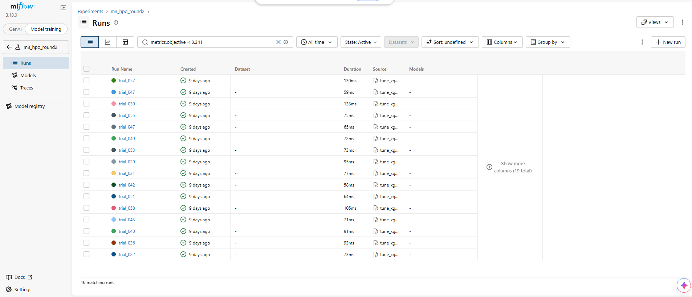

*Figure 4.1.* The 16 best trials of the E7c hyperparameter search (experiment `m3_hpo_round2`, 187 runs), selected with the filter `metrics.objective < 3.341`. Every trial is one run with its eight hyperparameters and its objective.

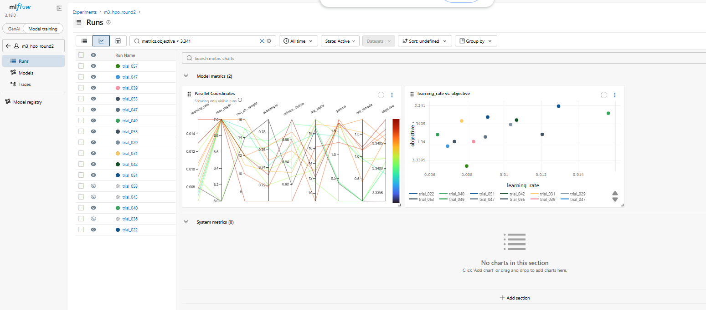

*Figure 4.2.* The same trials in MLflow's chart view (12 of the 16 are visible): the eight hyperparameters and the objective in parallel coordinates, and learning rate against objective. The best trials use low learning rates.

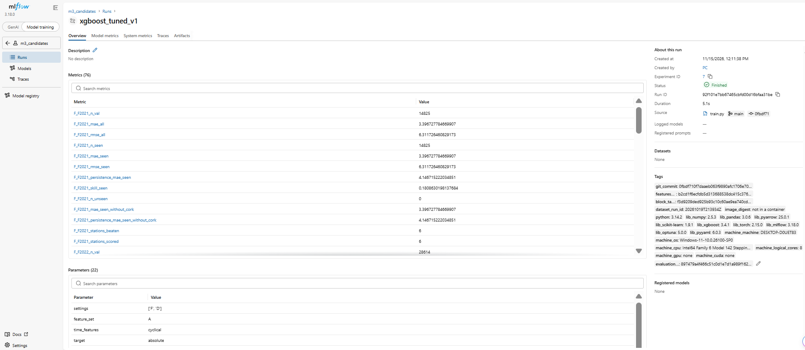

*Figure 4.3.* The run of the frozen XGBoost model (`xgboost_tuned_v1`, experiment `m3_candidates`, commit `0fbdf71`): 76 metrics, 22 parameters and the lineage tags (commit, SHA-256 hashes of the data, dataset run ID, library versions, machine).

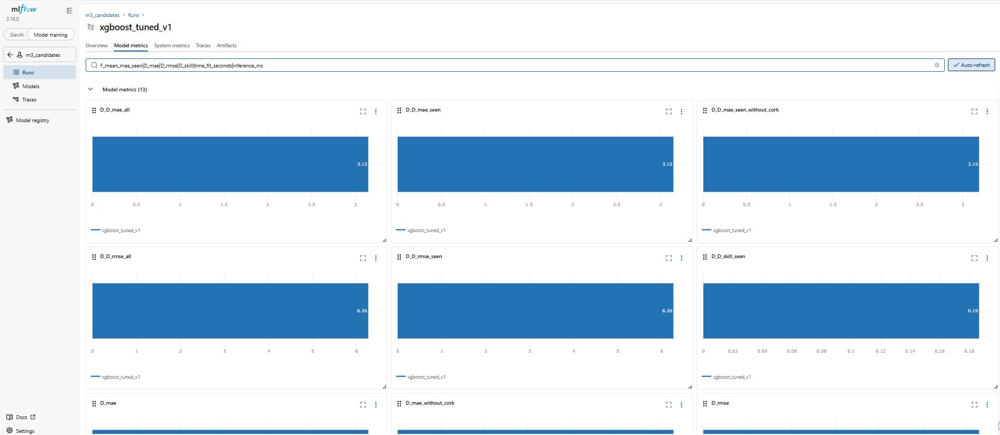
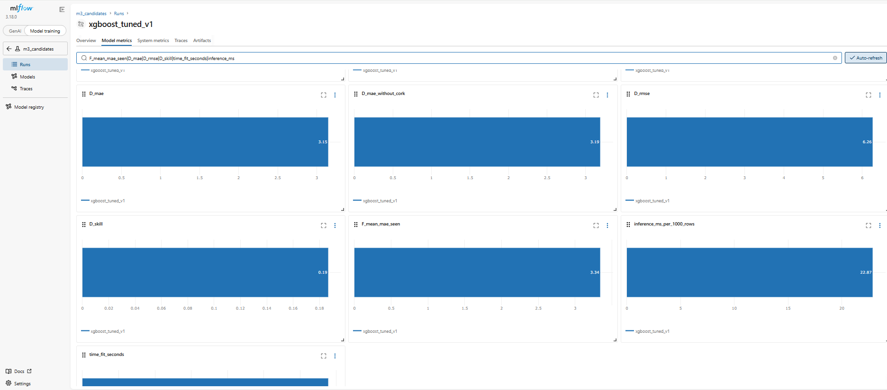
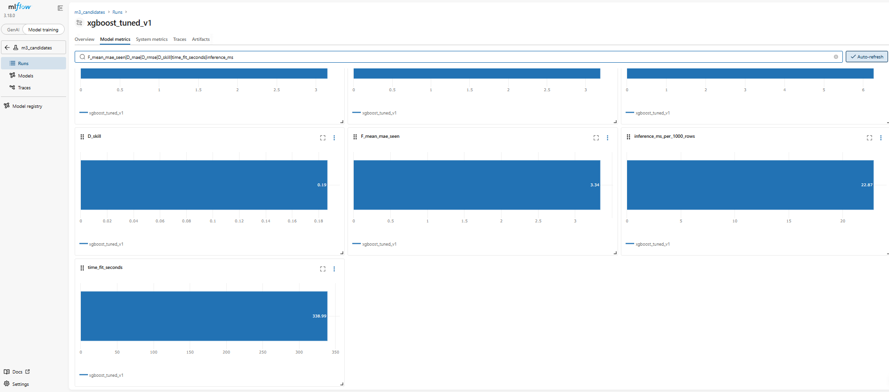

*Figure 4.4.* MLflow's charts of the frozen model's headline metrics: the 2024 MAE (3.15), RMSE (6.26) and skill (0.19), the selection-fold MAE (3.34), the fit time (339 s) and the prediction time (22.87 ms per 1,000 rows).

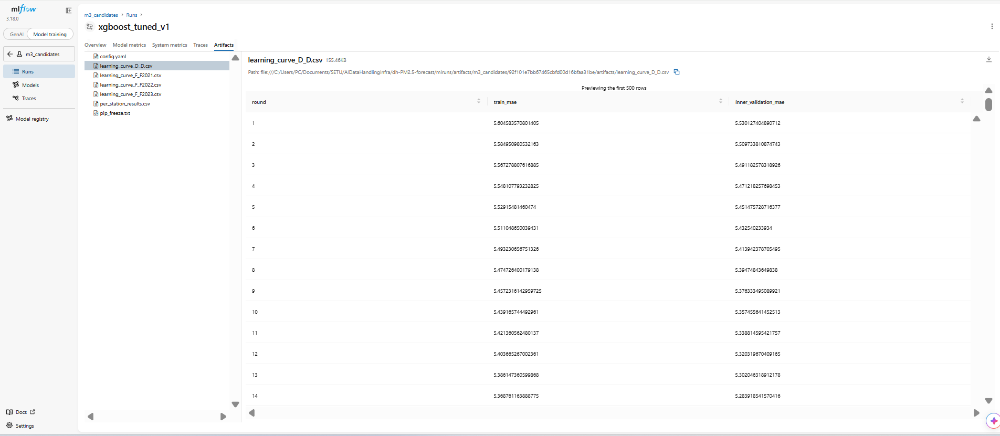

*Figure 4.5.* The files stored with the run: the configuration, the learning curves of each fold (the 2024 fit's training and inner-validation MAE per boosting round is shown), the per-station results and the exact package versions.


*Figure 4.6.* The run of the tuned GRU with seed 0 (`gru_tuned_final_seed0`, experiment `m3_neural`): 82 metrics, 11 parameters and the lineage tags (the seed is one of them).

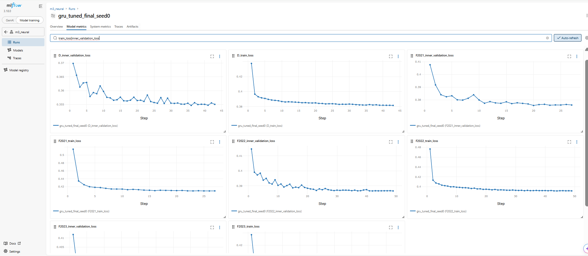
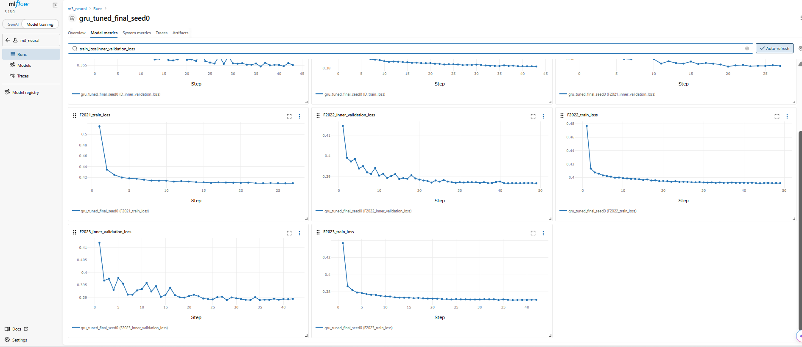

*Figure 4.7.* The learning curves of the tuned GRU with seed 0: the training loss and the inner-validation loss per epoch, for the 2024 fit (`D`) and the three selection folds (`F2021`, `F2022`, `F2023`). Both losses fall in the first few epochs and then flatten; neither rises at the end, so the curves show no sign of over-fitting.

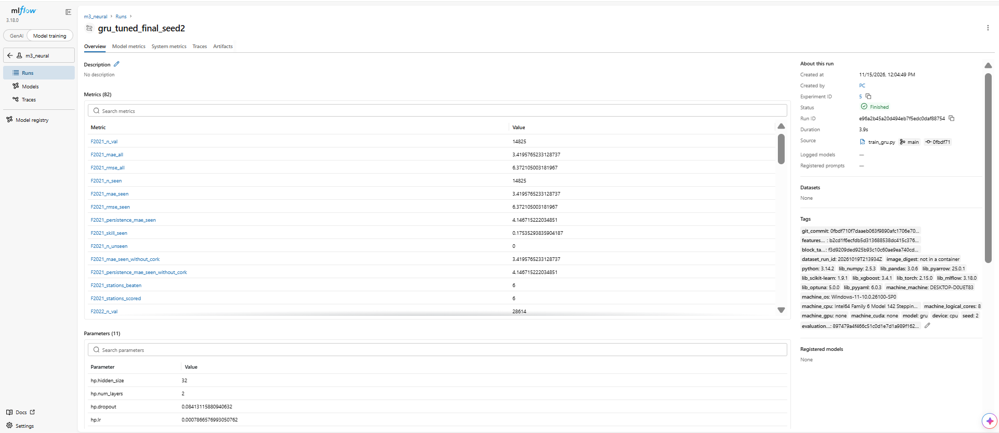
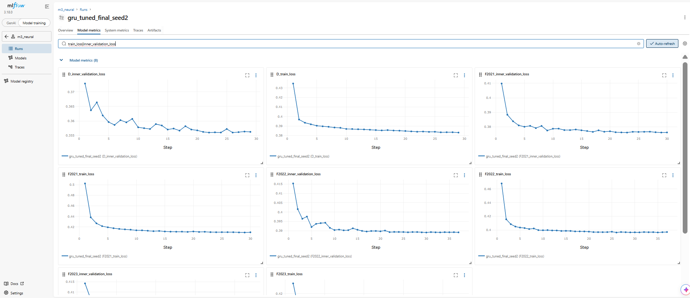
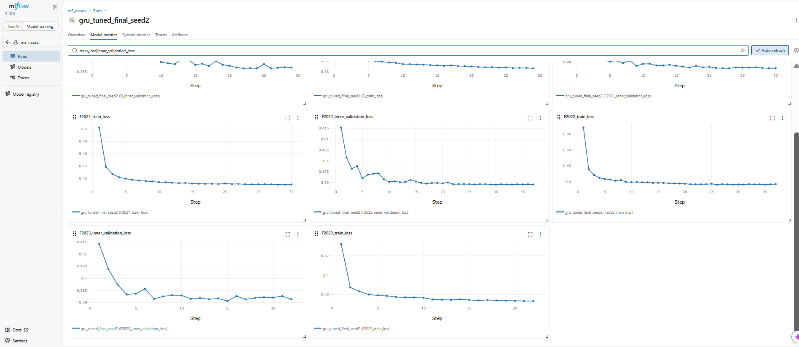

*Figure 4.8.* The same for the run with seed 2 (`gru_tuned_final_seed2`): its overview and the same learning curves, which have the same shape as those of seed 0.

---

## 5. Analysis and conclusions from the experiments

Each experiment was fixed in advance as a hypothesis, a data setting and a decision rule (section 1). A row below is completed only from logged runs.

| ID | Hypothesis (stated before running) | Experiment | Result (selection folds, then 2024) | Decision |
|---|---|---|---|---|
| H1 / RQ1 | A learned model beats persistence, the rolling mean and seasonal naive | E1 baselines; E2 Ridge and default XGBoost on set A | Selection folds / 2024 MAE: persistence 4.131 / 3.869; rolling mean 3.958 / 3.853; seasonal naive 4.790 / 4.706; Ridge 3.612 / 3.471; XGBoost 3.512 / 3.295 | Supported: both learned models beat every baseline in every fold and at all 12 stations (the rolling mean beats persistence at 5 of 12 stations on 2024, and seasonal naive is worse than persistence) |
| H2 | A seasonal feature (t−6) helps because of the daily cycle | E4a | Change vs reference (selection folds / 2024): Ridge −0.4% / −0.5%; XGBoost −0.3% / 0.0% | Not adopted (no fold reaches 1%): no clear difference |
| H3 | Predicting the change beats the absolute value; log1p helps linear models more than trees | E3 | Change: Ridge 0.0%, XGBoost +0.9% on 2024 (worse). log1p: Ridge +9.7%, +13.5%, +7.7% (folds), +8.8% on 2024; XGBoost −3.0%, −3.0%, −4.9%, −4.2% on 2024 | Change target rejected. log1p: the prediction was **the wrong way round** (it hurts the linear model and helps the trees); it adds nothing once the absolute-error loss is used (E6c) |
| H4 | Standardising helps Ridge and neural models but not XGBoost | E5 (XGBoost as the scale-invariant control) | Ridge unscaled equals scaled (3.4713 both); XGBoost standardised +0.2% on 2024 (folds −0.3%, +0.2%, −0.1%) | Standardising has no effect at α = 1; it is kept for the later regularisation sweep. The XGBoost control is within 0.3% of the reference (the small difference is probably histogram binning; not checked) |
| H5 | Cyclical time features beat a one-hot UTC block and no time features | E4b | XGBoost: one-hot UTC +2.2%, none +5.1% (2024); Ridge: one-hot UTC −1.0% (one fold of three at 1%), none +0.5% | Supported for XGBoost; no clear difference for Ridge |
| H5b | The raw 8-block window helps Ridge/XGBoost over rolling statistics | E4c | Ridge +1.4% (worse); XGBoost −0.3% (one fold of three at 1%) | Not adopted |
| H5c | A 16- or 24-block rolling window helps XGBoost over the 8-block window | E4d (section 2.3) | Mean of folds +0.8% (16) and +1.1% (24); 2024 +0.9% and +1.1%; no fold gains 1% | Not adopted |
| H6 | XGBoost beats Ridge | E2–E4 | 3.512 against 3.612 (selection folds), 3.295 against 3.471 (2024): −2.8%, −5.1% | Supported |
| H7 | Tuning improves on the starting configuration by a small margin (at most about 0.5%); TPE does not clearly beat random search under the same budget | E7, E7b (section 3.6); round 2 (section 3.3) | Round 1: gains of 0.3–0.45% on the selection folds; random and TPE differ by 0.001 (E7) and 0.002 (E7b) | Round 1 consistent with the prediction; round 2 (E7c, TPE only): 0.48% on the selection folds and 0.24% on 2024 (the selected study), above the seed noise and below the 1% that would have contradicted the diagnosis |
| H8 | Learning curves show over- or underfitting; early stopping saves compute | E6a | Best rounds 144, 164, 410, 270 against 500; early stopping −2.2%, −1.9%, −1.4% (folds), −0.9% (2024); small train/validation gap | No strong over-fitting; early stopping adopted (it removes the round count as a hand-set value) |
| H8b | Squared-error loss is not optimal for an MAE metric | E6b (squared error vs absolute error vs pseudo-Huber) | Absolute error −4.4%, −3.6%, −5.0% (folds), −4.3% (2024); pseudo-Huber −3.1% / −3.5%; E6c (log1p and absolute error together) −0.2% vs absolute error alone | Supported; absolute error adopted |
| H9 / RQ3 | Place features help or hurt in unseen cities; country is only testable where its country has other cities | E8 (section 5.1) | See section 5.1 | No variant adopted; the model has no place features |
| H10 | A GRU on the ordered window beats XGBoost on set A and an MLP on the same window | E9, E10 | Tuned GRU (three seeds): 3.371 on the selection folds and 3.187 ± 0.009 on 2024, against 3.339 and 3.147 for the tuned XGBoost (1.0% and 1.3% worse); the MLP was not run | Not supported for the GRU against XGBoost: the tuned GRU did not beat the tuned XGBoost. It was given the raw window (set B) and XGBoost set A, and XGBoost on the raw window was within 0.3% of set A (E4c), so the finding is that this GRU did not beat this XGBoost, not that the order of the history carries no information. The GRU-against-MLP part is untested |
| H11 | More CPU cores reduce XGBoost fit time with diminishing returns; a GPU helps little on XGBoost and possibly more on the GRU (a pilot on the development laptop, where 4 and 8 threads gave the same fit time, informed this expectation) | E11 (section 6) | Laptop, tuned XGBoost, median of 5 fits at 1 / 2 / 4 / 8 threads: 75.8 / 52.8 / 49.3 / 43.5 s, a speed-up of 1.74 and an efficiency of 0.22 at 8 threads (default configuration: 4.0 to 2.7 s, speed-up 1.48). CPU VM (idle, 4 cores with 2 threads each): 45.7 / 32.3 / 22.5 / 22.4 s, a speed-up of 2.04 and an efficiency of 0.25 at 8 threads (default configuration: 3.60 to 1.32 s, speed-up 2.73). The pilot's expectation that 4 and 8 threads give the same fit time held on the VM for both configurations (22.5 and 22.4 s tuned; 1.34 and 1.32 s default) and on the laptop for the default configuration (2.81 and 2.71 s), but not for the tuned configuration on the laptop (49.3 and 43.5 s). GPU VM (T4, with its own CPU as the control): the tuned XGBoost fit takes 7.06 s against 16.3 s on the CPU (2.3 times faster) and the default fit 0.89 s against 1.17 s (1.3 times); the tuned GRU takes 13.8 s against 51.3 s for 10 epochs (3.7 times). | Cores: confirmed (diminishing returns, a speed-up of about 2 at 8 threads, and 4 threads as fast as 8 on the VM). GPU on XGBoost: partly refuted, since it helps clearly for the large tuned fit (2.3 times) and little for the small one (1.3 times). GPU on the GRU: confirmed, and larger than on XGBoost (3.7 times) |
| H12 / RQ2 | The frozen model generalises to unseen cities and to 2025, with higher error than on development data | E12 | 2025 test: MAE 3.038 against 3.147 on 2024 (skill 0.179 against 0.187), 11 of 11 stations beat persistence. Held-out cities: MAE 3.069, skill 0.118, 5 of 5 stations beat persistence (Derry 0.269, Paris 0.114, London 0.034) | Partly supported: it generalises (it beats persistence at every station, seen or unseen), but the error is not higher in absolute terms, because 2025 was an easier year (persistence MAE fell from 3.869 to 3.699); the skill is lower on the unseen cities (0.118 against 0.179) |

### 5.1 Place ablation (RQ3), leave-one-city-out
For each of the nine development cities: train on the other eight cities with targets up to the end of 2022, validate on the left-out city in 2023, in four variants: no place features; latitude+longitude; country; all three. Fold sizes (measured): validation rows from 2,101 (Cork) to 5,598 (Athens); training rows 64,880 to 91,897; none below 1,000 validation rows. **Limitation of this evidence:** Athens (GR), Belfast (GB), Copenhagen (DK) and Madrid (ES) are the only development cities of their countries, so `country` is unseen there (its one-hot columns are all zero in training) and latitude/longitude are extrapolated; the country variant is only meaningfully testable in the five Irish folds. About 19% of Cork's validation targets are negative (log1p clipping applies), so results are also shown without Cork.
**Two versions, and why.** A model with latitude, longitude or country as inputs can learn what is typical of the cities it was trained on and then lean on that in a city it has not seen: there is no target information in those columns, but the risk is the same one that this milestone is meant to measure (does the model work in an unseen city?). The model therefore has no place features. A second model with latitude, longitude and country was not built, because the ablation below found no benefit from them and they carry the risk described here (section 1).

**Result (E8).** Models: Ridge (standardised, α = 1) and XGBoost (absolute-error loss, starting values), nine folds each. Pooled MAE of the left-out cities in 2023, and the change against "no place features" (negative = better):

| Model | None | Lat/lon | Country | All three |
|---|---|---|---|---|
| Ridge | 3.515 | 3.495 (−0.6%) | 3.525 (+0.3%) | 4.119 (+17.2%) |
| XGBoost | 3.407 | 3.471 (+1.9%) | 3.396 (−0.3%) | 3.462 (+1.6%) |

Applying the evidence rule to these folds (pooled MAE at least 1% better and at least 1% better in a majority, 5 or more, of the 9 cities; the rule was written for the selection folds, so this is its direct analogue): **no variant is adopted.** Two variants improve a majority of cities without reaching 1% pooled: Ridge with lat/lon (better by at least 1% in 6 of 9 cities, including all 5 Irish; 7 improve by any amount) and XGBoost with country (the same counts). In both, the five Irish cities improve by 2.4% and 1.6% on average, while the four non-Irish cities, which are the only cities of their country, show no gain on average and Ridge with lat/lon is 3.9% worse for Madrid. Adding all three is the worst variant: Ridge's MAE for Belfast more than doubles (+106%) and for Athens rises by 22%, where the country columns are all zero and latitude and longitude are extrapolated; XGBoost with lat/lon is worse for Cork (+8.5%) and Limerick (+11.9%), and for Cork falls below persistence. Figure: `reports/figures/m3_05_place.png`.
*Plausible explanation, not tested:* within Ireland the place features act as a regional offset learnt from neighbouring cities; where the model must generalise to a country it has not seen they carry no information. The held-out cities (Derry, London, Paris) are in countries with little or no training data (Great Britain through Belfast only, France not at all), which is the case where the evidence is weakest for place features.
**Not run:** the 2024 check that the full rule asks for, because no variant passed the first condition. Excluding Cork UCC from the pooled leave-one-city-out comparison (computed from the per-city results and the 2023 validation row counts; Cork is 6.7% of the rows) changes the pooled difference of each variant by at most about 0.4 percentage points (XGBoost, latitude and longitude: +1.9% with Cork and +1.5% without; Ridge, all three: +17.2% and +17.3%), so no variant reaches a 1% improvement with or without Cork and the conclusion does not depend on it.
**Conclusion for RQ3:** in these folds geographic diversity in the training data helped the model of an Irish city a little through place inputs and did not help the models of the other cities; place inputs are not needed for a model that generalises to a new country, and can hurt.

### 5.2 Trade-offs and the selected configuration

Accuracy against cost, on the laptop (the same data as the table in section 2.4, with the model size as logged). Peak memory was not recorded on the Windows laptop (the measurement needs a Linux system) and is reported with the VM results in section 6.3.

| Model | 2024 MAE | Fit time (4 fits) | Fit, 2024 only | Inference, ms per 1,000 rows | Model size |
|---|---|---|---|---|---|
| Ridge | 3.471 | 0.3 s | | 0.36 | 1.4 KB |
| XGBoost, starting values, absolute error | 3.152 | 16 s | about 5 s | 3.6 | 3.5 MB |
| XGBoost, tuned | 3.147 | 339 s | 114 s | 22.9 | 22 MB |
| GRU, tuned (3 seeds) | 3.187 | 813–1,238 s | 316–492 s | 5.9–6.6 | 44 KB |

The starting values were run twice with identical scores. The comparison run (`m3_features`) took 16 s to fit and 3.6 ms per 1,000 rows; the run that saved `xgboost/v2` took 20.6 s and 3.1 ms (the figures used in sections 3.6 and 3.8). This table and section 2.4 quote the first run's timings with the size of the saved model file.

**The selected configuration.** Model type: gradient-boosted trees (XGBoost). Feature set A (current block, three lags, 8-block rolling mean and standard deviation, sin and cos of hour and month). Hyperparameters: the E7c configuration of section 3.6 (learning rate 0.0080, depth 6, minimum child weight 14, subsample 0.794, colsample 0.919, lambda 0.0129, alpha 18.5, gamma 0.40, 3,682 rounds chosen by early stopping, seed 1). Decision rule: for variants of the features, target or loss, at least 1% better in at least 2 of the 3 selection folds and the 2024 score not worse; for the hyperparameters, the lowest selection-fold objective of the search, with 2024 reported and not used to choose. Evidence: sections 2.4 and 3.6.

**Where a more complex model was not worth its cost.** The tuned GRU takes about three to four times as long to fit (316–492 s against 114 s for the 2024 fit) and is 1.3% worse on 2024. The hyperparameter tuning of XGBoost was worth running but small: it gained 0.48% on the selection folds for a model that needs about 3,700 rounds instead of 500, so the fit takes 339 s against 16 s, the model file is about 6 times larger and prediction is about 6 times slower (22.9 against 3.6 ms per 1,000 rows). All of these costs are small in absolute terms for 31,192 development rows, so they do not change the choice, but they would matter for a much larger workload. The starting model with the absolute-error objective gives 3.152 for 16 s of fitting and is the fair "cheap" alternative if cost were the priority. The same reasoning applies to the GPU (section 6.3): for the selected model it saves about 9 seconds (16.3 s on the GPU VM's CPU against 7.1 s on its T4) and about $0.0004 per fit, and a GPU was hard to obtain. **Why the tuned model is still the primary model.** The search rule picks the best configuration by the selection-fold objective whatever the size of its gain, and it was fixed before the results; the starting-values model (`xgboost/v2`) is the cheap alternative. On the final evaluation it is within 0.2% on the 2025 test split (3.043 against 3.038) and 0.6% on the held-out cities (3.087 against 3.069), so a choice that put cost first would also be defensible; the tuned model stays primary because the freeze rule fixed it before any final score was seen.

### 5.3 Final evaluation (once, after the freeze)

**Frozen state (2026-11-15).** Every choice that could influence the final scores was fixed before the 2025 test split and the held-out cities were scored. The repository state at the freeze is commit `ba0b150`. The test split and the held-out stations were not used for any choice (features, loss, hyperparameters, rounds or epochs, which model).

| Item | Frozen value | Identifier |
|---|---|---|
| Data | dataset run `20261019T213934Z`; train 2018–2023, development 2024 | features file SHA-256 `b2cd1f6ecfdb5d313688538dc415c3768aa987e0002f2b559b4d05895695ffc4`; block table `f3d9209ded925b93c10c60ae9ea740cd031e3ea56c868abd465e607d8e9d45a3` |
| Inputs and target | feature set A (ten columns), 8-block window, cyclical time features, no place, weather or other-pollutant inputs; raw target | sections 2.3 and 2.5 |
| **Primary model: XGBoost** | the E7c configuration (section 3.6), absolute-error objective, 3,682 boosting rounds chosen by early stopping, seed 1, round cap 4,000 | `configs/xgboost_tuned_v1.yaml` (SHA-256 `3225f6dc4e28ec97ff8abf47027d974954ee4b51bfb5a1f4ab50392a8850c171`); model `models/xgboost/v3`, `model.json` SHA-256 `d9b4620d37a3230e9cb09625007173dcb5097a6716c2b1a6c65f696a5be2f66f` |
| **Comparison model: GRU** | the E9b configuration (section 3.7): 32 units, 2 layers, dropout 0.0841, learning rate 0.000787, **batch 256**, L1 loss, early stopping; seeds 0, 1, 2 | `configs/gru_tuned_final.yaml` (SHA-256 `0a464d9e4ac2ebc6a9870f1f20ee0aa67b65c10cf9ff9b935a4bb1bf6113c8ce`); models `models/pytorch_gru/v4`, `v5`, `v6`, `model.pt` SHA-256 `41f05d793054782e5106f3eea481ca51287f561948740e88b5081abb692218d8`, `f8dab0b8b467666eeaa2d2827829446512f081801b02efebdc42bae06c4cf937`, `f2bb3d1d25808bc80af3c70e633e407594bbfa9b00790f3c938fbede6c63b937` |
| Reference models | persistence, rolling mean, seasonal naive; Ridge with alpha = 1 on standardised inputs (the folder `models/ridge/v1` was saved on 2026-11-24, before any final score was seen, from `configs/ridge_reference_frozen.yaml`, which has the settings of `configs/ridge_feature_set_a.yaml`) | section 3.3 |
| Not frozen | nothing that influences a score | |

The two configuration-file hashes are of the files as checked out on Windows (CRLF line endings); a checkout with LF line endings gives different values for the same text.

After the freeze nothing is refitted, tuned or re-selected: each frozen model folder is scored once (`final_evaluation.py --confirm-freeze`) and no refit on 2024 is done (that belongs with the Milestone 4 retraining), so the final models have not seen 2024.

**Reference models declared before any final score was seen.** Besides the primary model (XGBoost v3), the final evaluation scored the three GRU seeds (`pytorch_gru/v4` to `v6`), Ridge (`ridge/v1`, saved from the frozen configuration before it was scored; it reproduced its logged development scores, 3.6120 on the selection folds and 3.4713 on 2024) and the starting-values XGBoost (`xgboost/v2`). They are references only: whatever their scores, they cannot change the choice of the primary model, all three GRU seeds are reported and none is picked, and each folder was scored exactly once.

**Decision at the freeze: GRU batch size stays 256.** The profile of the GRU (section 6) shows that a larger batch makes each epoch cheaper: on the laptop CPU the profile of the tuned GRU gave 6.0 s per epoch at batch 256, 3.7 s at 1,024 and 3.2 s at 4,096 (16.2 s at 64), 39% less at 1,024 (on the CPU VM: 5.0 s, 2.8 s and 1.5 s, 44% less at 1,024; on the GPU 1.5 s at 256 and 0.38 s at 1,024), because the fixed cost of each step is spread over more rows. A larger batch was not adopted, for two reasons. First, XGBoost is the stronger and cheaper model (1.3% lower error on 2024 and a fit about three to four times cheaper), so a small saving on the GRU does not change the conclusion of the project. Second, the saving is not clear-cut: fewer updates per epoch can mean more epochs, batch 512 matched batch 256 in the search (mean objective 3.3817 against 3.3815) while batch 1,024 was about 0.5% worse (three trials), and the tuned learning rate (0.000787) belongs to batch 256, so a change would mean re-tuning and re-running the three seeds. The batch size is therefore reported as a measured trade-off, not changed.

**Result for the primary model, scored once** (`final_evaluation.py`, MLflow experiment `m3_final`, `reports/final/xgboost_v3_final.csv`). The 2025 test split has 25,944 rows at 11 stations in 8 cities: Copenhagen has no valid 2025 hours and so no rows, and Kilmainham (`IE005AP`) has 225. The held-out set has 13,362 rows at 5 stations in 3 cities.

| Set | Rows | MAE | RMSE | Persistence MAE | Skill | Stations beating persistence |
|---|---|---|---|---|---|---|
| 2025 test split | 25,944 | 3.038 | 5.462 | 3.699 | 0.179 | 11 / 11 |
| Held-out cities (Derry, London, Paris) | 13,362 | 3.069 | 5.057 | 3.480 | 0.118 | 5 / 5 |

Without Cork UCC (23,345 test rows) the test MAE is 3.034 against 3.677 for persistence (skill 0.175), so Cork's negative readings do not drive the result; the held-out cities contain no Cork station. Per city:

| City | Set | Rows | MAE | RMSE | Persistence MAE | Skill |
|---|---|---|---|---|---|---|
| Athens | 2025 test | 5,071 | 2.957 | 4.973 | 3.627 | 0.185 |
| Belfast | 2025 test | 2,793 | 2.630 | 4.091 | 2.944 | 0.107 |
| Cork | 2025 test | 2,599 | 3.076 | 6.325 | 3.892 | 0.210 |
| Dublin | 2025 test | 2,671 | 3.391 | 6.092 | 4.280 | 0.208 |
| Galway | 2025 test | 2,724 | 2.398 | 3.656 | 2.790 | 0.141 |
| Limerick | 2025 test | 2,784 | 2.873 | 5.997 | 3.721 | 0.228 |
| Madrid | 2025 test | 4,728 | 3.231 | 4.891 | 3.787 | 0.147 |
| Waterford | 2025 test | 2,574 | 3.738 | 7.614 | 4.634 | 0.193 |
| **Derry** | held out | 2,552 | 2.804 | 4.776 | 3.836 | 0.269 |
| **London** | held out | 5,772 | 2.737 | 4.537 | 2.832 | 0.034 |
| **Paris** | held out | 5,038 | 3.582 | 5.717 | 4.042 | 0.114 |

Per station, 2025 test split (bias is forecast minus actual, so negative means under-prediction; `reports/m3/error_analysis/xgboost_v3_final/by_station.csv`):

| Station | City | Rows | MAE | RMSE | Bias | Persistence MAE | Skill |
|---|---|---|---|---|---|---|---|
| ES0118A | Madrid | 2,439 | 3.406 | 4.933 | −0.414 | 4.117 | 0.173 |
| ES1525A | Madrid | 2,289 | 3.044 | 4.846 | −0.159 | 3.436 | 0.114 |
| GB0567A | Belfast | 2,793 | 2.630 | 4.091 | −0.290 | 2.944 | 0.107 |
| GR0003A | Athens | 2,295 | 3.714 | 6.265 | −0.438 | 4.671 | 0.205 |
| GR0039A | Athens | 2,776 | 2.331 | 3.567 | 0.130 | 2.763 | 0.156 |
| IE0028A | Dublin | 2,446 | 3.289 | 5.949 | −0.752 | 4.150 | 0.208 |
| IE004BP | Cork | 2,599 | 3.076 | 6.325 | −0.389 | 3.892 | 0.210 |
| IE005AP | Dublin | 225 | 4.505 | 7.471 | −1.281 | 5.697 | 0.209 |
| IE005CP | Waterford | 2,574 | 3.738 | 7.614 | −1.007 | 4.634 | 0.193 |
| IE007CP | Limerick | 2,784 | 2.873 | 5.997 | −0.535 | 3.721 | 0.228 |
| IE009GY | Galway | 2,724 | 2.398 | 3.656 | −0.077 | 2.790 | 0.141 |

Per station, held-out cities:

| Station | City | Rows | MAE | RMSE | Bias | Persistence MAE | Skill |
|---|---|---|---|---|---|---|---|
| FR04002 | Paris | 2,304 | 3.456 | 5.997 | −0.734 | 3.788 | 0.088 |
| FR04058 | Paris | 2,734 | 3.689 | 5.471 | −1.007 | 4.255 | 0.133 |
| GB0566A | London | 2,892 | 2.620 | 4.282 | −0.433 | 2.738 | 0.043 |
| GB0620A | London | 2,880 | 2.855 | 4.779 | −0.497 | 2.927 | 0.025 |
| GB1060A | Derry | 2,552 | 2.804 | 4.776 | −0.368 | 3.836 | 0.269 |

**The other models, scored once on the same rows (reference only, none of them can change the choice).**

| Model | 2025 test MAE | RMSE | Skill | Stations beating persistence | Held-out MAE | RMSE | Skill | Stations beating persistence |
|---|---|---|---|---|---|---|---|---|
| Persistence (the current block) | 3.699 | | 0 | | 3.480 | | 0 | |
| Rolling mean | 3.700 | | 0.000 | | 3.699 | | −0.063 | |
| Seasonal naive (the same clock time yesterday) | 4.569 | | −0.235 | | 4.573 | | −0.314 | |
| Ridge, α = 1 (`ridge/v1`, reference) | 3.351 | 5.712 | 0.094 | 10 / 11 | 3.337 | 5.244 | 0.041 | 3 / 5 |
| XGBoost, starting values (`xgboost/v2`, reference) | 3.043 | 5.457 | 0.177 | 11 / 11 | 3.087 | 5.080 | 0.113 | 5 / 5 |
| **XGBoost, tuned (`xgboost/v3`, primary)** | **3.038** | **5.462** | **0.179** | **11 / 11** | 3.069 | 5.057 | 0.118 | 5 / 5 |
| GRU, tuned, seed 0 / 1 / 2 (`pytorch_gru/v4`–`v6`, reference) | 3.073 / 3.069 / 3.075 | 5.547 / 5.553 / 5.578 | 0.169 / 0.170 / 0.169 | 11 / 11 each | 3.061 / 3.045 / 3.073 | 5.048 / 5.042 / 5.097 | 0.121 / 0.125 / 0.117 | 5 / 5 each |
| GRU, mean of the three seeds | 3.072 | 5.559 | 0.169 | | 3.059 | 5.062 | 0.121 | |

*What the comparison shows.* The primary model is the best of the learned models on the test split, and beats the GRU's three seeds by 1.1% (3.038 against 3.069–3.075), at 10 of the 11 stations. On the held-out cities the order reverses by a very small amount: the GRU's mean is 3.059 and the primary model's 3.069 (0.3% apart), the GRU is lower at 4 of the 5 held-out stations (by 0.1% to 1.0%), and the three seeds themselves span 3.045 to 3.073, so the difference is inside the seed-to-seed spread and the primary model remains the selected one under the freeze rule. Tuning gave little out of sample, as on development: the tuned model is 0.2% better than the starting-values model on the test split (3.038 against 3.043) and 0.6% better on the held-out cities (3.069 against 3.087), which agrees with the 0.24% to 0.28% seen on 2024 and with the conclusion that tuning was worth running but small (section 5.2). Ridge is 10% and 9% worse, and does not beat persistence at one test station (Belfast, 2.950 against 2.944) or at both London stations (2.984 and 3.175 against 2.738 and 2.927), where persistence is already strong. The naive rolling mean is no better than persistence and the seasonal naive forecast is worse.

**Answer to RQ2.** Does the frozen model generalise to cities it has never seen and to a later year, and is its error higher than on development data? *Evidence-supported finding:* it generalises. It beats persistence at all 16 stations of the final evaluation, seen or unseen, and its MAE on the unseen cities (3.069) is within 1% of its MAE on the seen stations of the same year (3.038). The error is **not** higher than on development data in absolute terms (3.038 on 2025 against 3.147 on 2024): 2025 was an easier year, since persistence also improved (3.699 against 3.869, on a slightly different set of stations because Copenhagen has no 2025 hours), so the skill, which removes that effect, is the fair comparison. The skill is slightly lower on 2025 (0.179 against 0.187) and clearly lower on the unseen cities (0.118), where it ranges from 0.269 at Derry to 0.034 at London. *Plausible explanation, not tested:* London's persistence error is already low (2.832, against 3.7 for the test split), so there is little for a model to gain, and the unseen cities had no training stations, so the model could not learn their level or their local pattern. This matches the place-ablation result (section 5.1): adding latitude, longitude or country did not help the model to carry over to a new city.

---

## 6. Compute architecture selection

### 6.0 Where the experiments were run, and what that means for the timings
The experiments of this milestone (the baselines, the feature, target, loss and place comparisons, the XGBoost and GRU hyperparameter searches, the error analysis and the profile of the GRU) were first run on the development laptop (Intel i7-8565U, 4 physical cores, 15.8 GB RAM, no GPU) and not on a cloud VM. This was a deliberate choice to protect the cloud credits: every script and configuration was made to work, and the experiments were run, on a machine that costs nothing per hour, and the same code, configuration files and container image are then run on GCP VMs, including a VM with a GPU, for the compute comparison. Because the scripts and the image are the same on every machine (section 7), what changes between machines is the hardware, not the procedure. The results come from three places. The laptop produced all the experiments, and on 2026-11-16 (commit `16a05c6`, nothing else running) its benchmark, GRU profile and reproduction check. A Google Cloud CPU VM (`n1-standard-8`, zone `europe-west2-b`, created 17:29:39 UTC and deleted 18:43:36 UTC on 2026-11-23, commit `8852fef`) produced the benchmark, GRU profile and reproduction check described in section 6.3. A Google Cloud GPU VM (`n1-standard-8` with one NVIDIA T4, zone `europe-west4-b`, created at about 23:36 UTC on 2026-11-23 and deleted from 00:38 UTC on 2026-11-24, commit `ba2a82f`) produced the CPU-against-GPU benchmark, the GPU profile and two reproduction runs.

**Caveat on the times measured on the laptop.** Two kinds of laptop timing are reported and they differ in how controlled they are. The wall-clock, fit and search times of the experiments themselves (the baselines, the comparisons, the hyperparameter searches and the first profile of the GRU) were measured while the laptop was also used, at times, for other work unrelated to the project (browsing the internet and similar), and some project jobs ran at the same time as others (for example a test run during a search); they include contention from other processes and the thermal and power limits of a laptop processor, so they are noisy and are not controlled measurements. The compute benchmark of section 6.3, the profile of the tuned GRU and the reproduction check were run separately, on 2026-11-16, as one overnight job on the same laptop with every other application closed (and Docker Desktop quit), so that nothing else competed for the processor; these timings are the better laptop figures, although a laptop processor can still throttle with heat (section 6.3). The scores are not affected in either case: they depend on the data, the code and the seed, not on the load of the machine, and the seed-1 re-run reproduced the logged scores exactly. The GCP benchmark is run on an otherwise idle VM, and where the machines disagree the VM numbers are the controlled ones. The laptop and CPU VM numbers are side by side in section 6.3. The VM was both faster and steadier than the laptop (the tuned XGBoost fit at 8 threads took 22.4 s against 43.5 s, and the standard deviation of its 1-thread repeats was 0.43 s against 7.2 s), which fits the laptop's limits as a mobile processor but was not tested further.

### 6.1 Workload
About 123k training rows and 10–20 inputs; XGBoost fits take seconds; the GRU's window is 8 steps of one variable plus time features.
Pilot measurements on the development laptop (Intel i7-8565U, 4 physical cores / 8 threads, 15.8 GB RAM, no CUDA GPU; XGBoost 3.4.1; default configuration with 500 trees, learning rate 0.1, depth 6; feature set A):

| Measurement | Value |
|---|---|
| Data loading (123,364 train rows) | 0.09 s |
| Fit, fold 2021 / 2022 / 2023 (8 threads) | 2.20 / 2.41 / 2.46 s |
| One three-fold trial (8 threads) | 7.3 s |
| One three-fold trial (4 threads) | 7.5 s |

### 6.2 Options considered
| Option | Considered for | Decision and reason |
|---|---|---|
| Laptop CPU | Ridge, XGBoost, HPO, small GRU | Used for every experiment of this milestone: the tuned XGBoost fits in 44 s and the tuned GRU takes about 7 s per epoch (section 6.3), so no experiment needed more. It cannot test a GPU |
| Single GCP VM, CPU | repeatable runs inside the project image | Used for the controlled CPU timings and the reproduction check: the tuned XGBoost fits in 22 s at 4 or 8 threads and the tuned GRU takes about 5 s per epoch, with steady repeats (standard deviation at most 0.9 s); the image reproduced the logged scores from a fresh clone (section 7). The 74-minute session cost about $0.60 at the assumed list price (an estimate, section 6.3) |
| Single GCP VM with one GPU | XGBoost (`device="cuda"`) and the GRU | Used for the CPU-against-GPU comparison. The T4 fits the tuned XGBoost 2.3 times and the tuned GRU 3.7 times faster than the same machine's CPU, at about $0.9 per hour against $0.49 (assumed list prices; the billed rates are in section 6.3), so the estimated cost per fit is 20% lower for the tuned XGBoost and half for the GRU; for the small default XGBoost fit it is 1.3 times faster at 1.8 times the price, so not cheaper. **Obtaining the GPU was itself a cost: about four hours of refused requests (sections 6.3 and 6.4).** Not used for the project's main work, because the frozen model is XGBoost and its CPU fit takes 22 s (section 6.3) |
| Vertex AI custom job | managed training | Documented as an alternative (needs Artifact Registry, Cloud Build, IAM and GPU quota); not built because a single VM running the project image meets the need |
| Multiple GPUs / distributed data parallel, MPI | large models and datasets | Not justified here: the training set (123,364 rows) fits easily in memory (peak about 1 to 2 GB), a tuned fit takes 16 to 22 s on a CPU, and extra CPU threads already stop paying beyond four (section 6.3), so there is little to share out. How the fit time grows with more rows was not measured, which would matter for a much larger dataset |
| Kubernetes / OpenShift | serving, scheduling | Out of scope for training; relevant to Milestone 4 |

### 6.3 Benchmark (controls: same image digest, same data copied to local disk, same frozen configuration and seed, a discarded warm-up run)
| Test | Method |
|---|---|
| XGBoost CPU scaling | 1, 2, 4, 8 threads, 5 repeats; median and spread of fit time; speed-up S(N) = T1/TN; parallel efficiency; discussed with Amdahl's law (cloud vCPUs are usually hyperthreads, so flattening beyond the physical core count is expected) |
| XGBoost CPU vs GPU | `device="cpu"` vs `device="cuda"`, same configuration, 5 repeats |
| GRU CPU vs GPU | fixed number of epochs, fixed batch size, explicit torch thread count on CPU, at least 3 repeats |
| Always recorded | loading, fitting, prediction and total time separately; inference per 1,000 rows; peak RAM and GPU memory; model size; approximate cost (machine rate × runtime, current price list, region) |

*Laptop results (idle laptop, run overnight on 2026-11-16 at commit `16a05c6` with a clean tree; tuned and default XGBoost configurations and the tuned GRU; `reports/m3/m3_benchmark/laptop/`, `reports/figures/m3_04_benchmark.png`, MLflow `m3_benchmark`; the GPU rows are skipped on this machine and are the point of the VM runs).* Fit and prediction times are medians of 5 repeats (3 for the GRU).

| Test | Configuration | Fit, median | Range of fit times | Prediction per 1,000 rows |
|---|---|---|---|---|
| XGBoost, 1 thread | default (500 rounds) | 4.02 s | 3.87–4.07 s | 9.1 ms |
| XGBoost, 2 / 4 / 8 threads | default | 2.90 / 2.81 / 2.71 s | up to 0.2 s wide | 5.1 / 3.3 / 3.1 ms |
| XGBoost, 1 thread | tuned (3,682 rounds) | 75.8 s | 65.8–80.1 s | 85.1 ms |
| XGBoost, 2 / 4 / 8 threads | tuned | 52.8 / 49.3 / 43.5 s | 52.5–53.8 / 47.2–50.1 / 43.2–43.8 s | 42.3 / 27.6 / 23.3 ms |
| XGBoost on the CPU, default thread count | default / tuned | 3.08 s / 44.1 s | 3.06–3.11 / 43.9–44.3 s | 3.4 / 23.8 ms |
| GRU on the CPU, 10 epochs, batch 256, 4 torch threads | tuned | 67.9 s (6.8 s per epoch) | 67.8–68.4 s | 6.3 ms |

The speed-up at 8 threads is 1.48 for the default configuration and 1.74 for the tuned one, and the parallel efficiency is 0.19 and 0.22. Amdahl's law gives a parallel fraction of 0.37 for the default and 0.49 for the tuned configuration, so more than half of the work does not parallelise; 8 threads on this machine are 4 physical cores with hyperthreading, which also limits the gain beyond 4. The tuned fit takes about 14 times as long as the default fit (44 s against 3 s) for the same hardware. The five 1-thread repeats of the tuned configuration spread widely (65.8 to 80.1 s, standard deviation 7.2 s, against at most 1.2 s for the other thread counts); *plausible explanation, not tested:* thermal or power throttling of the laptop processor during the longest single-thread runs, so the 1-thread figure and the speed-ups computed from it are the least certain numbers here.

**Profile of the selected XGBoost model** (`src/profile_xgboost.py`, `reports/m3/profiling/xgboost_cpu/`; laptop, otherwise nearly idle, 2026-11-25; `docs/PROFILING_REPORT.md`). This profile is not logged to MLflow; its results are the exported files in that folder. XGBoost's own timers were read for one fit of the frozen settings (3,682 rounds), with three repeats of each setting. The median fit took 42.3 s at 8 threads and 69.6 s at 1 (speed-up 1.65). At 8 threads, 51% of the fit (21.4 s) is outside the tree-building step and did not speed up with more threads; histogram building took 5.3 s and moving rows to child nodes 3.0 s. About two thirds of the fit is not broken down by the timers. The same settings with squared error took 28.8 s but gave a worse 2024 error (3.260 against 3.147), so the absolute-error objective is kept. *Plausible explanation of its cost, not timed directly:* leaf values are recalculated from the residuals after each tree. The profiled fit reproduced the model's 2024 error (3.1466).

**Profile of the tuned GRU on the CPU** (`reports/m3/profiling/cpu/`, MLflow `m3_profile`; the 55 MB Chrome trace `trace.json` that the profiler also writes is regenerated by `python src/profile_gru.py` and is not kept in the repository). At batch 256 a training step takes 12.4 ms. The profiled steps (with the profiler's own overhead included) spend 49% in the backward pass, 39% in the forward pass, 10% in the optimiser and 1% each in choosing the batch and computing the loss, so the data supply is not the bottleneck. More torch threads do not help: 1, 2, 4 and 8 threads took 12.1, 12.2, 12.6 and 17.0 ms per step, because the matrices are too small to split profitably. The fused Adam step is the fastest of the three optimiser implementations (12.6 ms against 15.0 for the default and 15.2 for the foreach one). The batch size matters most:

| Batch size | Time per step | Estimated time per epoch | Rows per second |
|---|---|---|---|
| 64 | 8.4 ms | 16.2 s | 7,600 |
| 256 | 12.4 ms | 6.0 s | 20,700 |
| 1,024 | 30.3 ms | 3.7 s | 33,800 |
| 4,096 | 102.2 ms | 3.2 s | 40,100 |

**Reproduction check.** The tuned XGBoost configuration re-run natively on the laptop (`configs/reproduce_xgboost_tuned_cpu.yaml`, experiment `m3_reproduction`) gave the same scores as the frozen model: selection MAE 3.3393 and 2024 MAE 3.1466, with 3,682 rounds (difference 0.0000 on this machine; the container on the same laptop differed by up to 0.002, section 7).

**CPU VM results** (Google Cloud `n1-standard-8`: 8 vCPUs on 4 physical cores with 2 threads each, Intel Xeon at 2.0 GHz; Ubuntu 22.04.5 LTS, kernel 6.8.0-1073-gcp; zone `europe-west2-b`; 2026-11-23; commit `8852fef`; project CPU image `sha256:1d496aae27a9fd9ef3695ebcdc39114a4f7b3c42332c8752aa4ce77d3a595ed9`; the dataset's SHA-256 hashes were checked before the runs; `reports/m3/m3_benchmark/gcp-cpu-vm/`, `reports/m3/profiling/cpu_vm/`, MLflow experiments `m3_benchmark`, `m3_profile` and `m3_reproduction` with the environment tag `gcp-cpu-vm`). Medians of 5 fits (3 for the GRU), side by side with the laptop:

| Measurement | Laptop | CPU VM |
|---|---|---|
| XGBoost default, 1 / 2 / 4 / 8 threads | 4.02 / 2.90 / 2.81 / 2.71 s | 3.60 / 2.10 / 1.34 / 1.32 s |
| XGBoost tuned, 1 / 2 / 4 / 8 threads | 75.8 / 52.8 / 49.3 / 43.5 s | 45.7 / 32.3 / 22.5 / 22.4 s |
| Speed-up at 8 threads (default / tuned) | 1.48 / 1.74 | 2.73 / 2.04 |
| Efficiency at 8 threads (default / tuned) | 0.19 / 0.22 | 0.34 / 0.25 |
| Amdahl parallel fraction (default / tuned) | 0.37 / 0.49 | 0.72 / 0.58 |
| Standard deviation of the tuned 1-thread fits | 7.2 s | 0.43 s |
| XGBoost at the default thread count (default / tuned) | 3.08 / 44.1 s | 1.34 / 22.3 s |
| Tuned GRU, 10 epochs, batch 256, 4 torch threads | 67.9 s (6.8 s per epoch) | 49.9 s (5.0 s per epoch) |
| Prediction per 1,000 rows: default XGBoost / tuned XGBoost / tuned GRU | 3.4 / 23.8 / 6.3 ms | 2.7 / 20.8 / 2.2 ms |
| Wall time of the benchmark | 33.2 min | 19.7 min |
| Peak memory of the benchmark run | not recorded on Windows | 978 MB |

The two machines agree on the shape of the result. Going from 4 to 8 threads adds almost nothing on the VM (22.5 and 22.4 s for the tuned configuration, 1.34 and 1.32 s for the default): the 8 vCPUs are 4 cores with two threads each, so only the first four threads bring a gain. The speed-up at 8 threads is about 2, the efficiency falls from 0.71 at 2 threads to 0.25 at 8, and by Amdahl's law (parallel fraction 0.58 for the tuned configuration) about 40% of the work does not run in parallel. The VM is faster than the laptop for every test (the tuned fit with 1 thread takes 45.7 s against 75.8 s) and much steadier. *Plausible explanation, not tested:* the laptop processor throttles with heat and power limits, which would also explain the wide spread of its longest single-thread repeats; the processors also differ in kind.

**Profile of the tuned GRU on the CPU VM** (`reports/m3/profiling/cpu_vm/`). At batch 256 a training step takes 10.3 ms: 50% in the backward pass, 39% in the forward pass, 9% in the optimiser step, 1% choosing the batch and 1% computing the loss (the profiler's own overhead is included). Building the input tensors for all 123,364 training rows takes 0.016 s, so the data supply is not the bottleneck. More torch threads do not help: 1, 2, 4 and 8 threads took 9.8, 10.8, 10.7 and 13.5 ms per step (one thread was the fastest). The fused Adam step is the fastest implementation (10.0 ms against 10.6 for the default and 10.5 for the foreach one, about 6%). The batch size matters most:

| Batch size | Time per step | Estimated time per epoch | Rows per second |
|---|---|---|---|
| 64 | 6.7 ms | 13.0 s | 9,500 |
| 256 | 10.3 ms | 5.0 s | 24,800 |
| 1,024 | 23.2 ms | 2.8 s | 44,200 |
| 4,096 | 47.1 ms | 1.5 s | 87,000 |

A step costs far less than in proportion to the number of rows (16 times more rows for 4.6 times the time between batches 256 and 4,096), so the training of this small network on a CPU is limited by the fixed cost of each step (running many small operations) and not by arithmetic.

**Reproduction check on the CPU VM.** A fresh clone of the repository, a container built from it on the VM and `configs/reproduce_xgboost_tuned_cpu.yaml` gave selection-fold MAE 3.3409 and 2024 MAE 3.1452, with 2,540, 2,243, 4,000 and 3,996 boosting rounds in the four fits: the same scores and the same rounds as the container on the laptop. Against the logged values 3.3393 and 3.1466 the differences are +0.0016 and −0.0014, inside the tolerance (0.005 and 0.003). The four fits took 140.6 s in total (307 s on the laptop), the peak memory was 886 MB, and prediction took 17.1 ms per 1,000 rows.

**GPU VM results** (`n1-standard-8` with one NVIDIA T4, 15,360 MiB; zone `europe-west4-b`; Intel Xeon at 2.0 GHz; Ubuntu 22.04; NVIDIA driver 620.70.06, CUDA 13.5; PyTorch 2.15.0 built for CUDA 13.2; XGBoost 3.4.1 built for CUDA 13.3; 2026-11-23 to 24; commit `ba2a82f`; image `sha256:73efebcf8ef2fc9c42dfeb958a2d4ab1634a25c413fa6b2d0533e2c5decccf7d`; `reports/m3/m3_benchmark/gcp-gpu-vm/`, `reports/m3/profiling/cuda/`, environment tag `gcp-gpu-vm`). The CPU and the GPU ran on the same machine, one after the other, so the comparison is like for like. Medians of 5 fits (3 for the GRU); costs use the assumed rates of $0.49 per hour (CPU) and $0.9 per hour (CPU plus T4), in US dollars, as estimates:

| Test | CPU | GPU (T4) | Speed-up |
|---|---|---|---|
| XGBoost default (500 rounds), fit | 1.17 s | 0.89 s | 1.3 |
| XGBoost tuned (3,682 rounds), fit | 16.3 s | 7.06 s | 2.3 |
| Tuned GRU, 10 epochs, batch 256, fit | 51.3 s | 13.8 s | 3.7 |
| Prediction per 1,000 rows: default XGBoost / tuned XGBoost / GRU | 2.45 / 18.5 / 1.98 ms | 0.55 / 3.34 / 0.84 ms | 4.4 / 5.5 / 2.4 |
| Estimated cost per fit in US$: default XGBoost / tuned XGBoost / GRU | 0.00016 / 0.00222 / 0.00698 | 0.00022 / 0.00177 / 0.00346 | |
| GPU memory used: default XGBoost / tuned XGBoost / GRU | | 125 / 139 / 53 MB | |
| Wall time of the benchmark | | 7.0 min | |

The gain grows with the size of the job: the small default fit is 1.3 times faster, the tuned fit 2.3 times and the GRU 3.7 times. A GPU has a fixed cost for starting each piece of work, so a small fit gains little; and because the hourly price is 1.8 times higher, the GPU is cheaper per fit only when it is faster by more than that (the tuned XGBoost and the GRU) and not for the default XGBoost fit. The prediction timings of the GPU XGBoost model include copying the input rows from the host to the GPU (XGBoost warns that the input data is on the CPU), so they are conservative for a model that would be served from GPU memory. The CPU of this VM was faster than the CPU of the first CPU VM (tuned fit 16.3 s against 22.3 s at the default thread count, the same processor model name); *plausible explanation, not tested:* a difference between the physical hosts. It is the reason for reading the GPU result against the CPU run on the same machine.

**Reproduction runs on the GPU VM.** The CPU run (`configs/reproduce_xgboost_tuned_cpu.yaml`) gave selection-fold MAE 3.3409 and 2024 MAE 3.1452 with 2,540, 2,243, 4,000 and 3,996 rounds, exactly the scores and rounds of the container on the laptop and of the CPU VM, so three different machines agree. The GPU run (`configs/reproduce_xgboost_tuned_gpu.yaml`) gave 3.3399 and 3.1446 with 2,559, 2,537, 3,911 and 3,993 rounds: 0.0010 and 0.0006 lower than the CPU run on the same machine, and +0.0006 and −0.0020 from the logged values 3.3393 and 3.1466, inside the tolerance (0.005 and 0.003). A GPU build adds in a different order, so the trees are not identical; the CPU model stays the frozen model. The four fits took 97.3 s on the CPU and 52.5 s on the GPU (1.85 times faster), with a peak memory of 1.43 and 1.52 GB; the benchmark run's peak was 2.09 GB.

**Profile of the tuned GRU on the GPU** (`reports/m3/profiling/cuda/`). A training step takes 3.1 ms at batch 256 against 10.3 ms on the CPU VM. The GPU's own kernels account for 38 ms in the 40 profiled steps, about 0.95 ms per step, so the GPU is busy for roughly a third of each step: the step is limited by the cost of issuing many small operations, not by arithmetic. Of that kernel time, the cuDNN GRU backward pass accounts for 47%, the cuDNN GRU forward pass for 27% and the Adam update for 5% (calculated from the `aten::` rows of `operators.csv`; the `share_of_self_time` column and operator chart of the GPU run count time twice). The batch size has an even larger effect than on the CPU, because a step costs almost the same at 256 and 1,024 rows:

| Batch size | Time per step | Estimated time per epoch | Rows per second |
|---|---|---|---|
| 64 | 3.2 ms | 6.1 s | 20,100 |
| 256 | 3.1 ms | 1.5 s | 83,200 |
| 1,024 | 3.2 ms | 0.38 s | 323,900 |
| 4,096 | 5.8 ms | 0.18 s | 710,400 |

The fused Adam step is again the fastest (2.84 ms against 3.11 ms for the default, 9% less). Building the input tensors and moving them to the GPU takes 0.019 s for all 123,364 training rows, so the data supply is not the limit. The torch-thread sweep applies to the CPU only. The GPU profile was run with a corrected `phase_table` in `src/profile_gru.py`: at commit `ba2a82f`, which the GPU runs record, the function stopped on a GPU because the profiler lists each phase label twice there (a CPU range and a GPU range), so the corrected file (now in the repository) was mounted into the container for that one run, and its figure was then redrawn from the saved tables with shortened operator names. The tables and numbers are those of the run.
**Cost (estimate).** All costs are in US dollars and are estimates at assumed on-demand list prices ($0.49 per hour for the `n1-standard-8`, $0.9 per hour with the T4; the discounted monthly price does not apply to a run of a few hours). The CPU VM existed for 1 hour 14 minutes (created 17:29:39 UTC, deletion started 18:43:36 UTC on 2026-11-23), about $0.60 for the machine, excluding the disk and the temporary address; the GPU VM for about 1 hour 2 minutes (created at about 23:36 UTC on 2026-11-23, deletion started at 00:38:40 UTC on 2026-11-24), about $0.93. One full tuned XGBoost fit costs about $0.0018 on the T4 (7.1 s), $0.0022 on the GPU VM's CPU (16.3 s) and $0.0031 on the CPU VM at 8 threads (22.4 s); one 10-epoch GRU fit costs about $0.0035 on the T4 and $0.0070 on its CPU. The `approx_cost_per_fit` columns of the result files use the same assumed rates. These figures are estimates at the assumed rates; the billed charges are below.

**Billed charges** (Cloud Billing report for 23 to 24 November 2026, US dollars, by SKU; lines are rounded to cents). The billed quantities match the machines' runtimes: 9.84 vCPU-hours and 36.91 GiB-hours of memory in London, and 8.26 vCPU-hours, 30.98 GiB-hours and 1.03 T4 GPU-hours in the Netherlands. The total was **$1.45**.

| Item | CPU VM (London) | GPU VM (Netherlands) |
|---|---|---|
| vCPUs | $0.40 | $0.29 |
| Memory | $0.20 | $0.14 |
| NVIDIA T4 | | $0.36 |
| Persistent disk | $0.01 | $0.02 |
| Data transfer out | $0.01 | $0.00 |
| Session | about $0.62 | about $0.81 |

The other $0.02 is the VM Manager service ($0.01) and rounding; the external IP addresses, the operating-system licence, the storage operations and the network analysis lines show $0.00. The CPU VM's machine cost ($0.60 for 1.23 hours) gives $0.49 per hour, the assumed rate. The GPU VM was billed at about $0.77 per hour ($0.35 for the T4 and $0.42 for the vCPUs and memory), about 14% below the assumed $0.9, so the GPU cost estimates above are higher than what was billed. At the billed rates one tuned XGBoost fit costs about $0.0015 on the T4 and $0.0019 on the same VM's CPU, a saving of $0.0004 as before, and one 10-epoch GRU fit about $0.0029 against $0.0059: the ratios and the conclusions are unchanged.
**Availability is part of the cost of a GPU.** The cost figures above leave out the hardest part of using the T4. The project's GPU quota first had to be requested: the all-regions limit was 0 and a request for 1 was needed. Then every request for an on-demand `n1-standard-8` with one T4 was refused with `ZONE_RESOURCE_POOL_EXHAUSTED` ("does not have enough resources"), from the command line and from the console, in each zone tried in London, Frankfurt, Belgium and the Netherlands: well over 100 create requests in about four hours (19:28 to 23:36 UTC on 2026-11-23, from the operations log) before one in `europe-west4-b` was accepted. The quota usage was 0 and the same request is accepted when capacity exists, so this was a shortage of GPUs, not a mistake in the request. A plain CPU machine of the same size was much easier: the first zone tried for the CPU VM also had no free `n1-standard-8`, and the second accepted it at once. The consequences are practical: an unavailable GPU is a risk to a deadline (a fallback, reporting the GPU test as not run, was planned), the GPU VM needed extra set-up that the CPU VM did not (the driver, the container toolkit and a CUDA image), and a service that depended on a GPU would need reserved capacity or several zones and regions as a fallback (*reasoned, not tested here*). Against a saving of about 9 seconds and $0.0004 per fit, this is why the GPU is not the architecture chosen for the selected model.

**The chosen architecture.** For this project's work (the frozen XGBoost model and its retraining) a CPU machine is enough and the better value: a full tuned fit takes 16 to 22 s on a CPU (16.3 s on the GPU VM's own CPU, 22 s on the 4-core CPU VM at 8 threads) and costs $0.002 to $0.003; the GPU shortens it to 7 s and about $0.0018 on the same machine, a saving of about 9 s and $0.0004, which does not repay the effort of obtaining a GPU (about four hours of attempts here) or of the driver and container set-up. Extra threads stop paying at 4 (speed-up about 2, efficiency 0.25 at 8 on the VM), so the 4-core, 8-thread `n1-standard-8` is the sensible size, and the laptop gives the same results more slowly. The GPU is the right choice for the GRU: it is 3.7 times faster and half the cost per fit, and with a larger batch size the epoch could be four times cheaper again (1.5 s to 0.38 s at 1,024 rows), but the GRU is the comparison model and not the selected one. For the GPU the bottleneck is per-step overhead (about two thirds of each step the GPU waits for work), not compute and not data supply. *Reasoned, not tested:* a much larger dataset or a larger network would shift this towards the GPU.

### 6.4 The machine configuration, and why each setting was chosen

The two virtual machines differ in one thing, the GPU. Every other setting is the same, or follows from the aim of a controlled, repeatable timing, a short-lived machine and the least privilege that works.

| Setting | Choice | Reason |
|---|---|---|
| Compute service | Compute Engine virtual machines, created with `gcloud` | Each test needs one machine whose hardware is known and which is started and stopped on demand, so that a timed run is not disturbed. Kubernetes Engine would put a scheduling layer and a more involved GPU set-up between the code and the hardware, and its overhead would enter the measurements; it is relevant to serving (Milestone 4), not to this benchmark |
| Region and zone | the CPU VM in `europe-west2-b` (London), the GPU VM in `europe-west4-b` (Netherlands) | The T4 is offered in a small number of European zones, and the project's T4 quota allowed one GPU in each. The plan was one zone for both VMs. London (`europe-west2-a` and `-b`) had no free `n1-standard-8` with a T4, and over about four hours (19:28 to 23:36 UTC on 2026-11-23) requests in London, Frankfurt, Belgium and the Netherlands were refused with `ZONE_RESOURCE_POOL_EXHAUSTED` until `europe-west4-b` accepted one. A zone cannot be changed after creation, so each is named and not left to "any". Region does not enter the timings (all timed work runs on the VM from local disk); the two regions price the machines slightly differently, which the cost estimates ignore |
| Machine type | `n1-standard-8` (8 vCPUs, 30 GB) on both VMs | The T4 attaches to N1 machine types, so the GPU VM has to be N1. Giving the CPU VM the same type makes the GPU the only difference between the two. Eight vCPUs are 4 physical cores with 2 threads each, the same thread count as the laptop, so the thread-scaling results can be compared across the three machines |
| Minimum CPU platform | Intel Skylake or later on the CPU VM; none on the GPU VM | An N1 VM can be placed on different generations of Intel processor, and a minimum fixes the generation. The GPU VM was created from the command line without a minimum, to widen what Google could offer while capacity was short; both VMs report the same processor model (Intel Xeon at 2.0 GHz), and the model actually used is recorded with `lscpu` and in `machine.json`. The two VMs' CPU timings still differ (section 6.3), so the CPU run on the GPU VM is the like-for-like control for the GPU |
| Threads per core | the default (2) | Gives the 4 cores with 2 threads each that the benchmark records (`--physical-cores 4`); all cores are visible to the VM |
| Provisioning model | Standard (on demand), not Spot | A Spot VM can be pre-empted, which would stop a timed run |
| GPU VM only | one NVIDIA T4; host maintenance set to terminate | The T4 is the GPU the project's quota allows, and the CUDA build of PyTorch used in the image includes support for it (compute capability 7.5). A VM with a GPU cannot be live-migrated, so terminate is the only maintenance setting it accepts |
| GPU software | NVIDIA driver 620.70.06 (CUDA 13.5) from Google's installer; the NVIDIA container toolkit; the GPU image with PyTorch 2.15.0 (built for CUDA 13.2) and XGBoost 3.4.1 (built for CUDA 13.3) | The driver must support a CUDA version at least as new as the newest in the image (13.3), which it does. The benchmark and `train.py` ask XGBoost and PyTorch which device they really used and stop if a `cuda` run fell back to the CPU, so a CPU run cannot be recorded as a GPU run |
| Operating system | Ubuntu 22.04 LTS (x86-64) | A free image with long-term support, and one that Google's NVIDIA driver installer and Docker's installation script list as supported. The software environment of every run is the Docker image (Python 3.14.2 and pinned libraries), so the host operating system affects only the installation of Docker and of the GPU driver; its version is recorded with the results |
| Boot disk | balanced persistent disk; 50 GB (CPU VM) and 100 GB (GPU VM); deleted together with the VM | Balanced is the general-purpose disk type. A run reads a few hundred megabytes once and is limited by the processor, so disk speed does not enter the timings. The sizes hold the operating system, Docker, the image and the data; the GPU image is larger because it contains the CUDA build of PyTorch, and the GPU VM also holds the driver. Deleting the disk with the VM avoids a charge for a disk left behind |
| Software and data | a Docker image built on the VM from the pushed commit; the data copied from the bucket and checked against the dataset's SHA-256 hashes | The same code, the same pinned libraries and the same dataset on every machine, with the check showing that it is the dataset the experiments used |
| Identity and access | a dedicated service account (`pm25-benchmark`) with the Storage Object Viewer role on the bucket only, and only the read-only Storage access scope | The runs only read the processed data. With the least privilege that works, the VM cannot write to or delete anything in the bucket, and cannot call any other Google Cloud API |
| Network | the default network; a temporary external IP address; no HTTP, HTTPS or health-check firewall rules | The VM needs outbound access to install Docker, to fetch the image's layers and to read the bucket, and inbound SSH (already allowed by the default network). It runs no service, so no web ports are opened |
| Monitoring agent | the Ops Agent is not installed | A background agent would use processor time during the timed tests; the benchmark records its own timings and memory |
| Backups and replication | none | Everything on the VM can be recreated from the repository and the bucket, and the results are copied off the VM before it is deleted. Snapshots are not deleted with the VM and would keep a storage charge |
| Secure Boot | off, on both VMs | Secure Boot only loads signed kernel modules, which can stop the NVIDIA driver module from loading on the GPU VM; the same setting on both keeps the VMs alike |
| Encryption | Google-managed keys (the default) | The data are derived from public sources and nothing on the VM is secret, so customer-managed keys would add key management without a benefit |
| Deletion protection | off | So that the VM can be deleted as soon as the results have been copied back |
| Labels | `project=pm25-m3`, `purpose=benchmark` | The charge for the session can be found in the billing reports |
| Cost control | a budget with e-mail alerts at 50%, 90% and 100% of the amount (and a forecast alert), alerts only, tracking the cost before credits | A budget only sends e-mails; a spend cap would pause the services and could stop a run part-way. Tracking the cost before credits stops credits from cancelling the spend and silencing the alert. The hourly rates used for the cost figures are the on-demand prices of the machine and the GPU without the monthly sustained-use discount, which applies only to machines that run for much of a month |

---

## 7. Reproducibility

| Item | Where |
|---|---|
| Code | the repository at commit `8e04818` (full hash `8e048187e1c234b5399a39b3c36ba9939dc7c720`), the last Milestone 3 commit that changed code, configurations or dependencies; later Milestone 3 commits changed documentation only. Every run outside the search trials records the commit it was made at (the runs with the full lineage also a dirty flag), so the earlier experiments carry their own, earlier, commits |
| Data version | dataset run ID `20261019T213934Z` and raw-data version `3d01f5e70fe9d1cae0d771f248b9d87884bc8d68e19994e2fc7b2b03d503b3bd` from `manifests/dataset_versions.jsonl`; the processed files are stored in the project's bucket under fixed names, where replaced versions are deleted once they are 7 days old, so the exact data are identified by the SHA-256 hashes in section 5.3; `station_reference.csv` hash recorded |
| Row set | the 31,192 development rows; a hash of their keys (`station_id`, `block_start_utc`) is logged, and the code asserts that the recomputed persistence MAE equals 3.869 |
| Configuration | one configuration file per experiment in `configs/`, named for what it does (the experiment ID is in its first line); the full configuration is logged with the training runs and the searches. Table below |
| Seeds | 0, 1, 2 (HPO samplers, XGBoost, neural models) |
| Environment | exact versions in the one `requirements.txt` (numpy 2.5.3, pandas 3.0.6, pyarrow 25.0.1, scikit-learn 1.9.1, xgboost 3.4.1, torch 2.15.0, optuna 5.0.0, mlflow 3.18.0, PyYAML 6.0.3, matplotlib 3.11.2, google-cloud-storage 3.16.0, rdata 1.1.0); Python 3.14.2 both locally and in the Docker image (`python:3.14.2-slim`); `pip freeze` logged with the training and evaluation runs; image digest logged |
| Docker | `.dockerignore` excludes `.git`, `.venv`, raw and processed data, `mlruns/`, credentials and private files; the commit hash is passed as a build argument; credentials are mounted read-only at run time and never baked into the image |
| Instructions | below |

**Configuration files by experiment**
| Experiment | Configuration file |
|---|---|
| E1 baselines | `baseline_persistence.yaml`, `baseline_rolling_mean.yaml`, `baseline_seasonal_naive.yaml` |
| E2 reference models | `ridge_feature_set_a.yaml`, `xgboost_default_feature_set_a.yaml` |
| E3 target form | `ridge_target_change.yaml`, `ridge_target_log1p.yaml`, `xgboost_target_change.yaml`, `xgboost_target_log1p.yaml` |
| E4a seasonal feature (t−6) | `ridge_seasonal_lag.yaml`, `xgboost_seasonal_lag.yaml` |
| E4b time encoding | `ridge_time_onehot_utc.yaml`, `ridge_time_none.yaml`, `xgboost_time_onehot_utc.yaml`, `xgboost_time_none.yaml` |
| E4c raw 8-block window | `ridge_raw_window.yaml`, `xgboost_raw_window.yaml` |
| E4d window length (16 and 24 blocks) | `window_length.yaml` |
| E5 standardisation | `ridge_unscaled.yaml` (scaled reference: `ridge_feature_set_a.yaml`); control: `xgboost_standardised_control.yaml` |
| E6a learning curves and early stopping | `xgboost_early_stopping.yaml` |
| E6b loss function | `xgboost_loss_absolute_error.yaml`, `xgboost_loss_pseudo_huber.yaml` (reference: `xgboost_default_feature_set_a.yaml`) |
| E6c both adopted changes together | `xgboost_log1p_absolute_error.yaml` |
| Final XGBoost candidate (starting values, absolute-error objective), saved for the error analysis | `xgboost_final_candidate.yaml` |
| E7 random search vs TPE | `hpo_random_vs_tpe.yaml` |
| E7b the same with the absolute-error objective | `hpo_random_vs_tpe_absolute_error.yaml` |
| Seed-noise check for XGBoost (before round 2) | `seed_noise_xgboost.yaml` |
| E7c round 2 of the XGBoost search (TPE) | `hpo_tpe_round2.yaml` |
| E7d Ridge regularisation sweep | `hpo_ridge_alpha.yaml` |
| **Tuned XGBoost, the selected model and best experiment** | `xgboost_tuned_v1.yaml` |
| E8 place ablation | `ridge_place_{none,latlon,country,all}.yaml`, `xgboost_place_{none,latlon,country,all}.yaml` |
| E9 final GRU (tuned, three seeds) and its profile | `gru_tuned_final.yaml` (written by `tune_gru.py`), `profile_gru.yaml` |
| E9 GRU tuning grid | `gru_tuning_grid.yaml` |
| E9b GRU search (TPE) | `hpo_gru.yaml` |
| E11 compute benchmark | `compute_benchmark.yaml` (a few-minute pre-check on a new machine: `compute_benchmark_check.yaml`) |
| Profile of the selected XGBoost model | no configuration file: `profile_xgboost.py` reads the saved model folder |
| Reproduction checks of the tuned XGBoost (CPU and GPU) | `reproduce_xgboost_tuned_cpu.yaml`, `reproduce_xgboost_tuned_gpu.yaml` |
| Frozen Ridge reference model | `ridge_reference_frozen.yaml` |
| E10 MLP | not run |
| E12 final evaluation | no configuration file: `final_evaluation.py --model-dir models/<model>/v<N> --confirm-freeze` scores a frozen model folder |
| Final GRU | `gru_tuned_final.yaml` (the earlier grid winner: `gru_final.yaml`) |

**Instructions to reproduce the best experiment (the tuned XGBoost).** From a fresh checkout of the repository (Python 3.14.2):

```bash
python -m venv .venv && source .venv/Scripts/activate      # Git Bash on Windows. PowerShell: .\.venv\Scripts\Activate.ps1. Linux and macOS: source .venv/bin/activate
pip install -r requirements.txt
```

The processed data (dataset run `20261019T213934Z`) come from the pipeline of Milestones 1 and 2, or from the bucket's `processed/` folder: `gcloud storage cp gs://<BUCKET>/processed/features/pm25_features.parquet processed_data/features/pm25_features_with_splits.parquet`, and the same for `three_hour_aggregated.parquet` and `scalers.json` (`docs/GCP_RUNBOOK.md`, step 7). Check the SHA-256 of the features file (`b2cd1f6e…c4`) and of the block table (`f3d9209d…b3`) against section 5.3. Then:

```bash
export DATASET_RUN_ID=20261019T213934Z
python src/train.py --config configs/xgboost_tuned_v1.yaml --save-model
```

Expected: selection-fold MAE 3.3393 and 2024 MAE 3.1466 on the same operating system (within 0.005 and 0.003 on another one, see below). In the container: `docker build -t pm25-m3:cpu --build-arg GIT_COMMIT=$(git rev-parse HEAD) .`, then `docker run --rm -v "$PWD/processed_data:/app/processed_data:ro" -e DATASET_RUN_ID=20261019T213934Z pm25-m3:cpu src/train.py --config configs/reproduce_xgboost_tuned_cpu.yaml --no-tracking`. The GPU image is built with `--build-arg TORCH_INDEX=https://pypi.org/simple` (`docs/GCP_RUNBOOK.md`).

**Which commit is which.**

| Commit | What it is |
|---|---|
| `ba0b150` | the repository state at the freeze (2026-11-15) |
| `0fbdf71` | the commit the tuned model was trained at (its run is flagged dirty: the working tree had uncommitted changes) |
| `8852fef`, `ba2a82f` | the commits of the CPU VM and the GPU VM runs |
| `8e04818` | the final Milestone 3 code: nothing in `src/`, `configs/`, `requirements.txt` or the Dockerfile changed after it during the milestone; later Milestone 3 commits changed documents only |

The dirty flag on the tuned model's run does not put its result in doubt: the same configuration, re-run natively at a clean commit (`16a05c6`, nothing uncommitted), reproduced its scores exactly (selection-fold MAE 3.3393 and 2024 MAE 3.1466, difference 0.0000, see the clean-run test below), and the hashes of the saved model and its configuration are recorded in section 5.3.

**Reproducing without access to the author's bucket.** The processed files used for the experiments are in the author's private bucket, and `manifests/dataset_versions.jsonl` records their hashes. Without it, rebuild them from the public sources with the local steps of the pipeline (the download scripts and the local steps of the README's Setup Guide; the two scripts that upload to the bucket can be skipped), then check the row counts (train 123,364, development 31,192, test 25,944, held-out 13,362) and the SHA-256 of the features file (`b2cd1f6e…c4`). Fresh downloads can differ from the files used here, because the EEA service serves series up to the present and the Irish site is updated: if the hash matches, the scores should match within the tolerance below; if it does not but the row counts are within a few dozen rows, expect scores close to the logged ones and not identical. The model folders (`models/`) and the tracking store (`mlruns/`) are not committed: the model is rebuilt with `train.py --save-model`, and the run tables are exported to `reports/m3/`.

**Reproducibility is not determinism.** Docker fixes the environment, not bit-identical results. CPU XGBoost with a fixed seed and thread count repeats exactly on the same machine, and did so across host and container for the starting configuration (no row or column sampling). The tuned configuration samples rows and columns, and its CPU container run on Linux (WSL2, 8 threads) differed from the Windows host by 0.0016 on the selection-fold MAE (3.3409 against 3.3393) and by 0.0014 on 2024 (3.1452 against 3.1466), with different early-stopping rounds; this is within the seed-to-seed spread measured in section 3.6 (sd 0.001–0.002, range up to 0.004 on the selection folds and 0.002 on 2024). Results may also differ across thread counts, between CPU and GPU, and for the GRU (cuDNN). The tolerance used is 0.005 µg/m³ on the selection-fold MAE and 0.003 on the 2024 MAE, just above the largest seed-to-seed ranges measured.

**Clean-run test.** The best-performing experiment, the tuned XGBoost (`configs/xgboost_tuned_v1.yaml`, logged selection-fold MAE 3.3393 and 2024 MAE 3.1466), was re-run with its reproduction configuration (`configs/reproduce_xgboost_tuned_cpu.yaml`, the same settings) in three ways:

| Re-run | Selection-fold MAE | 2024 MAE | Difference from the logged values (selection / 2024) |
|---|---|---|---|
| Natively on the laptop (Windows, the environment of the logged run) | 3.3393 | 3.1466 | 0.0000 / 0.0000 |
| In the project container on the laptop (Linux under WSL2) | 3.3409 | 3.1452 | +0.0016 / −0.0014 |
| From a fresh clone (commit `8852fef`), in a container built there, on the CPU VM (Ubuntu 22.04, Xeon at 2.0 GHz) | 3.3409 | 3.1452 | +0.0016 / −0.0014 |

All three are inside the tolerance (0.005 and 0.003). The fresh-clone run on the VM reproduced the laptop container's scores and its early-stopping rounds (2,540, 2,243, 4,000 and 3,996) exactly, and the SHA-256 hashes of the dataset were checked equal to the experiments' before it ran.

**Window checks.** The GRU's window builder builds windows from the gap-free block table (never from row order in the features file, where 1,168 of 154,544 consecutive same-station rows are not 3 hours apart) and stops the run if a check fails: chronological order; the window ends at the forecast origin; the target is block t+2; no window crosses a station; no missing block inside a window; the last three values equal `pm25_lag_1..3`; the mean and standard deviation of the 8 values equal the stored rolling statistics; the window count equals the usable-row count (123,364 train, 31,192 development); no training target falls inside the validation period.

Output of `python src/check_windows.py` (excerpt; the full table of usable rows and complete windows per station is written to `reports/windows/`):

```
--- Window checks passed ---
rows by split: {'train': 123364, 'dev': 31192}; windows with all 8 blocks valid: 154,556 of 154,556
Block table (three_hour_aggregated.parquet): 172,501 blocks of 12 stations; every step within a station is 3 h: True; NaN block means (kept as NaN, never filled): 10,636
Features file: 1,168 of 154,544 consecutive same-station rows are NOT 3 h apart, so windows are built from the block table, never from row order.
Leakage guard of every fold (a training target must end before the validation period):
  F2021  fit  48,503  validation 14,825  seen-station 14,825
  F2022  fit  63,338  validation 28,614  seen-station 15,260
  F2023  fit  91,964  validation 31,377  seen-station 31,377
  D      fit 123,364  validation 31,192  seen-station 31,192
Evaluation row set: 31,192 development rows, key hash 897479a4f466c51c0d1e7d1a989f162432a41ddfb23228a2ec1ed1647d54b8d6
```

### 7.1 Design decisions and why

| Decision | Reason | Alternative not taken |
|---|---|---|
| **Scalers are fitted inside each model, and the Ridge scaler is checked against the stored `scalers.json`** | (1) Cross-validation has to fit a scaler on each fold's training rows only. The stored file was fitted on the whole training split (2018–2023), so using it inside a fold would put later years into the scaling of earlier folds. (2) Using the stored file only for the final model would give two scaling paths, and the final model would differ from the one the folds validated. (3) For the final fit nothing is lost: the model's scaler is fitted on the same 123,364 rows with the same population standard deviation, and the training script stops if the fitted mean or standard deviation of any shared column differs from the file (six columns: current block, lags 1–3, rolling mean and standard deviation). Largest difference found: 0.0 in all 7 Ridge runs that carry the check (the logged `scaler_check_max_abs_diff` tag). (4) The stored file has no statistics for the window blocks t−4 … t−7 (feature set B and the GRU) or for the sin/cos features, so using it for every model would mean changing the Milestone 2 pipeline, its stored files and its numbers. (5) A model that carries its own scaling is self-contained at prediction time | Loading `scalers.json` in the final models: it would make the lineage literal, and it is the natural design when Milestone 4 serving needs one shared artefact, so it is left for that milestone |
| **Window checks are assertions that stop the run, not a `tests/` folder** | The project's convention is to fail loudly before any result is written; a failed window check must prevent a number from being reported, which a separate test suite does not do | A pytest suite run on demand |
| **One Python version (3.14.2) locally and in the image** | Pinned library versions only mean something if the interpreter is the same; the local environment already runs the pinned versions on 3.14.2 | A different interpreter in the container, chosen for wheel availability |
| **Descriptive configuration names, with the experiment ID in the first line** | File names should say what an experiment does, like the scripts in `src/`; the ID ties each file to the experiment tables in this report | Names made of the experiment ID alone |
| **Models are stored by a separate script, one immutable version at a time** | Section 4 | Adding model upload to `store_preprocessed_data.py` |

---

## 8. Model card

> Full card: `docs/MODEL_CARD.md`. Summary:

| Field | Content |
|---|---|
| Model | XGBoost regressor with the absolute-error objective, PM2.5 history and time features only, no place inputs, tuned configuration (section 3.6), folder `models/xgboost/v3` (the earlier starting-values model is `models/xgboost/v2`); this is the frozen model (section 5.3), stored in the project's bucket under `models/xgboost/v3/` (uploaded on 2026-11-24, with a record in `manifests/model_versions.jsonl`) |
| Task | 3-hour mean PM2.5, six hours ahead, per station, µg/m³ |
| Intended use | a course experiment on forecasting urban PM2.5 from the previous 24 hours; **not** an operational public-health warning system |
| Out-of-scope use | health or regulatory decisions; stations or pollutants not in the training data; forecast horizons other than six hours |
| Training data | development stations in 9 cities, 2018–2023 (Irish stations 2022–2023), 123,364 rows; sources: UK-AIR, EEA, EPA (airquality.ie) under their published licences; dataset run ID `20261019T213934Z` |
| Inputs | feature set A: the current block, three earlier blocks, the 8-block rolling mean and standard deviation, and sin/cos of the local hour and the month (ten columns); no place, weather or other-pollutant inputs |
| Architecture and configuration | gradient-boosted trees; candidate: 500 rounds, learning rate 0.1, depth 6, XGBoost defaults otherwise; tuned (E7c, TPE seed 1, section 3.6): learning rate 0.0080, depth 6, minimum child weight 14, subsample 0.794, colsample 0.919, lambda 0.013, alpha 18.5, gamma 0.40, about 3,700 rounds (selection-fold MAE 3.3393 against 3.3554 for the starting values) |
| Training procedure | three expanding selection folds, then fit on 2018–2023, with early stopping on an inner window; seed 1; laptop CPU (i7-8565U), 339 s for the three folds and the 2024 fit in total (114 s for the 2024 fit), model file 22 MB, inference 22.9 ms per 1,000 rows; re-trained in the project's CPU container image `sha256:1d496aae27a9fd9ef3695ebcdc39114a4f7b3c42332c8752aa4ce77d3a595ed9` from a fresh clone (commit `8852fef`) on a Google Cloud VM |
| Evaluation methodology | MAE (primary) and RMSE, overall and per station with row counts, with and without Cork UCC; skill against persistence; selection folds, then the 2024 development year; the 2025 test split and the held-out cities used once |
| Performance | development year 2024 (31,192 rows): MAE 3.147, RMSE 6.263, skill 0.187 against persistence (MAE 3.869), better than persistence at 12 of 12 stations; 2025 test split (25,944 rows): MAE 3.038, RMSE 5.462, skill 0.179, 11 of 11 stations; held-out cities (13,362 rows): MAE 3.069, RMSE 5.057, skill 0.118, 5 of 5 stations |
| Limitations | single sensor source per station; the Irish hourly timestamp convention is an assumption that was not tested (section 10); Cork UCC negative readings (about 18% of its 2022–2023 targets); Copenhagen has no valid 2025 hours and Kilmainham few; an unexplained change in the 2024 data (Cork level +70%); an 8-block history only; no weather inputs; the final model has not seen 2024 |
| Ethical considerations | public open data, no personal data; forecast errors could mislead if used for health decisions, hence the stated intended use |
| How to reproduce | section 7 |
| Version history | tuned model frozen 2026-11-15 (dataset run 20261019T213934Z), version 2 |

### 8.1 Performance reported on the card

Numbers are for the tuned model (`models/xgboost/v3`). Every number is in the logged runs (`reports/m3/run_summary.csv`; per-station tables in `reports/m3/error_analysis/xgboost_v3_dev/`).

| Set | Rows | MAE | RMSE | Persistence MAE | Skill | Stations beating persistence |
|---|---|---|---|---|---|---|
| Selection folds (mean of 3, seen-station rows) | 14,825 / 15,260 / 31,377 | 3.339 | 6.070 | 4.131 | 0.192 | n/a |
| Development year 2024 | 31,192 | 3.147 | 6.263 | 3.869 | 0.187 | 12 / 12 |
| 2025 test split | 25,944 | 3.038 | 5.462 | 3.699 | 0.179 | 11 / 11 |
| Held-out cities (never seen) | 13,362 | 3.069 | 5.057 | 3.480 | 0.118 | 5 / 5 |

Skill is 1 − MAE_model / MAE_persistence. Without Cork UCC (28,540 development rows) the MAE is 3.189 against 3.913 for persistence, skill 0.185, so Cork's negative readings do not drive the result. Per station on 2024, the MAE ranges from 2.54 (Belfast) to 4.89 (Athens Aristotelous) and the skill from 0.09 (Copenhagen) to 0.28 (Limerick); the full table, with row counts, bias and persistence MAE, is in `docs/MODEL_CARD.md`, section 7. The same tables for the 2025 test split and each held-out city (Derry, London, Paris), with row counts (Copenhagen has no valid 2025 hours and Kilmainham has 225 rows), are in section 5.3 and in `docs/MODEL_CARD.md`, section 7.

### 8.2 Limitations and recommendations stated on the card

Causes are hypotheses; the evidence for each is in section 9.

- **Peaks.** For targets above 25 µg/m³ (3.6% of the rows) the mean signed error is −15.8 µg/m³ and the skill is only 0.05; those rows give 18.8% of the absolute error. At or below 5 µg/m³ the model over-predicts by 1.9.
- **Surges.** The worst 1% of errors (312 rows) are 91% under-predictions of surges that start from a low current value; persistence is wrong by about as much, so no method using only the station's history catches them.
- **Season and time of day.** The error is largest from November to March (42% of rows, 53% of the error) and for evening targets (25% of rows, 33% of the error).
- **Unseen places.** Latitude, longitude and country did not improve the leave-one-city-out error (section 5.1), so the primary model has no place inputs. On the same year the gap between the seen stations and the unseen cities is small in error (MAE 3.038 against 3.069) and larger in skill (0.179 against 0.118), because the unseen cities' persistence error is lower (3.480; London 2.832, which leaves a skill of 0.034).
- **Data.** One sensor and one source per station; Irish data are provisional, start in 2022, and their hour convention is inferred (section 10); Cork UCC has many negative readings and an unexplained change in 2024; France is not in training and Great Britain only through Belfast.
- **Design.** An 8-block history, no weather inputs, point forecasts only, and the final model has not seen 2024. Three seeds indicate variability and do not prove significance.
- **Recommendations for anyone using the model.** Compare with persistence on the same rows; report per-station errors with row counts; do not read a forecast below about 25 µg/m³ as evidence that a high-concentration episode will not happen, because the model under-predicts such episodes (on the final data, bias −14.9 µg/m³ when the actual value is above 25); re-evaluate before use at a new station, city or sensor type. The evidence points to inputs beyond the station's own PM2.5 history (weather, other pollutants, nearby stations) as the main improvement (section 9.5).

### 8.3 Version history

| Version | Date | Change | Dataset run ID | Development MAE |
|---|---|---|---|---|
| 1 (starting values) | 2026-11-14 | XGBoost, starting hyperparameters, absolute-error objective, no place inputs (`models/xgboost/v2`) | 20261019T213934Z | 3.152 |
| 2 (tuned, frozen 2026-11-15) | 2026-11-15 | The same model with the E7c configuration, early stopping on an inner window (`models/xgboost/v3`); frozen for the final evaluation | 20261019T213934Z | 3.147 |

---

## 9. Error analysis and model weaknesses

**What was analysed.** Three models on the development year 2024 (31,192 rows, 12 stations in 9 cities): the XGBoost model with the absolute-error objective (the leading candidate, `models/xgboost/v2`), the XGBoost model with the starting squared-error objective (`models/xgboost/v1`) and the GRU (seed 0, `models/pytorch_gru/v1`). The tables and figures below were produced for the starting-values model (`models/xgboost/v2`) before the tuning; the same analysis was repeated for the tuned model (`models/xgboost/v3`, `reports/m3/error_analysis/xgboost_v3_dev/`) and gives the same picture: the MAE is 3.147 against 3.152, the bias above 25 µg/m³ is −15.8 against −15.5, the worst 1% of errors has the same cutoff (19.6 µg/m³) and 91% rather than 89% are under-predictions, no station, band, hour, month or weekday with at least 100 rows loses to persistence, the heating season holds 53% of the error and evening targets 33%. The analysis is produced by `src/error_analysis.py`; its tables and figure are in `reports/m3/error_analysis/<model>_dev/` and in the MLflow experiment `m3_error_analysis`. During selection the development-year analysis may inform choices (it did: section 2.5 and 3.2 use it). The same script is run, without changing any model, on the 2025 test split and the held-out cities after the freeze (section 9.6). Causes below are **hypotheses**, each marked with the evidence for it and what was not checked.

### 9.1 Slices and how they are read
| Slice | What is shown |
|---|---|
| Station, city, country | MAE, RMSE, R², bias (forecast minus actual; negative = under-prediction), n, and persistence on the same rows, with the skill 1 − MAE / MAE of persistence |
| Local month, local hour of the forecast origin (3-hour bands), weekday | seasonal and daily pattern. The hour is that of the origin block, so the forecast target starts six hours later (origin 12:00–14:59 forecasts the block 18:00–20:59) |
| Concentration band | bands are fixed from the **training** target (edges 5.0, 8.3, 13.0, 19.3, 25.0 µg/m³: the 25th, 50th, 75th, 90th and 95th percentiles); error and bias by band show whether peaks are under-predicted |
| Year | training years are marked in-sample and shown for reference only |
| The worst 1% of absolute errors (312 rows, an absolute error above 19.6 µg/m³) | listed with their inputs and compared with all rows |
| With and without Cork UCC | sensitivity to the station with the negative readings |

### 9.2 Overall, against persistence
| Model (2024, 31,192 rows) | MAE | RMSE | R² | Bias | Skill vs persistence | Without Cork UCC (MAE / skill) |
|---|---|---|---|---|---|---|
| Persistence | 3.869 | 7.99 | 0.098 | — | 0 | 3.913 / 0 |
| XGBoost, squared error (starting) | 3.295 | 6.29 | 0.441 | +0.133 | 0.148 | 3.336 / 0.147 |
| XGBoost, absolute error | 3.152 | 6.26 | 0.446 | −0.475 | 0.185 | 3.193 / 0.184 |
| GRU (seed 0) | 3.201 | 6.36 | 0.429 | −0.462 | 0.173 | 3.245 / 0.171 |

All three models beat persistence at all 12 stations, and no slice with at least 100 rows loses to persistence for the absolute-error XGBoost or the GRU. The one place where a model loses to persistence is the lowest concentration band for the squared-error model (section 9.3, finding 2). Removing Cork UCC changes the XGBoost MAE by 0.04 and the skill by 0.001, so Cork does not drive the result (its 2024 targets are negative in 4.9% of blocks, against about 18% in 2022–2023).

### 9.3 Findings
**1. The highest concentrations are under-predicted, and they carry a disproportionate share of the error.** For the absolute-error XGBoost, the 3.6% of rows with a target above 25 µg/m³ give 18.6% of all absolute error (the 8.0% above 19.3 give 27.8%), and the mean signed error in that band is −15.5. The GRU behaves the same way (−16.6 above 25).

| Band (µg/m³) | n | XGBoost absolute error: MAE / bias / skill | XGBoost squared error: MAE / bias / skill | GRU: MAE / bias / skill |
|---|---|---|---|---|
| ≤ 5.0 | 10,392 | 2.17 / +1.92 / +0.11 | 2.54 / +2.34 / −0.04 | 2.31 / +2.16 / +0.05 |
| 5.0–8.3 | 8,162 | 1.93 / +0.53 / +0.31 | 2.20 / +1.05 / +0.21 | 1.82 / +0.61 / +0.35 |
| 8.3–13.0 | 6,500 | 2.64 / −0.60 / +0.30 | 2.77 / +0.02 / +0.26 | 2.58 / −0.66 / +0.31 |
| 13.0–19.3 | 3,709 | 4.26 / −2.80 / +0.18 | 4.11 / −2.05 / +0.21 | 4.26 / −2.98 / +0.18 |
| 19.3–25.0 | 1,301 | 6.76 / −5.57 / +0.08 | 6.51 / −4.64 / +0.11 | 7.07 / −5.98 / +0.04 |
| > 25.0 | 1,128 | 16.18 / −15.54 / +0.06 | 14.87 / −13.52 / +0.13 | 17.01 / −16.56 / +0.01 |

In the top band the models are barely better than persistence (skill 0.06 and 0.01). *Hypothesis, supported by findings 5 and 6:* the cause of an episode (weather, regional transport, a local source starting) is not among the inputs, so the model forecasts towards the typical level; the residuals are skewed the same way (1st percentile −18.2, 99th percentile +10.0).

**2. The objective trades peak accuracy against the rest.** The squared-error model is 8% better than the absolute-error model in the top band (MAE 14.9 against 16.2; bias −13.5 against −15.5) and also better in the two bands below it, but worse in the three lowest bands, and it **loses to persistence** at or below 5 µg/m³ (skill −0.04) where the absolute-error model wins (+0.11). Both over-predict the lowest band (bias +1.9 to +2.3). This is the median-against-mean effect behind the 4.3% gain of section 2.5, seen from the other side: a model that aims at the median shrinks peaks. Which model is preferable depends on whether the aim is MAE (absolute error) or catching episodes (squared error is closer, but neither is good).

**3. The error is concentrated in winter.** November to March hold 42.2% of the rows and 53.4% of the absolute error; January has the largest MAE (5.14, against 1.91 in July) and the lowest R² (0.20), and persistence has a negative R² in January and November (−0.50 and −0.01), so the model's skill is highest where persistence is worst (January 0.29, November 0.24). *Hypothesis:* heating-season emissions and stagnant weather create episodes that start abruptly; not tested (no heating or weather data).

**4. The error peaks for evening targets.** Origins at 12:00–17:59 local time, whose targets fall at 18:00–23:59, hold 25.2% of the rows and 33.0% of the absolute error (MAE 4.0 and 4.3 against 2.7–3.2 for the other origin bands, and skill only 0.07 for the 15:00 band). *Hypothesis:* the evening rise of residential and traffic emissions into a shallow evening air layer is the hardest part of the day to forecast from the previous 24 hours; not tested. The local hour is a label of the origin block and is not consistent across daylight saving time for Athens (section 2.3). There is **no weekday effect** (MAE 3.06–3.30 across the seven days, no pattern).

**5. Stations: Athens and the Irish stations are hardest, in different ways.**
- *Athens Aristotelous (GR0003A)* has the largest MAE (4.90, against persistence 6.65) and the largest RMSE for a non-Irish station (9.43). It supplies 25.3% of the worst 1% of errors with 8.5% of the rows (a ratio of 3.0).
- *Limerick (IE007CP) and Waterford (IE005CP)* have an RMSE of 3.0 and 2.3 times their MAE (10.56 and 7.52), the signature of a few very large episodes; they supply 12.5% and 10.9% of the worst 1%.
- *Irish stations as a group* have the lowest R² (0.32; Limerick 0.21, Waterford 0.28, Galway 0.33), and persistence has a negative R² for them (−0.18): the current value is a worse guide to the next one than the station's own mean. They also have the least training data (2022–2023 only), come from a single network (airquality.ie) whose readings are described as not yet validated, and have an inferred timestamp convention (section 10). The data in hand cannot separate these explanations.
- All stations still beat persistence (skill 0.09 to 0.28), including these.

**6. Representative failures (the worst 1%).** Of the 312 rows, 88.8% are under-predictions, and they are very different from the typical row: the mean target is 48.3 against 9.07, the rolling standard deviation 10.6 against 3.6, and the recent change has a median of +2.7 against 0. The largest cases:

| Station | Origin block (UTC) → target block starts | Target | Forecast | Current block (lags 1–3) | Model error | Persistence error |
|---|---|---|---|---|---|---|
| Limerick | 2024-01-06 12:00 → 18:00 | 289.5 | 13.5 | 6.6 (17.9, 5.8, 10.9) | −276.0 | 282.9 |
| Limerick | 2024-01-06 15:00 → 21:00 | 275.2 | 22.5 | 45.6 (6.6, 17.9, 5.8) | −252.7 | 229.5 |
| Limerick | 2024-01-17 15:00 → 21:00 | 232.0 | 14.3 | 10.0 (6.8, 5.8, 6.0) | −217.7 | 221.9 |
| Waterford | 2024-01-16 12:00 → 18:00 | 208.4 | 12.1 | 5.4 (23.0, 20.2, 22.0) | −196.3 | 203.0 |
| Athens, GR0039A | 2024-04-23 15:00 → 21:00 | 175.7 | 14.0 | 15.0 (10.7, 10.0, 11.3) | −161.7 | 160.7 |
| Athens, GR0003A | 2024-12-31 15:00 → 21:00 | 189.0 | 59.3 | 26.7 (10.0, 15.3, 37.7) | −129.7 | 162.3 |
| Athens, GR0003A | 2024-04-23 21:00 → 03:00 (24 Apr) | 168.7 | 46.8 | 144.7 (40.7, 25.3, 21.0) | −121.8 | **24.0** |

Two patterns. (a) **Most of the largest failures are unforecastable surges from a low current value**: in the first six rows the persistence error is about as large as the model's, so no method that uses only the station's history can catch them. They cluster in time and across stations (Limerick and Waterford in January, two Athens stations on 23 April): counted from the worst-1% table (`worst_1pct_cases.csv`, rows grouped by `block_start_utc`), 49% of the 312 rows share their 3-hour block with the worst-1% row of another station and 71% share their day, against about 18% (95% range 12% to 23%) expected if the same number of rows were scattered at random over the blocks of their own months, a comparison that keeps the winter concentration of the large errors out of the result (simulated 2,000 times; on the final data 59% of 394 rows share their block and 78% their day, against about 23%, range 19% to 28%, for the block share). This points to regional episodes (hypotheses: stagnant cold weather in January; a long-range dust episode on 23 April; not checked against an external record) and the 31 December Athens block covers local midnight (a possible fireworks effect). A single station with a very large value (Limerick on 6 January) could also be a local source or a sensor artefact; the readings are below the 500 µg/m³ rule of the data pipeline, and we cannot tell. (b) **The last row is a genuine model failure**: the station was already at 144.7 and persistence would have been wrong by 24.0, while the model forecast 46.8, shrinking an observed episode towards the typical level. This is the same effect as finding 1 and the one most open to improvement.

**7. Agreement between the models.** The GRU and the absolute-error XGBoost make errors of the same kind, with the same bias, the same worst stations and the same top-band weakness. They differ in detail: the GRU is better in the 5.0–13.0 bands (MAE 1.82 and 2.58 against 1.93 and 2.64) and worse at both ends (the lowest band and above 19.3).

**8. In-sample against out-of-sample.** The XGBoost MAE is 2.88–3.22 in the training years (in-sample) and 3.15 in 2024, so there is no sign of strong over-fitting (consistent with the learning curves, section 3.2). The skill in 2024 (0.185) is lower than in the training years (0.25–0.30) mainly because persistence is a stronger baseline in 2024 (MAE 3.869, the lowest of any year), not because the model is worse.

### 9.4 Weaknesses of the selected model, in order of importance
| # | Weakness | Evidence | Status |
|---|---|---|---|
| W1 | Under-predicts the highest concentrations (above 19 µg/m³); near-persistence skill there | Finding 1: 27.8% of the error from 8.0% of rows; bias −5.6 to −15.5 | Evidence; cause is a hypothesis |
| W2 | Cannot anticipate a surge that starts from a low value; shrinks an existing episode | Findings 1 and 6 | Evidence for the pattern; causes not checked |
| W3 | Larger error in the heating season and for evening targets | Findings 3 and 4 | Evidence; cause is a hypothesis |
| W4 | Weak skill for the Irish stations and for Athens Aristotelous | Finding 5 | Evidence; the data cannot separate training-data, network and timestamp explanations |
| W5 | Over-predicts the lowest concentrations (bias +1.9) | Finding 1 | Evidence |
| W6 | The objective that gives the best MAE gives the worst peaks | Finding 2 | Evidence (measured on two models) |
| W7 | Evidence from one development year and, after the freeze, one test year | Section 10 | Limitation of the study |

### 9.5 Possible improvements
Marked by how much the evidence supports each one.
- **Inputs beyond the station's PM2.5 history** (weather, other pollutants, nearby stations): the largest failures are surges that nothing in the history foreshadows (finding 6a). *Evidence supports the need; not done, outside this project's scope by decision.*
- **A loss or output closer to the use case.** If the aim is to catch episodes, the squared-error result (finding 2) shows part of the trade; quantile or asymmetric-loss forecasts of the upper tail would make it explicit. *The trade-off is measured; the improvement is not tested.*
- **Combining the two model types.** The GRU is better in the middle bands and XGBoost at the ends (finding 7); an average or a band-aware blend might do better than either. *Hypothesis, untested.*
- **More training data for the Irish stations** (2022–2023 only): the Milestone 4 retraining on 2026 data adds a third year. *Hypothesis.*
- **A longer history window** than 8 blocks, which was not tested. *Hypothesis.*

### 9.6 Final split (after the freeze)
The same analysis (`python src/error_analysis.py --model-dir models/xgboost/v3 --final --confirm-freeze`, `reports/m3/error_analysis/xgboost_v3_final/`) on the 2025 test split and the held-out cities together (39,306 rows), reported and not used to change the model. Overall: MAE 3.048, RMSE 5.328, bias −0.466 (the model under-predicts on average), skill 0.159 against persistence (3.624); without Cork UCC (36,707 rows) the MAE is 3.046 and the skill 0.155. The test split alone has a bias of −0.395 and the held-out cities −0.604.

**Findings 1, 3, 4, 5 and 6 repeat on the final data**; finding 2 (the objective) compares two loss functions on 2024 and is not repeated.

1. **Peaks are under-predicted (finding 1).** Above 25 µg/m³ (3.6% of the rows, 17.9% of the absolute error) the MAE is 15.36 against 13.87 for persistence and the bias is −14.9: the only slice where the model loses to persistence (skill −0.108). In the 19.3–25 band the skill is 0.092 and the bias −6.1, and the lowest band is over-predicted (bias +1.9), as on 2024.
2. **Winter holds the error (finding 3).** November to March hold 42.5% of the rows and 54.7% of the absolute error (42.2% and 53.4% on 2024); January is the worst month (MAE 4.82, RMSE 9.60, bias −1.52), September the best (1.82).
3. **Evening targets (finding 4).** Origins at 12:00 to 17:59 local time, whose targets fall in the evening, hold 25.1% of the rows and 31.2% of the absolute error, with biases of −1.1 and −1.3.
4. **Stations (finding 5).** The largest errors are at Waterford (3.738), Athens Aristotelous (`GR0003A`, 3.714) and Kilmainham (4.505, but only 225 rows); the Irish stations and Athens are again over-represented in the worst 1% (Kilmainham 3.5 times its share of the rows, Athens Aristotelous 1.9, Waterford 1.7, Cork 1.6).
5. **The worst 1% (finding 6).** Of the 394 rows above the cutoff of 18.8 µg/m³, 89.8% are under-predictions, the ten largest are all spikes of 94 to 140 µg/m³ forecast as 8 to 22 from current values of 4 to 26 µg/m³ (for example Limerick, 2 January 2025, 15:00: target 139.75, forecast 15.33, current block 13.47). 31% of them fall in January and a further 15% in December; the history carries no sign of these episodes.

**The held-out cities (never seen in training).** The model beats persistence at all five stations, but with a smaller margin than at the seen stations: skill 0.269 at Derry, 0.088 and 0.133 at the two Paris stations, 0.043 and 0.025 at the two London stations. Paris has the largest bias of the held-out cities (−0.88; only Waterford, −1.01, is larger overall), so the model under-predicts the level of a city with no training data, and London's low skill reflects its strong persistence baseline (MAE 2.832) rather than large errors (MAE 2.737). The held-out cities hold 34.8% of the worst-1% rows against 34.0% of all rows, so their failures are the same kind as the others: winter evening spikes (for example Derry, 4 January 2025, 12:00: target 87.33, forecast 15.30; Paris, 24 June 2025, 18:00: target 76.53, forecast 6.27, a summer episode in an unseen city) that the 24-hour PM2.5 history does not foreshadow. *Plausible explanation, not tested:* these episodes depend on weather or regional transport that the inputs do not contain (section 10), which is also the most likely reason why a place input could not help.

**Seen against unseen.** On the same year the error differs by 1% (MAE 3.038 against 3.069); the skill differs by 0.060 (0.179 against 0.118), mostly because the unseen cities' persistence is a stronger baseline.

---

## 10. Limitations, future work and AI acknowledgement

**Limitations of the study.** The experiments were run on a laptop that was shared with unrelated use, so their measured times are noisy (the compute benchmark was repeated on an idle laptop, and its single-thread timings may still reflect the laptop's thermal limits, sections 6.0 and 6.3); the scores are not affected. The three selection folds are not equally informative (the 2021 fold has six stations and no Irish station); the 1% adoption threshold is a heuristic and differences of that size may be inside the sampling noise; three seeds indicate variability and do not prove significance; the place ablation cannot test `country` for four of nine cities; the benchmark covers one small workload on the machines available (GPU capacity was scarce, section 6.3, so the GPU results come from one T4 VM in one region); the GRU window (8 blocks, 24 hours) matches the existing rolling window, and a longer window was tested for XGBoost only (section 2.3: no gain) and not for the GRU; the inputs are PM2.5 history only, so causes of episodes that lie outside that history (weather, regional transport) are not represented, which is the most likely reason for the under-prediction of the highest concentrations (section 3.2, a hypothesis). **Why no weather or other pollutants.** *Weather:* none of the project's sources supplies it except the UK-AIR files (Belfast, Derry, London), and adding a new weather source for the other stations was outside the scope of the project. *Other pollutants (NO2, PM10, ozone):* the project chose not to use them, for four reasons: the background reading done before the project began suggested they are less relevant to a PM2.5 forecast than PM2.5 itself; they would add several times as much data to download, validate and process, increasing the time needed for every later step; their added benefit is probably small and may be nil; and they are themselves missing at intervals that are hard to predict (in the files already downloaded, for example, NO2 is present for 74% of the hours at Belfast and ozone for 47% of the hours at Cork), which would need a missing-value policy that the project's no-imputation rule does not allow. Their effect was therefore not tested. A realistic weather input would also have to use weather up to the forecast origin only, because the weather at the target time is not known six hours earlier.

**Not tested: the Irish timestamp convention.** The hour convention of the Irish (EPA) files is inferred, not documented, and Milestone 2 lists a one-hour shift as a possible test. It was not run. A shift moves every Irish hour across the 3-hour block boundaries, so a fair test means rebuilding the aggregation, features and splits for those stations, and with them the Milestone 2 evidence, not just changing a model input; a cheaper variant that shifts only the time-of-day features would leave the blocks themselves unchanged and would not test the assumption. The Irish stations are reported separately, so a systematic effect would show as a difference between Irish and other stations, but that difference cannot be separated from the other differences between them (instrument, source, years of data).

**Future work.** Weather variables and other pollutants; quantile and uncertainty forecasts; a formal model registry; serving, monitoring and continuous retraining (Milestone 4); distributed training; remote experiment tracking; windows longer than 8 blocks.

**AI acknowledgement.** Generative AI tools were used in this milestone. I am responsible for every claim, line of code and result in this submission.

**Tools and purpose.**
- **Claude** (Sonnet 5.5) was my coding and writing assistant. From my decisions it wrote and ran the experiment scripts and configuration files, kept the MLflow tracking, ran the experiments on my laptop, analysed their outputs, and drafted this report, the model card, the hyperparameter history, the profiling report and the cloud runbook. I used separate Claude Sonnet sessions to discuss design choices and analyse code and the current git repo against the M3 marking rubric to identify further issues to address.
- **ChatGPT** was consulted before any code was written, to discuss the design choices of this milestone and to review recommendations (in addition to discussions with separate Claude Sonnet 5.5 sessions). I continuously prompted various models on suggestions from different models to ensure as many potential problems and counter points were addressed as possible. I weighed what they suggested against the lectures, the labs and the marking rubric, and decided myself. I also used ChatGPT to analyse the current repo and M3.md against the marking rubric to identify further issues to be addressed.

**Who decided what.**
- **The design and the decisions were mine.** I fixed the models to compare (the baselines, Ridge, XGBoost and a GRU) and the evaluation design: three selection folds inside the training years, 2024 as the development year, and the 2025 test split and the held-out cities left untouched until one final evaluation. I decided the compute plan (the laptop, a CPU virtual machine and a GPU virtual machine) and its cost controls, what counted as evidence, and when to freeze.
- **Specific decisions.** I chose the tuned XGBoost as the primary model and froze the state on 15 November; I kept the GRU batch size at 256 (XGBoost is the stronger model, so a small saving on the GRU did not justify changing it) and the XGBoost round cap at 4,000; I cancelled the experiment with place inputs in a second form because of the risk of leakage and the little benefit it promised; I decided not to add weather or other pollutants, for the reasons in section 10; and I declared the GRU seeds, Ridge and the starting-values XGBoost as reference models that cannot change the choice of the primary model.
- **The AI worked out the "how".** Claude proposed the code, the structure of the experiments, and the search ranges and values of the hyperparameter searches. I reviewed the record of every change and its justification (`docs/HYPERPARAMETER_HISTORY.md`), questioned it, and held back the freeze until I was satisfied with it. I checked every line of code to ensure it was readable and comprehensible.
- **The virtual-machine work was done from my own accounts and terminal.** I requested the quotas, set the budget alert (alerts only, not a spending cap), created and deleted both virtual machines, and ran the commands on them, including the search for a zone with a free GPU. Claude supplied the command sequences and diagnosed the errors from the output I pasted back. Its own access to my cloud project was limited to what I allowed: read-only queries (such as quotas, buckets, machines, access settings and the budget) and, at my request, one upload with `store_models.py` on 24 November, which added the four files of `models/xgboost/v3/` and one line to `manifests/model_versions.jsonl`. It deleted nothing. I took the MLflow and Perfetto screenshots myself.
- **Working rules I set.** The AI was not allowed to commit or push, or to add files and tools I had not approved; it had to propose changes and show evidence before implementing them; and no choice of features, loss, hyperparameters, rounds or model could use the 2025 test split or the held-out cities. The final-evaluation script refuses to run without a freeze confirmation and scores each model folder once.

**How the output was checked or changed.**
- The results in this report come from logged MLflow runs or exported tables (`reports/`); a few figures, such as the laptop pilot timings, the fit time of each fold and the cloud and billing facts, were read from console output, the cloud's own records and the bill and are not in those files. Of the 134 runs outside the search trials, 70, including every run that saved a model and every final-evaluation, benchmark and profile run, record the commit, the SHA-256 hashes of the data, the library versions and the machine; the others record at least the commit (section 4).
- The tuned XGBoost model was reproduced on three machines (natively on the laptop, in the container on the laptop, and from a fresh clone on a cloud virtual machine), with the scores and tolerances reported in section 7.
- The code was linted with `pyflakes` and every experiment was run end to end on the real data.
- **Where the AI was wrong or I changed its output.** The profiling script stopped on a GPU (the profiler lists each phase twice there); the fix is in the repository and described in section 6.3. A first figure of the GPU profile had clipped labels and was redrawn. Its guidance on the cloud console and on prices was out of date in places, and I corrected it against the live pages and the billing line items. A reproduction time was first quoted for one fit when it was the total of four, and was corrected. A long first draft of the virtual-machine guide was cut down at my request, and I removed or reworded statements in the report that I did not think were supported, for example about the other pollutants. I also stopped the freeze until every hyperparameter change had a recorded justification.

