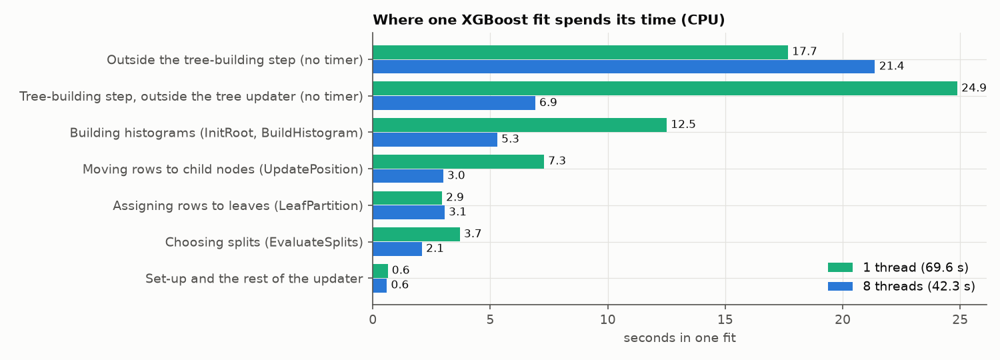
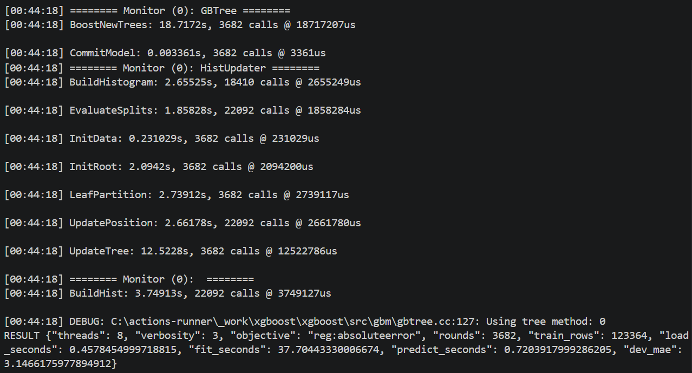

# Profiling report: training the selected XGBoost model (Milestone 3, bonus)

**Project:** Six-Hour Urban PM2.5 Forecasting Across Ireland and Europe (https://github.com/Dazzmondo/dh-PM2.5-forecast). **Script:** `src/profile_xgboost.py`; results in `reports/m3/profiling/xgboost_cpu/`.

## 1. Workload and method

One fit of the frozen model's settings (`models/xgboost/v3`: 3,682 boosting rounds, depth 6, absolute-error objective) on the 123,364 training rows with 10 inputs. XGBoost trains inside its compiled library, so the profile uses the library's own timers (`verbosity=3`), which report its internal operations. Each setting was run three times on a laptop (Intel i7-8565U, 4 cores, 8 threads) that was otherwise nearly idle; the table shows the run with the median total. The profiled fit reproduces the model's 2024 error (MAE 3.1466 at 8 threads).

## 2. Expensive operations

| Part of one fit | 1 thread | 8 threads | Speed-up | Share at 8 threads |
|---|---|---|---|---|
| Outside the tree-building step (no timer) | 17.7 s | 21.4 s | 0.83 | 51% |
| Tree-building step, outside the tree updater (no timer) | 24.9 s | 6.9 s | 3.60 | 16% |
| Building histograms (`InitRoot`, `BuildHistogram`) | 12.5 s | 5.3 s | 2.36 | 13% |
| Moving rows to child nodes (`UpdatePosition`) | 7.3 s | 3.0 s | 2.44 | 7% |
| Assigning rows to leaves (`LeafPartition`) | 2.9 s | 3.1 s | 0.96 | 7% |
| Choosing splits (`EvaluateSplits`) | 3.7 s | 2.1 s | 1.77 | 5% |
| Set-up and the rest of the updater | 0.6 s | 0.6 s | 1.06 | 1% |
| **Whole fit** | **69.6 s** | **42.3 s** | **1.65** | **100%** |

*Figure 1.* The same breakdown. The two parts without a timer are differences between the total and XGBoost's `BoostNewTrees` and `UpdateTree` timers.

## 3. Bottlenecks

- **Work outside tree building does not speed up.** It is the largest part at 8 threads and was slower than with 1 thread in every repeat, which limits the speed-up of the whole fit.
- **The absolute-error objective is a large part of it.** The same settings with squared error took 28.8 s instead of 42.3 s, with 8.4 s outside tree building instead of 21.4 s. *Plausible explanation, not timed directly:* for absolute error XGBoost recalculates the leaf values from the residuals after each tree.
- **Among the timed operations, histograms and row movement cost most**; 8 threads make both more than twice as fast. Assigning rows to leaves does not speed up.
- **Rounds multiply the cost of every round's work.** The tuned model needs 3,682 rounds against 500 for the starting values.
- **Not bottlenecks:** loading the data (about 0.5 s) and prediction (0.7 s for the 31,192 development rows, 3.1 times faster than with 1 thread).

*Figure 2.* XGBoost's timer output for the first repeat at 8 threads (two terminal captures of `timer_log.txt`, trimmed and joined). The table above uses the median repeat, so its times differ.

*Figure 3.* MLflow record of the frozen model: 339 s for its four fits (three selection folds and 2024) and 22.87 ms to predict 1,000 rows.

## 4. Mitigations

| Change tested | Time | Effect on 2024 error |
|---|---|---|
| CPU VM, 1 / 4 / 8 threads: tuned fit | 45.7 / 22.5 / 22.4 s | on the laptop, 1 and 8 threads differ by less than 0.001 |
| NVIDIA T4 instead of the same machine's CPU | 16.3 s to 7.06 s | 3.1452 on CPU, 3.1446 on GPU |
| 500 rounds (starting values) instead of 3,682 | four fits 20.6 s instead of 339 s; prediction 3.1 instead of 22.9 ms per 1,000 rows | 3.152 instead of 3.147 |
| Squared error instead of absolute error | 42.3 s to 28.8 s | 3.260 instead of 3.147: rejected |

Suggestions (the frozen model was not changed):

- Train on **4 threads** on a 4-core machine; 8 add nothing on the VM.
- If speed mattered more than the last 0.005 µg/m³, the **500-round model** is the largest saving.
- A **GPU** more than halves the fit time, but saves only about 9 seconds per fit.
- **Keep the absolute-error objective:** it costs time and gives a clearly lower error.
- **The largest part (outside tree building):** no tested change targets it without raising the error. A GPU or fewer rounds shortens the whole fit, and a lower-level profiler would be the next step to see which functions it contains.
- **Not tested:** fewer histogram bins (`max_bin`), aimed at the histogram cost.

## 5. Limits

About two thirds of the 8-thread fit falls outside the detailed timers. Times come from one laptop: totals ranged from 37.7 to 42.9 s at 8 threads (with and without timers) and from 66.2 to 69.8 s at 1, and the cost of the timers could not be told apart from this variation. The commit recorded for the runs, `2471e97`, precedes the commit that added the script. Thread and GPU timings in section 4 come from the benchmark in `docs/M3.md` section 6.3, where the GRU's training step was also profiled.
