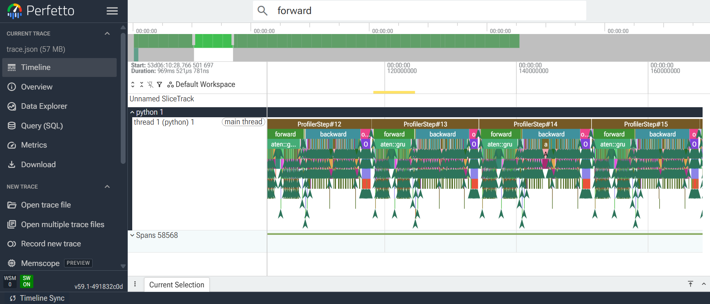
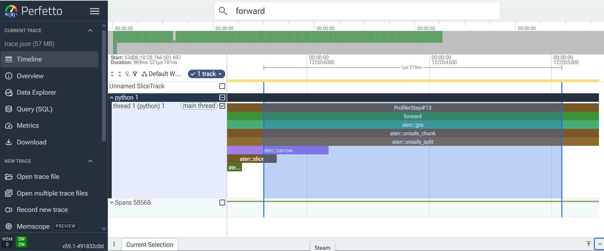
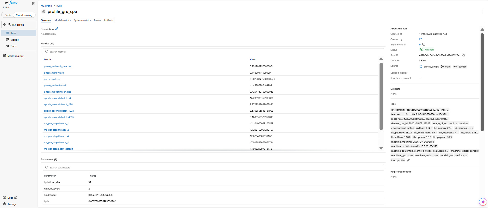
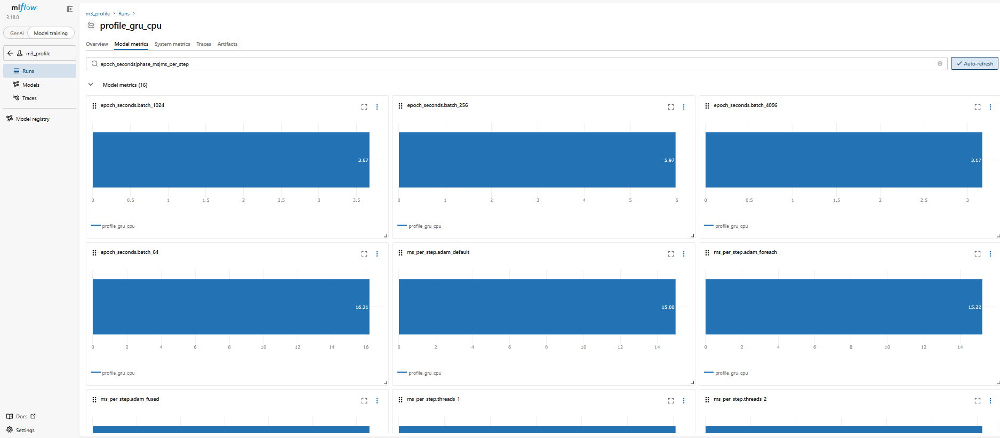
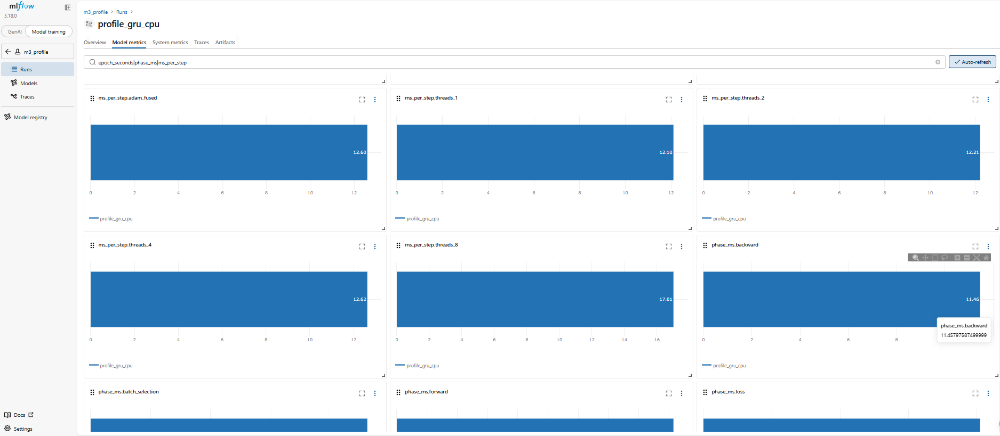
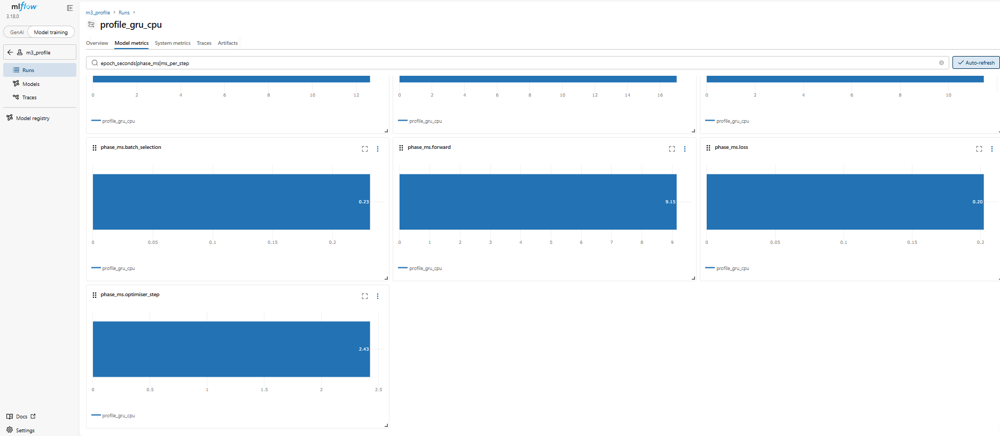
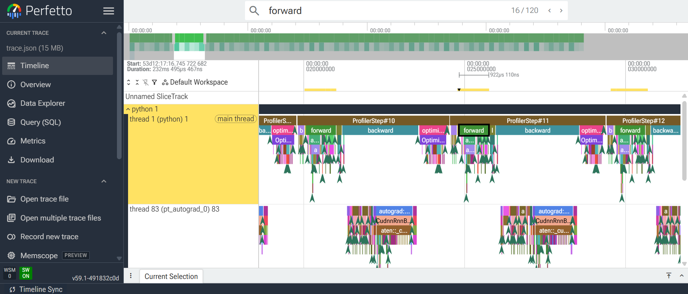

# Profiling report: training the GRU (Milestone 3, bonus)

**Project:** Six-Hour Urban PM2.5 Forecasting Across Ireland and Europe
**Repository:** https://github.com/Dazzmondo/dh-PM2.5-forecast
**Script and configuration:** `src/profile_gru.py`, `configs/profile_gru.yaml`; MLflow experiment `m3_profile`; results in `reports/m3/profiling/`

## 1. What was profiled and how

The workload is one training step of the tuned GRU of `docs/M3.md` section 3.7: 32 units, 2 layers, dropout 0.084, learning rate 0.000787, batch size 256, absolute-error loss, on the 123,364 training rows (2018–2023, windows of 8 blocks). Nothing is scored and no row after 2023 is used. `torch.profiler` recorded 40 training steps after 5 warm-up steps, with operator input shapes and memory. Each step is split into five phases (choosing the batch, forward pass, loss, backward pass, optimiser step) with `record_function`, so the profiler reports the operators and the phase they belong to. Three short sweeps then test the changes the profile suggests: batch size, the number of torch threads, and the three Adam implementations, each timed with the processor synchronised.

The profile was taken on two CPUs and one GPU: the development laptop (Intel i7-8565U, run alone on 2026-11-16) and a Google Cloud `n1-standard-8` virtual machine (4 physical cores, Xeon at 2.0 GHz, 2026-11-23). A GPU profile was taken on a Google Cloud GPU VM (`n1-standard-8` with one NVIDIA T4, zone `europe-west4-b`, NVIDIA driver 620.70.06 with CUDA 13.5, PyTorch built for CUDA 13.2, 2026-11-24). The profile figure is `reports/m3/profiling/cpu_vm/profile.png`.

*Figure 1.* The profile of the tuned GRU on the CPU VM: time by phase, by operator, and by batch size.

*Figure 2a.* The profiler's timeline of the CPU VM run (`reports/m3/profiling/cpu_vm/trace.json` opened in https://ui.perfetto.dev): four consecutive training steps (`ProfilerStep#12` to `#15`), each divided into the forward pass, the backward pass and the optimiser step, with the thousands of short operators beneath them.

*Figure 2b.* The same trace zoomed into a single forward pass (about 1 µs per division): the `aten::gru` call splits into chunks and slices, each a very short operation, which is why the cost is the fixed cost of starting operations and not arithmetic.

*Figure 3a.* The MLflow page of the profile run on the laptop (experiment `m3_profile`, run `profile_gru_cpu`, 2026-11-16, commit `16a05c6`): the run's metrics (the page lists the first 14 of 17), its parameters (the first 4 of 8) and its lineage tags (the commit, the data hashes, the dataset run ID, the environment `laptop` and the library versions).

*Figure 3b.* MLflow's own charts for the same run (Model metrics tab, filtered to the profile metrics): the estimated epoch time at batch sizes 64, 256, 1,024 and 4,096, and the step time with Adam's default, foreach and fused implementations.

*Figure 3c.* The step time with 1, 2, 4 and 8 torch threads, and the backward-pass time.

*Figure 3d.* The time per phase of a training step (choosing the batch, forward pass, loss and optimiser step; the backward pass is in Figure 3c).

## 2. Where the time goes

**By phase.** The backward pass takes about half of a training step, the forward pass about 40% and the optimiser about 10%; choosing the batch and computing the loss take about 1% each. The shares are almost the same on both machines (the profiler's own overhead is included in these figures).

| Phase | Laptop | CPU VM |
|---|---|---|
| Backward pass | 49% | 50% |
| Forward pass | 39% | 39% |
| Optimiser step | 10% | 9% |
| Choosing the batch | 1% | 1% |
| Loss | 1% | 1% |

**By operator.** No single operator dominates. On the VM the largest by self time are `aten::cat` (10.5%, 1,520 calls), `aten::mm` (7.0%), `aten::bernoulli_` (6.8%, the dropout masks), `aten::add_` (5.4%, 5,040 calls), `aten::addmm` (4.9%), the Adam step (4.8%), `aten::copy_` (4.5%, 4,200 calls) and `aten::mul` (4.2%). Together these are barely half of the time and they are called thousands of times in 40 steps, each doing little work: with 8 time steps, 2 layers and 256 rows per batch, the matrices are small, so the cost is mostly the fixed cost of starting each operation, not the arithmetic.

**Data supply is not the bottleneck.** Building the input tensors for all 123,364 training rows takes 0.016 s on the VM (0.019 s including the move to the GPU), and choosing a batch takes about 1% of a step.

**On the GPU** a training step takes 3.1 ms against 10.3 ms on the CPU VM, but the GPU is not the limit: its kernels account for 38 ms in the 40 profiled steps, about 0.95 ms per step, so it is busy for roughly a third of each step. The rest is the cost of issuing many small operations from the CPU, which is why the time per step barely changes between batches of 256 and 1,024 rows and the epoch time falls by four times (1.5 s to 0.38 s). In the profiler's CPU timings the backward pass takes 55% of the step, the forward pass 21%, the optimiser 16% and choosing the batch and the loss 4% each; on the GPU the largest kernels are the cuDNN GRU backward pass (19% of the GPU time), the Adam step (18%) and the cuDNN forward pass (11%).

*Figure 4a.* The profiler's timeline of the GPU run (`reports/m3/profiling/cuda/trace.json` opened in https://ui.perfetto.dev), CPU side: three consecutive training steps (`ProfilerStep#10` to `#12`), each with its forward, backward and optimiser phases on the main thread and, below it, the autograd thread that issues the cuDNN backward kernels.

*Figure 4b.* The GPU side of the same steps: the kernels on the GPU streams (stream 7 carries the GRU kernels) come in short bursts separated by idle gaps, which is the launch-bound behaviour described above; the other streams hold a few short kernels.

## 3. What would make training cheaper, tested

| Change | Laptop | CPU VM | GPU (T4) | Verdict |
|---|---|---|---|---|
| Batch size 64 / 256 / 1,024 / 4,096, time per epoch | 16.2 / 6.0 / 3.7 / 3.2 s | 13.0 / 5.0 / 2.8 / 1.5 s | 6.1 / 1.5 / 0.38 / 0.18 s | The largest effect on every machine; on the GPU 1,024 is 4 times cheaper than 256 |
| Torch threads 1 / 2 / 4 / 8, ms per step at batch 256 | 12.1 / 12.2 / 12.6 / 17.0 | 9.8 / 10.8 / 10.7 / 13.5 | not applicable | No gain: one thread is the fastest, and 8 threads are the slowest |
| Adam default / foreach / fused, ms per step | 15.0 / 15.2 / 12.6 | 10.6 / 10.5 / 10.0 | 3.11 / 3.09 / 2.84 | Fused is the fastest: 16% (laptop), 5% (VM) and 9% (GPU) cheaper |

A step costs far less than in proportion to its rows (between batches 256 and 4,096 there are 16 times more rows for 4.6 times the time on the VM), which is why a larger batch is the main lever: the fixed cost of each step is spread over more rows. Extra threads do not help because there is too little work in each operation to share out.

*Not tested:* fewer layers, a compiled model, or mixed precision. They are not reported as findings.

## 4. Decision: the batch size stays at 256

A larger batch would make each epoch cheaper (by 38% to 44% on the CPUs and by a factor of 4 on the GPU), and this is the one profile finding that could have changed a hyperparameter. It was not adopted, for two reasons that both applied.

1. **The project's reason.** XGBoost is the stronger model on this task (a 2024 MAE of 3.147 against 3.187 for the GRU, with a 2024 fit three to four times cheaper), so a possible small saving on the GRU does not change what the project concludes or delivers, and it is not worth the effort of changing the GRU's settings.
2. **A supporting reason.** The saving is not clear-cut. Fewer updates per epoch can mean more epochs; in the hyperparameter search batch 512 matched batch 256 (mean objective 3.3817 against 3.3815) while batch 1,024 was about 0.5% worse (three trials); and the tuned learning rate (0.000787) belongs to batch 256, so a change would mean tuning it again and re-running the three seeds.

The batch size was therefore reported as a measured trade-off and kept at 256 for the frozen model (`docs/M3.md` section 5.3). The fused Adam step, which changes speed and not results, is the one cheap improvement the profile found.

## 5. Limits

The profile covers 40 steps of one configuration on two CPUs and one GPU. The GPU profile was run with a corrected `phase_table` in `src/profile_gru.py`: at commit `ba2a82f`, which the GPU runs record, the function stopped on a GPU because the profiler lists each phase label twice there (a CPU range and a GPU range), so the corrected file (now in the repository) was mounted into the container for that one run, and its figure was then redrawn from the saved tables with shortened operator names. The tables and numbers are those of the run. The phase shares include the profiler's own overhead, so they describe where the time goes and not the exact cost of each phase. The laptop and the VM differ in processor type as well as speed, and the laptop's lower and less steady figures may reflect heat and power limits of a laptop processor; this was not tested. On the GPU the step is limited by launch overhead and not by the GPU's arithmetic, and the GPU run used a different machine (and region) from the CPU VM, so the GPU and CPU figures are compared through the CPU run on the same machine in `docs/M3.md` section 6.3.
