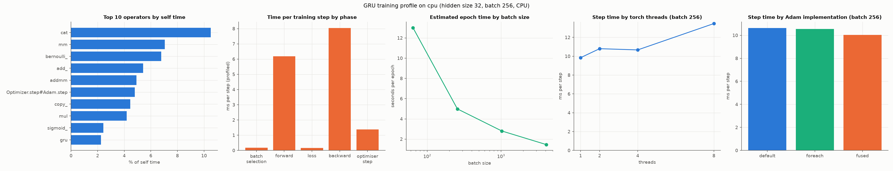
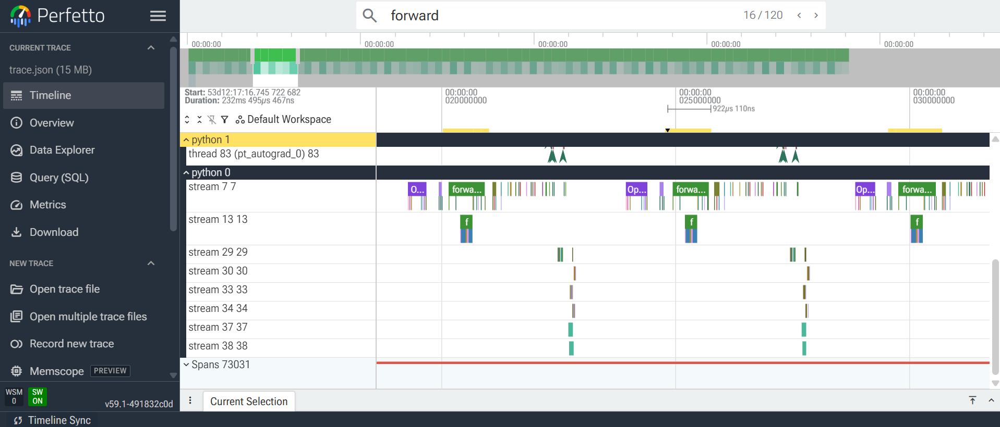

# Profiling report: training the GRU (Milestone 3, bonus)

**Project:** Six-Hour Urban PM2.5 Forecasting Across Ireland and Europe (https://github.com/Dazzmondo/dh-PM2.5-forecast). **Script:** `src/profile_gru.py`; results in `reports/m3/profiling/`; MLflow experiment `m3_profile`.

## 1. Workload and method

One training step of the tuned GRU (32 units, 2 layers, batch size 256; `docs/M3.md` section 3.7) on the 123,364 training rows. `torch.profiler` recorded 40 steps after 5 warm-up steps, with each phase labelled by `record_function`. Sweeps then timed three changes: batch size, torch threads and the Adam implementation. Machines: a laptop (Intel i7-8565U), a Google Cloud CPU VM (`n1-standard-8`) and a GPU VM (the same type with one NVIDIA T4).

## 2. Expensive operations

| Share of a training step (profiled CPU time) | Laptop | CPU VM | GPU VM |
|---|---|---|---|
| Backward pass | 49% | 50% | 55% |
| Forward pass | 39% | 39% | 21% |
| Optimiser step | 10% | 9% | 16% |
| Choosing the batch and computing the loss | 2% | 2% | 8% |

- **CPU VM:** no single operator dominates. The largest by self time are `aten::cat` (10.5%), `aten::mm` (7.0%), `aten::bernoulli_` (6.8%, the dropout masks), `aten::add_` (5.4%) and `aten::addmm` (4.9%).
- **GPU:** of the 38 ms of kernel time in 40 steps, the cuDNN GRU backward pass takes 47%, the forward pass 27% and the Adam update 5%.

*Figure 1.* CPU VM: operators, phases and the three sweeps.

## 3. Bottlenecks

**CPU: the cost of starting many small operations.** The matrices are small and the operators are called thousands of times. From batch 256 to 4,096, 16 times more rows cost only 4.6 times the time per step.

*Figure 2.* CPU VM timeline (Perfetto): four training steps, each a dense stack of short operators.

**GPU: the device waits for work.** A step takes 3.1 ms (10.3 ms on the CPU VM), but the kernels use only about 0.95 ms of it. The step time barely changes from 256 to 1,024 rows, which points to the cost of issuing operations from the CPU and not to arithmetic.

*Figure 3.* GPU VM timeline (Perfetto): short bursts of work on the GPU streams, separated by idle gaps.

**Not a bottleneck: the data supply.** Building the input tensors for all training rows takes under 0.02 s, also with the move to the GPU.

## 4. Mitigations

| Change tested | Laptop | CPU VM | GPU (T4) |
|---|---|---|---|
| Batch 64 / 256 / 1,024 / 4,096: seconds per epoch | 16.2 / 6.0 / 3.7 / 3.2 | 13.0 / 5.0 / 2.8 / 1.5 | 6.1 / 1.5 / 0.38 / 0.18 |
| Torch threads 1 / 2 / 4 / 8: ms per step | 12.1 / 12.2 / 12.6 / 17.0 | 9.8 / 10.8 / 10.7 / 13.5 | not applicable |
| Adam default / foreach / fused: ms per step | 15.0 / 15.2 / 12.6 | 10.6 / 10.5 / 10.0 | 3.11 / 3.09 / 2.84 |

Suggestions for future training (the frozen models were not retrained):

- **Fused Adam:** 16%, 6% and 9% faster than the default on the three machines.
- **One torch thread** on a CPU: more threads add nothing for this model.
- **Larger batch:** the main lever, but the batch size **stays at 256**. XGBoost is the stronger model (2024 MAE 3.147 against 3.187), so a small GRU saving does not change the project's conclusions. The saving is also not clear-cut: batch 512 only matched 256 in the search, 1,024 was about 0.5% worse (three trials), more epochs might be needed, and the learning rate was tuned for 256.
- **Not tested:** a compiled model (`torch.compile`, the first thing to try against the per-operation cost), fewer layers and mixed precision.

## 5. Limits

One configuration, 40 steps; phase shares include profiler overhead. The CPU and GPU VMs were separate machines (like-for-like comparison: `docs/M3.md` section 6.3). The GPU run used a corrected `src/profile_gru.py` (now in the repository) because the phase table failed on a GPU at its commit, `ba2a82f`. The GPU `share_of_self_time` column and operator chart count time twice, so the GPU shares above come from the `aten::` rows of `operators.csv`.
